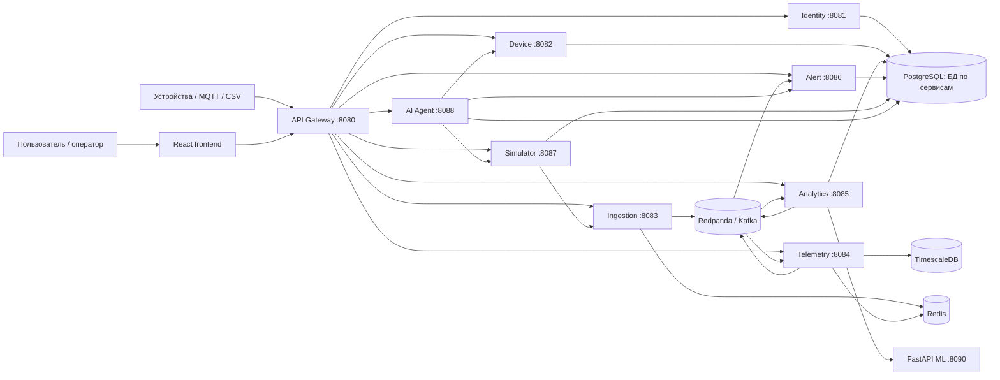
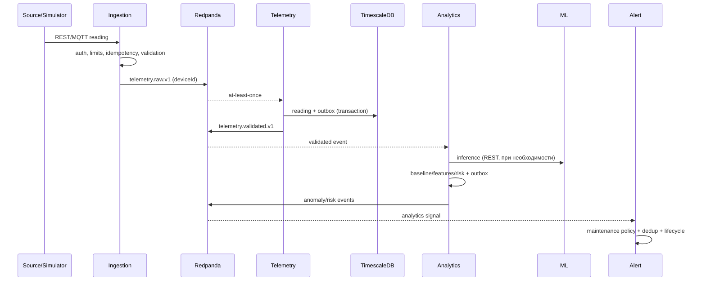

# Архитектура VoltCanary

> Состояние: статический анализ репозитория на 11 июля 2026 года. Документ описывает то, что подтверждается исходным кодом, конфигурацией, миграциями и тестами. Он не подтверждает состояние внешней production-среды.

## 1. Назначение системы

VoltCanary — многопользовательская платформа мониторинга IoT-устройств. Она принимает показания датчиков и умных розеток, нормализует и хранит временные ряды, строит аналитические признаки, выявляет аномалии и риск деградации, создает оповещения и показывает результаты в веб-интерфейсе. Дополнительные контуры позволяют симулировать устройства и управлять системой через AI-агента.

Архитектурно это монорепозиторий с набором независимо запускаемых сервисов. Java/Spring отвечает за транзакционные домены и потоковую обработку, Python/FastAPI выделен под ML, React/TypeScript — под браузерный кабинет. PostgreSQL используется для доменных данных, TimescaleDB — для телеметрии, Redpanda/Kafka — для асинхронных событий, Redis — для распределенных быстрых состояний.

## 2. Карта системы

Публичный синхронный путь идет через gateway. Kafka образует внутренний конвейер данных. У каждого stateful-сервиса собственная схема/БД; прямое чтение чужих таблиц в коде не используется.

## 3. Компоненты и уже реализованные возможности

### 3.1 API Gateway

`api-gateway` — единая HTTP-граница. Он маршрутизирует `/auth`, `/accounts`, `/locations`, `/devices`, `/maintenance-operations`, `/device-types`, `/ingestion`, `/telemetry`, `/analytics`, `/alerts`, `/alert-rules`, `/simulation` и `/ai-agent` к владельцам доменов. Реализованы CORS, JWT-проверка, correlation ID, ограничения размера запросов, распределенный rate limit через Redis и необязательная проверка здоровья downstream-сервисов.

Gateway не содержит бизнес-данных. Это оставляет одну точку применения внешней политики, не превращая ее в общий бизнес-монолит. Источник: [application.yml](../../backend/services/api-gateway/src/main/resources/application.yml).

### 3.2 Identity Service

Владеет пользователями, ролями и сессиями. Реализованы регистрация и вход, access/refresh JWT, ротация refresh-токена, выход из одной или всех сессий, смена и сброс пароля, подтверждение email, `/auth/me`, администрирование пользователей, ролей, статусов и сессий. Изменения жизненного цикла аккаунта могут синхронно передаваться в device-service и публиковаться через transactional outbox в `identity.account-lifecycle.v1`; оба механизма управляются флагами.

Ключевые точки: [AuthController.java](../../backend/services/identity-service/src/main/java/com/voltcanary/identity/controller/AuthController.java), [application.yml](../../backend/services/identity-service/src/main/resources/application.yml).

### 3.3 Device Service

Это источник истины для tenancy и инвентаря: аккаунты, иерархия локаций, типы и жизненный цикл устройств, датчики, источники данных и ingestion-токены, per-device analytics config, окна и групповые операции обслуживания. Есть CSV import/export устройств и источников, выпуск/отзыв токенов, enable/disable/decommission, аудит изменений.

Сервис предоставляет внутренние API для проверки доступа к устройству, получения metadata/owner, разрешения источника телеметрии и reconciliation окон обслуживания. Через outbox публикует `device-registry.changed.v1` и `maintenance-window.changed.v1`, потребляет `identity.account-lifecycle.v1`. Схема эволюционирует Flyway-миграциями: [db/migration](../../backend/services/device-service/src/main/resources/db/migration), контроллеры: [controller](../../backend/services/device-service/src/main/java/com/voltcanary/device/controller).

### 3.4 Ingestion Service

Единая входная точка телеметрии поддерживает одиночные и batch REST-запросы, отдельные import/backfill endpoints и опциональный MQTT subscriber. Пайплайн:

1. аутентифицирует/разрешает источник через локальный registry и device-service;
2. проверяет timestamp, размеры batch и metrics;
3. применяет rate limits по source/device/account/IP и backpressure;
4. дедуплицирует запросы в Redis с TTL;
5. публикует `telemetry.raw.v1` с ключом `deviceId`.

Redis дает общую идемпотентность и лимиты нескольким репликам. При его недоступности поведение ограниченно деградирует согласно реализации и health-настройкам. MQTT выключен по умолчанию. Источники: [IngestionController.java](../../backend/services/ingestion-service/src/main/java/com/voltcanary/ingestion/controller/IngestionController.java), [application.yml](../../backend/services/ingestion-service/src/main/resources/application.yml).

### 3.5 Telemetry Service

Потребляет `telemetry.raw.v1`, валидирует envelope и значения, контролирует давность/будущее timestamp и частоту, определяет дубликаты и сохраняет readings в TimescaleDB. Transactional outbox отделяет фиксацию показания от публикации `telemetry.validated.v1`; reconciliation повторно поднимает неполностью опубликованные записи. Poison events направляются в `telemetry.raw.dlq.v1`.

Query API возвращает диапазоны readings, CSV export, latest, quality summary и список metrics. Перед чтением сервис синхронно проверяет доступ через device-service. Максимальный диапазон графика и размер export page ограничены конфигурацией. Redis используется для распределенного rate limiting/быстрого состояния, а Timescale-политики включаются отдельно. Источники: [TelemetryRawConsumer.java](../../backend/services/telemetry-service/src/main/java/com/voltcanary/telemetry/consumer/TelemetryRawConsumer.java), [TelemetryController.java](../../backend/services/telemetry-service/src/main/java/com/voltcanary/telemetry/controller/TelemetryController.java), [db/migration](../../backend/services/telemetry-service/src/main/resources/db/migration).

### 3.6 Analytics Service

Потребляет `telemetry.validated.v1`, поддерживает baseline, features, anomalies, risk scores, recommendations, predictions и фоновые recalculation jobs. Публикует `anomaly.detected.v1` и `risk-score.changed.v1` через outbox. Для сложного inference синхронно вызывает ml-service; настройки ML задаются на уровне аккаунта и переопределяются устройством. Реализован тест правил и интеграция с alert-service для effective rules.

Окна обслуживания проецируются локально из `maintenance-window.changed.v1`: горячий аналитический путь не зависит от доступности device-service. Reconciliation устраняет долговременное расхождение. Предусмотрен DLQ `analytics.telemetry.validated.dlq.v1`. API: [AnalyticsController.java](../../backend/services/analytics-service/src/main/java/com/voltcanary/analytics/controller/AnalyticsController.java), pipeline: [TelemetryValidatedConsumer.java](../../backend/services/analytics-service/src/main/java/com/voltcanary/analytics/consumer/TelemetryValidatedConsumer.java), ML client: [MlClient.java](../../backend/services/analytics-service/src/main/java/com/voltcanary/analytics/ml/MlClient.java).

### 3.7 Alert Service

Потребляет аномалии, изменения risk score и окна обслуживания. Создает и дедуплицирует alerts, хранит lifecycle, позволяет acknowledge/resolve, предоставляет summary, pagination и support search. Отдельный домен правил поддерживает CRUD, enable/disable, effective rules и dry-run test. Есть предпочтения и каналы уведомлений, журнал попыток доставки и worker доставки по HTTP/webhook.

Локальная maintenance projection подавляет новые alerts в окне и позволяет разрешать пересекающиеся активные alerts без синхронного lookup. Ошибочные события уходят в topic-specific DLQ. Источники: [AlertController.java](../../backend/services/alert-service/src/main/java/com/voltcanary/alert/controller/AlertController.java), [consumer](../../backend/services/alert-service/src/main/java/com/voltcanary/alert/consumer), [NotificationDeliveryWorker.java](../../backend/services/alert-service/src/main/java/com/voltcanary/alert/service/NotificationDeliveryWorker.java).

### 3.8 Simulator Service

Хранит YAML-конфигурации симуляции, версии и историю запусков; умеет валидировать, сбрасывать шаблон, перечислять templates/presets, запускать и останавливать генерацию, показывать status и runs. Генерирует профили бытовых устройств и отправляет телеметрию в ingestion по HTTP либо, при включении, MQTT. Это полноценный тестовый producer, а не часть аналитического контура. Источники: [SimulationController.java](../../backend/services/simulator-service/src/main/java/com/voltcanary/simulator/controller/SimulationController.java), [application.yml](../../backend/services/simulator-service/src/main/resources/application.yml).

### 3.9 AI Agent Service

Оркестрирует управляемые действия: строит plan по пользовательскому запросу, хранит его и выполняет только отдельной командой. Tool layer обращается к device-, alert- и simulator-service. Реализованы каталог tools, настройки provider, CRUD провайдеров и моделей, выбор default, тест соединения и ротация зашифрованного секрета. Есть OpenAI-compatible provider и capability registry.

Разделение plan/execute является важной safety-границей: модель предлагает действия, но исполнение остается явным и проверяемым. Источники: [AiAgentController.java](../../backend/services/ai-agent-service/src/main/java/com/voltcanary/aiagent/controller/AiAgentController.java), [AiAgentOrchestrator.java](../../backend/services/ai-agent-service/src/main/java/com/voltcanary/aiagent/service/AiAgentOrchestrator.java), [ToolExecutor.java](../../backend/services/ai-agent-service/src/main/java/com/voltcanary/aiagent/service/ToolExecutor.java).

### 3.10 ML Service

FastAPI предоставляет `/health`, `/inference`, `/models`, `/train`, `/runs/{id}` и дублирующие маршруты под `/ml`. Реестр возвращает доступные baseline/anomaly models, inference формирует score/risk/confidence, training API управляет состоянием runs.

Ограничение: текущие модели и registry реализованы in-process, а не как production MLOps-платформа; перезапуск не должен восприниматься как долговечное хранение run state. Нет подтвержденного MLflow/MinIO model lifecycle. Источники: [main.py](../../ml-service/app/main.py), [services](../../ml-service/app/services), [models](../../ml-service/app/models).

### 3.11 Frontend

React SPA реализует login/register/password reset/email verification, список и карточку устройств, dashboard, детальную телеметрию и аналитику, alerts, календарь обслуживания, настройки аккаунта и ML, AI agent и его providers. API-модули централизуют вызовы gateway; access token используется клиентом для защищенных маршрутов. Источники: [App.tsx](../../frontend/src/app/App.tsx), [client.ts](../../frontend/src/api/client.ts).

## 4. Как сервисы общаются

### 4.1 Синхронный HTTP

| Откуда | Куда | Зачем |
|---|---|---|
| Frontend/клиент | Gateway | единственная публичная API-точка |
| Gateway | все Java-сервисы | path-based routing и единые политики |
| Ingestion | Device | разрешить source/token и проверить реестр |
| Telemetry/Analytics/Alert | Device | авторизация доступа и reconciliation reference data |
| Analytics | ML | inference для конкретного набора features |
| Analytics | Alert | effective rule evaluation |
| Identity | Device | опциональная немедленная синхронизация lifecycle |
| Simulator | Ingestion | отправка сгенерированной телеметрии |
| AI Agent | Device/Alert/Simulator | чтение и выполнение разрешенных tools |

Синхронность выбрана там, где вызывающей стороне нужен ответ сейчас: login, query, проверка доступа, inference. Цена — временная связанность; поэтому заданы timeouts, а для критичных проекций используется Kafka + reconciliation.

### 4.2 Асинхронные события

| Topic | Producer | Consumer | Назначение |
|---|---|---|---|
| `telemetry.raw.v1` | Ingestion | Telemetry | сырой прием |
| `telemetry.validated.v1` | Telemetry | Analytics | сохраненные валидированные данные |
| `anomaly.detected.v1` | Analytics | Alert | сигнал аномалии |
| `risk-score.changed.v1` | Analytics | Alert | изменение риска |
| `maintenance-window.changed.v1` | Device | Analytics, Alert | локальные maintenance read models |
| `device-registry.changed.v1` | Device | registry consumers | изменения устройств/источников |
| `identity.account-lifecycle.v1` | Identity | Device | блокировка/удаление tenant account |

Ключ `deviceId` сохраняет порядок внутри устройства. Доставка считается at-least-once, поэтому обработчики используют `eventId`, inbox/processed-events или уникальные ограничения. Transactional outbox решает dual-write: доменная запись и событие сначала фиксируются одной DB-транзакцией, затем publisher доставляет событие; повтор безопасен. Это дает надежность без распределенной транзакции, но добавляет eventual consistency и фоновые workers.

## 5. Сквозной поток телеметрии

Успех ingestion означает прием в Kafka, а не завершение аналитики. UI читает каждый домен отдельно и потому может кратковременно видеть телеметрию раньше analytics/alert. Это нормальная eventual consistency, а не атомарная сквозная транзакция.

## 6. Данные и владение

- Identity PostgreSQL: пользователи, credentials/status, refresh sessions, lifecycle outbox.
- Device PostgreSQL: accounts, locations, devices, sensors, sources/tokens, analytics config, maintenance, outbox/inbox.
- TimescaleDB telemetry: measurements, quality/processed events и telemetry outbox. Это отдельный write-heavy time-series контур.
- Analytics PostgreSQL: baseline/features/anomalies/risk/recommendations/predictions/jobs, ML settings, maintenance projection, outbox/inbox.
- Alert PostgreSQL: alerts, rules, channels/preferences, delivery attempts, maintenance projection, processed events.
- Simulator PostgreSQL: YAML configs, versions, runs.
- AI Agent PostgreSQL: provider/model configuration и зашифрованные secrets; plan storage определяется реализацией сервиса.
- Redis: ephemeral/distributed idempotency, rate limiting и cache-подобное состояние. Он не является источником истины домена.

Принцип database-per-service уменьшает скрытое сцепление и позволяет выбирать TimescaleDB там, где она оправдана. Цена — отсутствие SQL join между доменами, дублирование read models и необходимость reconciliation.

## 7. Безопасность

Внешняя аутентификация основана на JWT: identity подписывает токены, gateway проверяет issuer, audience и key id. Gateway также ограничивает CORS, размер тела и частоту запросов. Tenant/user context передается downstream в доверенных headers после проверки токена. Сервисы повторно проверяют доступ к device через внутренний API там, где риск утечки особенно высок.

Внутренние endpoints защищаются shared service token. Ingestion source tokens отделены от пользовательских JWT. AI provider secrets шифруются перед хранением. Пароли и refresh-сессии принадлежат identity.

Текущая цена/риск: shared internal token слабее workload identity/mTLS; default `dev-internal-token` допустим только локально. Секреты и JWT keys должны поступать через secret manager, а не через значения по умолчанию. Детали: [identity auth contract](../identity-auth-contract.md), [security overview](08-security.md).

## 8. Наблюдаемость и эксплуатация

Все Spring-сервисы открывают Actuator health, info, metrics и Prometheus endpoint; correlation ID проходит через gateway/common web и связывает логи. Локальный observability stack содержит Prometheus, Grafana, Loki и Promtail. Kubernetes probes используют health endpoints.

Репозиторий поддерживает:

- корневой Docker Compose для локального запуска;
- Kustomize base/overlays в [deploy/k8s](../../deploy/k8s);
- Helm chart в [deploy/helm/voltcanary](../../deploy/helm/voltcanary);
- отдельный observability compose.

Локальные Kubernetes manifests используют hostPath и runtime images, поэтому это production-like среда разработки, не готовый production supply chain. Для production нужны immutable images, внешние/HA stateful systems, secrets manager, TLS/mTLS, backup/restore, SLO/alerts и проверенный autoscaling.

## 9. Почему архитектура выбрана удачно — и где ее цена

| Решение | Почему подходит VoltCanary | Цена и когда пересмотреть |
|---|---|---|
| Монорепозиторий | единые контракты, сборка и локальная среда; удобно менять producer и consumer вместе | CI растет; нужны ownership и selective builds |
| Доменные микросервисы | telemetry, identity и analytics имеют разные нагрузки и темп развития | много deployment units и сетевых отказов; для маленькой команды modular monolith был бы дешевле |
| Gateway | одна публичная security/CORS/rate-limit граница | критичная точка; должна масштабироваться и не содержать бизнес-логику |
| Kafka/Redpanda | буферизует bursts, изолирует ingestion, допускает replay и независимое масштабирование | eventual consistency, DLQ, schema evolution и эксплуатация broker |
| Outbox/inbox | надежная публикация без XA, безопасный retry при at-least-once | фоновые задержки, рост таблиц, cleanup и monitoring |
| PostgreSQL по сервисам | сильные локальные транзакции и четкое владение | read models/reconciliation вместо cross-service joins |
| TimescaleDB | SQL плюс time-series hypertables/политики для большого потока telemetry | отдельная эксплуатационная специализация; выигрыш надо подтвердить объемом |
| Redis | быстрые распределенные idempotency/rate limits | деградация при outage; нельзя хранить единственную копию важных данных |
| Python ML отдельно | доступ к ML-экосистеме без смешивания с Java доменами | сетевой hop и два toolchain; контракт inference нужно версионировать |
| Локальные maintenance projections | analytics/alerts не блокируются на device-service | дублирование и временная рассогласованность, которую лечит reconciliation |
| Plan/execute у AI-agent | human-in-the-loop и контролируемый tool surface | больше шагов UX; обязательны authorization и audit каждого tool call |

Главное достоинство текущей схемы — тяжелый поток телеметрии отделен от control plane. Управление устройствами и пользователями остается транзакционным, а readings и derived analytics масштабируются независимо. Это разумно именно для IoT, где объем telemetry на порядки выше объема команд. Главный недостаток — высокая операционная сложность для стадии продукта; она оправдана только при реальной потребности в независимом масштабировании и отказоизоляции.

## 10. Подтверждено, частично и пока не подтверждено

**Подтверждено кодом:** десять Spring backend-сервисов; React SPA; FastAPI ML; REST/MQTT ingestion; Kafka pipeline; PostgreSQL/Timescale migrations; Redis limits/idempotency; outbox/inbox/reconciliation; maintenance projections; alerts/rules/notifications; simulation; AI provider configuration; Docker/Kubernetes/Helm manifests; health/metrics.

**Частично или флагами:** Kafka lifecycle/device-registry публикация в отдельных сервисах, MQTT, Timescale policies, downstream health и некоторые reconciliation-процессы зависят от environment flags. Их наличие в коде не означает, что они включены в конкретной среде.

**Не подтверждено как production capability:** долговечный ML model registry и полноценный training pipeline, MLflow/MinIO artifact lifecycle, production HA/backup/DR, mTLS/workload identity, фактические SLO и нагрузочные пределы. MinIO присутствует в инфраструктурных намерениях, но основной кодовый путь не показывает завершенного artifact workflow.

## 11. Границы анализа и актуализация

Анализ статический: исходный код не доказывает, какие flags включены и какие manifests реально развернуты. Не выполнялись security pentest, нагрузочный тест и аудит внешних secrets/providers.

Документ требуется пересматривать при изменении gateway routes, состава сервисов, Kafka topics/envelopes, владельца таблиц, cross-service clients, security headers/tokens, deployment topology или ключевого пользовательского потока. Проверять следует в таком порядке: controllers/consumers/producers → application config → Flyway migrations → integration tests → ADR и тематические docs.

Связанные решения: [ADR-001 monorepo](../adr/ADR-001-use-monorepo.md), [ADR-002 microservices](../adr/ADR-002-use-microservices.md), [ADR-003 Redpanda](../adr/ADR-003-use-redpanda-kafka.md), [ADR-004 TimescaleDB](../adr/ADR-004-use-timescaledb.md), [ADR-005 Python/FastAPI](../adr/ADR-005-use-python-fastapi-for-ml.md), [ADR-006 Kubernetes](../adr/ADR-006-use-kubernetes.md), [ADR-009 ingestion](../adr/ADR-009-unified-telemetry-ingestion-service.md), [ADR-010 maintenance](../adr/ADR-010-maintenance-window-platform.md).
