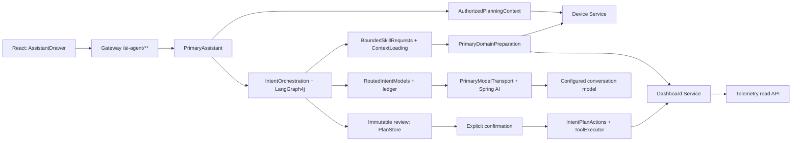
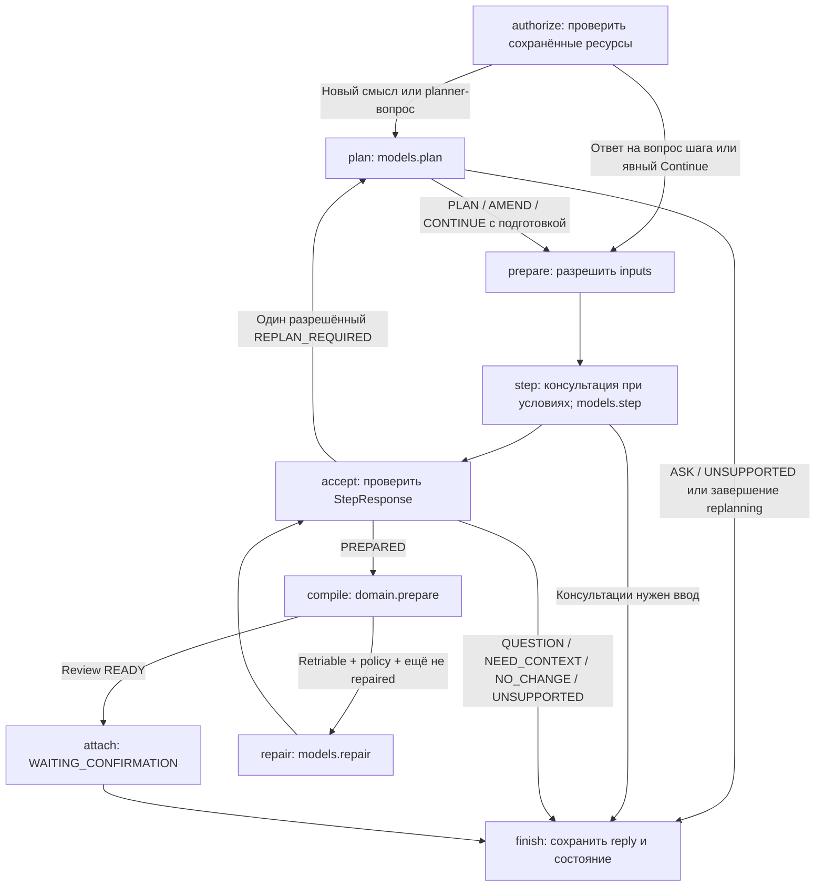
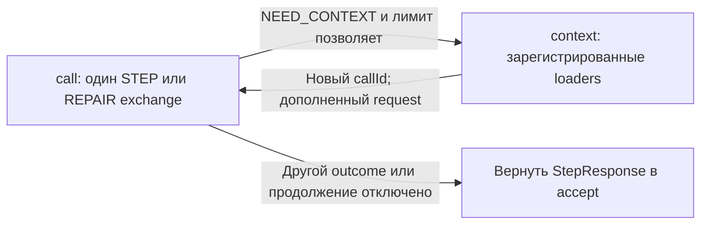
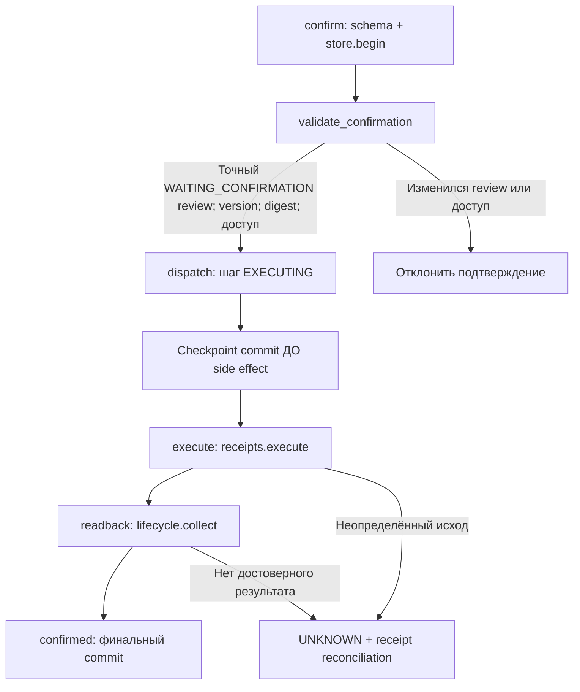
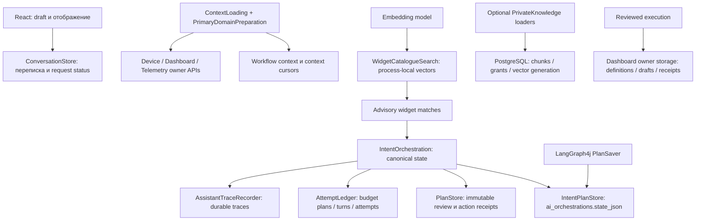
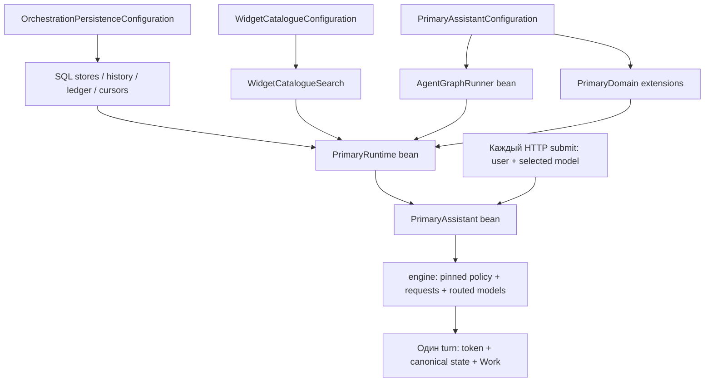

# AI Agent Service: от кнопки «Отправить» до проверенного результата

Статический разбор исходников основного checkout `D:/canary/voltcanary` на **19 ноября 2026 года**. Это учебный путеводитель по фактически написанному коду, включая текущие незакоммиченные изменения. Проверка исходников не устанавливает, какие флаги включены в работающем окружении, какой провайдер настроен и насколько хорошо конкретная модель решает задачу. Живые обращения к моделям для этого документа не выполнялись.

Актуальный архитектурный контракт находится в [Spring AI assistant](spring-ai-assistant.md); здесь тот же механизм разобран по вызовам и данным. Документ посвящён LLM-ассистенту, его контексту, embeddings и исполнению dashboard-действия.

## Как читать этот документ

Сначала пройдите разделы 1–4, затем откройте `PrimaryAssistant.submit` и `IntentOrchestration.run` по ссылкам. Разделы 5–12 раскрывают узлы подготовки, разделы 13–16 — подтверждение и исполнение. В конце есть карта хранилищ, разбор сбоев и индекс исходников с проверенными номерами строк.

В тексте используются три разных вида примеров:

- **Реальный контракт** — имена endpoint, Java record, поля и ветвления из checkout.
- **Иллюстрация данных** — вымышленные UUID, название «Обзор автобуса 42» и текст пользователя. Они не утверждают существование ресурсов в базе.
- **Условная ветка** — возможное решение модели, которое ещё должен принять Java-код. Это не запись реального LLM-ответа и не обещание успешного завершения.

Сквозное условие: пользователь уже приложил автобус как `context.deviceId`. Его фраза: **«Хочу создать дашборд для автобуса 42»**. Поиск устройства по словам «автобус 42» для этого сценария не нужен. Приложенный UUID определяет выбранный ресурс, а доступ к нему отдельно проверяют сервисы. Исходная фраза не задаёт точный состав и имя панели. Возможны вопросы, предложение допустимого варианта, отказ либо техническая остановка. Позже мы условно продолжим: **«Назови “Обзор автобуса 42”, хочу положение и скорость»**. Положение и скорость допустимы только в пределах реально возвращённых capabilities; вымышленных ключей телеметрии здесь нет.

## 1. Кто именно делает работу

Слово «агент» здесь обозначает составной серверный workflow. Модель не является Spring bean, который сам ходит по контроллерам, и не исполняет Java-методы по своему усмотрению.

| Исполнитель | Конкретная обязанность | Чего из этого не следует |
| --- | --- | --- |
| React, `AssistantDrawer`, `useServerConversation` | Собрать сообщение, выбранный контекст и идентификатор запроса; показать сохранённый ответ/review | Клиент не устанавливает права на deviceId |
| Spring DI, `PrimaryAssistantConfiguration` | Создать и связать beans: runtime, registry, runner, ports, adapters | DI не выбирает следующий узел графа |
| Java application code, `PrimaryAssistant`, `IntentOrchestration` | Авторизация, канонизация, состояния, допустимые переходы, бюджет, проверки предложения | Наличие корректного JSON ещё не разрешает mutation |
| LangGraph4j, `LangGraphAgentRunner` | Обойти заданные Java-кодом узлы и conditional edges, вызвать checkpoint saver | Библиотека не придумывает бизнес-план и не даёт прав |
| Spring AI, `SpringAiExchange`, `SpringAiModels` | Передать подготовленные messages/schema в provider model и разобрать ответ | Нет скрытого автономного tool loop |
| Настроенная разговорная LLM | Интерпретировать текст, предложить план, вопрос, запрос контекста либо команду | Её слова «создано» не являются квитанцией исполнения |
| Embedding model, если включена | Преобразовать тексты в числовые векторы | Она не вычисляет права, не сохраняет dashboard и не выбирает итоговый status |
| Dashboard Service | Определить возможности виджетов, валидировать composition, владеть definition/draft/revisions и сохранением | Agent Service не становится владельцем dashboard-таблиц |

В [PrimaryAssistantConfiguration] создаётся один bean `AgentGraphRunner`. Однако сам `StateGraph` адаптер строит/компилирует для вызова из переданных node handlers; выражение «singleton граф» не означает одного вечного процесса исполнения. `compiled.invoke(...)` запускается синхронно; `emitterExecutor(Runnable::run)` сохраняет исполнение emitter на потоке вызывающего кода. Между HTTP-запросами остаётся durable state, а не продолжающий думать Java-объект.

## 2. Общая карта границ



Читать схему нужно как зависимости и вызовы, не как обязательный порядок всех стрелок. Например, контекст устройства для planner читается раньше вызова модели; review возникает только после успешной доменной подготовки. Подтверждение — отдельный пользовательский запрос. Agent Service делает часть чтений напрямую в Device Service; неверно рисовать все чтения через Dashboard Service.

## 3. Последовательность для приложенного автобуса

Диаграмма сохраняет фактические границы вызовов. Ветка ответа модели условна. Внутри одного turn может быть несколько exchanges, число заранее не фиксировано.

```mermaid
sequenceDiagram
    actor U as Пользователь
    participant F as AssistantDrawer / hook
    participant C as ConversationController
    participant P as PrimaryAssistant
    participant D as Device Service
    participant O as IntentOrchestration
    participant B as BoundedSkillRequests / domain
    participant H as Dashboard Service
    participant M as Routed models / Spring AI / provider
    participant S as Durable stores
    U->>F: Отправить текст; deviceId уже приложен
    opt Новый разговор
        F->>C: POST /ai-agent/conversations
        C->>D: GET /accounts/current/scope
        C->>S: Создать conversation
    end
    F->>C: POST /conversations/{id}/messages
    C->>P: submit(parseBearerToken(...), ...)
    P->>D: GET /accounts/current/scope
    P->>O: engine.turns().submit(...)
    O->>S: begin: request claim + source message
    O->>B: models.plan -> requests.planner
    B->>D: GET /devices/{deviceId} для plannerChoices
    B-->>M: PlannerRequest с choices и dialogue
    M-->>O: PlannerResponse
    alt ASK
        O->>S: WAITING_INPUT + pendingQuestion + reply
        O-->>F: Detail с вопросом
    else PLAN или допустимый CONTINUE
        O->>B: prepare inputs; requests.step
        B->>D: Чтение выбранного устройства / источников
        B->>H: widget-types; composition/capabilities
        H-->>B: Разрешённые choices и diagnostics
        B->>M: StepRequest с workflow.context
        M-->>O: PREPARED / QUESTION / NEED_CONTEXT / другое
        alt PREPARED и доменная подготовка принята
            O->>H: POST /dashboards/composition/prepare
            H-->>O: READY + definition + digest
            O->>S: Immutable review; WAITING_CONFIRMATION
            O-->>F: Detail + review для preview
        else Вопрос, нехватка контекста или отказ
            O->>S: Сохранить фактическую ветку
            O-->>F: Вопрос / диагностика
        end
    end
    Note over U,S: Следующее уточнение — новый явный ввод; не resume старого provider-запроса
```

В схеме сокращены повторные проверки scope, revision, receipt и доступа. Они описаны далее. Embeddings и консультации не нарисованы обязательными ступенями: их условия отдельные.

## 4. Этап 1 — реальный DOM event и HTTP-запрос

Откройте [AssistantDrawer]. У кнопки `type="submit"`, `aria-label="Отправить сообщение"`. Нажатие вызывает `onSubmit` формы `assistant-window-compose`: `event.preventDefault(); void assistant.send();`. Текст берётся из `conversation.draft`; textarea меняет его через `assistant.patch(...)`. Контекст уже лежит в `conversation.context`, например после выбора устройства кнопкой context picker. Визуальная подпись устройства не является идентификатором для API.

`useAssistantConversation.ts` реэкспортирует [useServerConversation]. Его `send(override?, automatic=false, displayText?, continueStepId?)` проверяет непустой текст, максимум 2000 символов и отсутствие текущего pending. Ставит UI-фазу `planning`, `busy`, затем может обработать отдельный typed-name answer через `answerTypedName`. Поэтому нельзя утверждать, что абсолютно любой последующий ответ всегда проходит ровно тот же message endpoint: в реализации есть и `/requirements/answers` для типизированного уточнения.

Для обычного нового сообщения `send` делает следующее:

1. Если `previous.saved` ложно, вызывает `createConversation(previous.id)` — `POST /ai-agent/conversations` с `conversationId`.
2. Определяет, продолжает ли сообщение текущую незавершённую задачу. При продолжении добавляет `parentPlanId` соответствующего review; завершённые/неопределённые состояния не считаются обычным refinement.
3. Строит fingerprint из conversation, plan, text, context и параметров продолжения. Для того же клиентского повтора сохраняет ранее созданный `requestId`, а не генерирует новый каждый раз.
4. Вызывает `submitConversationMessage(id, body)` из [conversationApi]. Там сначала `await prepareAiSession()`, потом `apiRequest(..., {method: "POST", body: JSON.stringify(body)})`.
5. Общий [api-client] добавляет текущий bearer token и обрабатывает HTTP-ответ. После response hook делает `hydrate`, обновляет историю и UI.

**Иллюстрация HTTP body**, соответствующая структуре `SubmittedMessage`. Все UUID вымышлены; revision `0` относится только к этому примеру первого turn, не к последующим запросам:

```json
{
  "requestId": "11111111-1111-4111-8111-111111111111",
  "expectedRevision": 0,
  "text": "Хочу создать дашборд для автобуса 42",
  "context": {"deviceId": "42424242-4242-4424-8424-424242424242"},
  "automatic": false,
  "metadata": {
    "requestId": "11111111-1111-4111-8111-111111111111",
    "taskId": "22222222-2222-4222-8222-222222222222",
    "branchId": "22222222-2222-4222-8222-222222222222",
    "expectedTaskRevision": 0,
    "acceptedSuggestion": false
  }
}
```

Это не весь возможный DTO. Серверный [ConversationContracts] объявляет `Submit(requestId, expectedRevision, text, context, parentPlanId, providerId, modelConfigId, metadata, automatic, displayText, continueStepId)`. Nullable-поля могут отсутствовать в JSON клиента. Bean Validation проверяет обязательный requestId, неотрицательную revision и длины текста. `metadata` не заменяет авторизацию и не является разрешением на исполнение.

**Что сохраняется:** создание conversation проходит через `ConversationStore`; сообщение/claim следующего turn записывается durable orchestration store при `begin`, а не самим React. Локальный draft — вспомогательная клиентская запись, не источник истории. **Паузы/ошибки:** disabled/busy UI, refresh session, сетевой сбой, `409`. При `409` hook перечитывает разговор и сбрасывает retry pointer. Повтор с новой revision нельзя выдавать за точный replay старого запроса.

## 5. Этап 2 — Gateway, JWT и account scope

Gateway [gateway-config] маршрутизирует `Path=/ai-agent/**` в `AI_AGENT_SERVICE_URI`. Это транспортный выбор назначения. Внутри Agent Service [AssistantConversationController] обрабатывает `POST /ai-agent/conversations/{id}/messages` методом `submit(...)` и вызывает:

```text
identity.parseBearerToken(authorization)
    -> JwtAccessTokenService.validate(token)
    -> AuthenticatedUser
primary.submit(user, conversationId, request, authorization)
```

[JwtIdentityService] требует префикс `Bearer `, передаёт token в общий [JwtAccessTokenService], преобразует `sub` в UUID и возвращает `AuthenticatedUser(userId, email, role, expiresAt)`. Общая валидация проверяет `kid`, алгоритм RS256, наличие соответствующего public key, RSA-подпись, срок `exp`, непустые subject/email/role, ожидаемый issuer, audience, `jti`, access-token `typ`, наличие `iat`. Наличие `iat` здесь не означает отдельной проверки, что timestamp не из будущего. Этот метод не обращается к списку отозванных JWT; обещать revocation на его основании нельзя.

Далее `PrimaryAssistant.session` вызывает [AuthorizedPlanningContext] `scope(user, authorization)`:

```text
GET device-service /accounts/current/scope
Authorization: тот же пользовательский bearer token
```

Ответ должен иметь `userId`, совпадающий с authenticated user, и `status == ACTIVE`; `id` ответа используется как accountId. Итог — `Scope(userId, accountId)`. В отличие от claim с ролью, это запрос к владельцу актуального account scope. Он повторяется и в более поздних проверках; схема не обещает один HTTP-read на весь turn.

**Вход:** header и conversation DTO. **Выход:** авторизованная `Session(user, owner, authorization)`. **Состояние:** само чтение scope не создаёт review. **Кто решает:** криптографическая библиотека и детерминированный Java-код; LLM здесь отсутствует. При невалидном JWT, несовпавшем user/status или недоступности зависимости генерация не получает безопасного session.

## 6. Этап 3 — PrimaryAssistant превращает внешний запрос в turn

У [PrimaryAssistant] `submit` сначала вызывает `requireEnabled()`. `app.ai.orchestration.enabled`, связанное с `AI_ASSISTANT_V2_ENABLED`, по умолчанию false; выключение даёт `503 ASSISTANT_GENERATION_DISABLED`. Даже если UI позволяет набрать текст, это не доказывает включение генерации. При ошибке v2 нет автоматического переключения на legacy-generation.

После scope код редактирует чувствительные значения через `ConversationRedaction.value`, отклоняет `automatic=true` (`V2_REQUIRES_EXPLICIT_USER_INPUT`) и смотрит `PrimaryOrchestrationJournal.turn(owner, conversation, requestId)`. Для нового turn также требуется запас срока сессии больше 300 секунд. Уже сохранённый запрос рассматривается отдельно от нового.

Далее код выбирает текущее состояние orchestration или исходное состояние старого request; проверяет доступ к явно выбранному review. Для завершённых `SUCCEEDED/CANCELLED/EXPIRED` новый ввод может начать новый orchestration plan. У продолжаемого primary plan modelConfigId извлекается из `policyId` вида `primary-<UUID>`: попытка сменить модель даёт `MODEL_CHANGE_REQUIRES_NEW_PLAN`. `resolve` вызывает [AiModelResolver] с пользовательской конфигурацией provider/model. Нет оснований объявлять фактически развёрнутой какую-либо конкретную модель по её рекламному имени.

`ports.runtime().engine(session, selected)` собирает объект `Engine`. Затем `context.deviceId` становится элементом selection: `TurnSubmitSelectionItem("deviceId", UUID.fromString(id).toString())`. Входной произвольный Map не пересылается бесконтрольно как доверенный prompt. Код обрабатывает известные поля selection и сортирует их. У конкретного DTO есть также отдельные варианты source/knowledge selection; они не возникают из слов пользователя автоматически.

**Реальная структура внутреннего `TurnSubmit`** из [AssistantProtocol]:

```text
version, kind, requestId, expectedRevision, message, selectedReviewId,
selection, routing, replyToQuestionId, continueStepId
```

Здесь `version="assistant-v2"`, `kind="turn.submit"`; routing имеет режим `PINNED`, policyId и modelConfigId. `replyToQuestionId` берётся из сохранённого pending question, а не придумывается фронтендом по тексту вопроса. Внешняя `expectedRevision` разговора передаётся отдельно в `engine.turns().submit(...)`; внутренняя expectedRevision относится к orchestration state. Их нельзя заменять друг другом.

**Выход:** вызов `IntentOrchestration.submit(session, conversation, planId, canonical, policyId, policyVersion, skills, conversationRevision)`, после которого `detail(...)` собирает ответ. **Решение:** Java определяет identity, revisions и route; модель ещё не вызывалась. **Записи:** здесь используются journal/store; атомарный claim следующего этапа является точкой принятия turn.

## 7. Этап 4 — принятие turn и два разных графа

[IntentOrchestration] `submit` проверяет `turnSubmit` по schema, прогоняет `PlanningInputGuard`, сверяет routing policy, conversation, policy version и сохранённую engine definition. Для нового plan создаёт seed; для существующего читает `IntentPlanStore.read(owner, planId)`.

`store.begin(...)` делает durable request claim с requestId, expectedRevision, request kind `TURN`, сериализованным canonical request, исходным сообщением и conversation revision. В JDBC-реализации [JdbcIntentPlanStore] это связано с транзакциями, revision/lease fences и сохранённой перепиской. Если `claim.claimed()` ложно, `submit` возвращает сохранённое состояние. Дубликат не является командой «заново спросить модель».

После claim `Work` содержит token, state, session и доступные skills. Он существует только на время обработки. Проверяется точный вопрос, на который отвечает пользователь; терминальный plan с шагами не допускается продолжить как обычный turn. На узлах и при записи код проверяет, что работа всё ещё владеет текущей revision. Поздний ответ внешнего сервиса не должен перезаписать более новое состояние.

**Граф A: бизнес-зависимости.** [IntentPlanGraph] проверяет план, предложенный planner: цели, шаги, provenance source messages, skill/contracts, bindings, `dependsOn`, отсутствие циклов и корректность ссылок. Например, «создать устройство, затем сделать ему dashboard» могло бы содержать зависимость второго шага от первого. В нашем примере устройство уже существует; обязательного шага создания устройства нет. Модель предлагает DAG, Java принимает или отклоняет его.

**Граф B: управление текущим turn.** `IntentOrchestration.run` задаёт узлы `authorize/plan/prepare/step/accept/compile/repair/finish`, а LangGraph4j обходит их. Здесь ограниченные циклы допустимы, потому что это retry/context/control flow, а не циклические зависимости пользовательских действий.



Текстовая версия: `authorize → plan или prepare → step → accept → compile → finish`; разрешённые возвраты — `accept → plan` и `compile → repair → accept`. Сбой уходит в обработчик `fail`, не нарисованный как штатный узел. `finish` означает конец обработки текущего turn, а не обязательный успех всей пользовательской задачи.

Важная тонкость: после replan `decide(..., !work.replanning)` не обязан сразу начать подготовку нового шага в том же turn. `work.allowReplan` разрешается на соответствующей ветке ответа на вопрос; это не безусловный цикл «думать до победы». Повторный replan или replan после repair отклоняется.

## 8. Этап 5 — что planner узнаёт до первого LLM-вызова

Узел `plan` вызывает `models.plan(modelInput, session, callId)`, то есть [RoutedIntentModels] `plan`. Метод сначала вызывает `requests.planner(...)`, реализацию [BoundedSkillRequests]. Поэтому контекст не появляется только после первого ответа модели.

`planner(...)` детерминированно собирает `PlannerRequest`: `version`, `kind`, `requestId`, `messageId`, `message`, `catalogue`, `planSummary`, `facts`, `resourceChoices`, `dialogue`. Catalogue — список доступных intent summaries; это ещё не полный контракт всех доменных объектов. Plan summary содержит сохранённые шаги/цели; facts относятся к подтверждённым результатам, а dialogue — к сохранённой беседе и точному вопросу. Контекст ограничивается размером; усечение истории отражается в метаданных, а не выдаётся за полную память.

В конструктор requests передан `PrimaryDomain` как `ContextSources.Initial`. В текущей wiring он обёрнут расширениями, но dashboard planner choices доходят до [PrimaryDomainPreparation] `plannerChoices`:

```text
BoundedSkillRequests.planner
  -> initial.plannerChoices(input, session)
  -> PrimaryDomainPreparation.selectedDevices
  -> PlanningContextRead.read(devices, "/devices/" + id, authorization, true)
  -> Choice(id, "device", actualName, {deviceId, selection: "UI_CONTEXT"})
```

`selectedDevices` читает структурированные selection из сохранённых TURN requests разговора, начиная с последних; это не NLP-поиск по именам. Лимит выбранных устройств — 20; ограниченная история до 100 requests может потребовать сузить выбор. В нашем сценарии первый сохранённый request уже содержит deviceId.

На стороне владельца [DeviceController] `get` вызывает [DeviceService] `get`, затем `findOwned(user, id)`. `findOwned` получает `accountService.currentAccount(user)` и делает `deviceRepository.findByIdAndAccountId(id, account.id)`. Недоступное устройство не возвращается по одному лишь знанию UUID: результат — not found. Имя в `Choice` берётся из реального ответа; строка «автобус 42» из пользовательской фразы его не подменяет.

**Вход/выход:** один выбранный id → авторизованный Choice с реальным label. **Записи:** на этой ступени доменного устройства не создают; source message и canonical selection уже сохранены в claim. **Ошибка/пауза:** недоступный device, неверный UUID, слишком широкий выбор или dependency failure останавливают подготовку. **Кто решает:** Java/владелец ресурса; LLM позже решает, как истолковать пользовательскую задачу с этими choices.

## 9. Этап 6 — planner предлагает, Java проверяет

После сборки request `RoutedIntentModels.invoke` сверяет ownership revision, message identity, pending question и pinned routing; только затем запускает model-call path из раздела 11. Ответ читается как `PlannerResponse` и проверяется registered schema и skill catalogue. `PrimaryPlannerChecks` и пробное `IntentPlanGraph.apply` дополнительно отбрасывают семантически/структурно некорректный план.

Возможны следующие решения, объявленные контрактом:

- `PLAN`/`AMEND`: Java применяет предложенный DAG, проверяет bindings и provenance, инвалидирует вытесненные reviews. Если допустима подготовка и есть READY step, выбирает его.
- `CONTINUE`: targetStepId обязан указывать существующий continuable step. Это не право создать произвольный новый шаг.
- `ASK`: сохраняется `WAITING_INPUT`, точный pending question и reply. Следующее сообщение пользователя будет отдельным turn.
- `UNSUPPORTED`: состояние завершается как `FAILED` с explanation.

Для исходной фразы нельзя заранее назвать точный выбор. Вопрос «Как назвать дашборд и что показать?» — **иллюстрация возможного диалога**, не ожидаемый обязательный JSON модели. Модель также может предложить имя, если parameter policy это допускает, или задать более узкий вопрос. Нельзя превратить отсутствие имени в универсальное правило «всегда ровно один ASK».

Для чтения исходников полезно видеть полную структуру реального `PlannerResponse`, не подставляя вымышленный успешный ответ:

```text
PlannerResponse(
  version, kind, decision, explanation, targetStepId,
  supersedesStepIds, question, steps, proposedGoals, supersedesGoalIds
)
StepProposal(stepId, intentId, dependsOn, inputs, goalIds)
Input(field, binding)
Question(text, missingFields, choices)
```

Если модель выбирает вопрос, заполнение `question` обязано соответствовать этой ветке schema. Если выбирает PLAN, в `steps` приходят предложения с разрешёнными intentIds и bindings; Java ещё должна проверить их. Это разные ветки одного контракта, а не ответ со всеми возможными outcome одновременно.

Если выбран dashboard step, `prepare` вызывает `ConfirmedInputs.resolve(...)`. Literal proposal, fact reference и output dependency — разные виды bindings. Ссылки на результаты читаются через receipts; модель не может объявить неподтверждённый output готовым. При refinement старые literal proposals не считаются текущими значениями принятого review. Сохранённые dependencies и receipt-backed bindings сохраняют обязательность.

## 10. Этап 7 — полный dashboard-контекст и реальные поля

Узел `step` сначала может запустить зарегистрированную консультацию; если ей требуется ввод, текущий turn заканчивается. В остальных случаях вызывается `RoutedIntentModels.step → BoundedSkillRequests.step`.

`step` требует ровно один PREPARING step, сохранённую версию skill и совпадающий digest instructions. Поднимает base review, если skill его использует. Для нового CREATE_DASHBOARD ambient review не становится основой автоматически. Собирает [AssistantProtocol] `StepRequest`:

```text
version, kind, callId, planId, stepId, intentId, skill, instructions,
context, responseSchemaId, repair, messageId, message, contract, loadResults
```

Это структура реального DTO, не полный готовый provider payload. `contract` включает trust policy, parameter rules, input/command schema, bindings, resolvedInputs и разрешённые loader schemas. `context` содержит bounded dialogue, facts, goals, base review identity и метаданные completeness. `loadResults` добавляет фактические domain reads.

`initial.read(...)` вызывает для этого сценария `PrimaryDomainPreparation.read`. Он берёт cached workflow context либо `build`, повторно валидирует resource refs и сохраняет снимок в `ai_orchestration_contexts` по `(plan_id, request_id, step_id)`. `build` проверяет свежий scope; собирает structured selection и resolvedInputs. Для dashboard вызывает [DashboardPlanningContext] `enrich`.

Последовательность содержательных reads в `enrich`:

1. `GET dashboard-service /dashboard-templates` — доступные templates, их описания и panels.
2. `GET /dashboards/composition/widget-types` — типы, versions, units, reducers, visualizations, size constraints, capability descriptors и setting contracts.
3. Для приложенного устройства — прямой `GET device-service /devices/{id}`, затем `GET /devices/{id}/data-sources`; отбрасываются выключенные/неактивные источники, собираются ссылки из фактического контекста. Ветка каталога `/devices?status=ACTIVE...` предназначена для отсутствующего выбора; для нашего уже приложенного id начинать с поиска по имени не требуется.
4. [DashboardCapabilityContext] `enrich` делает `POST /dashboards/composition/capabilities` с реальными `deviceIds` и `period: LAST_1_HOUR`. Это период запроса capability evidence в этом адаптере; не следует принимать его за окончательный выбранный пользователем период всех виджетов.

На стороне Dashboard Service цепочка конкретна:

```text
DashboardCapabilitiesController.capabilities
  -> ownership.resolveReadOnly(authorization)
  -> DashboardCapabilityResolution.resolve(actor, authorization, Request)
  -> ownership.canReadDevice(...) для каждого id
  -> HttpDashboardCapabilityEvidence.read(authorization, id)
  -> TemplateDeviceCatalogue.read(...) + telemetry reads
  -> совместимость с WidgetManifests -> Resolution
```

[HttpDashboardCapabilityEvidence] получает метаданные устройства через [HttpTemplateDeviceCatalogue], читает `GET /telemetry/devices/{id}/fields`, проверяет типы/ключи/лимит и timestamp. Для VEHICLE читает по каждому источнику `GET /telemetry/devices/{id}/positions/latest?sourceId={externalSourceId}` и разбирает freshness (`FRESH/STALE/NO_DATA/UNKNOWN`). Числа скорости или координаты не фабрикуются из общего типа VEHICLE.

[DashboardCapabilityResolution] формирует семейства choices: `REGISTERED_NUMERIC_METRIC` (кроме `var_`), `RECORDED_VEHICLE_FIELD` для позиции/записанных полей соответствующего источника, `DOMAIN_EVIDENCE`. Сопоставляет их с supported manifests: dataKind, valueTypes, units, purpose, visualizations, reducers и периодом. Позиционная choice для vehicle source сама по себе не подтверждает наличие свежей позиции: currentStatus/freshness могут указывать отсутствие либо неопределённость. `historyStatus` здесь остаётся `UNKNOWN`; совместимость истории не равна доказанной полноте данных.

В `Resolution` есть `snapshotId`, `choices`, `diagnostics`. При нескольких совпадающих источниках возникает `AMBIGUOUS_SOURCE`. Неподдерживаемые варианты не превращаются в готовые виджеты. Dashboard resolver допускает до 200 choices, но agent adapter сужает до 60 и потребует уменьшить выбор; это разные границы двух компонентов.

Обратно [DashboardCapabilityContext] создаёт task-local `dataRef`, связывает его с реальной choice/resource ref, сохраняет `requiresSourceChoice`, labels, тип/единицы/status/views. Модель видит компактные `dashboardDataChoices`, а Java удерживает реальное соответствие. Изменение `dataRef` на выдуманный идентификатор не даёт нового поля.

**Условное продолжение:** пользователь уточнил имя «Обзор автобуса 42», положение и скорость. Теперь модель должна выбрать реально предложенные refs. Если speed-поле не вернулось, нельзя вставить произвольное `speed`/`transport.speed` только потому, что это автобус. Если есть два источника, может понадобиться вопрос о выборе. Если position freshness `NO_DATA`, нельзя показать выдуманную текущую точку. Если тип/unit/view не совпадают, domain preparation отклонит proposal. Доступность поля, текущего значения, свежесть и доступность истории — четыре разных свойства.

**Кто решает:** владельцы и Java формируют разрешённые варианты; модель связывает смысл «положение и скорость» с предложенными вариантами. **Записи:** cached workflow context в agent DB; reads не создают dashboard. **Сбой:** `403/404` трактуются как недоступность выбранных данных, `422` требует сужения, иные dependency failures не маскируются под пустую телеметрию.

## 11. Этап 8 — точный путь одного обращения к LLM

Для planner/step/repair используется один общий механизм; схема не означает одинаковый prompt для всех фаз:

```text
RoutedIntentModels.plan / step / repair
  -> BoundedSkillRequests.planner / step / repair
  -> RoutedIntentModels.invoke
  -> RoutedModelCalls.call
       validate policy/request/skill; определить response schema
       ledger.open
       WireAdapter.prepareContext (PrimaryModelTransport)
       ModelRouting.select с сериализацией/оценкой полного body
       BudgetedModelCalls.call
         ledger.reserve; trace RESERVED; verifyAccess; trace STARTED
         PrimaryModelTransport.send(body, route, timeout, permit)
           PreparedExchangeFactory.prepare
           SpringAiExchange.call
             SpringAiModels.open
             ChatClient.prompt(...).call().chatResponse()
         decode/normalize/schema + registered/application checks
         ledger.finish + persistent outcome
```

Порядок принципиален: сначала определяется подходящая response schema, затем `prepareContext` может добавить retrieval hints и зарезервировать embeddings под тем же ledger, затем сериализуется тело и окончательно выбирается route. Резервирование chat attempt находится в `BudgetedModelCalls`, перед фактическим dispatch. Нельзя утверждать, что сначала выбран окончательный provider route, а потом без учёта бюджета произвольно нарастили prompt.

[PrimaryRuntime] строит PINNED routing policy для выбранной пользовательской модели, skill catalogue, доступные intents и лимиты. Policy version зависит от model/settings, profile, prompt projections, skill digests и catalogue identity. Это защита воспроизводимости policy, а не обещание бит-в-бит одинакового ответа LLM. [AiModelResolver] отвечает за доступность пользовательских provider/model configurations. [SpringAiModels] строит соответствующие provider clients; сведения из source defaults не доказывают текущую настройку окружения.

[BudgetedModelCalls] использует [AttemptLedger] и его durable adapter: attempts учитывают callId, phase, step, request digest, route, estimates и зарезервированные пределы. Уже завершённый успешный call может вернуть сохранённый proposal; reserved/uncertain attempt не даёт права послать тот же provider запрос заново. Обязательные trace starts должны сохраниться до network I/O. Доступ перепроверяется непосредственно перед dispatch. Поздний сбой записи диагностического outcome не разрешает повторять mutation или provider exchange.

Что именно передаётся модели? [PrimaryModelTransport] берёт server trust instructions и выбранный skill, текущий текст, сохранённую bounded историю/вопрос, plan/facts/goals, resolved inputs, каталоги и результаты loaders. Динамическая operation schema уточняет допустимый `command.payload`. Prompt projections компактируют представление и ссылки; это handwritten Java, а не reasoning модели. [SpringAiConversationContext] преобразует подготовленную структуру в сообщения Spring AI: сначала `SystemMessage(instructions)`, затем сохранённые USER/ASSISTANT сообщения соответствующими ролями с messageId/text, затем `UserMessage` с текущей структурой request. Текст history удаляется из её дублирующего структурного представления, но source metadata сохраняются. Для других видов input используется более простая system/user проекция. Полные raw prompts здесь намеренно не дублируются: источником их текста остаётся код guides/projections.

Режимы output: `JSON_TEXT`, `STRICT_JSON`, `NATIVE_TOOLS`. При strict/native режиме `StrictOutputProjection` меняет wire shape (включая proposal wrapper и представление свободных JSON-полей), а затем восстанавливает canonical proposal. Поэтому внутренний `StepResponse` и фактические tool arguments на проводе нельзя механически считать одним JSON.

[SpringAiExchange] открывает provider model, создаёт `ChatClient`, добавляет messages, отключает auto-registration tool-calling advisor. При native tools регистрируется proposal tool; ответ обязан содержать ровно один вызов ожидаемого tool name. Этот вызов возвращает **аргументы предложения**, не исполняет `POST /dashboards`. При наличии `DispatchPermit` advisors сверяют prepared manifest и reservation. `request.call().chatResponse()` выполняет один exchange. Продолжение диалога/tool-loop принадлежит application code. Provider refusal, incomplete output и неверная форма ответа распознаются отдельно; доступный usage сохраняется и при отклонённом completion.

**Состояние/ошибки:** budget stop, access change, invalid schema, cancellation/revision conflict, refusal, uncertainty. Неизвестное завершение provider dispatch сохраняет reservation и не вызывает blind retry. Итоговая стоимость может быть `UNKNOWN`, если нет достоверного usage/price; отсутствие цены не равно бесплатному вызову.

## 12. Этап 9 — context loaders, консультации и ограниченные исправления

`NEED_CONTEXT` — структурированный ответ модели с loader requests, а не право обратиться к произвольному URL. В [RoutedIntentModels] `stepCall` реализован отдельный in-turn граф:



[BoundedSkillRequests] разрешает максимум 3 context continuations; один набор requests ограничен, общий объём контекста также ограничен. Перед каждым продолжением сверяется revision/cancellation, создаётся устойчиво производный callId. Это дополнительные exchanges, а не скрытая работа Spring AI.

[ContextLoading] `load` проверяет: loader разрешён для текущего skill и capabilities, argumentsSchemaId соответствует, arguments валидны, cursor связан с owner/conversation/plan/step/skill/arguments. Затем вызывает зарегистрированный Java `Loader.load`, проверяет result schema, отсутствие credentials и допустимый snapshot time. Возвращает реальный `LoadedContext(loaderId, snapshotId, asOf, completeness, nextCursor, data)`. PARTIAL и COMPLETE — явные состояния; есть `ai_context_cursors`, а не доверие к произвольному cursor из модели. Перед model dispatch выполняется повторная проверка результатов через `verifyForDispatch`.

Если предел исчерпан, результат — остановка с диагностикой, а не бесконечное «агент ещё ищет». Если `NEED_CONTEXT` дошёл до основного `accept`, сохраняется WAITING_DATA/contextRequests. Обычные контекстные продолжения происходят раньше внутри stepCall. Вопрос пользователю заканчивает текущий turn; новый ввод читает canonical state. `LangGraphAgentRunner` запускает `GraphInput.args`, а не слепо возобновляет заброшенный provider dispatch по checkpoint.

`NO_CHANGE` тоже не превращается в SUCCESS только со слов модели: `acceptStep` записывает WAITING_DATA и diagnostic `POSTCONDITIONS_REQUIRED` — ожидается серверная проверка результата. `UNSUPPORTED` записывает FAILED с переданной структурированной diagnostic. Так модель не может закрыть цель одним заявлением «уже всё сделано».

Зарегистрированная name consultation в [PrimaryRuntime] и [NameConsultation] может участвовать в подготовке/уточнении имени dashboard. Её worker, child tasks, requirements slots и subgraphs имеют собственные ограничения в рамках того же plan/turn ledger. В `step` она вызывается до обычного models.step; отдельная ветка одиночного вопроса `missingFields=["name"]` также может передать ей работу. Это не произвольный spawn любого специалиста по желанию LLM. Требуемый доступ/данные проверяются в Java; child result не становится подтверждённой доменной mutation. Наличие механизма не означает, что все виды консультаций и все сценарии прошли runtime-квалификацию.

Есть **два разных исправления**, которые не следует сливать в один «retry»:

1. `RoutedIntentModels.invoke` ловит `ModelProposalRejected`: если profile разрешает corrections и phase не REPAIR/VERIFY, допускается один format-correction exchange с отдельным callId. Исправляется proposal по schema/контракту, с сохранением исходного смысла и ограничений. Transport uncertainty этой веткой не исправляется.
2. `IntentOrchestration.compile` ловит `StepPreparationFailure`. Только `diagnostic.retriable`, включённые automatic corrections и отсутствие уже выполненного repair дают переход в узел `repair`. Он передаёт модели diagnostic и отвергнутую command, затем возвращает результат в accept. Повторного безграничного domain repair нет.

[PrimaryExecutionProfile]: `STANDARD(true,false)` разрешает corrections, но не model judge; `FIRST_PASS_DIAGNOSTIC(false,false)` отключает оба; `VERIFIED(true,true)` включает и bounded assessment через `DashboardAssessment`. Default свойства — STANDARD. VERIFY является дополнительным read-only model call над candidate, не заменяет access/schema/domain guards и не выбирает действие во время подтверждения. Поэтому обещание «всегда два вызова LLM» неверно: число зависит от вопроса, continuation, consultation, format/domain repair, assessment и отказов.

## 13. Этап 10 — предложение становится immutable review

Для `PREPARED` узел `accept` возвращает `compile`. Модель передаёт `Command(schemaId, schemaVersion, payload)` в реальной оболочке протокола; registered schema должна соответствовать выбранному skill. [DashboardSkillContract] задаёт dashboard protocol version `2` и допустимые creation operations, например `rename_dashboard`, `show_map`, `show_current`, `show_history`, настройки/размещение. Это API для предложения, а не универсальный SQL/HTTP tool.

Здесь не приводится «готовый успешный command» с придуманными dataRef: такие refs рождаются в текущем workflow context и schema. **Иллюстрация смысла** допустимого предложения после уточнения: назвать dashboard «Обзор автобуса 42», показать карту по предоставленной position choice и текущую скорость по предоставленной совместимой numeric/source-field choice. Реальные operation fields, local references и период берутся из [DashboardOperationSchema], а не из этой словесной иллюстрации.

Цепочка handwritten Java:

```text
IntentOrchestration.compile
  -> graph.skill + graph.validateCommand
  -> compiler.prepare (lambda PrimaryRuntime)
  -> PrimaryDomainPreparation.prepare / prepareChecked
  -> DashboardSkillContract.validate + domainPayload
  -> DashboardOperationProtocol.parse
  -> DashboardOperationCompiler.compile
  -> DashboardCompositionCompiler.compile
  -> POST dashboard-service /dashboards/composition/prepare
  -> PrimaryDashboardVerification.verify
  -> optional assessment по profile
  -> authority.revalidate
  -> PlanStore.save + journal.bind
  -> IntentReviewLifecycle.attach
```

[PrimaryDomainPreparation] требует cached workflow context того же owner. Создаёт `AgentAction` и `AgentPlan` как серверные объекты с серверными UUID. Operation compiler переводит разрешённые semantic operations в конкретный intent, resolves refs и фиксирует expected outcomes. [DashboardCompositionCompiler] проверяет допустимые поля, 1–12 widgets, связи устройств и источников, разрешает `dataRef` через [DashboardDataReferences], затем посылает доменному сервису конкретные deviceIds/widgets/name/period.

[DashboardCompositionController] вызывает [DashboardCompositionPreparation]. Этот доменный слой готовит реальную definition и digest; проверяет собственные widget/data/layout contracts. Только `READY` принимается как успешная preparation. Подготовка не равна сохранению нового dashboard: для создания отдельный `POST /dashboards` будет после подтверждения. Сохранённый action содержит `compositionVersion`, `prepareIntent`, `prepareDigest`, `definition` и связанные метаданные. Это объект review, который можно показать без повторного обращения к LLM.

`PrimaryDashboardVerification` детерминированно проверяет результат компиляции против разрешённых изменений/ожидаемых эффектов. В профиле VERIFIED дополнительно применяется model assessment; модель не заменяет эту проверку. Перед сохранением снова проверяются resource refs. [PlanStore] сохраняет immutable review со своей version, payload digest, expiry, actions и ссылками; [PrimaryOrchestrationJournal] связывает review с orchestration step. `IntentReviewLifecycle.attach` проверяет review через receipts, выходные контракты и переводит шаг в `WAITING_CONFIRMATION`.

**Различайте четыре объекта:** mutable orchestration plan (цели/шаги/questions), immutable reviewed plan (конкретные действия), domain definition (настройки будущего dashboard), execution receipt (что действительно получилось). У каждого своя роль и идентификаторы. Поле `planId` в публичном review API может обозначать review ID; это не повод приравнивать его к id orchestration из `Detail.orchestration`.

**Вход/выход:** проверенный PREPARED command → domain-prepared definition → сохранённый review. **Записи:** `ai_reviewed_plans`, references/actions, review binding; orchestration status/checkpoint. **Ошибки:** изменённый доступ, несуществующий ref, несовместимая view, stale draft, domain rejection, недоступный Dashboard Service. Только явно retriable preparation failures идут в ограниченный repair. Неуспех подготовки не оправдывает изменение уже принятого review на «приблизительно такой же».

## 14. Этап 11 — ответ, уточнение и восстановление окна

`finish`/checkpoint вызывает `IntentPlanStore.commit` с token/revision и reply. В [LangGraphAgentRunner] `PlanSaver.put` делегирует в application `Persistence.save`; тот сохраняет `IntentPlans.GraphExecution(engine, definition, requestId, checkpointId, node, next, values)` внутри canonical state. JDBC хранит это в `ai_orchestrations.state_json`. Отдельной «LangGraph database» в этой цепочке нет.

`PrimaryAssistant.detail` читает текущее состояние и focus review, собирает [ConversationContracts] `Detail(conversation, plan, resourceStatus, pendingStatus, orchestration, acceptedReview)`. Если request PENDING/UNKNOWN, review не выдаётся как свежий готовый ответ. При pending question либо failure строится question/error projection `PlanResponse`; ранее принятый review может сохраняться отдельно как `acceptedReview`. Это помогает не потерять последний допустимый макет при неудачной новой подготовке.

Клиент `hydrate` получает сообщения через `conversationMessages`: `GET /ai-agent/conversations/{id}/messages?after=...`, проходит страницы по sequence/cursor, а plan/history восстанавливает серверными reads. Hook опрашивает pending состояние; reload и просмотр истории не означают новый model dispatch. Local storage держит вспомогательные drafts/recovery pointers. Серверные conversation messages — источник переписки, а не дополнительная бесконтрольная `ChatMemory` Spring AI.

Для обычного уточнения hook отправляет новый requestId с актуальной revision и при необходимости parentPlanId; `PrimaryAssistant` связывает ввод с точным pending question. Ответ на вопрос шага может идти `authorize → prepare`, минуя новый planner. Ответ на planner-вопрос проходит соответствующую planner-ветку. Для типизированного name requirement существует отдельная API-ветка `answerTypedName → answerRequirement → POST /ai-agent/plans/{id}/requirements/answers` с question/requirements revisions; после неё UI перечитывает conversation. Нельзя описывать любое уточнение как слепой повтор исходного текста.

Review отображается через [PlanReview], а dashboard preview — через общий `DashboardDefinitionPreview`/обычные dashboard rendering components. Устаревший review можно читать/выбирать для допустимого refinement; выбор версии не является подтверждением. Для read-only планов hook имеет отдельную ветку автоматического execution при `!planMutates(plan)`; **создание dashboard — mutating action**, и эта ветка его не подтверждает.

## 15. Этап 12 — явное подтверждение и execution graph

Пользователь проверяет review и нажимает кнопку выполнения в [PlanReview]. `execute()` передаёт `executeAgentPlan(plan.planId, mutating, plan.version, plan.payloadDigest)` из [aiAgentApi]. Для conversational dashboard кнопка сама является явным действием подтверждения; дополнительный modal в соответствующей ветке пропускается. Нельзя делать вывод об отсутствии подтверждения только по отсутствию второго окна.

Реальный HTTP endpoint: `POST /ai-agent/plans/{reviewId}/execute`. Body имеет `confirmed`, `expectedVersion`, `payloadDigest`. Это значения текущего review, а не текст «да» в произвольном chat message. [AssistantExecutionController] разбирает JWT, определяет `primary.mapped(...)`; для primary review вызывает `PrimaryAssistant.execute`. Сохранённые прочие reviews обслуживаются отдельной совместимой execution boundary; это не fallback новой генерации.

`PrimaryAssistant.execute` требует confirmed, получает scope, journal binding и orchestration state. Confirmation requestId детерминирован от review/version/digest; при сохранённом запросе берётся его expectedRevision. Затем создаётся реальный `ConfirmationRequest(version, kind, requestId, stepId, reviewId, expectedRevision, expectedVersion, payloadDigest)` и вызывается `runtime.actions().confirm(...)`.



Реальные имена узлов в [IntentPlanActions] — `validate_confirmation`, `dispatch`, `execute`, `readback`, `confirmed`. Промежуточный прямоугольник checkpoint на схеме поясняет `Persistence.save` между узлами, это не дополнительный node из исходника. На каждом save сверяется ownership revision/cancellation. Только после сохранения EXECUTING происходит вызов receipts.

Здесь **нет нового обращения к LLM для выбора операции**. Действие и параметры уже зафиксированы в review. Проверки: статус WAITING_CONFIRMATION, review id, expectedVersion, digest, доступность inputs/dependencies, фактический READY receipt. Устаревшая кнопка не подтверждает новый изменившийся payload. Duplicate confirmation claim возвращает сохранённый state.

## 16. Этап 13 — кто реально создаёт dashboard

[ExistingOrchestrationReceipts] реализует application port `Receipts` через существующие `PlanStore`, `AiAgentOrchestrator`, `AuthorizedPlanningContext`. `inspect` сверяет точный review с сохранённой version/digest/actions, свежий scope и refs, читает action results. `execute` допускает dispatch только для READY, затем вызывает существующий execution use case:

```text
IntentPlanActions: execute node
  -> ExistingOrchestrationReceipts.execute
  -> AiAgentOrchestrator.execute(user, reviewId, true, authorization, version, digest)
  -> PlanStore.find + revalidate + claim + recordConfirmation
  -> PlanStore.actionStarted
  -> ToolExecutor.execute
  -> ActionExecutionBoundary.run
  -> DashboardCreationExecutor.execute
```

[AiAgentOrchestrator] ведёт durable claim review, audit начала/результата и action receipts. Idempotency identity строится через `PlanStore.actionKey(scope, reviewId, version, actionId)`. Для CREATE_DASHBOARD switch в [ToolExecutor] выбирает [DashboardCreationExecutor]. Модель здесь не участвует ни в switch, ни в конструировании ключа.

`DashboardCreationExecutor.execute` сначала повторяет доменную preparation: для composition action это `POST /dashboards/composition/prepare` с сохранённым `prepareIntent`. Требует `READY` и **тот же prepareDigest**, что в review. Это защита от изменившихся widgets/bindings после preview. Ветка template preparation в том же executor существует для соответствующих ранее подготовленных actions; её не следует подставлять вместо composition в нашем сценарии.

Затем фактическая mutation:

```text
POST dashboard-service /dashboards
Authorization: user bearer token
Idempotency-Key: DashboardCreationExecutor.domainKey(actionKey)
body: { "definition": <точная сохранённая definition из review> }
```

`domainKey` — префикс `ai-dashboard-` и SHA-256 полной scoped action identity, чтобы уложиться в доменный лимит ключа. Это серверный ключ; новый случайный ключ при recovery разрушил бы связь с исходной операцией.

Dashboard owner API сохраняет definition через собственные application/storage adapters; ориентиры — [DashboardCatalogController] и [JdbcDashboardStorage]. Ответ должен содержать id и `publishedRevision == 0`. Agent executor требует подтверждения **private draft**, возвращает `dashboardId`, `dashboard`, `route: /dashboards/{id}/edit`, `setupStatus: PRIVATE_DRAFT`. Создание не означает публикацию dashboard. Если пользователь хочет дальнейшее редактирование уже существующего draft, это отдельный intent `UPDATE_DASHBOARD_DRAFT`: [DashboardDraftTarget] закрепляет id/base revision/etag, executor делает `PUT /dashboards/{id}/draft` с `If-Match` и тем же принципом идемпотентности. Смешивать CREATE, refinement ещё не исполненного review и UPDATE сохранённого draft нельзя.

На стороне владельца `DashboardCatalogController.create` получает actor через `ownership.resolve`, декодирует definition через `DashboardRequestDecoder` и вызывает [DashboardCatalog] `create`. Этот application method с `@Transactional` проверяет `DefinitionValidation.validate` и `DefinitionBindings.requireAuthorized`, затем входит в `DashboardIdempotency.execute(actor, "/dashboards", key, body, ...)`. Новое создание выполняет `insert`: проверяет quota, создаёт серверный dashboard UUID, пишет `storage.insert`, `storage.saveDraft` с definition/baseRevision=0/новым etag и `storage.audit`. Port `DashboardStorage` реализован `JdbcDashboardStorage`. Recovery endpoint вызывает `DashboardCatalog.creationReceipt → idempotency.lookup` и снова проверяет ownership найденного ресурса. Так сохранение, идемпотентность и право читать квитанцию остаются в одном доменном владельце.

Почему Dashboard Service отдельный? Он уже обслуживает обычный UI: владеет типами widgets и manifests, composition validation, definitions, drafts, revisions, storage и query execution. Agent Service переводит язык в предложение и управляет review/confirmation. Если перенести сохранение и widget rules в агент, возникнут два владельца одного доменного контракта и обход обычных guardrails. При этом отдельный deploy — архитектурный выбор проекта; такую границу можно реализовать и модулем в одном процессе. Существенна единственная domain authority, а не обязательный network hop как универсальный закон.

## 17. Этап 14 — readback, успех и UNKNOWN

`ActionExecutionBoundary.run` переводит ответ executor в `ActionExecutionResponse(actionId, tool, status, result, error)`. Для mutating action `ResourceAccessException`, HTTP 5xx и непроверяемый ответ дают UNKNOWN; отклонённые входные данные — FAILED. Так отражается различие «владелец точно отказал» и «запрос мог выполниться, но ответ потерян».

`AiAgentOrchestrator` сохраняет `actionFinished`, audit и общий `ExecutePlanResponse`. Далее execution graph делает `readback`: [IntentReviewLifecycle] `collect` заново читает receipt через `inspect`. Он проверяет статус каждого review action. Только подтверждённые SUCCESS actions позволяют построить факты из output bindings; [ExistingOrchestrationReceipts] `output` читает сохранённый result по точному JSON pointer и повторно проверяет текущий доступ к созданному ресурсу. Для dashboard это означает owner-authorized read через refs/authority, а не просто доверие фразе LLM.

`readback` здесь — сбор и проверка **реальных receipts/output и доступа**, не второй LLM-verifier и не утверждение о полном сравнении всех пикселей/данных dashboard. Достаточность результата устанавливает конкретный код guards и receipts. `SUCCEEDED` присваивает Java lifecycle, goals становятся VERIFIED по успешным owning steps; зависимые steps могут стать READY. Даже после успеха отдельного шага весь plan не обязан завершиться, если у него ещё есть работа.

Если ошибка произошла после начала dispatch, `IntentPlanActions.confirm` сохраняет UNKNOWN с `RECEIPT_RECONCILIATION_REQUIRED` (если всё ещё владеет revision). При потерянном владении выдаёт `LATE_EXECUTION_RESULT_REQUIRES_RECONCILIATION`. Нельзя восстанавливать это новым review или повтором с новым actionId, объявляя его тем же действием.

**Точная recovery-ветка для dashboard:** explicit control `RETRY` над UNKNOWN/EXECUTING уходит в `IntentReviewLifecycle.reconcile`, а не в генерацию нового plan. READY после прерванного orchestration claim сам по себе не разрешает dispatch. Для UNKNOWN review `ExistingOrchestrationReceipts.reconcile → AiAgentOrchestrator.execute` использует reconciliation claim; [CreationReconciliation] выбирает поддерживаемый owner executor. `DashboardCreationExecutor.reconcile` сначала делает `GET /dashboards/creation-receipt` с **прежним** Idempotency-Key. При найденной квитанции возвращает прежний результат. При `404` код допускает `execute(...)` с тем же ключом и повторной проверкой preparation. Поэтому точная формулировка: **нет слепого повторения side effect с новой идентичностью; есть owner-receipt recovery и ограниченное повторное обращение по тому же доменному idempotency contract**. Это не универсальное «вообще никакого POST при recovery».

И provider `UNCERTAIN`, и domain `UNKNOWN` выражают неопределённость, но находятся в разных хранилищах и имеют разные процедуры. Первое не даёт повторить LLM dispatch; второе требует сверить доменную квитанцию.

## 18. Embeddings: кто создаёт векторы и кто считает similarity

В этом проекте embeddings — условный вспомогательный поиск возможностей виджетов, а не обязательный первый этап любого сообщения. У него отдельная конфигурация от разговорной модели:

```text
WidgetCatalogueConfiguration.widgetCatalogueSearch
  -> WidgetEmbeddingProperties(enabled, baseUrl, model, apiKey, timeoutMs)
  -> если enabled: SpringAiCapabilityEmbeddings
  -> WidgetCatalogueSearch(mapper, embeddings или null)
```

[WidgetEmbeddingProperties] привязаны к `app.ai.widget-embeddings`; default `AI_WIDGET_EMBEDDINGS_ENABLED=false`. [SpringAiCapabilityEmbeddings] создаёт Spring AI `OpenAiEmbeddingModel` поверх OpenAI-compatible client/endpoint; задаёт model из embedding properties и `maxRetries(0)`. Отдельные baseUrl/model/apiKey позволяют использовать иную модель и иной endpoint, чем в chat. Identity включает digest baseUrl+model; credentials разговорного пользователя автоматически не переиспользуются. Timeout допустим 100–5000 ms; действующая конфигурация окружения этим документом не проверялась.

[PrimaryModelTransport] `prepareContext` входит сюда, только если intent поддерживается dashboard skill, phase не VERIFY, и `workflow.context.data.context.dashboardWidgetTypes` действительно присутствует. Вызывает [WidgetCatalogueSearch] `search`, добавляет `widgetCapabilityMatches` в context **до chat-сериализации**. Для planner с его общим catalogue это не безусловный retrieval pass.

Как работает поиск по шагам:

1. Java строит из полного catalogue документы: description type/widget и отдельные setting contracts. Ограничивает число/размер текстов.
2. При включённых embeddings первый запрос к данной catalogue/model identity отправляет массив этих текстов в embedding model. Она возвращает `List<float[]>`: для каждого текста числовой вектор. Ни cosine, ни сортировку модель в этом вызове не выполняет.
3. Java хранит принятые vectors в `WidgetCatalogueSearch.indexes`, **в памяти процесса**, key — digest identity+catalogue. В реализации удерживается до двух индексов. Restart теряет cache; отдельная vector DB для widget catalogue не используется.
4. Для текущей query получает embedding её текста. Проверяет count, одинаковую dimension, конечность элементов и ненулевую норму. Cache результата hints в `PrimaryModelTransport` привязан к turn/catalogue/query; это не вечный глобальный cache всех пользовательских запросов.
5. Java `terms` считает lexical overlap; Java `cosine` считает скалярное произведение и нормы. Итог при vectors: `0.45 * lexical + 0.55 * max(0, cosine)`; без vectors — только lexical score. Java сортирует и оставляет не более 8 matches.
6. Результат имеет `advisoryOnly=true`. Полный owner catalogue и schema/domain validation сохраняют authority; высокий score не добавляет нового widget type или прав.

Для совместимого embedding space недостаточно одинаковой длины массива. Query и catalogue должны быть получены согласованной моделью/версией/настройками одного пространства; код проверяет identity и размерности, но сам не доказывает семантическую эквивалентность двух разных моделей. Подмена модели за тем же endpoint/name требует учитывать cache/identity semantics.

Embeddings вызываются через [BudgetedEmbedding], с резервированием в том же plan/turn ledger; это дополнительный внешний расход, даже если результат advisory. При disabled/unavailable/invalid embedding `WidgetCatalogueSearch` возвращает lexical fallback с diagnostic, а не заменяет отсутствие фактов фантазией. Budget/call/контекстные лимиты остаются общими ограничениями. Embedding вектор не даёт доступа к устройству и не заменяет HTTP-чтение capabilities.

## 19. Другой retrieval: private knowledge для rule-authoring

Этот механизм существует в checkout, но **не является обязательной частью dashboard-сценария**. Его полезно разобрать отдельно, чтобы слово RAG не скрывало два разных исполнения.

[OrchestrationPersistenceConfiguration] создаёт `PrivateKnowledge` только при `app.ai.knowledge.enabled=true`, проверяя PostgreSQL role, подчинённую row-level security. [PrimaryAssistantConfiguration] добавляет `knowledge.search` и `knowledge.resolve`, только если этот bean доступен. В [PrimarySkillPackages] эти loaders включаются для `CREATE_ALERT_RULE`; они не выдаются всем dashboard skills. Если `app.ai.knowledge.vector-generation` задан, нужен включённый embedder, а generation UUID фиксирует версию индексирования. Пустая generation оставляет lexical path.

[PrivateKnowledgeSearchLoader] требует scoped corpusRefs и requirementsRevision. Scope приходит из явного выбора пользователя и подтверждённых OWNER_EVIDENCE requirements; права проверяются через owner access. `knowledge.search` принимает query, purpose `RULE_POLICY_EVIDENCE`, limit и допустимые corpusRefs. Возвращает metadata-only hits: `corpusId`, `sourceId`, `sourceVersion`, `chunkId`, плюс mode и revision. Это кандидаты, не автоматически весь текст документов.

Для выбранных кандидатов последующий `knowledge.resolve` требует snapshotId прежнего search и subset chunkIds из него. Java проверяет связь search/step, requirements revision и текущие grants; только затем возвращает ограниченные fragments (`evidence` с hit/text). Перед model dispatch повторно проверяются права/актуальность. Текст документа считается untrusted evidence, не инструкцией обойти server policy.

[JdbcPrivateKnowledge] реализует candidate index, owner access и resolver. SQL соединяет `assistant_knowledge_chunk`, source и reader grants по account/corpus/source/version; проверяет principal, active source и corpus scope. Lexical поиск использует PostgreSQL text search; optional hybrid path использует versioned vectors и budgeted query embedding. Это JDBC/PostgreSQL retrieval с ACL и migrations, в отличие от небольшого process-local widget index. Наличие таблиц/возможности wiring не доказывает, что corpus загружен, feature включена или качество поиска квалифицировано в текущем окружении.

## 20. Где живут состояния, context и authority



Смысл ownership: PostgreSQL Agent Service хранит workflow, переписку, согласованные reviews и квитанции вызовов; Dashboard Service хранит сам dashboard. Checkpoint — часть canonical plan state. Embedding cache — производная подсказка, потеря которой не уничтожает conversation/review. Наличие context snapshot не отменяет fresh authorization перед отправкой/исполнением.

| Что нужно найти | Владелец / таблицы | Исходник и owning migration |
| --- | --- | --- |
| Разговор, порядок сообщений, выбор разговора, состояние message requests | `ai_conversations`, `ai_conversation_messages`, `ai_conversation_requests`, selection | [ConversationStore], [V004] |
| Mutable plan, steps/goals/focus/question/graph execution в JSON; request claims и resource events | `ai_orchestrations`, `ai_orchestration_requests`, `ai_orchestration_resource_events` | [JdbcIntentPlanStore], [V008] |
| Review с version/digest/expiry, refs, действия/результаты, audit | `ai_reviewed_plans`, `ai_plan_references`, `ai_plan_actions`, `ai_plan_audit` | [PlanStore], [V002] |
| Связь review и orchestration; workflow context на request/step | `ai_orchestration_review_bindings`, `ai_orchestration_contexts` | [PrimaryOrchestrationJournal], [PrimaryDomainPreparation], [V010] |
| Резервы и исходы model/embedding attempts | `ai_model_budget_plans`, `ai_model_budget_turns`, `ai_model_budget_attempts` | [AttemptLedger], [JdbcAttemptLedger], [V007] |
| Наблюдаемые стадии/usage/ошибки | `ai_assistant_trace_events` | [AssistantTraceRecorder], [V006] |
| Ограниченное продолжение context pages | `ai_context_cursors` | [ContextLoading], [V009] |
| Requirements/consultations, когда используются | `ai_orchestration_collaboration`, events | [NameConsultation], [V011] |
| Private knowledge, если включено | sources/readers/chunks; optional vector generation | [JdbcPrivateKnowledge], [V012], [V013], [V014], [knowledge-vectors] |
| Definition, draft, revision и owner receipts dashboard | Dashboard Service storage | [JdbcDashboardStorage]; его migrations принадлежат dashboard-service |

В разговорной речи «память агента» может означать разные строки этой таблицы. Подтверждённые outputs/facts нельзя заменять summary переписки; memory модели не является источником receipts. Trace не является отдельным разрешением исполнить операцию. В trace сохраняются наблюдаемые артефакты и usage, а не доступ к скрытым внутренним рассуждениям LLM.

## 21. Кто проверяет права: вызывающий код и владелец

| Момент | Проверка в Agent Service | Проверка/источник authority владельца |
| --- | --- | --- |
| Входной message | JWT identity; активный account scope | `/accounts/current/scope` в Device Service |
| UI-selected device для planner | Канонический UUID, selection provenance, authorized read | `DeviceController.get → DeviceService.get → findOwned → findByIdAndAccountId` |
| Dashboard capabilities | Scope/refs и ограниченные deviceIds | Dashboard `resolveReadOnly/canReadDevice`, device catalogue и authorized telemetry reads |
| Domain preparation | Skill schemas, resource refs, operation constraints, свежая revalidation | Dashboard composition rules/manifests/data compatibility |
| Подтверждение review | owner, status, exact review/version/digest, dependencies | Проверки сохранённых domain refs актуальными owner APIs |
| Mutation | Durable claims, confirmation, stable action key | Dashboard create/draft API: domain validation, ownership, idempotency/revision |
| Output/readback | Точный action receipt и pointer, fresh scope/ref checks | Read созданного dashboard под тем же пользователем |
| Private fragments | Skill/corpus/revision/search-result binding | JDBC grants/source active/version + RLS и повторная ACL-проверка |

Проверка у вызывающего кода предотвращает неправильный workflow; owner-проверка защищает сам ресурс при любом клиенте, включая обычный UI. Название, UUID, cosine similarity, соответствие JSON-schema и фраза пользователя «подтверждаю» не заменяют эти границы.

## 22. Как разбирать сбой по этой цепочке

Если UI не показывает review, сначала разделите классы результата, а не делайте вывод «модель не поняла»:

| Наблюдение | Где искать причину | Безопасное следующее действие |
| --- | --- | --- |
| Generation disabled / configured model required | PrimaryAssistant.requireEnabled/resolve, runtime properties | Проверить конфигурацию; историю можно читать отдельно |
| Ошибка access/scope/device not found | JWT, AuthorizedPlanningContext, DeviceService.findOwned | Обновить сессию/выбор и проверить реальный доступ |
| WAITING_INPUT | PlannerResponse ASK или StepResponse QUESTION / requirements | Ответить на точный сохранённый вопрос новой revision |
| NEED_CONTEXT / WAITING_DATA | Loader args/result/completeness, лимит continuation | Использовать разрешённые loaders/сузить выбор; не выдумывать данные |
| PREPARATION_FAILED / schema rejection | Trace, registered contract, compiler/domain diagnostics | Разделить ошибку proposal и dependency; repair только по policy |
| WAITING_CONFIRMATION | PlanStore review READY, version/digest | Проверить preview и явно подтвердить текущий review |
| PROVIDER_UNCERTAIN | Budget attempt и dispatch trace | Не повторять неопределённый exchange автоматически |
| UNKNOWN execution | Action receipt / owner creation receipt / lifecycle | Explicit reconciliation с исходными identities |
| Результат создан, но ссылка недоступна | Output revalidation после успешного receipt | Восстановить доступ и перечитать; не создавать заново |

Документ не утверждает конкретную текущую доступность поля скорости, выбранного provider/model, включение orchestration/embeddings/knowledge flags и качество всех возможных вопросов/предложений. Это известные runtime-неизвестные. Проверка source paths, ссылок и структуры документа подтверждает навигацию/описанную статическую цепочку; она не является live model evaluation или доказательством production readiness.

## 23. Архитектура проекта: как эта цепочка встроена в VoltCanary

### 23.1. Frontend, backend modules и реальные доменные владельцы

Репозиторий объединяет web console, Maven backend и deployment/documentation. Монорепозиторий означает совместную разработку и контракты в одном дереве, но не одну общую runtime-базу всех сервисов. Для этой задачи полезно держать в голове такой срез:

```text
frontend/src/
  app/                         shell, routing, application layout
  api/client.ts                auth/session + общая HTTP boundary
  aiAgent/                     conversation UI, review, API clients, hooks

backend/
  pom.xml                      parent, версии/BOM, список Maven modules
  common/common-security/      общий JWT token contract/validation
  common/common-web/           согласованный Jackson/RestClient boundary
  services/
    api-gateway/               внешний HTTP routing
    identity-service/          identity/session API
    device-service/            accounts, devices, owned device metadata/sources
    telemetry-service/         recorded fields и position reads
    dashboard-service/         dashboard domain, preparation, drafts, queries
    ai-agent-service/          language-to-reviewed-action workflow

docs/current/                  описание реализованного поведения
docs/target/                   целевые контракты/направление развития
openspec/                      спецификации и активные изменения
deploy/                        отдельная конфигурация запуска/инфраструктуры
```

Это срез для рассматриваемого workflow, а не полный список сервисов репозитория. Общие библиотеки здесь действительно участвуют: `common-security` даёт `JwtAccessTokenService`, `common-web` даёт `JacksonRestClients`. Shared library не становится владельцем account или dashboard. Он предоставляет техническую реализацию, которую сервисы используют внутри своих границ. Parent Maven и сервисный [agent-pom] показывают compile/runtime dependencies; внешние domain calls идут через `RestClient`, а не через внедрение `DeviceService` из другого процесса.

Например, `PrimaryDomainPreparation` не получает Spring bean `com.voltcanary.device.service.DeviceService` в конструктор. Он получает `RestClient.Builder` и properties, создаёт клиент с deviceBaseUrl и отправляет HTTP GET. Уже в другом сервисе его контроллер вызывает собственный application service и repository. В одном IDE можно открыть обе стороны, но DI-контейнеры и транзакции у них разные.

Пользовательская цепочка создания dashboard в этом документе использует синхронные HTTP-вызовы. Не нужно вставлять Kafka между `submit`, planner и execution только потому, что в платформе есть event-driven части. Конкретные producer/consumer не вызываются показанными методами для выбора и dispatch dashboard action. Распределённая надёжность этой цепочки строится на durable claims, revisions, receipts и idempotency, а не на несуществующей общей HTTP-транзакции.

### 23.2. Пакеты Agent Service: где искать нужный тип решения

Структура Agent Service развивалась постепенно: новый orchestration core использует существующий review/execution слой, поэтому неверно считать каждый класс в `service/` устаревшим или каждую legacy-ветку новым primary generation path.

| Пакет под `com.voltcanary.aiagent` | Содержимое, которое видно в этой цепочке | Пример вопроса к этому слою |
| --- | --- | --- |
| `controller` | HTTP входы conversation, execution, control, requirements, traces | Какой endpoint вызвал UI и какой DTO он принимает? |
| `conversation` | ConversationContracts, store, redaction и проекции истории | Где хранится текст/порядок сообщений, как восстановить разговор? |
| `security` | JwtIdentityService и локальная identity | Кто пользователь данного HTTP-запроса? |
| `config` | Properties и composition roots | Какие ports реально wired и что default-off? |
| `orchestration/contract` | AssistantProtocol, ProtocolValidator, SkillRegistry | Какая структура предложения допустима? |
| `orchestration/plan` | IntentOrchestration, IntentPlanGraph, IntentPlanActions, lifecycle и ports | Как принять turn, подготовить шаг и подтвердить review? |
| `orchestration/context` | BoundedSkillRequests, ContextLoading, ContextSources | Какие данные разрешены и помещаются в request? |
| `orchestration/routing` | RoutedModelCalls, BudgetedModelCalls, AttemptLedger, DispatchPermit | Разрешён ли конкретный внешний attempt и как он учитывается? |
| `orchestration/collaboration` | Requirements, консультации, PrivateKnowledge ports | Как ограниченная консультация связана с исходной задачей? |
| `adapter` | JDBC stores, PrimaryModelTransport, scoped readers, retrieval adapters | Как port реализован через SQL/HTTP/framework? |
| `adapter/langgraph4j` | Единственный graph runner adapter | Как application nodes превращаются в StateGraph? |
| `adapter/springai` | Chat/embedding exchange, provider clients, advisors, role projection | Как подготовленные данные уходят к провайдеру? |
| `service` | PrimaryAssistant/Runtime/DomainPreparation и существующие review/domain executors | Как соединены HTTP use case, orchestration и owning domain API? |
| `llm/adapter` | AiModelResolver, resolved user model и run recorder | Как выбирается доступная пользовательская конфигурация модели? |
| `model`, `dto`, `port`, `trace` | Reviewed actions/plans, API projections, наблюдаемость | Какая форма у результата и кто обязан её записать? |

Название пакета — ориентир, но решающим остаётся реальная зависимость. Например, `PrimaryDomainPreparation` выполняет application/domain-adapter роль и содержит HTTP/JDBC collaborators; его нельзя объявить чистой математической domain entity только потому, что он называется Domain. `IntentPlanGraph` валидирует пользовательский DAG; `LangGraphAgentRunner` интегрирует библиотеку; `DashboardOperationCompiler` переводит типизированное предложение в доменную composition. Все три работают с «графом/компиляцией» в разных смыслах.

### 23.3. Composition roots: что делает Spring до первого сообщения

При старте приложения Spring создаёт технические зависимости: DataSource/JdbcTemplate/transaction infrastructure, HTTP builder, properties, clock, trace ports и application beans. В [RestClientConfig] builder берётся из общего `JacksonRestClients.builder()`. Это согласование сериализации application HTTP DTO; provider transport Spring AI создаётся своими adapters.

[OrchestrationPersistenceConfiguration] создаёт stores и read ports: `JdbcIntentPlanStore`, `JdbcCollaborationStore`, `AttemptLedger → JdbcAttemptLedger`, `ContextSources.History → JdbcContextHistory`, cursors, scoped review context и domain loaders. `Clock` — UTC для серверных операций/expiry. Persistence beans доступны независимо от opt-in новой генерации: выключенный generation flag не требует уничтожать историю и принятые reviews.

[PrimaryAssistantConfiguration] создаёт:

1. `AgentGraphRunner → LangGraphAgentRunner` — adapter обхода.
2. `PrimaryDomainPreparation` — базовую реализацию подготовки и initial workflow context.
3. `primaryDomainExtensions` — текущую композицию `VehiclePrimaryDomain(NativePrimaryDomain(existing, ...), ...)`. Для dashboard эти wrappers делегируют соответствующему существующему domain path; presence расширения не означает, что bus dashboard создаётся native-table executor.
4. `PrimaryRuntime` — собирает definitions loaders, registry и loading; получает stores/ledger/receipts/model resolver, profile и catalogue search. Дополнительные loaders включаются по доступности feature/bean.
5. `PrimaryAssistant` — HTTP/application bridge, которому runtime и все нужные boundary ports передаются в `Ports`.

В этом месте Spring решает **какие реализации связать**. Он не читает фразу «хочу дашборд» и не выбирает PLAN/ASK. При каждом `PrimaryRuntime.engine(session, selected)` уже application code создаёт pinned policy, requests, route resolver, transport и `IntentOrchestration` для конкретной session/модели. Поэтому общие Spring beans не означают смешивание пользователей в одном mutable Work: state, owner и tokens передаются явно.



На схеме стрелки от configuration означают создание, а от HTTP — runtime вызов. Это полезно отличать от sequence diagram: constructor dependency ещё не показывает порядок network reads.

### 23.4. Ports/adapters: зачем между классами столько переходов

У [OrchestrationPorts] есть отдельные роли `Models`, `CommandReviews`, `Receipts`, `Session`. Они разбивают права, а не просто переименовывают один большой service:

- `Models` возвращает proposal/question; его результат ещё не должен менять доменный ресурс.
- `CommandReviews` превращает принятую command в проверенный review с output contract; preparation по этому port не подтверждает mutation.
- `Receipts` проверяет, исполняет и сверяет **точный** review; он же читает подтверждённые output values.
- `IntentPlanStore` хранит canonical workflow и request claims; `AttemptLedger` отдельно отвечает за external model dispatch/reservation.
- `ContextSources`/`ContextLoading` ограничивают read capabilities, чтобы модель не получила общий HTTP-клиент или SQL connection.

Внутренний orchestration code вызывает интерфейс. Wiring выбирает adapter: например, Models — `RoutedIntentModels`, graph runner — `LangGraphAgentRunner`, plan store — `JdbcIntentPlanStore`, receipts — `ExistingOrchestrationReceipts`. Последний специально переиспользует действующие PlanStore/AiAgentOrchestrator/ToolExecutor. Это объясняет, почему confirmation flow проходит через старые по возрасту классы, даже когда вся новая генерация использует primary pipeline.

На model boundary тоже два слоя: `PrimaryModelTransport` знает про project prompt projections и proposal wire format, а `SpringAiExchange` знает, как провести один Spring AI exchange. `SpringAiModels` создаёт provider-specific model. Если менять способ prompt projection, это один тип правки; если добавлять provider/client option — другой. Ни одна такая правка сама по себе не должна давать модели право вызвать ToolExecutor.

### 23.5. Нет одной транзакции от сообщения до dashboard

Весь путь пересекает несколько независимых boundary: browser, gateway, Agent DB, provider API и domain service DB. SQL-транзакция Agent Service не может откатить уже отправленный provider request или успешный `POST /dashboards`. Поэтому «обернуть весь метод в `@Transactional`» не решило бы потерянный ответ.

Вместо этого в коде есть три разные durable identities:

| Identity | Что защищает | Что нельзя подставлять вместо неё |
| --- | --- | --- |
| Conversation/requestId + revisions | Повтор пользовательского ввода и конкуренцию вкладок | Новый random requestId после неизвестного исхода как «точный replay» |
| Model callId + requestDigest + policy pins | Один зарезервированный provider attempt и сохранённый proposal | Следующий оплачиваемый provider dispatch под старой uncertain reservation |
| Review/version/digest/actionId + scoped action key | Подтверждение конкретного payload и доменную идемпотентность | Новый review с похожим текстом или новый domain key |

Промежуточный checkpoint помогает понять, на каком узле остановились, но не отменяет эти identities. Сам факт «next=execute» в graph state не заменяет свежую confirmation/claim boundary. Точно так же сохранённое `PREPARED` не является доказательством успешного `POST /dashboards`. Только соответствующий owner receipt и action result закрывают этот разрыв.

### 23.6. Что нужно менять при новой возможности — ориентир по существующим границам

Это не предложение внедрять новый функционал, а способ понимать текущую архитектуру при чтении. Новый widget type прежде всего относится к Dashboard manifests/preparation/query/rendering contract; он не должен появиться только как фраза в prompt. Agent catalogue получает актуальные owner descriptors, а command/schema/compilation должны поддерживать требуемые операции.

Новый read-only context источник относится к typed loader definition, result/args schema, owner authorization и ограничению размера/cursor. Новая mutation требует собственного domain executor/receipt/reconciliation semantics и reviewed confirmation; добавления native tool name к ChatClient недостаточно. Новый provider относится к resolver/output capabilities/Spring AI model adapter, policy/usage/timeout tests. Новый вопрос пользователю должен быть сохранённым question/requirement с revision, чтобы reload и ответ другой вкладки не потеряли его смысл.

Так видно, что значительная часть «интеллекта агента» в инженерном смысле написана вручную: ограничения, provenance, wire projections, validation, budget, state machine, compilation, authorization и execution recovery. Разговорная модель добавляет интерпретацию языка и proposal; embedding model добавляет векторное представление текста; Spring и LangGraph4j выполняют инфраструктурные задачи в определённых проектом границах.

### 23.7. Проверка именно этого документа

19 ноября 2026 года выполнены локальные проверки: все 87 reference-ссылок на исходники разрешаются, их однобазовые line anchors попадают в существующие файлы; проверены также inline relative links. Проверена базовая структура 7 Mermaid-блоков: границы fenced blocks, типы схем, определения flowchart nodes и вложенность sequence branches. Mermaid renderer/parser в workspace не установлен; отрисовка схем этой проверкой не подтверждалась.

`npm.cmd run structure:check` завершился с кодом 0 и предупреждениями о размерах/зависимостях существующих классов и других structural risks. `npm.cmd run openspec:validate` завершился с кодом 0: 106 passed, 0 failed. Java/runtime не менялись, широкие runtime/test suites и live model calls для поясняющего документа не запускались. Эти проверки не являются квалификацией описанного сценария на реальном provider и данных.

## 24. Маршрут чтения исходников

Для первого прохода откройте `AssistantDrawer → useServerConversation → conversationApi → AssistantConversationController → PrimaryAssistant → IntentOrchestration`. На втором проходе из узлов `plan/step/compile` переходите к requests, domain context и model transport. Для третьего прохода начните с `PlanReview → AssistantExecutionController → IntentPlanActions → ExistingOrchestrationReceipts → AiAgentOrchestrator → ToolExecutor → DashboardCreationExecutor`, затем вернитесь в `IntentReviewLifecycle.collect`.

Индекс ниже указывает реальные файлы относительно этого документа и однобазовые строки объявления/ключевого символа на дату разбора. По мере изменения кода номера могут сдвинуться; имя символа остаётся дополнительным ориентиром. Полные paths в labels приведены для однозначного перехода между одинаковыми названиями компонентов.

| Символ / файл | Исходник (проверенная строка) |
| --- | --- |
| `AiAgentOrchestrator` | [backend/services/ai-agent-service/src/main/java/com/voltcanary/aiagent/service/AiAgentOrchestrator.java:22](../../../backend/services/ai-agent-service/src/main/java/com/voltcanary/aiagent/service/AiAgentOrchestrator.java#L22) |
| `AiModelResolver` | [backend/services/ai-agent-service/src/main/java/com/voltcanary/aiagent/llm/adapter/AiModelResolver.java:18](../../../backend/services/ai-agent-service/src/main/java/com/voltcanary/aiagent/llm/adapter/AiModelResolver.java#L18) |
| `AssistantConversationController` | [backend/services/ai-agent-service/src/main/java/com/voltcanary/aiagent/controller/AssistantConversationController.java:78](../../../backend/services/ai-agent-service/src/main/java/com/voltcanary/aiagent/controller/AssistantConversationController.java#L78) |
| `AssistantDrawer` | [frontend/src/aiAgent/AssistantDrawer.tsx:19](../../../frontend/src/aiAgent/AssistantDrawer.tsx#L19) |
| `AssistantExecutionController` | [backend/services/ai-agent-service/src/main/java/com/voltcanary/aiagent/controller/AssistantExecutionController.java:22](../../../backend/services/ai-agent-service/src/main/java/com/voltcanary/aiagent/controller/AssistantExecutionController.java#L22) |
| `AssistantProtocol` | [backend/services/ai-agent-service/src/main/java/com/voltcanary/aiagent/orchestration/contract/AssistantProtocol.java:11](../../../backend/services/ai-agent-service/src/main/java/com/voltcanary/aiagent/orchestration/contract/AssistantProtocol.java#L11) |
| `AssistantTraceRecorder` | [backend/services/ai-agent-service/src/main/java/com/voltcanary/aiagent/port/AssistantTraceRecorder.java:8](../../../backend/services/ai-agent-service/src/main/java/com/voltcanary/aiagent/port/AssistantTraceRecorder.java#L8) |
| `AttemptLedger` | [backend/services/ai-agent-service/src/main/java/com/voltcanary/aiagent/orchestration/routing/AttemptLedger.java:9](../../../backend/services/ai-agent-service/src/main/java/com/voltcanary/aiagent/orchestration/routing/AttemptLedger.java#L9) |
| `AuthorizedPlanningContext` | [backend/services/ai-agent-service/src/main/java/com/voltcanary/aiagent/service/AuthorizedPlanningContext.java:21](../../../backend/services/ai-agent-service/src/main/java/com/voltcanary/aiagent/service/AuthorizedPlanningContext.java#L21) |
| `BoundedSkillRequests` | [backend/services/ai-agent-service/src/main/java/com/voltcanary/aiagent/orchestration/context/BoundedSkillRequests.java:24](../../../backend/services/ai-agent-service/src/main/java/com/voltcanary/aiagent/orchestration/context/BoundedSkillRequests.java#L24) |
| `BudgetedEmbedding` | [backend/services/ai-agent-service/src/main/java/com/voltcanary/aiagent/adapter/BudgetedEmbedding.java:19](../../../backend/services/ai-agent-service/src/main/java/com/voltcanary/aiagent/adapter/BudgetedEmbedding.java#L19) |
| `BudgetedModelCalls` | [backend/services/ai-agent-service/src/main/java/com/voltcanary/aiagent/orchestration/routing/BudgetedModelCalls.java:13](../../../backend/services/ai-agent-service/src/main/java/com/voltcanary/aiagent/orchestration/routing/BudgetedModelCalls.java#L13) |
| `ContextLoading` | [backend/services/ai-agent-service/src/main/java/com/voltcanary/aiagent/orchestration/context/ContextLoading.java:19](../../../backend/services/ai-agent-service/src/main/java/com/voltcanary/aiagent/orchestration/context/ContextLoading.java#L19) |
| `ConversationContracts` | [backend/services/ai-agent-service/src/main/java/com/voltcanary/aiagent/conversation/ConversationContracts.java:14](../../../backend/services/ai-agent-service/src/main/java/com/voltcanary/aiagent/conversation/ConversationContracts.java#L14) |
| `ConversationStore` | [backend/services/ai-agent-service/src/main/java/com/voltcanary/aiagent/conversation/ConversationStore.java:26](../../../backend/services/ai-agent-service/src/main/java/com/voltcanary/aiagent/conversation/ConversationStore.java#L26) |
| `CreationReconciliation` | [backend/services/ai-agent-service/src/main/java/com/voltcanary/aiagent/service/CreationReconciliation.java:12](../../../backend/services/ai-agent-service/src/main/java/com/voltcanary/aiagent/service/CreationReconciliation.java#L12) |
| `DashboardCapabilityContext` | [backend/services/ai-agent-service/src/main/java/com/voltcanary/aiagent/service/DashboardCapabilityContext.java:17](../../../backend/services/ai-agent-service/src/main/java/com/voltcanary/aiagent/service/DashboardCapabilityContext.java#L17) |
| `DashboardCapabilityResolution` | [backend/services/dashboard-service/src/main/java/com/voltcanary/dashboard/application/DashboardCapabilityResolution.java:22](../../../backend/services/dashboard-service/src/main/java/com/voltcanary/dashboard/application/DashboardCapabilityResolution.java#L22) |
| `DashboardCatalog` | [backend/services/dashboard-service/src/main/java/com/voltcanary/dashboard/application/DashboardCatalog.java:35](../../../backend/services/dashboard-service/src/main/java/com/voltcanary/dashboard/application/DashboardCatalog.java#L35) |
| `DashboardCatalogController` | [backend/services/dashboard-service/src/main/java/com/voltcanary/dashboard/controller/DashboardCatalogController.java:30](../../../backend/services/dashboard-service/src/main/java/com/voltcanary/dashboard/controller/DashboardCatalogController.java#L30) |
| `DashboardCompositionCompiler` | [backend/services/ai-agent-service/src/main/java/com/voltcanary/aiagent/service/DashboardCompositionCompiler.java:20](../../../backend/services/ai-agent-service/src/main/java/com/voltcanary/aiagent/service/DashboardCompositionCompiler.java#L20) |
| `DashboardCompositionController` | [backend/services/dashboard-service/src/main/java/com/voltcanary/dashboard/controller/DashboardCompositionController.java:17](../../../backend/services/dashboard-service/src/main/java/com/voltcanary/dashboard/controller/DashboardCompositionController.java#L17) |
| `DashboardCompositionPreparation` | [backend/services/dashboard-service/src/main/java/com/voltcanary/dashboard/templates/DashboardCompositionPreparation.java:22](../../../backend/services/dashboard-service/src/main/java/com/voltcanary/dashboard/templates/DashboardCompositionPreparation.java#L22) |
| `DashboardCreationExecutor` | [backend/services/ai-agent-service/src/main/java/com/voltcanary/aiagent/service/DashboardCreationExecutor.java:21](../../../backend/services/ai-agent-service/src/main/java/com/voltcanary/aiagent/service/DashboardCreationExecutor.java#L21) |
| `DashboardDataReferences` | [backend/services/ai-agent-service/src/main/java/com/voltcanary/aiagent/service/DashboardDataReferences.java:10](../../../backend/services/ai-agent-service/src/main/java/com/voltcanary/aiagent/service/DashboardDataReferences.java#L10) |
| `DashboardDraftTarget` | [backend/services/ai-agent-service/src/main/java/com/voltcanary/aiagent/service/DashboardDraftTarget.java:12](../../../backend/services/ai-agent-service/src/main/java/com/voltcanary/aiagent/service/DashboardDraftTarget.java#L12) |
| `DashboardOperationSchema` | [backend/services/ai-agent-service/src/main/java/com/voltcanary/aiagent/service/DashboardOperationSchema.java:12](../../../backend/services/ai-agent-service/src/main/java/com/voltcanary/aiagent/service/DashboardOperationSchema.java#L12) |
| `DashboardPlanningContext` | [backend/services/ai-agent-service/src/main/java/com/voltcanary/aiagent/service/DashboardPlanningContext.java:22](../../../backend/services/ai-agent-service/src/main/java/com/voltcanary/aiagent/service/DashboardPlanningContext.java#L22) |
| `DashboardSkillContract` | [backend/services/ai-agent-service/src/main/java/com/voltcanary/aiagent/service/DashboardSkillContract.java:12](../../../backend/services/ai-agent-service/src/main/java/com/voltcanary/aiagent/service/DashboardSkillContract.java#L12) |
| `DeviceController` | [backend/services/device-service/src/main/java/com/voltcanary/device/controller/DeviceController.java:30](../../../backend/services/device-service/src/main/java/com/voltcanary/device/controller/DeviceController.java#L30) |
| `DeviceService` | [backend/services/device-service/src/main/java/com/voltcanary/device/service/DeviceService.java:223](../../../backend/services/device-service/src/main/java/com/voltcanary/device/service/DeviceService.java#L223) |
| `ExistingOrchestrationReceipts` | [backend/services/ai-agent-service/src/main/java/com/voltcanary/aiagent/adapter/ExistingOrchestrationReceipts.java:17](../../../backend/services/ai-agent-service/src/main/java/com/voltcanary/aiagent/adapter/ExistingOrchestrationReceipts.java#L17) |
| `HttpDashboardCapabilityEvidence` | [backend/services/dashboard-service/src/main/java/com/voltcanary/dashboard/adapter/HttpDashboardCapabilityEvidence.java:19](../../../backend/services/dashboard-service/src/main/java/com/voltcanary/dashboard/adapter/HttpDashboardCapabilityEvidence.java#L19) |
| `HttpTemplateDeviceCatalogue` | [backend/services/dashboard-service/src/main/java/com/voltcanary/dashboard/adapter/HttpTemplateDeviceCatalogue.java:17](../../../backend/services/dashboard-service/src/main/java/com/voltcanary/dashboard/adapter/HttpTemplateDeviceCatalogue.java#L17) |
| `IntentOrchestration` | [backend/services/ai-agent-service/src/main/java/com/voltcanary/aiagent/orchestration/plan/IntentOrchestration.java:202](../../../backend/services/ai-agent-service/src/main/java/com/voltcanary/aiagent/orchestration/plan/IntentOrchestration.java#L202) |
| `IntentPlanActions` | [backend/services/ai-agent-service/src/main/java/com/voltcanary/aiagent/orchestration/plan/IntentPlanActions.java:41](../../../backend/services/ai-agent-service/src/main/java/com/voltcanary/aiagent/orchestration/plan/IntentPlanActions.java#L41) |
| `IntentPlanGraph` | [backend/services/ai-agent-service/src/main/java/com/voltcanary/aiagent/orchestration/plan/IntentPlanGraph.java:23](../../../backend/services/ai-agent-service/src/main/java/com/voltcanary/aiagent/orchestration/plan/IntentPlanGraph.java#L23) |
| `IntentReviewLifecycle` | [backend/services/ai-agent-service/src/main/java/com/voltcanary/aiagent/orchestration/plan/IntentReviewLifecycle.java:15](../../../backend/services/ai-agent-service/src/main/java/com/voltcanary/aiagent/orchestration/plan/IntentReviewLifecycle.java#L15) |
| `JdbcAttemptLedger` | [backend/services/ai-agent-service/src/main/java/com/voltcanary/aiagent/adapter/JdbcAttemptLedger.java:20](../../../backend/services/ai-agent-service/src/main/java/com/voltcanary/aiagent/adapter/JdbcAttemptLedger.java#L20) |
| `JdbcDashboardStorage` | [backend/services/dashboard-service/src/main/java/com/voltcanary/dashboard/adapter/JdbcDashboardStorage.java:27](../../../backend/services/dashboard-service/src/main/java/com/voltcanary/dashboard/adapter/JdbcDashboardStorage.java#L27) |
| `JdbcIntentPlanStore` | [backend/services/ai-agent-service/src/main/java/com/voltcanary/aiagent/adapter/JdbcIntentPlanStore.java:39](../../../backend/services/ai-agent-service/src/main/java/com/voltcanary/aiagent/adapter/JdbcIntentPlanStore.java#L39) |
| `JdbcPrivateKnowledge` | [backend/services/ai-agent-service/src/main/java/com/voltcanary/aiagent/adapter/JdbcPrivateKnowledge.java:21](../../../backend/services/ai-agent-service/src/main/java/com/voltcanary/aiagent/adapter/JdbcPrivateKnowledge.java#L21) |
| `JwtAccessTokenService` | [backend/common/common-security/src/main/java/com/voltcanary/common/security/JwtAccessTokenService.java:25](../../../backend/common/common-security/src/main/java/com/voltcanary/common/security/JwtAccessTokenService.java#L25) |
| `JwtIdentityService` | [backend/services/ai-agent-service/src/main/java/com/voltcanary/aiagent/security/JwtIdentityService.java:10](../../../backend/services/ai-agent-service/src/main/java/com/voltcanary/aiagent/security/JwtIdentityService.java#L10) |
| `LangGraphAgentRunner` | [backend/services/ai-agent-service/src/main/java/com/voltcanary/aiagent/adapter/langgraph4j/LangGraphAgentRunner.java:25](../../../backend/services/ai-agent-service/src/main/java/com/voltcanary/aiagent/adapter/langgraph4j/LangGraphAgentRunner.java#L25) |
| `NameConsultation` | [backend/services/ai-agent-service/src/main/java/com/voltcanary/aiagent/orchestration/collaboration/NameConsultation.java:13](../../../backend/services/ai-agent-service/src/main/java/com/voltcanary/aiagent/orchestration/collaboration/NameConsultation.java#L13) |
| `OrchestrationPersistenceConfiguration` | [backend/services/ai-agent-service/src/main/java/com/voltcanary/aiagent/config/OrchestrationPersistenceConfiguration.java:29](../../../backend/services/ai-agent-service/src/main/java/com/voltcanary/aiagent/config/OrchestrationPersistenceConfiguration.java#L29) |
| `OrchestrationPorts` | [backend/services/ai-agent-service/src/main/java/com/voltcanary/aiagent/orchestration/plan/OrchestrationPorts.java:13](../../../backend/services/ai-agent-service/src/main/java/com/voltcanary/aiagent/orchestration/plan/OrchestrationPorts.java#L13) |
| `PlanReview` | [frontend/src/aiAgent/PlanReview.tsx:18](../../../frontend/src/aiAgent/PlanReview.tsx#L18) |
| `PlanStore` | [backend/services/ai-agent-service/src/main/java/com/voltcanary/aiagent/service/PlanStore.java:28](../../../backend/services/ai-agent-service/src/main/java/com/voltcanary/aiagent/service/PlanStore.java#L28) |
| `PrimaryAssistant` | [backend/services/ai-agent-service/src/main/java/com/voltcanary/aiagent/service/PrimaryAssistant.java:96](../../../backend/services/ai-agent-service/src/main/java/com/voltcanary/aiagent/service/PrimaryAssistant.java#L96) |
| `PrimaryAssistantConfiguration` | [backend/services/ai-agent-service/src/main/java/com/voltcanary/aiagent/config/PrimaryAssistantConfiguration.java:39](../../../backend/services/ai-agent-service/src/main/java/com/voltcanary/aiagent/config/PrimaryAssistantConfiguration.java#L39) |
| `PrimaryDomainPreparation` | [backend/services/ai-agent-service/src/main/java/com/voltcanary/aiagent/service/PrimaryDomainPreparation.java:60](../../../backend/services/ai-agent-service/src/main/java/com/voltcanary/aiagent/service/PrimaryDomainPreparation.java#L60) |
| `PrimaryExecutionProfile` | [backend/services/ai-agent-service/src/main/java/com/voltcanary/aiagent/service/PrimaryExecutionProfile.java:4](../../../backend/services/ai-agent-service/src/main/java/com/voltcanary/aiagent/service/PrimaryExecutionProfile.java#L4) |
| `PrimaryModelTransport` | [backend/services/ai-agent-service/src/main/java/com/voltcanary/aiagent/adapter/PrimaryModelTransport.java:19](../../../backend/services/ai-agent-service/src/main/java/com/voltcanary/aiagent/adapter/PrimaryModelTransport.java#L19) |
| `PrimaryOrchestrationJournal` | [backend/services/ai-agent-service/src/main/java/com/voltcanary/aiagent/adapter/PrimaryOrchestrationJournal.java:13](../../../backend/services/ai-agent-service/src/main/java/com/voltcanary/aiagent/adapter/PrimaryOrchestrationJournal.java#L13) |
| `PrimaryRuntime` | [backend/services/ai-agent-service/src/main/java/com/voltcanary/aiagent/service/PrimaryRuntime.java:72](../../../backend/services/ai-agent-service/src/main/java/com/voltcanary/aiagent/service/PrimaryRuntime.java#L72) |
| `PrimarySkillPackages` | [backend/services/ai-agent-service/src/main/java/com/voltcanary/aiagent/service/PrimarySkillPackages.java:17](../../../backend/services/ai-agent-service/src/main/java/com/voltcanary/aiagent/service/PrimarySkillPackages.java#L17) |
| `PrivateKnowledgeSearchLoader` | [backend/services/ai-agent-service/src/main/java/com/voltcanary/aiagent/adapter/PrivateKnowledgeSearchLoader.java:16](../../../backend/services/ai-agent-service/src/main/java/com/voltcanary/aiagent/adapter/PrivateKnowledgeSearchLoader.java#L16) |
| `RestClientConfig` | [backend/services/ai-agent-service/src/main/java/com/voltcanary/aiagent/config/RestClientConfig.java:8](../../../backend/services/ai-agent-service/src/main/java/com/voltcanary/aiagent/config/RestClientConfig.java#L8) |
| `RoutedIntentModels` | [backend/services/ai-agent-service/src/main/java/com/voltcanary/aiagent/orchestration/plan/RoutedIntentModels.java:100](../../../backend/services/ai-agent-service/src/main/java/com/voltcanary/aiagent/orchestration/plan/RoutedIntentModels.java#L100) |
| `SpringAiCapabilityEmbeddings` | [backend/services/ai-agent-service/src/main/java/com/voltcanary/aiagent/adapter/springai/SpringAiCapabilityEmbeddings.java:14](../../../backend/services/ai-agent-service/src/main/java/com/voltcanary/aiagent/adapter/springai/SpringAiCapabilityEmbeddings.java#L14) |
| `SpringAiConversationContext` | [backend/services/ai-agent-service/src/main/java/com/voltcanary/aiagent/adapter/springai/SpringAiConversationContext.java:14](../../../backend/services/ai-agent-service/src/main/java/com/voltcanary/aiagent/adapter/springai/SpringAiConversationContext.java#L14) |
| `SpringAiExchange` | [backend/services/ai-agent-service/src/main/java/com/voltcanary/aiagent/adapter/springai/SpringAiExchange.java:29](../../../backend/services/ai-agent-service/src/main/java/com/voltcanary/aiagent/adapter/springai/SpringAiExchange.java#L29) |
| `SpringAiModels` | [backend/services/ai-agent-service/src/main/java/com/voltcanary/aiagent/adapter/springai/SpringAiModels.java:21](../../../backend/services/ai-agent-service/src/main/java/com/voltcanary/aiagent/adapter/springai/SpringAiModels.java#L21) |
| `ToolExecutor` | [backend/services/ai-agent-service/src/main/java/com/voltcanary/aiagent/service/ToolExecutor.java:13](../../../backend/services/ai-agent-service/src/main/java/com/voltcanary/aiagent/service/ToolExecutor.java#L13) |
| `V002` | [backend/services/ai-agent-service/src/main/resources/db/migration/V002__durable_reviewed_plans.sql:1](../../../backend/services/ai-agent-service/src/main/resources/db/migration/V002__durable_reviewed_plans.sql#L1) |
| `V004` | [backend/services/ai-agent-service/src/main/resources/db/migration/V004__assistant_conversations.sql:1](../../../backend/services/ai-agent-service/src/main/resources/db/migration/V004__assistant_conversations.sql#L1) |
| `V006` | [backend/services/ai-agent-service/src/main/resources/db/migration/V006__assistant_trace_events.sql:1](../../../backend/services/ai-agent-service/src/main/resources/db/migration/V006__assistant_trace_events.sql#L1) |
| `V007` | [backend/services/ai-agent-service/src/main/resources/db/migration/V007__assistant_model_attempt_budgets.sql:1](../../../backend/services/ai-agent-service/src/main/resources/db/migration/V007__assistant_model_attempt_budgets.sql#L1) |
| `V008` | [backend/services/ai-agent-service/src/main/resources/db/migration/V008__assistant_intent_plans.sql:1](../../../backend/services/ai-agent-service/src/main/resources/db/migration/V008__assistant_intent_plans.sql#L1) |
| `V009` | [backend/services/ai-agent-service/src/main/resources/db/migration/V009__assistant_context_cursors.sql:1](../../../backend/services/ai-agent-service/src/main/resources/db/migration/V009__assistant_context_cursors.sql#L1) |
| `V010` | [backend/services/ai-agent-service/src/main/resources/db/migration/V010__assistant_primary_bindings.sql:1](../../../backend/services/ai-agent-service/src/main/resources/db/migration/V010__assistant_primary_bindings.sql#L1) |
| `V011` | [backend/services/ai-agent-service/src/main/resources/db/migration/V011__assistant_collaboration.sql:1](../../../backend/services/ai-agent-service/src/main/resources/db/migration/V011__assistant_collaboration.sql#L1) |
| `V012` | [backend/services/ai-agent-service/src/main/resources/db/migration/V012__assistant_private_knowledge.sql:1](../../../backend/services/ai-agent-service/src/main/resources/db/migration/V012__assistant_private_knowledge.sql#L1) |
| `V013` | [backend/services/ai-agent-service/src/main/resources/db/migration/V013__assistant_knowledge_search_indexes.sql:1](../../../backend/services/ai-agent-service/src/main/resources/db/migration/V013__assistant_knowledge_search_indexes.sql#L1) |
| `V014` | [backend/services/ai-agent-service/src/main/resources/db/migration/V014__assistant_knowledge_row_security.sql:1](../../../backend/services/ai-agent-service/src/main/resources/db/migration/V014__assistant_knowledge_row_security.sql#L1) |
| `WidgetCatalogueConfiguration` | [backend/services/ai-agent-service/src/main/java/com/voltcanary/aiagent/config/WidgetCatalogueConfiguration.java:12](../../../backend/services/ai-agent-service/src/main/java/com/voltcanary/aiagent/config/WidgetCatalogueConfiguration.java#L12) |
| `WidgetCatalogueSearch` | [backend/services/ai-agent-service/src/main/java/com/voltcanary/aiagent/service/WidgetCatalogueSearch.java:19](../../../backend/services/ai-agent-service/src/main/java/com/voltcanary/aiagent/service/WidgetCatalogueSearch.java#L19) |
| `WidgetEmbeddingProperties` | [backend/services/ai-agent-service/src/main/java/com/voltcanary/aiagent/config/WidgetEmbeddingProperties.java:6](../../../backend/services/ai-agent-service/src/main/java/com/voltcanary/aiagent/config/WidgetEmbeddingProperties.java#L6) |
| `agent-pom` | [backend/services/ai-agent-service/pom.xml:1](../../../backend/services/ai-agent-service/pom.xml#L1) |
| `aiAgentApi` | [frontend/src/aiAgent/aiAgentApi.ts:1](../../../frontend/src/aiAgent/aiAgentApi.ts#L1) |
| `api-client` | [frontend/src/api/client.ts:1](../../../frontend/src/api/client.ts#L1) |
| `conversationApi` | [frontend/src/aiAgent/conversationApi.ts:1](../../../frontend/src/aiAgent/conversationApi.ts#L1) |
| `gateway-config` | [backend/services/api-gateway/src/main/resources/application.yml:1](../../../backend/services/api-gateway/src/main/resources/application.yml#L1) |
| `knowledge-vectors` | [backend/services/ai-agent-service/src/main/resources/db/knowledge/V001__private_knowledge_vectors.sql:1](../../../backend/services/ai-agent-service/src/main/resources/db/knowledge/V001__private_knowledge_vectors.sql#L1) |
| `useServerConversation` | [frontend/src/aiAgent/useServerConversation.ts:140](../../../frontend/src/aiAgent/useServerConversation.ts#L140) |

[AiAgentOrchestrator]: ../../../backend/services/ai-agent-service/src/main/java/com/voltcanary/aiagent/service/AiAgentOrchestrator.java#L22
[AiModelResolver]: ../../../backend/services/ai-agent-service/src/main/java/com/voltcanary/aiagent/llm/adapter/AiModelResolver.java#L18
[AssistantConversationController]: ../../../backend/services/ai-agent-service/src/main/java/com/voltcanary/aiagent/controller/AssistantConversationController.java#L78
[AssistantDrawer]: ../../../frontend/src/aiAgent/AssistantDrawer.tsx#L19
[AssistantExecutionController]: ../../../backend/services/ai-agent-service/src/main/java/com/voltcanary/aiagent/controller/AssistantExecutionController.java#L22
[AssistantProtocol]: ../../../backend/services/ai-agent-service/src/main/java/com/voltcanary/aiagent/orchestration/contract/AssistantProtocol.java#L11
[AssistantTraceRecorder]: ../../../backend/services/ai-agent-service/src/main/java/com/voltcanary/aiagent/port/AssistantTraceRecorder.java#L8
[AttemptLedger]: ../../../backend/services/ai-agent-service/src/main/java/com/voltcanary/aiagent/orchestration/routing/AttemptLedger.java#L9
[AuthorizedPlanningContext]: ../../../backend/services/ai-agent-service/src/main/java/com/voltcanary/aiagent/service/AuthorizedPlanningContext.java#L21
[BoundedSkillRequests]: ../../../backend/services/ai-agent-service/src/main/java/com/voltcanary/aiagent/orchestration/context/BoundedSkillRequests.java#L24
[BudgetedEmbedding]: ../../../backend/services/ai-agent-service/src/main/java/com/voltcanary/aiagent/adapter/BudgetedEmbedding.java#L19
[BudgetedModelCalls]: ../../../backend/services/ai-agent-service/src/main/java/com/voltcanary/aiagent/orchestration/routing/BudgetedModelCalls.java#L13
[ContextLoading]: ../../../backend/services/ai-agent-service/src/main/java/com/voltcanary/aiagent/orchestration/context/ContextLoading.java#L19
[ConversationContracts]: ../../../backend/services/ai-agent-service/src/main/java/com/voltcanary/aiagent/conversation/ConversationContracts.java#L14
[ConversationStore]: ../../../backend/services/ai-agent-service/src/main/java/com/voltcanary/aiagent/conversation/ConversationStore.java#L26
[CreationReconciliation]: ../../../backend/services/ai-agent-service/src/main/java/com/voltcanary/aiagent/service/CreationReconciliation.java#L12
[DashboardCapabilityContext]: ../../../backend/services/ai-agent-service/src/main/java/com/voltcanary/aiagent/service/DashboardCapabilityContext.java#L17
[DashboardCapabilityResolution]: ../../../backend/services/dashboard-service/src/main/java/com/voltcanary/dashboard/application/DashboardCapabilityResolution.java#L22
[DashboardCatalog]: ../../../backend/services/dashboard-service/src/main/java/com/voltcanary/dashboard/application/DashboardCatalog.java#L35
[DashboardCatalogController]: ../../../backend/services/dashboard-service/src/main/java/com/voltcanary/dashboard/controller/DashboardCatalogController.java#L30
[DashboardCompositionCompiler]: ../../../backend/services/ai-agent-service/src/main/java/com/voltcanary/aiagent/service/DashboardCompositionCompiler.java#L20
[DashboardCompositionController]: ../../../backend/services/dashboard-service/src/main/java/com/voltcanary/dashboard/controller/DashboardCompositionController.java#L17
[DashboardCompositionPreparation]: ../../../backend/services/dashboard-service/src/main/java/com/voltcanary/dashboard/templates/DashboardCompositionPreparation.java#L22
[DashboardCreationExecutor]: ../../../backend/services/ai-agent-service/src/main/java/com/voltcanary/aiagent/service/DashboardCreationExecutor.java#L21
[DashboardDataReferences]: ../../../backend/services/ai-agent-service/src/main/java/com/voltcanary/aiagent/service/DashboardDataReferences.java#L10
[DashboardDraftTarget]: ../../../backend/services/ai-agent-service/src/main/java/com/voltcanary/aiagent/service/DashboardDraftTarget.java#L12
[DashboardOperationSchema]: ../../../backend/services/ai-agent-service/src/main/java/com/voltcanary/aiagent/service/DashboardOperationSchema.java#L12
[DashboardPlanningContext]: ../../../backend/services/ai-agent-service/src/main/java/com/voltcanary/aiagent/service/DashboardPlanningContext.java#L22
[DashboardSkillContract]: ../../../backend/services/ai-agent-service/src/main/java/com/voltcanary/aiagent/service/DashboardSkillContract.java#L12
[DeviceController]: ../../../backend/services/device-service/src/main/java/com/voltcanary/device/controller/DeviceController.java#L30
[DeviceService]: ../../../backend/services/device-service/src/main/java/com/voltcanary/device/service/DeviceService.java#L223
[ExistingOrchestrationReceipts]: ../../../backend/services/ai-agent-service/src/main/java/com/voltcanary/aiagent/adapter/ExistingOrchestrationReceipts.java#L17
[HttpDashboardCapabilityEvidence]: ../../../backend/services/dashboard-service/src/main/java/com/voltcanary/dashboard/adapter/HttpDashboardCapabilityEvidence.java#L19
[HttpTemplateDeviceCatalogue]: ../../../backend/services/dashboard-service/src/main/java/com/voltcanary/dashboard/adapter/HttpTemplateDeviceCatalogue.java#L17
[IntentOrchestration]: ../../../backend/services/ai-agent-service/src/main/java/com/voltcanary/aiagent/orchestration/plan/IntentOrchestration.java#L202
[IntentPlanActions]: ../../../backend/services/ai-agent-service/src/main/java/com/voltcanary/aiagent/orchestration/plan/IntentPlanActions.java#L41
[IntentPlanGraph]: ../../../backend/services/ai-agent-service/src/main/java/com/voltcanary/aiagent/orchestration/plan/IntentPlanGraph.java#L23
[IntentReviewLifecycle]: ../../../backend/services/ai-agent-service/src/main/java/com/voltcanary/aiagent/orchestration/plan/IntentReviewLifecycle.java#L15
[JdbcAttemptLedger]: ../../../backend/services/ai-agent-service/src/main/java/com/voltcanary/aiagent/adapter/JdbcAttemptLedger.java#L20
[JdbcDashboardStorage]: ../../../backend/services/dashboard-service/src/main/java/com/voltcanary/dashboard/adapter/JdbcDashboardStorage.java#L27
[JdbcIntentPlanStore]: ../../../backend/services/ai-agent-service/src/main/java/com/voltcanary/aiagent/adapter/JdbcIntentPlanStore.java#L39
[JdbcPrivateKnowledge]: ../../../backend/services/ai-agent-service/src/main/java/com/voltcanary/aiagent/adapter/JdbcPrivateKnowledge.java#L21
[JwtAccessTokenService]: ../../../backend/common/common-security/src/main/java/com/voltcanary/common/security/JwtAccessTokenService.java#L25
[JwtIdentityService]: ../../../backend/services/ai-agent-service/src/main/java/com/voltcanary/aiagent/security/JwtIdentityService.java#L10
[LangGraphAgentRunner]: ../../../backend/services/ai-agent-service/src/main/java/com/voltcanary/aiagent/adapter/langgraph4j/LangGraphAgentRunner.java#L25
[NameConsultation]: ../../../backend/services/ai-agent-service/src/main/java/com/voltcanary/aiagent/orchestration/collaboration/NameConsultation.java#L13
[OrchestrationPersistenceConfiguration]: ../../../backend/services/ai-agent-service/src/main/java/com/voltcanary/aiagent/config/OrchestrationPersistenceConfiguration.java#L29
[OrchestrationPorts]: ../../../backend/services/ai-agent-service/src/main/java/com/voltcanary/aiagent/orchestration/plan/OrchestrationPorts.java#L13
[PlanReview]: ../../../frontend/src/aiAgent/PlanReview.tsx#L18
[PlanStore]: ../../../backend/services/ai-agent-service/src/main/java/com/voltcanary/aiagent/service/PlanStore.java#L28
[PrimaryAssistant]: ../../../backend/services/ai-agent-service/src/main/java/com/voltcanary/aiagent/service/PrimaryAssistant.java#L96
[PrimaryAssistantConfiguration]: ../../../backend/services/ai-agent-service/src/main/java/com/voltcanary/aiagent/config/PrimaryAssistantConfiguration.java#L39
[PrimaryDomainPreparation]: ../../../backend/services/ai-agent-service/src/main/java/com/voltcanary/aiagent/service/PrimaryDomainPreparation.java#L60
[PrimaryExecutionProfile]: ../../../backend/services/ai-agent-service/src/main/java/com/voltcanary/aiagent/service/PrimaryExecutionProfile.java#L4
[PrimaryModelTransport]: ../../../backend/services/ai-agent-service/src/main/java/com/voltcanary/aiagent/adapter/PrimaryModelTransport.java#L19
[PrimaryOrchestrationJournal]: ../../../backend/services/ai-agent-service/src/main/java/com/voltcanary/aiagent/adapter/PrimaryOrchestrationJournal.java#L13
[PrimaryRuntime]: ../../../backend/services/ai-agent-service/src/main/java/com/voltcanary/aiagent/service/PrimaryRuntime.java#L72
[PrimarySkillPackages]: ../../../backend/services/ai-agent-service/src/main/java/com/voltcanary/aiagent/service/PrimarySkillPackages.java#L17
[PrivateKnowledgeSearchLoader]: ../../../backend/services/ai-agent-service/src/main/java/com/voltcanary/aiagent/adapter/PrivateKnowledgeSearchLoader.java#L16
[RestClientConfig]: ../../../backend/services/ai-agent-service/src/main/java/com/voltcanary/aiagent/config/RestClientConfig.java#L8
[RoutedIntentModels]: ../../../backend/services/ai-agent-service/src/main/java/com/voltcanary/aiagent/orchestration/plan/RoutedIntentModels.java#L100
[SpringAiCapabilityEmbeddings]: ../../../backend/services/ai-agent-service/src/main/java/com/voltcanary/aiagent/adapter/springai/SpringAiCapabilityEmbeddings.java#L14
[SpringAiConversationContext]: ../../../backend/services/ai-agent-service/src/main/java/com/voltcanary/aiagent/adapter/springai/SpringAiConversationContext.java#L14
[SpringAiExchange]: ../../../backend/services/ai-agent-service/src/main/java/com/voltcanary/aiagent/adapter/springai/SpringAiExchange.java#L29
[SpringAiModels]: ../../../backend/services/ai-agent-service/src/main/java/com/voltcanary/aiagent/adapter/springai/SpringAiModels.java#L21
[ToolExecutor]: ../../../backend/services/ai-agent-service/src/main/java/com/voltcanary/aiagent/service/ToolExecutor.java#L13
[V002]: ../../../backend/services/ai-agent-service/src/main/resources/db/migration/V002__durable_reviewed_plans.sql#L1
[V004]: ../../../backend/services/ai-agent-service/src/main/resources/db/migration/V004__assistant_conversations.sql#L1
[V006]: ../../../backend/services/ai-agent-service/src/main/resources/db/migration/V006__assistant_trace_events.sql#L1
[V007]: ../../../backend/services/ai-agent-service/src/main/resources/db/migration/V007__assistant_model_attempt_budgets.sql#L1
[V008]: ../../../backend/services/ai-agent-service/src/main/resources/db/migration/V008__assistant_intent_plans.sql#L1
[V009]: ../../../backend/services/ai-agent-service/src/main/resources/db/migration/V009__assistant_context_cursors.sql#L1
[V010]: ../../../backend/services/ai-agent-service/src/main/resources/db/migration/V010__assistant_primary_bindings.sql#L1
[V011]: ../../../backend/services/ai-agent-service/src/main/resources/db/migration/V011__assistant_collaboration.sql#L1
[V012]: ../../../backend/services/ai-agent-service/src/main/resources/db/migration/V012__assistant_private_knowledge.sql#L1
[V013]: ../../../backend/services/ai-agent-service/src/main/resources/db/migration/V013__assistant_knowledge_search_indexes.sql#L1
[V014]: ../../../backend/services/ai-agent-service/src/main/resources/db/migration/V014__assistant_knowledge_row_security.sql#L1
[WidgetCatalogueConfiguration]: ../../../backend/services/ai-agent-service/src/main/java/com/voltcanary/aiagent/config/WidgetCatalogueConfiguration.java#L12
[WidgetCatalogueSearch]: ../../../backend/services/ai-agent-service/src/main/java/com/voltcanary/aiagent/service/WidgetCatalogueSearch.java#L19
[WidgetEmbeddingProperties]: ../../../backend/services/ai-agent-service/src/main/java/com/voltcanary/aiagent/config/WidgetEmbeddingProperties.java#L6
[agent-pom]: ../../../backend/services/ai-agent-service/pom.xml#L1
[aiAgentApi]: ../../../frontend/src/aiAgent/aiAgentApi.ts#L1
[api-client]: ../../../frontend/src/api/client.ts#L1
[conversationApi]: ../../../frontend/src/aiAgent/conversationApi.ts#L1
[gateway-config]: ../../../backend/services/api-gateway/src/main/resources/application.yml#L1
[knowledge-vectors]: ../../../backend/services/ai-agent-service/src/main/resources/db/knowledge/V001__private_knowledge_vectors.sql#L1
[useServerConversation]: ../../../frontend/src/aiAgent/useServerConversation.ts#L140
