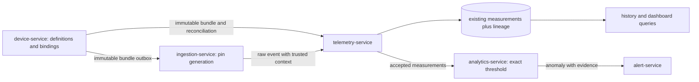

# Device variables

Status: first numeric variable scope implemented and verified behind opt-in
flags. The six completed device-variable changes remain active for review.
See [acceptance evidence and limits](../flows/device-variable-verification.md).

## Ownership and data flow

`device-service` owns account-scoped variable definitions for a device type,
immutable formula revisions, source bindings, defaults, rollout intents and
immutable processing bundles. An existing binding stays pinned when a new
revision is published. Definitions are numeric, `OBSERVED` or `DERIVED`.

`ingestion-service` authenticates the source, applies its retention policy,
validates bounded numeric inputs and stamps the exact trusted bundle generation
and digest. User input cannot choose these processing references. Its processing
projection is local to each replica; a referenced but unavailable bundle returns
503 rather than silently skipping computation.

`telemetry-service` owns the bounded evaluator, preview, durable processing
projection and materialization. Observed and computed values use the existing
measurement table. Computed storage tokens are `var_` followed by the variable
UUID without hyphens; APIs additionally require the variable and source UUIDs.
Lineage records the revision, bundle generation, source event, inputs, eligibility
and result status. A missing input or invalid division records failure without
inventing zero or discarding valid sibling measurements.

Activation is asynchronous: the mutation returns a desired generation. Until
source runtime and processing projections catch up, readings can follow the prior
configuration. The console exposes PROPAGATING and waits for a new matching
generation before showing ACTIVE. Previously accepted readings are not recomputed.

Within one database transaction, a source lock serializes processing and commits
input/output measurements, lineage, receipt and accepted-event outbox. Unknown
bundles park events durably for bounded retry. Historical bundles remain available
for delayed events, so changing a formula does not reinterpret accepted inputs.

`analytics-service` consumes accepted measurements for explicit variable threshold
rules. It uses full-resolution values, checks current source capability,
freshness, maintenance exclusion, cooldown and replay identity, and publishes the
normal anomaly event with variable evidence. `alert-service` retains alert
lifecycle and notification ownership. Materialized variables do not automatically
become ML features.

## Materialization versus presentation

Persist a variable when its identity and values must be shared by history,
thresholds and other consumers. Dashboard AVG/MIN/MAX buckets and bounded envelope
queries are computed when read; they create no additional telemetry rows. A graph
does not drive alert evaluation. Historical responses separate formula revisions
and processing generations and leave missing samples unfilled.

No new deployable service or cloud function is introduced. The evaluator has no
network access, arbitrary JavaScript/Python execution, time-window state or
cross-device dependencies. Arithmetic supports declared inputs, constants,
addition, subtraction, multiplication, division and explicit C/F/K conversion.
Publication validates aliases, numeric bounds and unit compatibility.

## Limits and lifecycle

- At most 100 definitions per account/type, 1,000 revisions per definition,
  eight inputs, 64 AST nodes and depth 12.
- At most 32 enabled variables and 4,096 expression operations per source bundle.
- Rollout requests have at most 50 explicit source targets. Each target stores
  its expected binding version; retries cannot overwrite a later manual edit.
- Defaults affect unbound devices with exactly one matching active source role.
  Ambiguous sources remain UNBOUND; existing pins are preserved.
- Bound inputs must remain retained numeric fields with the same identity/unit.
  Changing device type requires disabling its variable bindings first.
- Archive preserves measurements and revisions and schedules explicit disable
  intents. Current runtime capability stops considering archived variables active.

Each valid derived sample adds a measurement row plus lineage and outbox work;
failure adds lineage. Retained input snapshots and reconciliation history also
consume storage. Measurement retention follows the existing telemetry policy;
automatic lineage/bundle cleanup and production capacity measurements are
future work. There is no demonstrated fleet-size or latency guarantee yet.

See [API](../api/device-variables.md), [events](../events/device-variables.md),
[operations and verification](../operations/device-variables.md) and
[ADR-013](../../adr/ADR-013-device-variable-materialization.md).
