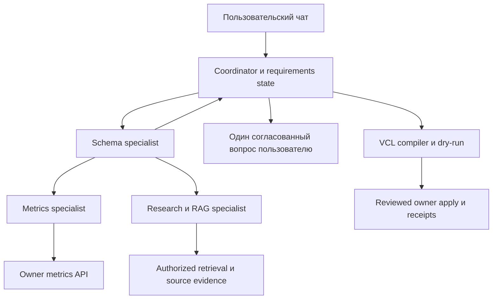

# AI: уточнение требований, специалисты и retrieval

Статус: **целевая архитектура, specification revision 2**, 2026-11-03. Анализ кода выполнен на рабочем
дереве; runtime, зависимости, live trials и deployment этим документом не меняются.
Дополнение к [существующему orchestration](ai-assistant-orchestration.md) и
[configurable operations](configurable-operations-platform.md).

Framework implementation companion: [Spring/Spring AI components and extension
boundaries](ai-assistant-spring-implementation.md). Он задаёт reuse матрицу,
two-Advisor pipeline, узкий observation aspect и SPR01–SPR15; не меняет
requirements/VCL/owner semantics, описанные здесь.

## 1. Что уже есть и чего не хватает

Дополнение 2026-11-11: [AI-first](../../openspec/changes/README.md#ai-first-execution-priority)
и [LangGraph4j assessment/migration](../../openspec/changes/adopt-langgraph4j-agent-orchestration/proposal.md)
задают механизм исполнения. Scheduler/task tree в этом контракте — требования
к ограниченной оркестрации через единственный квалифицированный library graph,
не указание построить ещё один самописный обход. G7 владеет requirements,
вопросами, provenance и policy; новый change — graph execution/checkpoint adapter.
Сначала доказывается базовый workflow, затем консультации; optional RAG не
является их обязательным prerequisite. Ни одна проверка схем ниже не доказывает
совместимость библиотеки, runtime или качество модели.

| Наблюдение в коде | Значение для качества | Решение |
| --- | --- | --- |
| backend/pom.xml фиксирует Spring AI2.0.2; SpringAiExchange делает один exchange и отключает SDK tool-loop | Контроль эффекта/повторов остаётся приложению | Сохранить Spring AI и durable orchestration |
| IntentOrchestration различает QUESTION, NEED_CONTEXT, PREPARED; pending question имеет ID/revision | Уже есть основа корректного диалога | Расширить typed requirements и консультации, не создавать второй chat engine |
| PrimaryRuntime формирует одну PINNED candidate и один профиль для planner/step/repair/verify | Маршрутизация по сложности пока не реализована этой конфигурацией | Сохранить PINNED; opt-in role profiles квалифицировать отдельно |
| BoundedSkillRequests требует ровно один PREPARING step; IntentPlans хранит один pendingQuestion | Нет общего scheduler вложенных специалистов и арбитража вопросов | Добавить bounded task tree и один user-facing question arbiter |
| WidgetCatalogueSearch держит до двух локальных индексов и смешивает lexical/cosine score | Это advisory widget retrieval, не общий tenant RAG; нет calibrated relevance | Не объявлять существующий поиск общей knowledge base |
| PrimaryModelTransport.serialize вызывает catalogueSearch.search; RoutedModelCalls сначала serialize/estimate, потом BudgetedModelCalls.reserve | Embedding I/O возможно до reservation основного model call; embedding usage не является usage этого call | Вынести retrieval из serializer; каждому внешнему embedding/reranker вызову собственная reservation |
| SkillRegistry.catalogue ограничен32 intents, importResources —100 resource events | Расширяемость не достигается добавлением всех schemas в каждый prompt | Scoped discovery/paging; mandatory context сохраняется независимо от retrieval |

Это review механизмов, а не утверждение о дефекте каждого запроса. Trace уже
фиксирует embeddingCalls, однако счётчик не заменяет monetary/token reservation.
Serialize/estimate должны стать чистыми, детерминированными и без сети.

Последний найденный локальный отчёт `artifacts/native-live-20261102/summary.json`
для STANDARD/NATIVE_TOOLS, embeddings OFF: 27 диалогов,13 passed; 29/54 first-pass
turns,35/54 final turns,5 first-pass unknown; qualified=false, qualityStatus=FAILED.
Это описательный baseline конкретного снимка/конфигурации, не измерение текущего
изменённого кода или эффекта RAG. Сравнивать нужно одинаковые snapshots/cases/
concurrency/graders; repairs нельзя считать новыми независимыми trials.

## 2. Принятое устройство

Один пользовательский чат владеет целью, requirements revision, plan и review.
Под ним существуют **внутренние typed consultation tasks** с отдельным bounded
context. Каждый специалист может предложить задачу следующему специалисту.
Сервер проверяет запрос и запускает его через общий scheduler/ledger; Java-вызов
ChatClient из callback другого ChatClient запрещён. Отдельные публичные чаты и
копирование их полных transcript не требуются.

В UI основной чат показывает дерево консультаций: role, задача, status,
использованные источники, итог и расход; private reasoning не сохраняется.
Если нужен ответ именно из другого существующего пользовательского чата,
он подключается явно как authorized conversation source: read permission,
selected message/fact IDs, snapshot revision и purpose. Владение одним workspace
не даёт автоматического доступа к частной истории другого пользователя.
Найденное старое сообщение — evidence, не свежая метрика и не transferable consent.

Роли — пакеты server-owned skills существующего ai-agent-service, не отдельные
deployments. Coordinator разбирает цель/неизвестное и собирает результат;
schema specialist сопоставляет identities/types; metrics specialist проверяет
определение метрики и формирует точный query; rule specialist пишет VCL;
research specialist ищет разрешённые документы/API descriptions; verifier
проверяет independently labelled postconditions. Простое действие обходится
обычным skill + deterministic loader, без обязательного набора агентов.

## 3. Уточнение требований как данные

RequirementsDocument хранится как versioned JSONB projection существующего plan
с append-only изменениями. Не создавать EAV/таблицу на каждый слот. Он содержит:
goal IDs, subject/scope, available signals, semantic metric definitions, time zone,
window/calendar, thresholds/units, completeness/unknown policy, recipients/effects,
resource/schema revisions, required slots и unresolved conflicts.

Slot = slotId, path (JSON Pointer), typeSchemaId, status, value, evidenceRefs,
sourceMessageIds, dependsOn, revision. status:
UNKNOWN | PROPOSED | CONFIRMED | DERIVED | CONFLICT | STALE.
UNKNOWN/CONFLICT/STALE имеют value=null. PROPOSED не считается подтверждением.
CONFIRMED пользовательского business decision требует exact message/question
binding; DERIVED вычисляется только зарегистрированной функцией из подтверждённых
входов/owner evidence. Источник происхождения задаёт сервер, не модель.

Данные владельца могут подтвердить наличие датчика, но не решить за компанию,
считается ли движение рабочим временем. Рабочая норма не угадывается из GPS,
наличия двигателя или найденного документа другой компании. Правовая норма
требует отдельно подтверждённой применимости; синтетические8часов в fixtures —
настройка примера, не юридическое утверждение.

Порядок работы:

1. Из реплики извлечь proposed slots с точными source message IDs.
2. Подтвердить доступные schemas/metrics/policies через authorized loaders.
3. Для технических неизвестных использовать retrieval/специалиста; для business
   choices, которых нет в подтверждённой политике, сформировать question candidate.
4. Arbiter объединяет одинаковые вопросы и задаёт ближайший blocking choice;
   максимум3 связанных вопроса в одном turn. Не спрашивать пользователя UUID,
   SQL или название внутреннего поля, которые может получить owner API.
5. Answer принимает planId, questionId, expectedQuestionRevision,
   expectedRequirementsRevision, requestId и typed bindings либо free text. Choice IDs разрешаются сервером. Short answer «да»
   относится только к этому открытому вопросу; не является mutation confirmation.
6. CAS применяет patch, транзитивно помечает зависимые slots/tasks/reviews STALE.
   Изменение timezone инвалидирует windows, но не unrelated device label.
7. Preview показывает подтверждённое, предлагаемое и неизвестное. Required slots
   не заполнены — activation заблокирован; draft разрешён с missing diagnostics.

Наличие чата не означает обязательную анкету при открытии. «Создай график
температуры этого датчика за сутки» не требует вопроса при единственном доступном
поле и заданном периоде. «Следи за переработками» требует определить сотрудника,
работу/перерывы, calendar/time zone и утверждённую норму, если policy их не задаёт.

## 4. Контракт делегирования и выполнения

Внутренние contracts закрытые: unknown properties reject; IDs — UUID, revisions
— неотрицательные safe JSON integers; user/tenant/access вычисляются сервером.
Версия `ASSISTANT-COLLAB/1`; нормативные поля DTO:

Wire grammar (target specification revision2): [JSON Schema](ai-assistant-collaboration.schema.json) и
[положительные/отрицательные примеры](ai-assistant-collaboration.examples.json).
`npm run ai-contracts:check` (PowerShell7) проверяет grammar и отдельные documentation semantic vectors, не runtime AI01–AI24.
Это отдельный consultation envelope; текущие assistant-v2 step/planner contracts
не получают новые outcome branches без явной versioned integration.

| DTO/method | Обязательные входы | Результат |
| --- | --- | --- |
| requirements.inspect | planId, expectedRequirementsRevision | Typed slots/conflicts/provenance |
| requirements.answer | planId, questionId, expectedQuestionRevision, expectedRequirementsRevision, requestId, answer | New requirements revision; stale dependants |
| consultations.request | parentTaskId, requestKey, skillId/version, goalIds, requirementsRevision, inputRefs, question, resultSchemaId | Server taskId/state, inherited budget/access |
| consultations.inspect | taskId, expectedTaskRevision | State, result/evidence or typed failure |
| consultations.cancel | taskId, expectedTaskRevision, requestKey | Cancellation epoch; descendants fenced |
| metrics.describe/query | metricId or approved typed query, subjectRefs, interval, zone, snapshot policy | Exact MetricEvidence + read manifest |
| knowledge.search | corpusRefs, query, purpose, limit, requirementsRevision | Bounded ranked evidence candidates, not facts |
| knowledge.resolve | hitIds, expectedSourceVersions | Authorized current spans/provenance or STALE/DENIED |

Новые целевые public bindings: GET /ai-agent/plans/{planId}/requirements;
POST /ai-agent/plans/{planId}/requirements/answers с полным RequirementsAnswer
body; GET /ai-agent/plans/{planId}/consultations/{taskId};
POST /ai-agent/plans/{planId}/consultations/{taskId}/cancel с
`{expectedTaskRevision,requestKey}`. Path/body planId совпадают. Inspect возвращает
current revision; stale expected revision на write даёт409. Hidden resource —404,
expired question/plan —410, invalid binding —422, missing revision —428.
Request replay с тем же requestId/body возвращает stored authorized result;
same ID/different body —409. Старые conversation-message endpoints неизменны:
их versioned adapter может сформировать RequirementsAnswer только из exact
pending question/revisions, иначе QUESTION_CHANGED, без догадки по последней реплике.
`consultations.request`, metrics и knowledge — internal registered application
ports, не публичные произвольные tool-execution endpoints.

RequirementsAnswer.answer — ровно одна ветка CHOICE(choiceId), TEXT(text) или
VALUES(bindings[{slotId,value}]); value — VCL Literal. Required/nullable/unit/enum
checks выполняются по exact slot typeSchemaId. Compound choices хранятся через
authorized snapshot/artifact REF либо несколько объявленных scalar slots, а не
произвольный model-supplied object. Choice.bindings — map slotId→VCL Literal;
keys ограничены объявленными question.slotIds, а значения проверяет slot registry.
Автоматическое принятие extracted free-text значения допускается только при
однозначном соответствии explicit ответу/declared slot schema; иначе PROPOSED
и точное уточнение. Event provenance отличает USER_CHOICE, USER_TEXT,
OWNER_EVIDENCE и MODEL_PROPOSED; модель сама origin не назначает.

Consultation request resultSchemaId выбирается из registry выбранного skill;
question ≤2000 chars; goalIds1..16; inputRefs≤32 authorized artifact IDs;
requestKey1..160 chars. Нет произвольного prompt/system-role, credentials,
model endpoint или raw SQL. Child inputs — scoped requirement subset, exact
parent question, relevant evidence и readSet. Parent transcript/secret не копируются.

Worker response — закрытый tagged union:
- ANSWER: typed payload по resultSchemaId, evidenceRefs, unresolvedSlotIds;
- NEED_DATA: registered loader requests;
- DELEGATE: typed consultation requests;
- NEED_USER: question candidates со slotIds, reason, offered choices/evidence;
- UNSUPPORTED: diagnostic code + missing capability;
- FAILURE: safe diagnostic + retry class.

Все варианты содержат taskId, attemptId, requirementsRevision, readSetDigest.
В DELEGATE поле parentTaskId каждого child request совпадает с taskId текущего
server-issued задания; произвольное назначение parent не разрешено. ANSWER
payload и NEED_DATA arguments дополнительно проверяются registry schemas,
не только общей envelope grammar. inputRefs/evidenceRefs должны разрешаться
в текущем scope; наличие синтаксически корректного UUID ничего не подтверждает.
Модель не возвращает `verified:true` или authority grants. Ответы специалистов
являются proposals; authoritative facts возникают после owner verification.
Root получает summary, typed result и bounded evidence refs, не private reasoning.

Default policy: depth≤3 (root=1, child=2, grandchild=3),≤12 consultation nodes
на plan,≤3 children у node,≤2 одновременно исполняющихся children суммарно
на plan,≤2 model exchanges за всю жизнь одного consultation request (включая
продолжения NEED_DATA/DELEGATE/NEED_USER). Это ceilings, не гарантированный расход:
существующие per-turn/per-plan call/token/cost/deadline limits имеют приоритет.
Повторная попытка, rebase и restart не обнуляют exchange/node counters. Когда
лимита2 недостаточно, возвращается CONSULTATION_LIMIT_REACHED и root решает,
можно ли завершить цель точными loaders либо показать capability/budget gap.
Дочерняя задача не получает новый бюджет. Расширение лимитов требует явной
account policy revision, не решения модели.

Цикл определяется по ancestor skill+goal+normalized inputs+requirements revision;
повтор → DELEGATION_CYCLE. Siblings с тем же exact requestKey/input digest
используют один result; same key/different digest →409. Самоконсультация без
новых данных не маскируется под новое имя агента. Model may propose graph;
scheduler проверяет depth/count/access/capabilities до model I/O.

States: QUEUED → RUNNING → WAITING_DATA|WAITING_CHILD|WAITING_USER → QUEUED;
RUNNING → SUCCEEDED|FAILED; any nonterminal → CANCELLED|STALE|EXPIRED.
Ждущая задача освобождает worker lease, не держит HTTP/thread/database transaction.
Persisted events + fenced leases восстанавливают её после crash. Completion
проверяет exact taskId/attemptId, server-issued input/read manifest digest,
continuationEpoch, cancellationEpoch и версии прочитанных slot/resource dependencies.
Счётчик общей plan/parent revision сам по себе не делает независимый ответ STALE.
Если requirements revision выросла, но все declared dependency versions и scope
не изменились, сервер CAS выполняет REBASE_ACCEPTED без нового model call, сохраняя
originalRequirementsRevision и acceptedRequirementsRevision в provenance. При
изменении зависимости — STALE; при смене attempt/continuation — STALE_ATTEMPT;
при отмене — CANCELLED. Current authorization всегда rechecked. Late result
сохраняется как obsolete audit, не перезаписывает актуальный ответ.
Модель лишь echo возвращает IDs/digest из assignment; они сверяются со stored
manifest. Подставленные ею hashes не доказывают чтение данных или актуальность.
UNKNOWN model exchange — outcome попытки, не новый terminal task status: unknown
usage учитывается, повтор — отдельная разрешённая reservation. Domain mutation
UNKNOWN блокирует зависимые эффекты по owner receipt protocol.

WAITING_USER candidates сходятся в root arbiter; специалисты не задают вопросы
пользователю одновременно. Parent может передать вопрос компетентному child,
но отсутствие факта в модели не превращается в голосование агентов.
Противоречивые evidence фиксируются как CONFLICT; root не выбирает большинство.
Independent branches разрешено продолжать, effects требуют полного review.
Root arbiter только объединяет/показывает вопросы зарегистрированных domain
skills по их slot schemas. Planner ASK остаётся вопросом об intent/target routing:
добавление arbiter не разрешает planner придумывать domain parameter bindings.
Сервер валидирует choices по slot schemas и текущим allowed resource IDs; free
text остаётся user evidence до semantic extraction/подтверждения, не готовым patch.

## 5. Метрики: точность и стоимость

Сквозной пример с тремя агентными контекстами:

1. Пользователь: «Предупреждай о переработках сотрудников нашего автопарка».
   Coordinator (depth1) фиксирует цель; scope берёт из selected workspace.
2. Coordinator поручает schema/workflow specialist (depth2) найти источник работы,
   assignments, подтверждённую норму и проверить недостающие requirements.
3. Specialist поручает metrics specialist (depth3) проверить доступность расчёта
   net work duration. Тот вызывает describe/query owner APIs; если нужно прочесть
   описание company policy, использует registered knowledge loader без нового
   агента. Обнаруженный пробел возвращается наверх как NEED_USER/UNSUPPORTED.
4. Есть только GPS/ignition — root спрашивает источник/определение работы.
   Есть подтверждённые work intervals, но нет нормы — спрашивает норму и calendar.
   Подтверждённая текущая company policy уже содержит timezone/window/норму —
   показывает её источник, не повторяет вопрос без причины.
5. Ответ пользователя связывается с exact question; новый requirements revision
   возобновляет только зависимые consultations. Метрики считаются owner engine.
6. Rule specialist обычным следующим plan step формирует interval union + compare
   из тех же generic operators. Dry-run показывает positive/negative/unknown
   examples и coverage, затем root готовит один exact reviewed diff.
7. Подтверждённый owner apply возвращает rule/dashboard/resource receipts.
   Production rule выполняется без вызова AI при каждом telemetry event.

Нужен четвёртый уровень — текущая policy возвращает DELEGATION_DEPTH_EXCEEDED;
root может перепланировать отдельный следующий step с тем же бюджетом/целью,
но не обнулить depth через фиктивный новый root. Новая последовательная задача
использует тот же plan-wide node/count/deadline accounting.

«Спросить метрики у другого чата» означает поручить metrics specialist выбрать
правильный контракт. COUNT/SUM/interval union/geodesic выполняются owner engines.
MetricEvidence: metricDefinitionId, metricVersion, unit, subjectRefs,
interval {start,end}=[start,end), timezone, value (VCL Literal), valueSemantics,
status OK|NO_DATA|PARTIAL|STALE|DENIED|UNKNOWN, coverage, readManifestId,
evidenceRefs. Manifest разрешает exact source/checkpoint/readSet. valueSemantics
=EXACT|LOWER_BOUND|UNAVAILABLE. OK требует COMPLETE coverage и non-NULL EXACT value;
NO_DATA/STALE/DENIED/UNKNOWN требуют NULL literal и UNAVAILABLE. PARTIAL допускает
только NULL/UNAVAILABLE или доказанный LOWER_BOUND, не approximate guessed value.
LOWER_BOUND может поддержать только разрешённое monotonic threshold proof по
covered finalized intervals; generic exact comparison запрещён. NO_DATA не равно0.
Definition unit/type, subject scope, valid instants/start<end и manifest binding
проверяет owner независимо от grammar. Метрика с другими единицами не accepted.
LOWER_BOUND разрешён только для INT64/DECIMAL/DURATION и соответствующей declared
metric semantics; PARTIAL не имеет COMPLETE coverage. DENIED envelope используется
внутри authorized task только с уже разрешённой metadata; он не выдаёт caller
скрытые IDs/units/evidence/counts. Public unauthorized lookup использует safe404.
Рабочее время объединяется по сотруднику с assignment boundaries и break policy,
а не суммируется моделью из случайной выборки поездок.

Кэш: digest metric/query + account/access scope + subject IDs + time window +
source/schema/policy revisions + read cutoff. Изменение grant или source revision
не позволяет повторно использовать старую выборку. Если service не поддерживает
нужную историю/метрику, specialist возвращает capability gap/NEED_USER, не оценку
«примерно». Векторный поиск численные агрегаты не вычисляет.

## 6. RAG: что индексировать и как искать

| Данные | Механизм |
| --- | --- |
| Slot values, pending question, selected resource IDs, receipts | Exact persisted plan/context; всегда обязательны, не top-k |
| Текущая schema/type/unit/capability | Exact owner describe; semantic search лишь предлагает IDs, затем resolve |
| Policy descriptions, manuals, integration docs, approved glossary | Versioned document RAG с authorized spans |
| Current telemetry/rows/counts/history | Bounded owner queries/projections; не загрузка всех значений в embeddings |
| Public route/stop catalogue | Registered data adapter + typed import; research документ лишь помогает найти API |
| Old conversation explanation | Authorized scoped history loader; opt-in semantic recall не заменяет exact question/consent |

Выбор хранения: **PostgreSQL16 + pgvector**, отдельная AI-owned knowledge schema/DB
и pool в существующей инфраструктуре. Это opt-in derived index, не новая
обязательная БД на каждый dataset и не customer DB extension. Не включать RAG
путём массового embedding всех таблиц клиента. Qdrant/другая отдельная система
нужна только при измеренном недостатке выбранного решения; новая абстракция
не должна скрывать ACL/consistency capabilities конкретного backend.

Минимальная модель: knowledge_source (owner/resource/version/digest/ACL/status),
knowledge_chunk (sourceVersion, ordinal, section/span, textDigest, language,
bounded text, classification), knowledge_embedding_generation (model revision,
dimensions, preprocessing/chunker versions), vector rows по generation/chunkId.
Одна source revision публикуется атомарно после полного ingest; статус
PENDING|INDEXING|READY|FAILED|RETIRED. Ни один пользовательский scalar не
разлагается в этот индекс вместо обычного typed SQL.

Ingestion contract `KNOWLEDGE-INGEST/1`: sourceId, sourceVersion, artifactId,
sha256, explicit mediaType/parserVersion, language, authorityClass, sourceLocator,
accessPolicyRef, effectiveFrom/To, retentionPolicyRef, expectedHeadVersion.
Все поля обязательны, nullable явно только effective dates; ACL/authority/source
задаёт owner. Допускаются UTF-8 text/Markdown и sandboxed registered PDF parser;
max artifact20MiB, extracted text10MiB,≤10000 chunks/source revision. Encrypted
PDF/unsupported encoding/unknown format не проходят auto-detect fallback.
URL retrieval отдельно проверяет allowlisted egress/redirects/size/content hash;
ни RAG, ни модель не расширяют доступ сети. No executable macros/downloaded tools.

Chunking profile: target512 tokens, overlap64, hard cap800 tokens по pinned
embedding tokenizer; boundaries учитывают section/table header, сохраняют span
в original source. Таблица не теряет units/header при split. Переполнение limits
возвращает LIMIT_EXCEEDED, не индексируется незаметно только начало файла.
Model/preprocessing/chunker/normalization changes создают new generation с
background rebuild и atomic head swap; смешение разных vector spaces запрещено.

Retrieval pipeline:

1. Проверить scope, purpose, corpus allowlist, policy и requirements revision.
2. Exact lookup выбранных identities/definitions. Для descriptive query —
   PostgreSQL full-text `simple` + exact identifiers и dense cosine candidates.
   Не называть native full-text BM25: это другой lexical rank.
3. Candidate limits:≤40 lexical +≤40 vector, dedup по source/span. Reciprocal
   rank fusion с pinned k=60; relevance thresholds калибруются на corpus, не
   считаются вероятностью истинности или выбора business policy.
4. Проверить текущий owner access/version для IDs ДО загрузки private text и до
   передачи provider/reranker. Только authorized text может попасть в reranking.
5. Optional reranker по≤20 candidates; final≤8 chunks и≤6000 tokens, сохранив
   источник/версию/section/span. Mandatory exact context не вытесняется RAG.
6. knowledge.resolve повторно подтверждает applicability/version/access;
   source content остаётся untrusted evidence. Устаревшая policy даёт STALE,
   противоречащие документы — CONFLICT; отсутствие hits — NO_EVIDENCE.

Approximate top-k не доказывает, что другой политики/остановки/строки не существует.
Для small authorized corpora используется exact vector scan; ANN включается
после measured plan/recall acceptance. Server builds parameterized access filters;
их нельзя заменить модельным metadata filter. RLS/authorized source selection
и pre-hydration recheck обязательны; retrieval DB role не имеет BYPASSRLS.
Для общего ANN index tenant filtering влияет на recall; нужны evaluated
partitioning/iterative scan settings, не надежда на top-k после ACL.
Ограниченный fallback тоже явно возвращает PARTIAL, не COMPLETE.

Public platform docs и private corpora разделяются authority/scope. Только
поставляемый платформой server-owned versioned registry является tool contract; найденный manual не меняет
system prompt. Text sanitization не доказывает отсутствие prompt injection:
дополнительно tools allowlist, scoped evidence, no writes у research, compiler
и review. Grant revocation проверяется на admission/resolve/cache reuse по правилам9.4;
purge embeddings асинхронный и не служит границей разрешений. Уже авторизованный
in-flight export не отзывается задним числом. Backup/purge obey source retention.

## 7. Что использовать со Spring AI

Сохранить Spring AI2.0.2 BOM, ChatClient/provider adapters и typed ToolCallback.
Не вводить второй Java/Python orchestration framework ради nested agents.
Консультации и retrieval — новые application ports и зарегистрированные skills
в существующем durable runtime. SDK automatic tool-loop остаётся отключённым.
[ToolCallingAdvisor](https://docs.spring.io/spring-ai/reference/api/tools/tool-calling-advisor.html)
умеет вести цикл вызовов; в нашей архитектуре этим циклом уже владеет ledger/runtime.
Подключить его параллельно означало бы получить обход budget/review checkpoints.

Для knowledge adapter использовать Spring AI EmbeddingModel и
PgVectorStore/VectorStore там, где он сохраняет owner ACL/source contract;
SQL hybrid search/head publication реализует focused repository adapter.
Для assembly подходят модули `spring-ai-rag`, DocumentRetriever и
DocumentPostProcessor из
[modular RAG](https://docs.spring.io/spring-ai/reference/api/retrieval-augmented-generation.html).
Не вешать непрозрачный default advisor на каждый запрос: rewrite/embedding/
reranker вызовы должны быть видимыми jobs/reservations, затем готовый bounded
context передаётся SpringAiExchange. Отдельный ChatMemory/VectorStoreChatMemory
не заменяет существующее persisted dialogue/provenance.

[PgVectorStore](https://docs.spring.io/spring-ai/reference/api/vectordbs/pgvector.html)
поддерживает PostgreSQL vector search. Schema/extension migration выполняется
контролируемо, initialize-schema=false у runtime. Pinned pgvector build с
поддержкой iterative scans (≥0.8.0) квалифицируется deployment change.
[Документация pgvector](https://github.com/pgvector/pgvector#filtering)
отдельно описывает ANN post-filtering/recall и multitenancy; performance и tenant
isolation необходимо проверить на нашей ACL-selectivity и объёме.

Embedding baseline для RU/EN/FI descriptions — self-hosted
[BAAI/bge-m3](https://huggingface.co/BAAI/bge-m3), dense1024, pinned artifact revision,
лицензия MIT. Это кандидат qualification, не доказательство оптимальности.
Его sparse/multivector режим не требуется: базовый hybrid использует PostgreSQL
lexical index + dense vectors. Optional
[bge-reranker-v2-m3](https://huggingface.co/BAAI/bge-reranker-v2-m3) — multilingual
cross-encoder, Apache2.0; включать только при измеренном выигрыше relevance и
допустимой latency. Вызовы идут через отдельный разрешённый inference endpoint,
не через ML failure-prediction API и не через загрузку кода из model output.
Cloud embedding — альтернативный account policy profile с явной data-egress
политикой; смена chat model не меняет embedding model автоматически.

Модель coordinator/rule reasoning выбирается по measured semantic quality;
простая schema extraction может использовать более дешёвую квалифицированную
модель. Fixed model names/prices не являются архитектурой. Признаки escalation:
unsupported structure, conflicting typed evidence, missing mandatory context,
failed independently checked postconditions — не самооценка confidence модели.
Escalation не пересоздаёт budget и не скрывает first-pass failure.

## 8. Качество, бюджет и порядок исправлений

Сначала устранить неконтролируемый embedding I/O и измерить существующий single
skill path; затем typed requirements, read-only consultations, knowledge adapter,
после этого nested composition и full qualification. Это интегрированные этапы
G7/A5/A6/G8, не новая независимая очередь, блокирующая все простые функции.

Общий ledger получает types CHAT|EMBED|RERANK и phases RETRIEVE|CONSULT|VERIFY
через versioned additive contracts; старые pinned policy digests не переписывать.
До внешнего запроса reserve calls/input/output/cost/deadline; indexing job тоже
имеет budget. Один provider batch считается одним вызовом и всеми input items.
Self-hosted inference не "нулевая стоимость": записываются compute time/bytes,
memory/queue pressure и отдельно monetary price-known/unknown. Unknown usage
не превращается в0. Model fallback/rewrite/summary/index rebuild учитываются.
Replays используют сохранённые authorized results без повторной generation.

Качество разделяется на: grammar; semantic intent/requirements; retrieval;
compiler correctness; owner effects; actual runtime business outcomes.
Первый валидный JSON не означает успешного создания правильного дашборда.
Scoring выполняется независимыми oracle postconditions/recorded user goals;
LLM judge — дополнительный сигнал, не единственный release authority.

Новые cases (каждый требует independent expected effects):

| ID | Проверка |
| --- | --- |
| AI01 | Известные slots не спрашиваются повторно; UNKNOWN work definition вызывает точный вопрос |
| AI02 | Изменение ответа/zone в другом turn делает только зависимые slots/reviews STALE |
| AI03 | Coordinator→schema→metrics возвращает typed metric evidence; loop/depth overrun отклоняется до I/O |
| AI04 | Два children просят один slot: один root question; конфликт не решается голосованием |
| AI05 | Parent cancelled/requirements changed while child runs: late result fenced |
| AI06 | Embedding/rewrite/rerank при budget exhaustion:0 unreserved external calls; serialize has0 I/O |
| AI07 | Exact receipt/question/resource ID сохраняется при пустом/плохом retrieval |
| AI08 | Hidden/revoked tenant document не появляется в candidate text, provider input, counts, cache или citations |
| AI09 | Source policy revision/re-embedding generation changes: no mixed vectors/stale binding |
| AI10 | Malicious retrieved text cannot call tools, change role, grant access or confirm apply |
| AI11 | Metric NO_DATA/PARTIAL/UNKNOWN не становится0/false; aggregate verified by owner engine |
| AI12 | RU/EN/FI paraphrases, novel schema labels, obsolete/conflicting docs, irrelevant top-ranked distractor |
| AI13 | Retrieval unavailable: lexical mode labelled; unsupported semantics не становятся supported |
| AI14 | Three-domain UI/AI flows preserve exact resources/effects and independently checked outcomes |
| AI15 | Unrelated requirements edit accepts an unchanged child read set by server rebase; changed dependency makes it STALE |
| AI16 | Answer binds both exact question revision and requirements revision; wrong/expired choice cannot update slots |
| AI17 | Forged attempt/readSet/evidence or wrong delegate parent is rejected despite valid envelope grammar |
| AI18 | Current owner policy conflicts with an old manual/user preference: policy authority/applicability checked, no automatic override |
| AI19 | One specialist, extra specialist, RAG and reranker compared separately; more agents cannot pass on higher cost alone |
| AI20 | Every requested device/dashboard/rule effect has a requirement-to-owner-postcondition mapping; attractive wrong metric fails |
| AI21 | Evidence duplicated through several agents remains one source; no independent-verification claim from repetition |
| AI22 | Private retrieval candidates are IDs until access check; default document-returning VectorStore cannot bypass hydration policy |
| AI23 | Task waiting for a user releases compute lease; answer resumes under a new turn reservation without resetting plan counters |
| AI24 | Relevant source absent/contradictory: NO_EVIDENCE/CONFLICT and explicit limitation, no unsupported completion or fabricated citation |

Report: clarification necessity/answer retention, unnecessary-question rate,
retrieval Recall@20/nDCG@8 on authorized labelled spans, evidence citation validity,
first-pass/final complete-task success, false accepts, p50/p95 latency, total
calls/cost per successful task и all attempted tasks. ANN сравнивается с exact
retrieval на том же corpus/access scope; chat model quality — на одинаковых inputs.
Frozen existing corpus/graders неизменны; новые случаи отдельным versioned corpus.
Release требует100% critical ACL/confirmation/receipt invariants и всех critical
AI01–AI24; noncritical rates/latency/cost thresholds заранее фиксируются в A6
campaign manifest до trials. Не выбирать порог по уже полученному результату.
Реальные paid/model calls этим проектированием не запускаются.

## 9. Уточнения второго аудита и повышение точности

Эта revision исправляет ещё не реализованный draft, а не production records.
Ни один completed OpenSpec task не переоткрывается автоматически.

### 9.1 Когда нужен агент, а когда достаточно loader

Порядок исполнения — direct exact loader → один domain skill → bounded consultation
при отдельной unresolved reasoning obligation. Не создавать specialist ради GET,
COUNT, cosine search или пересылки текста. Delegation request связывается с
goal/slot obligation, ожидаемым typed output и причиной: SCHEMA_REASONING,
POLICY_INTERPRETATION, RULE_COMPOSITION или INDEPENDENT_ASSESSMENT. Эти значения
хранятся в server task manifest; proposer не может расширить registry capabilities.
Каждый child добавляется, только если его output нужен другому step/postcondition.
Детерминированные lookup/validation функции продолжают работать без model call.

Выбор сложности делает проверяемая policy по requested capability, input bounds
и доступным данным. Отдельный LLM-router не обязателен для каждого вопроса.
Нужна новая consultation после исчерпания2 exchanges — это новый declared node
с той же obligation/lineage, учитываемый в node/exchange/plan budget; нельзя
продолжить тот же request под другим requestKey для обхода лимита. Независимый
следующий plan step не наследует случайную глубину sibling, но повтор той же
неразрешённой obligation сохраняет causal depth/cycle guards.

Multi-agent режим включается по skill/case matrix после ablation: тот же frozen
input/model budget с одним skill, с delegation, с RAG, с reranker. Принятие режима
требует измеренного прироста independently graded quality/coverage в нужных
классах задач при заранее заявленных cost/latency ceilings. Частота отказов,
задержка и расход на неуспешные задачи остаются в отчёте.
Такой выбор простого workflow по умолчанию согласуется с
[разбором agent/workflow patterns](https://www.anthropic.com/research/building-effective-agents);
точные правила выше — решение VoltCanary, а не свойство framework.

### 9.2 Семантическое связывание и полнота цели

Для каждого goal хранится requirementCoverage: requirementId, slot/evidence refs,
resource/metric IDs и versions, proposed VCL/operation paths, независимые
postconditions, unresolved obligations. Это typed plan artifact, не hidden chain
of thought. Слово «энергия» недостаточно: нужны metric definition, unit, aggregation,
subject, temporal window, source provenance и meaning. Два поля с одинаковыми
units/labels не считаются одной метрикой. Имена/синонимы дают candidates, затем
exact owner describe и semantic checks; ambiguous business meaning уточняется.

Перед PREPARED compiler/owner проверяет input/output types, cardinality, direction
relations, effect scope и preservation invariants. Перед apply проверяется mapping
всех обязательных требований к actual owner diff. После apply independent read-back
проверяет persisted IDs/bindings/layout/rule revision и receipts. Требование без
mapping не исчезает из summary: INCOMPLETE_REQUIREMENTS. Обязательное требование
нельзя снять только потому, что другая реализация проще. Параметрическое
подтверждение не заменяет versioned consent на effects.

Prompt per role строится из minimal sufficient context: exact task/goal, assignment
manifest, relevant confirmed slots, open question/current answer, selected identities,
typed contracts и bounded resolved evidence. Полные каталоги/дубликаты схем не
рассылаются всем агентам. Optional text удаляется первым; mandatory contract,
question choices, resource ambiguity и required evidence не обрезаются ради модели.
Если ядро не помещается — разрешённый larger-window profile или CONTEXT_INSUFFICIENT.
Schema/prompt projections генерируются из registry и проверяются на round-trip
с canonical form; technical aliases возвращаются в exact IDs до domain compile.
Few-shot примеры versioned и disjoint от held-out corpus; автоматическое добавление
непроверенных chat answers в demonstrations/knowledge запрещено.

### 9.3 Происхождение, применимость и противоречия

Порядок authority: enforced access/owner constraints → действующая approved
account/workspace policy для данного scope/effective time → explicit user choice
в разрешённых пределах → descriptive external/history evidence → model proposal.
Текст пользователя не отменяет enforced policy. Изменение самой company policy
требует её отдельного owner review и полномочий; после него пересчитываются slots.
Подписанный документ подтверждает происхождение, но не универсальную применимость:
policy matching включает account, subject, jurisdiction/организационную область,
effective interval, supersession и source revision. Нет доказанной применимости —
CONFLICT/UNKNOWN, а не автоматический выбор самого свежего текста.

Каждый factual claim ссылается на evidenceId и точный source version/span или
owner read manifest; summary специалиста не становится новым независимым source.
Provenance DAG запрещает circular support. Три агента, повторившие один manual,
имеют одно свидетельство, а не три подтверждения. Verifier получает исходную
цель/constraints и candidate owner state с разрешёнными evidence, а не утверждение
writer «всё сделано». Его assessment может остановить ошибку, но не заменить
детерминированные checks и не повысить failed task до success.

### 9.4 Публикация RAG, ACL и воспроизводимость

knowledge.search сначала возвращает candidate IDs, source versions и безопасные
scores; private text загружает отдельный knowledge.resolve после owner authorization.
В application adapter разделены CandidateIndex.searchIds и EvidenceResolver.hydrate.
Stock VectorStore.similaritySearch возвращает documents: для private corpora его
нельзя вызывать, а затем обещать ACL-before-hydration. Использовать scoped ID-only
PostgreSQL repository с RLS/access filter; PgVectorStore допустим для public
platform corpus либо если эквивалентная private authorization доказана в adapter.
Интерфейс Spring AI не является гарантией tenant isolation.

Нормативный режим фильтрации: request scope → DB/RLS metadata candidate scope →
batch owner check IDs → text hydrate → optional rerank → bounded context. Counts,
scores и trace metadata не раскрывают foreign corpus. Scope проверяется снова при
использовании cached evidence. Revocation закрывает новые admission/reuse после
authoritative check; уже авторизованная in-flight передача не может быть отозвана.
Audit различает admission/access epoch, resolve, dispatch и revoke; не обещать
атомарную revoke/dispatch транзакцию между owner и model provider. До новых effects
owner всё равно reauthorizes. Queue entries с устаревшим доступом не отправляются.

RetrievalManifest хранит corpus/source/head versions, query digest, authority/
effective filters, embedding model artifact/dimensions, chunker/tokenizer versions,
fusion/reranker profile, hit IDs/spans, retrieval mode, truncation/empty reasons
и access-scope digest. Для exact replay сохраняется ordered evidence set в рамках
retention/access policy; ANN поиск заново не называется воспроизведением старого
результата. Старый read snapshot можно объяснить исторически, но не активировать
правило по уже отменённой policy без нового review.

Chunk metadata содержит authorized title, section path, source language и units/
table headers. Соседний chunk/parent section подгружается bounded resolve, когда
это нужно для смысла; он тоже входит в final token/evidence budget. LLM contextual
enrichment, query rewrite, translation и HyDE не default: могут добавить выдуманный
контекст/скрытый расход. Их включение требует отдельного профиля, lineage и ablation;
original source всегда доступен verifier. На языке, не прошедшем квалификацию,
результат не объявляется supported только потому, что embedding multilingual.

### 9.5 Turn, task, plan и сроки ожидания

RequestId/turnId, consultation taskId, attemptId и owner mutation idempotencyKey —
разные namespace. Root request и его background descendants расходуют исходный
turn budget до WAITING_USER/terminal outcome. Scheduler не создаёт synthetic user
turn ради продолжения. WAITING_USER закрывает compute attempt/lease; пользовательский
ответ создаёт новый authorized turn budget, сохраняя plan-wide node/call/cost usage.
WAITING_USER освобождает compute lease, но **не останавливает абсолютные clocks**.
Default текущего PINNED profile:240s/turn и3600s/plan от открытия budget records
(PrimaryRuntime/JdbcAttemptLedger). Answer создаёт новый turn deadline, но не
продлевает plan deadline. Effective expiresAt=min(plan budget deadline, owner review
expiry и отдельно заданный plan TTL). После него — EXPIRED/new plan/revalidation;
consent не переносится. Conversation history может жить дольше execution plan.
Для долгого business dialogue нужен новый явно qualified policy profile с большим
absolute plan lifetime; он не выдаётся child агенту и не меняет deadlines pinned
in-flight plan. Pause/restart/новый requestId не сбрасывают calls/cost/deadline.

Task SUCCEEDED означает полученный допустимый result, а не закрытую цель:
ANSWER с unresolved slots/NO_DATA не разрешает activation. Transport UNKNOWN
потребляет reservation с unknown usage; reconciliation/повтор не скрывают старый
attempt. После crash один fenced lease может завершить попытку. Unrelated parent
events допускают CAS retry/rebase; изменившиеся continuation/dependency epochs — нет.

### 9.6 Qualification и изменения моделей

Квалифицируется tuple model/provider snapshot + role prompt/skill registry + output
projection + retrieval/index/reranker profile + compiler version. Отдельные candidate
models per role разрешены только в opt-in qualified AUTO; PINNED не эскалируется
молча. Каждый plan сохраняет policy snapshot. Неподдержанная native-tool schema
не понижается незаметно до free text; сначала qualification совместимого режима.
Provider outage, reasoning complexity и context overflow — разные diagnostic routes.

Рекомендуемый порядок улучшений: чистый serializer и полные budgets → exact context
и schema linking → targeted clarification и requirementCoverage → selective retrieval
→ role-specific routing → лишь затем измеренно полезная delegation/verification.
Смена framework/fine-tuning не заменяет исправление этих границ. Fine-tuning —
отдельный поздний opt-in эксперимент по authorized labelled training set, с data
lineage, train/test separation и requalification; mutable company facts остаются
в owner/RAG. Не обучать модель автоматически на private chats.

Перед экспериментом A6 campaign manifest фиксирует critical case IDs, eligible
languages/domains, exact success/clarification/retrieval denominators, allowed
abstentions, thresholds, sample counts/repetitions, pricing uncertainty, ceilings
и stop rules. Без заполненного manifest запуск BLOCKED, не «пороги выберем потом».
Recall@20 оценивается на first20 resolved authorized candidates, nDCG@8 — на final8
с независимыми relevance labels. Empty/no-answer cases отдельно оценивают correct
abstention; их нельзя удалить из end-to-end denominator. Clarification necessary/
unnecessary decisions имеют независимые labels, не самооценку writer. Unavailable,
cancelled, unknown и rejected-by-verifier outcomes учитываются раздельно. Наряду
с point estimates публикуются sample sizes и confidence intervals; результат одной
попытки не доказывает превосходство модели. Новый режим включается только при
выполнении всех существующих frozen/critical gates и заранее заданных новых gates.

Проверка документации revision2: `npm run ai-contracts:check` —11 positive documents
(все worker outcomes, RequirementsAnswer и MetricEvidence),14 grammar rejections
и15 grammar-valid assignment/dependency/binding vectors. Проверяется совпадение
проекции VCL literals с canonical registry; это не доказательство реального
ACL, scheduler concurrency, model quality или live source correctness.
