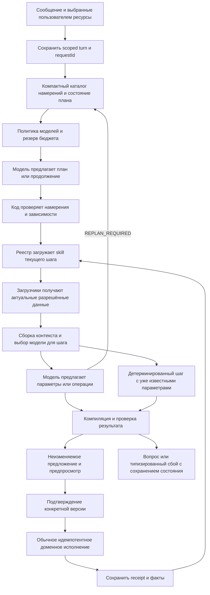

# AI-помощник: намерения, серверные skills и экономичные модели

Дополнение 2026-11-11: пользователь выбрал AI-first и Java/LangGraph4j assessment.
[Приоритет и порядок](../../openspec/changes/README.md#ai-first-execution-priority),
[library migration](../../openspec/changes/adopt-langgraph4j-agent-orchestration/proposal.md)
и [framework amendment](ai-assistant-spring-implementation.md#langgraph4j-assessment-and-migration-2026-11-11)
имеют приоритет над старым выбором следующего этапа. Сохраняются доменные
контракты и один ledger; graph traversal нового плана уже использует core1.9.9.
[Реализованные границы](../current/architecture/spring-ai-assistant.md#langgraph4j-core-integration--2026-11-11)
не включают полную specialist оркестрацию, in-place migration или качество модели.

Дополнение 2026-10-29: пользователь запросил полную миграцию на Spring AI 2 и
Spring Boot 4. Текущие framework/context/tool границы описаны в
[реализации Spring AI](../current/architecture/spring-ai-assistant.md).
Ниже сохраняются доменные требования и незавершённые quality gates A5/A6.

Точные целевые Spring bindings, роли custom Advisors/AOP, dependency reuse,
transaction/async/observation boundaries и работы S0–S6:
[контракт реализации Spring AI](ai-assistant-spring-implementation.md).


Статус: **целевая архитектура, предложена 2026-10-26; не описание работающего API**.
Этот документ и [формальные контракты](ai-assistant-protocol.schema.json) задают
направление новых OpenSpec-ченджей. Создание этих документов не разрешает запускать
реальные AI-прогоны, менять настройки провайдера или включать новый runtime.

Текущая реализация: [AI API](../current/api/ai-agent-api.md).
Дополнение 2026-10-27: по явному запросу пользователя идёт локальная A5-интеграция
и проверка на реальной модели. Новый путь включён локально, общая квалификация
ещё не пройдена. Актуальные ограничения и результаты описаны в AI API;
следующие абзацы сохраняют историю первоначальных этапов.
В первом проходе 2026-10-26 реализованы внутренние границы A1/A2 (контракты,
реестр, routing и durable budget), проверенные двумя офлайн-сценариями. Новые
HTTP writers, orchestration/context runtime A3/A4 и миграция domain skills A5
ещё не подключены; default-off и live qualification gates сохраняются.
Следующим проходом реализованы внутренний runtime A3, durable state и read-only
recovery. PostgreSQL/frontend-приёмка A3 пока не проводилась; сборка ограниченного
контекста A4 теперь реализована внутренними фабриками и scoped readers;
domain/UI-интеграция A5 ещё не включена. A4 проверяется двумя офлайн-сценариями,
без PostgreSQL/browser/live-приёмки. См. фактическое состояние
и команды в [AI API](../current/api/ai-agent-api.md#assistant-v2-durable-intent-plans-a3-2026-10-26).
Очередь и зависимости: [программа миграции](../../openspec/changes/README.md#ai-assistant-orchestration-program).
Проверяемые документы запросов/ответов: [JSON-примеры](ai-assistant-protocol.examples.json).
Уточнение контракта 2026-10-28: `planSummary.steps` допускает необязательные
`dependsOn` и `goalIds`; текущий writer передаёт их, старые документы без этих
полей остаются допустимыми. Planner выбирает workflow и привязки ресурсов;
имена, периоды и виджеты определяет выбранный доменный skill. Три dashboard
skill-контракта создания, правки review и сохранённого draft описаны в
[актуальном API](../current/api/ai-agent-api.md#a5-dashboard-skill-responsibility-contract--2026-10-28-follow-up).
Предыдущая архитектура [дашбордов](ai-dashboard-assistant.md) сохраняет требования
к точным изменениям, предпросмотру и исполнению; новая архитектура заменяет способ
интерпретации, загрузки инструкций, выбора модели и координации попыток.

## 1. Цель и границы

Система должна выполнять свои типовые задачи экономичными моделями разных
провайдеров. Достигаем этого ограниченными операциями, декомпозицией, серверными
skills, дозированной загрузкой данных и детерминированным исполнением.
Размер контекстного окна не является показателем качества. Более сильная модель
доступна только по разрешённой политике; она не заменяет исправление архитектуры.

Обязательные принципы:

1. Модель выбирает намерения из переданного каталога и понимает свободную речь.
   Код не интерпретирует речь регулярными выражениями, ключевыми словами или
   проверками формулировки предыдущего вопроса. Сам предыдущий вопрос, нужные
   сообщения и результаты действий передаются модели: именно она понимает
   намерение, имя/другие параметры, период и ссылки «его», «этот», «теперь».
   Формат UUID, число строк сетки, допустимость enum и номер борта проверяет код.
   Существующие детекторы секретов и технические парсеры не считаются NL-router.
2. Параметры всех видов описываются контрактами: обязательность, ограничения,
   происхождение, допустимые значения, возможность предложения моделью.
   Подтверждённые значения сохраняются; отсутствующие необязательные не блокируют
   работу. Модель предлагает подходящие значения, когда это разрешено контрактом.
3. Полное состояние находится на сервере. Модель получает только необходимые
   инструкции и данные текущей фазы; её скрытые рассуждения не являются памятью.
4. Модель предлагает действия. Код проверяет доступ, зависимости, форматы,
   совместимость, постусловия и выполняет обычные доменные команды.
5. Все обращения к провайдерам входят в один журнал бюджета. Адаптеры и skills
   не владеют собственными скрытыми повторами.
6. Миграция сохраняет все существующие сценарии, включая не-HSL устройства,
   произвольные зарегистрированные типы, источники, симуляторы, правила и read-only
   инструменты. Недоступные/неперенесённые возможности обозначаются явно; нельзя
   молча превратить их в создание устройства или вопрос о технической схеме.

## 2. Компоненты и последовательность



Один intent может требовать несколько операций; несколько операций не означают
несколько AI-вызовов. Модель может вернуть move/resize/presentation в одном ответе.
Известное техническое действие не нуждается в новом обращении к AI.

Первый запрос без подходящего плана проходит planner. Когда один известный шаг
ожидает ответ/правку, сервер может сразу загрузить его skill и отправить сообщение
туда, без обязательного дополнительного router-вызова. Это выбор по состоянию,
не по словам пользователя. Модель сама распознаёт выход за рамки шага и возвращает
REPLAN_REQUIRED; только тогда приложение вызывает planner с исходным сообщением
и сохранённым состоянием под тем же бюджетом. До этого действий нет. Несколько
равноправных активных шагов без явного выбора требуют planner/уточнения.

Владелец координации — application-слой `ai-agent-service`, с отдельными портами
реестра skills, контекста, моделей, бюджета и хранения. Чистые доменные классы
проверяют граф плана, факты и операции без JDBC/HTTP/provider SDK. Доменные сервисы
по-прежнему владеют устройствами, источниками и дашбордами. Не нужен новый
микросервис, фреймворк агентов, векторная БД или сеть субагентов.

## 3. Реестр намерений и skills

Skill — наш версионированный серверный пакет, а не `.codex/skills` для разработки
и не обязательная функция провайдера. Пакет поставляется с приложением и проходит
review; модель не может загрузить исполняемый код или произвольный файл по URL.

Манифест `skill.manifest` содержит:

- `intentId`, `skillId`, `skillVersion`, краткое описание;
- версии входной, выходной и командной схем;
- `parameterRules`: требования к каждому параметру и разрешённое происхождение;
- ожидаемые выходы, входные зависимости и режим `MODEL`/`DETERMINISTIC`;
- разрешённые загрузчики, инструменты и коды проверки;
- профиль модели, ограничения контекста и вид подтверждения;
- серверные инструкции с digest и список совместимых версий протокола.

Планировщик получает только компактную проекцию: intentId, описание, входные
ключи, возможные выходы и зависимости. Все длинные инструкции и каталоги
виджетов/типов одновременно ему не передаются. Каталог формируется по текущим
правам, установленным интеграциям и feature flags. Большой каталог делится на
описанные группы с ограниченной загрузкой через тот же бюджет, без regex-router.

Намерения задаются реестром, а не зашиваются в глобальный enum провайдера.
Примеры: `CREATE_DEVICE`, `CONNECT_SOURCE`, `CREATE_DASHBOARD`, `EDIT_DASHBOARD`,
а также все уже поддерживаемые задачи. `CONNECT_SOURCE` объявляется доступным
только для реально реализованного подключения; generic REST-source metadata
не означает поддержку произвольного MQTT-коннектора.

## 4. Форматы и границы доверия

Нормативные конверты версии `assistant-v2` описаны в
[ai-assistant-protocol.schema.json](ai-assistant-protocol.schema.json).
Это provider-neutral JSON Schema 2020-12. Она не отправляется целиком каждому
провайдеру. Адаптер строит компактную совместимую схему для выбранного skill,
затем результат всегда проходит локальную каноническую и доменную проверку.

| Конверт | Отправитель → получатель | Назначение |
| --- | --- | --- |
| `turn.submit` | UI → приложение | Текст, requestId, expectedRevision, выбранный review и явные resource refs |
| `planner.request` | приложение → модель | Последнее сообщение, краткий план, каталог, известные факты |
| `planner.response` | модель → приложение | PLAN / CONTINUE / AMEND / ASK / UNSUPPORTED |
| `skill.manifest` | серверный реестр | Инструкции и контракты шага |
| `skill.context` | сборщик → application/model projection | Факты, choices, базовый review, ожидаемые цели, снимок и полнота |
| `step.request` | приложение → модель | Один skill, его контекст, схема ответа и безопасная диагностика повтора |
| `step.response` | модель → приложение | PREPARED / QUESTION / NEED_CONTEXT / NO_CHANGE / REPLAN_REQUIRED / UNSUPPORTED |
| `plan.state` | приложение → хранилище | Версия плана, шаги, ревизии, receipts и факты |
| `routing.policy`, `budget.state` | приложение | Выбор разрешённых моделей и общий расход; не полномочия модели |
| `price.snapshot` | серверный реестр цен | Версия ставок, валюта, период действия и правила учёта usage |
| `turn.response` | приложение → UI | Честное состояние, вопрос/ошибка, review/confirmation и итог шага |
| `confirmation.request` | UI → приложение | Подтверждение конкретного step/review/version/digest с expectedRevision |
| `control.request` | UI → приложение | Явный CANCEL / RESUME / RETRY с requestId и expectedRevision |

Инструкции из реестра являются серверной политикой. Текст пользователя, имена,
описания ресурсов, прошлые ответы модели и значения фактов — недоверенные данные
в отдельной секции. Токены авторизации и ключи провайдеров не входят в эти JSON.
userId/accountId определяются проверенной сессией и не принимаются как аргументы
модели. Упоминание resource ref никогда не выдаёт доступ к ресурсу.

### 4.1 Планировщик

`planner.request` передаёт `message`, `dialogue`, `catalogue`, `planSummary`, `facts` и
доступные ссылки на ресурсы. `planSummary` показывает завершённые и ожидающие
шаги, их неизменяемые результаты и цели, но не весь transcript.

Пример ответа:

```json
{
  "version": "assistant-v2",
  "kind": "planner.response",
  "decision": "PLAN",
  "explanation": "Создадим автобус, подключим источник и подготовим дашборд.",
  "targetStepId": null,
  "supersedesStepIds": [],
  "supersedesGoalIds": [],
  "proposedGoals": [
    {"goalId":"g1","sourceMessageId":"message-create","text":"Создать автобус"},
    {"goalId":"g2","sourceMessageId":"message-create","text":"Подключить источник"},
    {"goalId":"g3","sourceMessageId":"message-create","text":"Подготовить дашборд"}
  ],
  "question": null,
  "steps": [
    {"stepId":"bus","intentId":"CREATE_DEVICE","dependsOn":[],"inputs":[],"goalIds":["g1"]},
    {"stepId":"feed","intentId":"CONNECT_SOURCE","dependsOn":["bus"],"inputs":[{"field":"deviceId","binding":{"kind":"step_output","stepId":"bus","outputKey":"deviceId"}}],"goalIds":["g2"]},
    {"stepId":"view","intentId":"CREATE_DASHBOARD","dependsOn":["bus","feed"],"inputs":[{"field":"deviceId","binding":{"kind":"step_output","stepId":"bus","outputKey":"deviceId"}},{"field":"sourceId","binding":{"kind":"step_output","stepId":"feed","outputKey":"sourceId"}}],"goalIds":["g3"]}
  ]
}
```

`proposedGoals` — интерпретация моделью требований со ссылкой на реальное исходное
сообщение; её полнота проверяется независимыми сценариями, а не объявляется
доказанной JSON-схемой. Сервер сохраняет исходное сообщение без потери требований,
связывает `goalIds` с прежними или новыми предложенными целями и назначает их
состояние. Модель не может удалить непокрытые цели отсутствием их в новом ответе.
`supersedesGoalIds` разрешены только в AMEND из нового пользовательского turn,
явно отражаются в изменении плана и не принимаются из repair/context continuation.
PLAN создаёт план, CONTINUE
выбирает существующий шаг, AMEND предлагает явную замену невыполненных шагов.
ASK задаёт содержательный вопрос; UNSUPPORTED обозначает реальный пробел возможностей.
Оба исхода без исполнения. Точные условные ограничения приведены в схеме.

Проверяются уникальность ID, известные intentId, типы входов/выходов, отсутствие
циклов, максимальное число шагов, необходимые зависимости и сохранение уже
выполненных действий. Ссылка `step_output` — типизированная пара stepId/outputKey,
а не исполняемая строка, JSONPath или шаблон подстановки. Для ресурса она становится
конкретным ID только после успешного receipt и повторной проверки текущего доступа.

### 4.2 Контекст шага

`skill.context` включает:

- `snapshotId`, `asOf`, `completeness`, `omittedSections`, разрешённые `contextRequests`;
- факты `{factId, field, value, origin, sourceMessageId, receiptId, confirmation}`;
- choices `{ref, kind, label, properties}` из актуальных scoped API;
- `baseReviewId`, `baseDigest`, ожидаемые цели и подтверждённые ограничения;
- `dialogue`: реальные предыдущие сообщения, открытый вопрос, фокус и события ресурсов;
- оценки размера и версию проекции; отсутствие данных и устаревшие данные различаются.

`step.request.contract` передаёт server-owned trust policy, `parameterRules`,
input/command schemas, bindings/resolved inputs и контракты разрешённых loaders.
`step.request.loadResults` содержит отдельные untrusted data envelopes с loaderId,
snapshotId/asOf, completeness и scoped nextCursor. A4 всегда передаёт оба поля;
они optional в wire-схеме для чтения ранних A1 запросов. Данные загрузчиков и
предложенные параметры не становятся подтверждёнными domain receipts.

Происхождение: USER_EXPLICIT, MODEL_PROPOSED, USER_CONFIRMED, DOMAIN_RECEIPT.
Модель только предлагает новые значения; сервер назначает происхождение на основе
реального события. Предложенное имя/тип/период/источник не становятся подтверждёнными
от заявления модели. Правила каждого параметра определяют, нужен ли вопрос,
допустимо ли предложение или достаточно обычного review перед исполнением.

Полный каталог не обязателен в каждом запросе. Загрузчики передают только выбранные
ресурсы, релевантные группы данных и краткие описания. Если требуется продолжение,
модель возвращает NEED_CONTEXT с loaderId и opaque cursor из разрешённого списка.
Код проверяет аргументы загрузчика, доступ, размер и остаток бюджета. Модель не
задаёт URL/SQL/произвольный путь. Недостающие обязательные данные нельзя молча
обрезать: CONTEXT_INSUFFICIENT, вопрос о сужении выбора или следующий ограниченный
снимок. Временные refs и cursors имеют scope, snapshot и expiry; это не grants.

### 4.2.1 Память диалога и сборка следующего запроса

Предыдущий вопрос обязательно доступен модели, когда пользователь отвечает на
него. Удаляем программное угадывание смысла вопроса, а не сам вопрос из контекста.
`step.request` содержит `messageId` и исходный `message`, как и planner-запрос.
Одних извлечённых параметров недостаточно: они могут потерять условия пользователя.

| Слой | Где и в каком виде | Зачем |
| --- | --- | --- |
| Полная история | Серверное хранилище PostgreSQL: упорядоченные пользовательские и ассистентские сообщения, после удаления секретов по действующей политике | Восстановить диалог и исследовать сбой; не отправлять весь архив каждый раз |
| Состояние работы | План, исходные цели, факты с provenance, pendingQuestion, focus, review/version/digest, доменные receipts | Сохранить параметры и результаты независимо от выбранной модели и после reload |
| Контекст вызова | JSON-проекция `dialogue` вместе с текущим текстом, facts, scoped choices и инструкциями текущей фазы | Дать модели достаточно смысла для конкретного решения |

`dialogue.messages` содержит предыдущие сообщения с ID, порядком, ролью, текстом
и связями question/step/review. Текущее сообщение передаётся отдельно, без
дублирования. `pendingQuestion` содержит серверный questionId, исходный текст,
missingFields, варианты и шаг, ожидающий ответ. Сервер назначает ID после
QUESTION/ASK; модель не назначает себе статус подтверждения. UI может передать
`replyToQuestionId`; сервер проверяет его принадлежность и актуальность, но это
не запрещает пользователю сменить задачу вместо ответа на вопрос.

`dialogue.focus` показывает выбранные устройство, дашборд и review с происхождением
выбора. `resourceEvents` сохраняют порядок создания/изменения ресурсов, ссылки на
сообщения и receipts, включая предыдущие завершённые планы этого же диалога.
Завершение плана не стирает созданный автобус из доступной памяти разговора.
«Создан» в тексте ассистента не заменяет успешный доменный receipt.

Сервер собирает окно по связям состояния, явному выбору в UI и порядку сообщений,
без семантического regex-поиска. Обязательное ядро: исходная цель текущего шага,
открытый вопрос со всеми вариантами, текущий ответ, выбранный review и необходимые
факты/результаты. Последние соседние реплики помогают понять смену темы.
Старые подробности подгружаются зарегистрированным `conversation.history` loader
через NEED_CONTEXT; cursor проверяется по scope и бюджету. Для planner предусмотрен
ASK или его ограниченное протоколом продолжение загрузки каталога/истории;
нельзя ожидать от planner исход NEED_CONTEXT, которого нет в его response-схеме.
История обычного чтения/reload загружается без AI-вызова.

`historyCompleteness`, `omittedMessageCount` и `historyCursor` явно показывают
обрезку окна. Нельзя скрыть второго подходящего автобуса, чтобы поместиться в
маленькую модель, и затем объявить выбор однозначным. Если ядро не помещается,
политика выбирает разрешённую модель с подходящим окном или возвращает
CONTEXT_INSUFFICIENT. Автоматическая AI-суммаризация не обязательна; при её
введении она учитывается в общем бюджете и не заменяет receipts и исходные цели.

Размер измеряется для каждого запроса в байтах и токенах выбранного токенизатора.
Для иллюстрации, не как норматив: 4–8 коротких реплик могут занимать примерно
0.3–1.5 тыс. токенов; весь запрос с инструкциями и scoped данными — несколько
тысяч. Большие definitions/каталоги считаются отдельно; фиксированного размера
для всех задач и провайдеров нет. Само чтение истории не добавляет AI-вызов.

### 4.2.2 Подробный сквозной сценарий

```mermaid
sequenceDiagram
    actor U as Пользователь
    participant A as UI и сервер оркестрации
    participant H as PostgreSQL: история и состояние
    participant C as Реестр skills и сборщик контекста
    participant M as Выбранная модель
    participant D as Доменные сервисы
    U->>A: Создай автобус №42
    A->>H: Сохранить исходное сообщение и requestId
    A->>C: Каталог, история, цели, доступные ресурсы
    C-->>A: Компактный planner.request
    A->>M: Текст + dialogue + каталог + факты
    M-->>A: План CREATE_DEVICE
    A->>C: Skill устройства, правила параметров, типы
    A->>M: Текст + история + инструкции + scoped context
    M-->>A: Параметры автобуса или вопрос
    A->>A: Проверить параметры, сохранить review
    A-->>U: Предпросмотр создания
    U->>A: Подтвердить конкретный review
    A->>D: Идемпотентно создать устройство
    D-->>A: Receipt: deviceId=B42
    A->>H: Успешный результат, факт B42, focus, событие
    U->>A: Теперь создай для него дашборд
    A->>H: Сохранить текст; получить прошлые реплики и результат B42
    A->>M: Текст + dialogue + факт B42 + каталог
    M-->>A: CREATE_DASHBOARD с привязкой к B42
    A->>C: Skill дашборда, реальные источники, поля и виджеты B42
    Note over A,D: Если нужен источник: отдельный шаг подключения, review и receipt
    A->>M: Исходная цель + dialogue + capabilities + факты
    M-->>A: QUESTION: За какой период показать данные?
    A->>H: Сохранить вопрос Q1, текст, варианты, шаг и ревизию
    A-->>U: За какой период показать данные?
    U->>A: За сутки
    A->>H: Сохранить ответ и получить Q1 с прежней целью
    A->>M: Текущий текст + исходный запрос + вопрос Q1 + факты + skill
    M-->>A: PREPARED: период LAST_24_HOURS
    A->>A: Скомпилировать definition, проверить цели и сохранить review R1
    A-->>U: Предпросмотр R1
    U->>A: Перенеси карту вниз
    A->>M: Текст + последние реплики + R1 + widget refs + прежние цели
    M-->>A: Операция перемещения конкретной карты
    A->>A: Рассчитать layout, проверить сохранность, сохранить R2
    A-->>U: Обновлённый предпросмотр R2
    U->>A: Подтвердить R2
    A->>D: Создать дашборд из точной подтверждённой версии
    D-->>A: Receipt: dashboardId=D7, revision=1, deviceId=B42
    A->>H: Результат D7, факты, focus и связи; завершить план
    U->>A: Уменьши карту в этом дашборде
    A->>M: Текст + история + событие D7 + каталог намерений
    M-->>A: EDIT_DASHBOARD, dashboardId=D7
    A->>D: Прочитать актуальный draft и revision D7
    A->>M: Skill изменения + текущий draft + widget refs + dialogue
    M-->>A: Операция resize
    A-->>U: Проверенный review изменения D7
    U->>A: Подтвердить изменение
    A->>D: Обновить draft D7 с проверкой revision
    D-->>A: Receipt обновления того же D7
    A->>H: Сохранить результат и новую revision
```

До первого подтверждённого создания «карту вниз» меняет предложение R1 → R2,
а не ресурс. После создания EDIT_DASHBOARD использует существующий dashboardId,
актуальную revision и reviewed UPDATE_DASHBOARD_DRAFT; конфликт требует обновления
снимка и нового review. Нельзя создавать копию вместо изменения. Это требование
нового A5, а не заявление о готовности существующего executor к обновлению draft.

Если в истории два автобуса и фраза «для него» неоднозначна, модель видит оба
события и явный focus, затем выбирает обоснованную ссылку либо спрашивает, какой
автобус нужен. Сервер проверяет ссылку и доступ. Выбор «последнего автобуса»
фиксированным правилом вместо модельного понимания не вводится.
Если пользователь ответил «да» на вопрос о параметре, это не подтверждение
доменной мутации: для исполнения нужен отдельный versioned confirmation.

### 4.3 Результат подготовки

PREPARED содержит typed command envelope: schemaId, schemaVersion, payload.
Содержимое payload проверяется конкретной схемой из skill; generic JSON-object
не является разрешением произвольной команды. Модель не возвращает результат
исполнения, READY/SUCCESS, цену, пройденные проверки или подтверждение пользователя.

QUESTION содержит missingFields и реальные варианты выбора; техническая ошибка
не становится вопросом. NEED_CONTEXT запрашивает дополнительную разрешённую часть.
NO_CHANGE — предложение проверить уже выполненное требование, а не доказанный
ALREADY_SATISFIED. Последнее устанавливает verifier по выбранному base review.
REPLAN_REQUIRED означает, что новый пользовательский смысл выходит за skill;
модель не подменяет его похожей поддерживаемой операцией. Native tool calling
тоже возвращает предложение: mutating tools не исполняются непосредственно по
модельному вызову. `toolIds` манифеста описывают разрешённые application adapters;
read-only loading/preparation и подтверждённое исполнение разделены сервером.

Для перемещения виджетов модель возвращает существующие widget refs и TOP/BOTTOM/
BEFORE/AFTER. Компилятор вычисляет координаты и разрешённый reflow, сохраняя
остальные ID, данные, настройки и относительный порядок на всех breakpoints.
Схемы операций и manifests берутся из существующего dashboard-owned каталога;
новая матрица виджетов и генерация моделью полного definition не вводятся.

## 5. Серверное состояние и исполнение

`plan.state` отделяет orchestration plan от immutable review. Шаг хранит intent,
skill/schema versions, ревизию, зависимости, факты, reviewId, receiptId и diagnostic.
Статусы плана: ACTIVE, WAITING_INPUT, WAITING_CONFIRMATION, WAITING_DATA, PAUSED,
FAILED, CANCELLED, SUCCEEDED, EXPIRED. Статусы шага дополнительно включают BLOCKED,
READY, PREPARING, EXECUTING, UNKNOWN, SUPERSEDED. SUCCEEDED назначается только кодом.

Обязательные свойства:

- До удалённых вызовов фиксируются turn/requestId, expectedRevision и attempt.
  Повторная доставка того же requestId не запускает новый план/модель/мутацию.
- После каждой мутации сохраняется receipt. Downstream шаг не запускается при
  FAILED/UNKNOWN обязательной зависимости. Частичный успех сохраняет реальные
  результаты; повтор не создаёт устройство заново.
- Каждый новый mutating review по умолчанию требует отдельного подтверждения
  reviewId/version/digest и списка действий. Текст «создай всё» не является
  заранее выданным подтверждением ещё неизвестных payload.
- Изменение плана инвалидирует затронутые неподтверждённые reviews. Выполненные
  шаги не удаляются; отмена не откатывает ресурсы и не создаёт скрытый delete.
- WAITING_FOR_DATA не превращается в выдуманные измерения. Skill описывает,
  достаточно ли подключённого источника для честного empty preview, либо нужна
  явная readiness-проверка. Нет бесконечного фонового опроса/AI-повторов.
- Cancel не запускает другой вызов; поздний ответ не перезаписывает новую ревизию.
  UNKNOWN исполнения восстанавливается по обычным receipts, отдельно от AI-repair.
- История, reload, preview и чтение diagnostics не вызывают AI и мутации.

Повторно используются PostgreSQL conversations, reviewed plans, action receipts,
working tasks и shared AssistantTraceRecorder. Добавляются миграции для типизированных
orchestration records и budget ledger; текущие миграции не переписываются. Один
источник истины для каждого факта, references на существующие записи вместо
новых копий всего transcript. Сроки, scope, удаление и совместимость схем явны.
В браузере остаются owner-scoped recovery IDs и redacted unsent drafts.

## 6. Предлагаемые HTTP-границы

Это **новые проектируемые маршруты**, не существующие контракты:

- `POST /ai-agent/conversations/{id}/turns`: `turn.submit` → `turn.response`;
  checked session, requestId, expectedRevision, pinned/automatic routing preference.
- `GET /ai-agent/orchestrations/{planId}`: scoped `plan.state`; read-only recovery.
- `POST /ai-agent/orchestrations/{planId}/confirmations`: stepId, reviewId,
  expectedRevision, expectedVersion, payloadDigest и requestId; обычное исполнение.
- `POST /ai-agent/orchestrations/{planId}/controls`: typed CANCEL/RESUME/RETRY,
  requestId и expectedRevision; retry не повторяет мутацию без receipt reconciliation.
- `GET /ai-agent/routing-policies` и `GET/PUT /ai-agent/routing-policies/{policyId}`:
  owner-scoped `routing.policy`; обновление с `If-Match` текущей policyVersion.
  Разрешаются только уже доступные конфигурации провайдеров. Секреты и полномочия
  не передаются в policy; новые credential destinations не возникают из model output.

Conversation transcript/trace API и существующие `/plans` продолжают работать.
400 — неверный формат, 401/403/404 — текущая авторизация/доступ, 409 — ревизия или
изменившееся подтверждение, 410 — expiry, 422 — невыполнимый контракт, 503 —
зависимость/провайдер. В сохранённом turn остаётся безопасный типизированный outcome.
Асинхронная доставка/streaming не меняет request identity и состояние исполнения.

## 7. Выбор моделей и единый бюджет

Выбор выполняется обычным кодом, без ещё одного AI-classifier. Режим PINNED
сохраняет выбранную пользователем конфигурацию; AUTO выбирает из явного allowlist
разрешённых credential destinations и квалифицированных профилей модели для skill.
Политика учитывает совместимость, измеренное качество, полный объём контекста,
резерв выхода/рассуждений, задержку и стоимость. Операция перемещения не означает
обязательный переход на более сильную модель; декомпозиция и узкий контекст первичны.

Адаптер поддерживает native tools/strict schema, когда они доступны. Провайдер без
них может вернуть JSON с обязательной локальной проверкой. Любой format repair
считается обращением к провайдеру. Минимальный контракт — возможность получить и
проверить typed proposal; название провайдера не является критерием качества.
Не предполагается конкретный набор возможностей/цен DeepSeek/OpenAI/других моделей.

Бюджет резервируется атомарно **до** каждого удалённого запроса и принадлежит turn
и его parent plan. Включаются planner, step preparation, NEED_CONTEXT continuation,
repair, любой optional judge и provider-format repair. Нет вложенных сбросов лимита.
Повтор доставки/restart не сбрасывает счётчики. Новый пользовательский turn имеет
свой лимит, но не обходит общий ceiling плана. Увеличение ceiling — явная policy-
операция, не решение модели или автоматического clarification timer.

Учитываются maxCalls, input/output reservations, maxElapsedMs, maxCost и валюта.
Размер оценивается с учётом инструкций, схем и данных; сохраняется EXACT/ESTIMATED.
Неизвестная tokenizer overhead покрывается консервативным запасом. Неопределённый
сетевой результат учитывается как попытка; резерв не освобождается без основания.
Фактический расход сверяется с reservation. Budget stop никогда не разрешает
непроверенный или частичный результат.

Стоимость использует версионированные rates: currency, effectiveAt, source,
input/cached-input/output/дополнительные сборы. Cached input — подмножество input;
reasoning — подмножество output, когда так сообщает провайдер: их нельзя сложить
повторно. При неизвестной цене стоимость UNKNOWN; строгая денежная политика
останавливает запрос с PRICE_UNAVAILABLE либо заранее применяет настроенную
консервативную верхнюю границу. UNKNOWN не считается бесплатным вызовом.

Метрика — сумма стоимости всех вызовов на **успешно выполненную пользовательскую
задачу**, вместе с неудачами и повторами. Сравниваются фактические pipeline runs с
зафиксированным вариантом большой модели, одинаковыми заданиями и quality gate.
Бюджетный baseline не означает обязательный runtime-вызов большой модели. Порог
выгоды и абсолютный денежный ceiling задаются до живых trials; без обоих priced
результатов нет доказательства экономии. Не сравниваем только цену миллиона токенов.

Переключение модели разрешено только AUTO-политикой с причиной и остатком бюджета.
PINNED не меняется скрыто. Не меняются provider account settings и доступ. Во всех
случаях сохраняются state, goals, skill version и accepted base; доменные действия
не повторяются при model escalation. Значения лимитов утверждаются для deployment,
а не объявляются здесь универсальными лимитами всех моделей.

## 8. Диагностика, проверки и критерии допуска

### Уточнение порядка и измерений, 2026-10-28

Остаются этапы A5 и A6. Внутри A5 сначала дорабатываются компактные версионируемые
skills (цель, входы, контекст, операции, ограничения, вопросы, схема, примеры,
критерии), актуальный инвентарь виджетов и native strict output при поддержке
выбранного профиля. JSON_TEXT — явно выбранный совместимый режим, а не скрытый
откат после ошибки strict schema. Каноническая серверная проверка сохраняется.

Сначала измеряем качество первого кандидата без автоматических исправлений и
дополнительного модельного проверяющего. Обязательные planner/step/context-вызовы
по-прежнему учитываются; «первая попытка» не означает один HTTP-вызов на весь
диалог. Исходный текст, нужная история, точный вопрос и подтверждённые факты не
вырезаются. Проверки схемы, прав доступа и подтверждения работают всегда.
Независимые кодовые проверки оценивают результат после прогона; ошибки и
недостигнутые шаги остаются в знаменателе. Офлайн-фикстуры проверяют механику,
но не доказывают качество реальной модели.

Проверка смыслового результата V и отказоустойчивость R добавляются в конце A5,
после зафиксированного first-pass checkpoint. Сравнение только с маской,
выбранной генератором, не доказывает правильность цели. Итоговая проверка
использует исходную просьбу, base и фактический diff; модельная оценка, если
нужна, ограничена бюджетом A2 и калибруется по независимым эталонам. Неясный
обязательный результат не получает READY; кодовые инварианты не отменяются.

В A6 отдельно публикуются успех с первой попытки, доля исправленных исходных
неуспехов, конечный успех и полные calls/tokens/cost, включая проверяющего.
Успешный retry не превращает ошибку первого ответа в first-pass success и не
создаёт новый trial. Порог first-pass и бюджет объявляются до прогона; старые
итоговые quality/preservation gates не ослабляются. Эта поправка — план работ,
не разрешение менять runtime, настройки провайдера или запускать платные тесты.

Каждый actual MODEL_CALL имеет callId, parent turn/step, phase, skill/schema/context
versions, context size, route reason, budget reservation, outcome и usage. Один
model-run summary может содержать несколько calls и не используется как счётчик.
История/trace сохраняют безопасные доступные артефакты и явные truncation markers;
нет секретов, raw upstream headers и private chain-of-thought. Полные provider
payload не обещаются: для воспроизводимости записываются версии/хеши и снимки в
пределах заданного safe capture budget.

Обязательные проверки до живых прогонов:

- схемы всех конвертов, семантические ограничения графа и версионирование;
- перефразы и языки без изменения semantic regex, несколько намерений, ответы
  и перепланирование; неизвестная возможность и настоящая неоднозначность;
- все параметры: user-provided/proposed/confirmed, optional/missing/invalid;
- обычные и HSL устройства, источники/симуляторы/правила/read-only parity;
- movement/resize/settings с независимыми postconditions и точным undo/branch;
- no-data/stale/false/zero, недоступные capabilities и отсутствие вымышленных полей;
- повтор доставки, restart/cancel/late result, два аккаунта, удалённый ресурс,
  частичное создание и UNKNOWN receipt recovery, отказ записи бюджета/трассы;
- providers с разными возможностями structured output без изменения domain skills;
- ограничение calls/context/cost, отсутствующий usage/rates, единое исчерпание.

Далее — заранее ограниченный корпус живых trials с обычной авторизацией и только
QA-ресурсами. Сохраняются все исходные провалы и unreached steps.
Для первоначальной квалификации новой конфигурации используется явный PINNED
выбор в изолированной кампании с тем же ledger, до назначения qualificationId.
Production AUTO допускает только прошедшие профили. Это устраняет циклическое
требование «модель уже квалифицирована, чтобы начать её квалификацию».

В отчёте фиксируются
качество, first-pass success, вызовы, usage, стоимость, задержка, screenshots и
exact reviewed-versus-created config. Нужны основной экономичный профиль и хотя
бы одна дополнительная конкретная модель другого провайдера для заявления о
проверенной переносимости; отсутствие доступа блокирует этот claim, а не всю
разработку. Цена/качество не выводятся из бренда провайдера.

Существующие dashboard gates (восемь critical dialogues по пять trials, общий
95% gate и ноль hard preservation/access violations) не ослабляются. Новые
бюджеты могут остановить кампанию раньше: результат будет incomplete/failed,
а не pass. Одни и те же подходящие результаты используются всеми change owners;
не запускаются отдельные дорогие кампании для каждого документа.

## 9. Миграция и соответствие старой очереди

Сначала contracts/readers и offline fixtures, затем budget/provider seam, планы,
skills/context и доменные workflows с verifier/recovery. Новые writers включаются
только opt-in после интеграции; квалификация и rollback завершают программу.
Legacy reviews исполняются как сохранены, без нового перевода моделью. Rollback
выключает v2 generation, сохраняя readers, receipts, историю и diagnostics.
Неперенесённый сценарий остаётся явно на legacy UI/path; скрытого fallback из
провалившегося v2-плана в regex-planner нет.

Это временный режим миграции. Перед заявлением о полном переходе/default v2 все
поддерживаемые NL-сценарии из parity matrix должны работать через skills без
semantic regex/keyword/question-text routing. Legacy readers и исполнение старых
reviews сохраняются, но не требуют старого NL-parser. Оставленный только в legacy
генерации сценарий означает незавершённую миграцию, а не молчаливое снятие функции.

| Старая работа | Новая ответственность |
| --- | --- |
| C1 conversations, C2 trace, stages1-4 | Реиспользуемая реализованная база; архивные измерения неизменны |
| C3 grounding, ещё не принят | Plans/context/workflow migration и общая qualification; не закрывать авансом |
| Stage5 outcome verification | Сохраняется отдельным change owner; интегрируется с workflow skills |
| Stage6 retry budget | Единственный ledger владелец — model-routing/budget change; stage6 интегрирует recovery |
| Stage6 UX/quality/default rollout | Recovery integration + qualification evidence; default gate остаётся закрыт |
| Незавершённые последние prompt/schema patches | Проверить при migration/parity; не считать принятой архитектурой |

Старые C3/stages5-6 больше не задают порядок новых architecture tasks. Их
незавершённые критерии остаются обязательными и получают ссылки на новых owners.
Ни один checkbox не закрывается фактом создания предложения. Подробный порядок
и отсутствие dependency cycles фиксируются в [program index](../../openspec/changes/README.md#ai-assistant-orchestration-program).

## Основания и пределы

[Function calling](https://developers.openai.com/api/docs/guides/function-calling),
[Structured Outputs](https://developers.openai.com/api/docs/guides/structured-outputs),
[выбор моделей](https://developers.openai.com/api/docs/guides/model-selection) и
[стоимость](https://developers.openai.com/api/docs/guides/cost-optimization)
поддерживают подход с инструментами, контрактами и измерением компромиссов.
Это наша целевая архитектура, а не обещание одинакового качества всех моделей,
готового runtime или доказанной экономии без собственных результатов.

## Requirements, nested consultations and knowledge retrieval amendment

The [collaboration and retrieval contract](ai-assistant-collaboration-and-retrieval.md)
extends the existing durable runtime with typed requirement slots, bounded nested
specialist tasks, exact metric evidence and optional PostgreSQL/pgvector knowledge
retrieval. It preserves existing review/receipt authority, PINNED defaults and
shared budgets. [Consultation grammar](ai-assistant-collaboration.schema.json),
[examples](ai-assistant-collaboration.examples.json); `npm run ai-contracts:check`
validates documentation only. Implementation and real-model trials remain stopped.

The collaboration contract specification revision2 additionally defines dependency-aware
rebase, dual question/requirements CAS, absolute budget deadlines, private ID-only
retrieval and requirement-to-effect/evidence quality gates AI01-AI24. Its JSON
examples and selected semantic vectors are checked by `npm run ai-contracts:check`.
