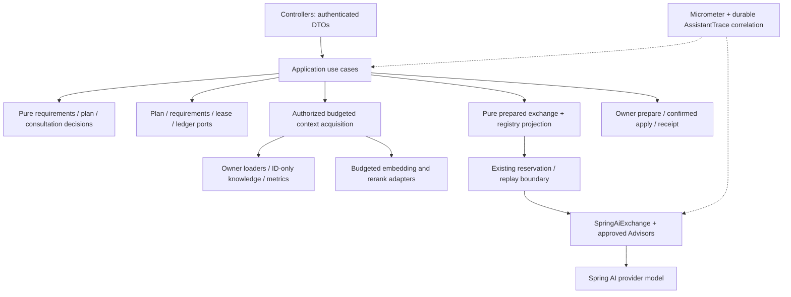

# AI runtime: Spring и Spring AI — контракт реализации

Статус: **целевая архитектура реализации**, 2026-11-03. Этот документ задаёт
framework bindings и работы для существующих A5/A6/G7/G8. Он не разрешает
запуск runtime, изменение dependencies или live/paid trials.
Продуктовые правила остаются в [orchestration](ai-assistant-orchestration.md),
[requirements/consultations/RAG](ai-assistant-collaboration-and-retrieval.md),
[VCL](configurable-operations-language.md) и [owner control](configurable-operations-control.md).
При конфликте framework convenience не отменяет их authorization/receipt invariants.

<a id="langgraph4j-assessment-and-migration-2026-11-11"></a>

## LangGraph4j: оценка и миграция — 2026-11-11

Пользователь выбрал **Java и проверку LangGraph4j**, приоритет — работающий
AI-агент перед дальнейшим широким развитием таблиц/temporal runtime.
[Актуальная очередь](../../openspec/changes/README.md#ai-first-execution-priority)
и [отдельный change](../../openspec/changes/adopt-langgraph4j-agent-orchestration/proposal.md)
задают compatibility spike, перенос graph execution и приёмку.
Core1.9.9 уже подключён для new-plan traversal, context continuation и
подтверждённого исполнения; [текущие границы](../current/architecture/spring-ai-assistant.md#langgraph4j-core-integration--2026-11-11)
и [ADR-015](../adr/ADR-015-library-backed-agent-graph.md) фиксируют реализацию.
Полные specialist semantics, in-place migration и quality gates остаются открыты.

LangGraph4j — самостоятельный Java-проект, вдохновлённый LangGraph, не официальный
Python/TypeScript runtime. Граф здесь — управление процессом агента; отдельная
графовая БД не требуется и не входит в запрос.

Целевое разделение: LangGraph4j core владеет nodes/edges/conditional traversal,
pause/resume и ограниченными subgraphs; Spring AI сохраняет model/provider
exchanges; VoltCanary сохраняет skills, domain validation, права, review/consent,
ledger, exact receipts и source-linked requirements. Сохранять самописный обход
внутри пустого library wrapper недостаточно. Новый scheduler консультаций
G7/100.2 и G7/102.2 должен использовать тот же graph runtime. Product/authorization
правила ASSISTANT-COLLAB/1 и SPR01–SPR15 продолжают действовать.

До runtime wiring проверить released artifact на Java21/Boot4/Spring AI2.0.2,
реальный dependency tree и deterministic provider fixtures. Stock agent/tool
executors не должны обходить single-exchange/reservation boundary. Не обновлять
и не понижать общий Spring baseline ради неявной совместимости. Прямой core
adapter предпочтителен, если integration module навязывает другой model loop.

Checkpoint adapter должен иметь один источник истины с существующим планом:
атомарная запись либо явно согласуемая projection с revision/lease fences.
Нельзя выдавать библиотечный PostgreSQL saver за готовую транзакционную
совместимость. Crash после отправки model request сохраняет UNCERTAIN; resume
не повторяет запрос автоматически. Старый checkpoint не переносит права и не
заменяет review/version/digest/confirmation. Engine/graph version фиксируются
на план; migration и rollback явные, без скрытого engine fallback.

Первый срез: существующее устройство -> уточнение -> dashboard review ->
подтверждение -> сохранение и точный readback -> same-ID edit -> restart/replay.
Далее — bounded specialists/requirements через те же graph/ledger owners.
Полный G0/G1/G3/G4, RAG и сложная model routing не блокируют этот срез; реально
отсутствующая capability требует точечного owner prerequisite. Общие quality
gates A5/A6 остаются открытыми; offline graph pass не доказывает качество модели.

Остальные разделы документа сохраняют действующие Spring/domain boundaries.
Предписания о самописном scheduler/traversal применяются только как описание
baseline либо требования к надёжности adapter, а не второй реализации graph
engine. Completed Spring AI migration повторно не открывается.

## 1. Зафиксированный baseline и реальные пробелы

Приоритет и целевой владелец graph traversal изменены дополнением
[LangGraph4j выше](#langgraph4j-assessment-and-migration-2026-11-11).
Таблица baseline описывает существующий код; «один runtime» больше не означает
сохранение самописного обхода графа после квалифицированного cutover.

Baseline рабочего дерева: Java21, Boot4.0.9, Spring AI2.0.2 из backend/pom.xml.
Использовать BOM и существующие provider adapters; upgrade — отдельная scope.
Spring Framework версию берём из Boot BOM, не из заголовка latest web reference.

| Существующий компонент | Переиспользование / необходимое изменение |
| --- | --- |
| PrimaryAssistant / PrimaryRuntime / IntentOrchestration | Сохранить contracts/state authority; квалифицированный LangGraph4j заменяет traversal, requirements/consultation semantics остаются focused use cases |
| SkillRegistry / ProtocolValidator / strict projections | Единый registry/contracts; не генерировать альтернативную business grammar из случайных Java DTO |
| RoutedModelCalls / BudgetedModelCalls / JdbcAttemptLedger | Единственный budget/replay owner; расширить учёт EMBED/RERANK, не переносить его в AOP |
| SpringAiExchange / SpringAiModels | Один SDK exchange; сохранить provider options/leases; внедрить registry, approved advisors и dispatch guard через factory |
| PrimaryModelTransport.serialize / WidgetCatalogueSearch | Убрать retrieval I/O из сериализации в budgeted acquisition stage |
| AssistantTraceRecorder / AssistantTrace | Сохранить durable starts/outcomes; добавить correlation bridge к Micrometer и явный async scope |
| ExistingOrchestrationReceipts / owner executors | Review/confirmation/CAS/reconciliation сохраняют authority; ToolCallback не исполняет effects |

Сейчас SpringAiExchange создаёт ChatClient через static create, а SpringAiModels
создаёт models вручную. Само наличие Boot ObservationRegistry не означает, что
эти экземпляры используют его: registry необходимо передать builders явно.
PrimaryRuntime/его helpers создаются частично через new; их внутренние вызовы
не перехватываются Spring AOP. Это допустимо для чистых state-machine kernels,
но недопустимо как предположение, что добавленная аннотация обеспечила guard.

## 2. Слои, packages и Spring beans



| Package/module | Ответственность / proposed types |
| --- | --- |
| orchestration/contract | Existing DTO/schema/registry; checked provider projections; no HTTP/JDBC |
| orchestration/plan, context, routing | Existing plan/dependency/input/cost decisions; no Spring AI imports |
| orchestration/requirements | RequirementSlots, RequirementDependencies, QuestionArbiter, RequirementCoverage; pure transitions |
| orchestration/consultation | ConsultationGraph, ConsultationLimits, CompletionAcceptance; pure lineage/rebase/cycle decisions |
| application use-case beans | RequirementsAnswers, ConsultationDispatch, ContextAcquisition, PreparedExchangeFactory, RuleProposalPreparation |
| port | RequirementStore, ConsultationWork, KnowledgeCandidates, EvidenceResolver, MetricQueries; existing BudgetedModelCalls.SingleExchange; new embedding/rerank boundaries |
| adapter/jdbc | Existing stores/ledger plus focused persistence/projection/lease adapters; one authoritative DB per owner |
| adapter/springai | Existing providers/exchange, provider wire projections and approved model-client factory |
| adapter/springai/advisor | PreparedManifestAdvisor, ReservedDispatchAdvisor; request-local state passed explicitly |
| adapter/knowledge, adapter/metrics | Versioned candidate search/hydration and exact owner API clients |
| config | Constructor wiring, validated properties, executor/pool, advisor allowlist; no user-facing policy service |

Названия новых классов — target responsibilities, а не требование создать отдельный
wrapper на каждый метод. Existing OrchestrationPorts/ContextSources продолжают
использоваться; новый port добавляется при новой boundary, не ради переименования.
common-vcl остаётся pure Java library; Spring AI DTOs не проходят в language/domain.

Stateless application/adapter beans — singleton с constructor injection. Execution
context — immutable value, не singleton mutable field/request-scope bean: он нужен
также background worker. Provider model/client — per-exchange Lease по текущей
реализации. Не кешировать ChatClient.Builder/model с mutable tenant options между
accounts. Повторное использование connections допустимо лишь после отдельного
qualified lifecycle/cache design с provider/secret revision boundaries.

PrimaryRuntime сохраняется composition facade. Извлекать focused collaborators
из него/PrimaryDomainPreparation при росте responsibilities, а не складывать ещё
requirements/RAG/scheduler в один bean с десятками dependencies.

## 3. Что берём готовым, где нужна своя логика

| Задача | Spring/Spring AI reuse | Специфика VoltCanary |
| --- | --- | --- |
| Provider transport/options/usage | ChatClient, ChatModel, provider model builders | Account-resolved model/secret, exact single exchange, qualified output mode |
| Model interception | CallAdvisor, Advisor ordering | Immutable prepared-manifest check + existing-reservation dispatch check |
| Tools/schema discovery | ToolCallback / ToolDefinition / ToolContext | Registry-selected proposal tool and registered loader descriptions; no generic bean discovery |
| Structured output | Qualified provider-native schema options; converter only after validation | Canonical schema, exact references/units/provenance, deterministic semantic compile |
| Chat history | Spring typed Message/UserMessage/AssistantMessage | Existing persisted bounded history projection; no second ChatMemory |
| RAG composition | EmbeddingModel, DocumentRetriever, DocumentPostProcessor | Prior budgets, ID-only private candidates, owner hydration and RetrievalManifest |
| Vector operations | PgVectorStore for qualified/public cases | Private ID-only hybrid repository where standard document-returning API is insufficient |
| HTTP/security | Existing verified identity and common-security boundaries; method security where already enabled | Per-resource scope and owner reauthorization; no permission in model context |
| Local transactions | TransactionTemplate / short @Transactional store methods | Plan/lease/inbox/outbox/CAS atomicity; never DB transaction around model/remote HTTP |
| Workers | ThreadPoolTaskExecutor, TaskScheduler, TaskDecorator | Durable lease/state/outbox claim, fencing, depth/global budget |
| Metrics/traces | ObservationRegistry, MeterRegistry, built-in AI observations | Existing durable trace events + redacted correlation; billing remains ledger-owned |
| Cache | CacheManager / explicit cache decorators | Scope/revision-aware keys and reauthorization before returning data |
| HTTP DTO shape | Jakarta Bean Validation / existing exception translation | JSON Schema closed unions + registry/VCL semantic validation |

RAG components могут использоваться как modules вне default ChatClient advisor
chain. Это reuse Spring AI, а не переписывание retrieval SDK. Новые intelligence/
domain decisions остаются тестируемыми use cases, не SpEL expressions в аспектах.

## 4. Один model exchange: точный порядок

1. Authenticated submit/resume выбирает существующий plan/turn/pinned policy.
2. Short transaction принимает requestId/CAS и фиксирует state/required trace start.
3. ContextAcquisition разрешает exact history/metadata/metric/evidence dependencies.
   Для каждого внешнего EMBED/RERANK/rewrite call отдельно резервирует ledger.
4. Чистый PreparedExchangeFactory строит финальные messages, selected tool/schema,
   provider options/output bounds, dependency manifest и prompt projection version.
5. Routing проверяет available qualified model/window/price; estimate включает
   фактические messages, schema/tools и conservative SDK framing. После reservation
   messages/tools/options не расширяются advisor-ом или memory/RAG module.
6. Existing ledger reserve возвращает completed replay либо STARTED reservation.
   Replay возвращается до SDK/client creation после authorization/contract checks.
7. Dispatcher short transaction привязывает dispatch claim к exact attempt/request
   fingerprint, checks cancellation/deadline/lease. Только победитель получает
   локальный single-use DispatchPermit. Не создавать второй billing ledger.
8. SpringAiExchange получает PreparedExchange + DispatchPermit, открывает Lease и
   ChatClient через wired factory с ObservationRegistry и approved advisor chain.
9. PreparedManifestAdvisor проверяет effective messages/tools/options fingerprint.
   ReservedDispatchAdvisor проверяет/consumes permit и границы deadline/scope.
10. Model provider делает ровно один exchange; SDK/HTTP auto retry=0, auto tool loop
    off. Timeout≤min(provider config, remaining turn/plan deadline).
11. Adapter сохраняет observed usage/failure даже для refusal/truncation/invalid
    tool/JSON. Response decode не превращает их в PREPARED.
12. Existing ProtocolValidator parse → normalize exact technical refs → grammar →
    skill/parameter provenance → VCL/domain compiler → owner prepare/readiness.
13. Short CAS принимает актуальный result/rebase или отмечает stale/cancelled.
    Ledger outcome и durable trace отражают фактическую попытку; late result не
    меняет новое accepted state. Repair создаёт новый attempt через тот же flow.
14. Только отдельное authorized versioned confirmation ведёт к owner apply;
    после этого receipt/read-back и RequirementCoverage проверяют actual effects.

Dispatch claim — additive fields существующей attempt persistence или linked
attempt-owned row, не новая таблица budgets/receipts. Current ledger statuses
STARTED/SUCCEEDED/FAILED/UNCERTAIN не переименовываются в consultant task statuses.
STARTED уже означает prior reservation; нужна ещё CAS-защита send ownership.
Crash после send claim и до неизвестного remote outcome не разрешает автоматически
послать тот же callId снова. Сохраняется UNCERTAIN; read/reconcile или отдельный
разрешённый новый attempt расходует новый budget. Provider exactly-once inference
не обещается. Owner mutation exactly-once/CAS/receipt имеет собственный контракт.

PreparedExchange digest — canonical application wire, а не hash Java object.toString
или secret-bearing HTTP headers. Effective prompt fingerprint включает roles/text,
registry tool names/input schemas, model/config/policy/projection IDs и relevant
options; SDK framing учитывается отдельно. Header credentials исключены. Golden
provider HTTP fixtures проверяют соответствие подготовленной форме, включая
default options SDK. JSON-to-typed-message projection не теряет pending question.

Target application/adapter signatures для нового boundary (не новые public APIs):

| Method | Typed contract |
| --- | --- |
| PreparedExchangeFactory.prepare | ValidatedStep + ResolvedContext + QualifiedModel → PreparedExchange; pure, без loader/provider I/O |
| DispatchClaims.claim | Existing Turn + Attempt + preparedDigest + expectedLeaseEpoch → Claimed(DispatchPermit) либо Replay(existing receipt)/Denied(code) |
| SpringAiExchange.call | PreparedExchange + DispatchPermit + remaining deadline → existing Result(text, usage, failure); адаптируется под existing SingleExchange |
| ContextAcquisition.resolve | Authorized ExecutionContext + declared context requests → ResolvedContext + read/retrieval manifests; внешние вызовы только через reserved adapters |
| CompletionAcceptance.accept | Existing assignment + result + current dependency/access versions → ACCEPTED/REBASE_ACCEPTED/STALE/CANCELLED с CAS |

PreparedExchange хранит requestDigest, effectivePromptFingerprint, immutable
wire messages/tool schemas/options, model/policy/skill/projection IDs, input
manifest ref, output limits и approved advisorProfileVersion. Не хранит credentials,
mutable Spring ChatOptions/ToolCallback или live repository objects в persisted
manifest. SDK Messages/options строит adapter из defensive copies wire values;
guard fingerprint проверяет отсутствие изменения. DispatchPermit — внутренний
server-created single-use объект, не строка bearer token и не provider tool field.
Ошибки guards: PREPARED_EXCHANGE_CHANGED, DISPATCH_PERMIT_REQUIRED,
DISPATCH_PERMIT_CONSUMED, DISPATCH_EXPIRED, DISPATCH_CANCELLED; все до SDK send.
Request/manifest/advisor semantic profile revisions входят в новый policy/exchange
snapshot при изменении поведения. Старые pinned policy digests и successful
canonical replay blobs не переписываются ради нового bean wiring.

## 5. Spring AI Advisors: наши два, готовые — по назначению

CallAdvisor chain для non-streaming proposal profile:

| Order | Advisor | До nextCall | После ответа |
| --- | --- | --- | --- |
| 0 | PreparedManifestAdvisor (custom) | Check immutable request/schema/options/context fingerprint, selected tool allowlist | Не меняет ответ; семантический compiler остаётся снаружи |
| 100 | ReservedDispatchAdvisor (custom) | Check valid local DispatchPermit/attempt/epoch/deadline; consume exactly once | Не повторяет вызов, не завершает billing/owner receipt |
| terminal | Spring AI model-call terminal | Один вызов ChatModel | Typed ChatResponse/usage |

Order проверяется по реально построенной chain; ниже order — раньше request/
позже response. Оба custom advisors вызывают nextCall ровно один раз и не используют
chain.copy/retry. Это adapter guards, не бизнес-оркестратор. Missing manifest/
permit, modified request или повтор permit — zero provider calls.

Advisor context содержит только server-assigned opaque references/immutable
DispatchPermit object и diagnostics IDs; не raw JWT/secret/context dump. Это
внутренний side channel Java runtime, не model messages. Authority всё равно
проверяет application/owner; присланный моделью permit UUID ничего не разрешает.
Advisors singleton/stateless; request state в immutable context. Scope переоценка
в guard не означает атомарный revoke/provider-send commit; boundary semantics
остаются определёнными в collaboration contract.

| Готовый механизм | Решение для текущего proposal profile |
| --- | --- |
| ToolCallingAdvisor | Auto-registration=false; orchestration уже владеет продолжением/бюджетом. Не наследовать tool loop ради скрытого scheduler |
| StructuredOutputValidationAdvisor / entity(..., spec -> spec.validateSchema()) | Не подключать автоматический retry loop; grammar validation без повторного I/O выполняет existing validator, correction — новый durable attempt |
| BeanOutputConverter / entity mapping | Допустим для mapping уже validated compatible DTO; не заменяет canonical registry/schema и не должен включать validateSchema |
| MessageChatMemoryAdvisor / VectorStoreChatMemoryAdvisor | Не подключать второй state store; использовать typed messages из существующей persisted projection |
| RetrievalAugmentationAdvisor / QuestionAnswerAdvisor | Не default на mutation proposal path; retrieval уже подготовлен и оплачен. Public read-only Q&A profile — отдельная opt-in qualification, те же budgets/ACL |
| SimpleLoggerAdvisor | Не включать raw prompts/completions/tools; reuse redacted existing traces/observations |
| SafeGuardAdvisor / generic LLM moderation | Может быть дополнительной qualified policy, но не source/resource authorization, business validation или mutation consent |

Для этой версии сигнатуры CallAdvisor.adviseCall, CallAdvisorChain.nextCall,
ChatClientRequest.context и builders сверены через javap с локальными2.0.2 jars.
При upgrade сверять pinned API, не переносить примеры из2.1-SNAPSHOT как готовые.

## 6. Spring AOP: один технический аспект и явные decorators

Наш необходимый AOP extension — **AssistantBoundaryObservationAspect** для
`@AssistantBoundary(operation=...)` на public application use-case beans.
Он создаёт/закрывает Micrometer observation, добавляет allowlisted correlation
к existing trace session, классифицирует exception и вызывает proceed **один раз**.
Если explicit boundary wrapper уже открыл тот же scope, аспект присоединяется,
а не создаёт второй turn/model event. Аннотация задаёт constant operation enum,
не произвольный tag/SpEL serialization аргументов.

Aspect не резервирует money, не открывает user consent, не строит prompt,
не выполняет retry, не ловит ошибку для возврата fabricated success и не владеет
transaction across I/O. Durable required starts/receipts сохраняет explicit
application flow/AssistantTraceRecorder. Optional observation export failure
не переисполняет effect; невозможность обязательного durable start блокирует
side effect до dispatch по существующей политике.

Target annotation: `@Target(METHOD) @Retention(RUNTIME)` с единственным
`AssistantOperation operation()` enum; aspect pointcut — `@annotation(boundary)`.
Аспектный bean получает ObservationRegistry и существующий correlation bridge
через constructor, не lookup в static ApplicationContext. `@Around` оборачивает
public synchronous entry method и в finally закрывает scope; exceptions
propagate unchanged. Не ставить одновременно @Observed и этот аспект на тот же
operation boundary: будет двойная instrumentation. Spring AI model/http spans
остаются отдельными child spans, не ещё одним application boundary.
Explicit authorization и transaction methods не зависят от порядка этого аспекта.

| Boundary | Готовый механизм / выбранное решение |
| --- | --- |
| Trace timing/correlation | Custom boundary aspect + Boot/Micrometer observations; не создавать собственный tracing backend |
| Resource permissions | Existing auth adapters + explicit AuthorizedPlanningContext/owner guards; method security только дополнительный facade gate |
| Local DB mutation | TransactionTemplate или отдельный public @Transactional store bean |
| Budgeted model/embed/rerank call | Explicit Budgeted...Exchange decorator/ledger; не @Budgeted на произвольных методах |
| Idempotent apply/replay | Explicit owner receipts and ledger; не универсальный @Idempotent cache |
| Schema/units/provenance validation | Pure compiler/registry methods; не aspect на setters/DTOs |
| Scope-aware cache | Explicit authorize→cache lookup→reauthorize/hydrate decorator; generic @Cacheable не заменяет scope checks |

Spring proxy constraints являются обязательной частью реализации: self-invocation
не пересекает proxy; final class/method нельзя советовать через CGLIB; объект,
созданный new, не становится advised bean. Поэтому существующие final pure
PrimaryRuntime kernels сохраняют явные guards, а observation boundary вводится
на отдельном non-final application facade. Не использовать self-injected proxy,
AopContext.currentProxy или AspectJ weaving как обход архитектуры. @Transactional
не ставить на private helper и не полагаться на вызов this.transactionalMethod().

Новая annotation/aspect допустима только с owner, bounded concern, failure policy,
ordering и real Spring-context test. Не создавать ряд @AiSecure/@AiRetry/@AiBudget/
@AiConfirm, которые дублируют существующие explicit boundaries и скрывают порядок.

## 7. Конфигурация, providers и ObservationRegistry

Composition root разделяется на focused @Configuration(proxyBeanMethods=false):
existing persistence; assistant application/registry; Spring AI exchange factory;
consultation worker executor; optional knowledge adapter. @ConfigurationProperties
+ Bean Validation проверяют profile/deadline/pool/index bounds. Immutable user
routing policy snapshot остаётся domain data, не mutable Spring config bean.

Bootstrap проверяет unique skill/advisor/loader IDs и versions, необходимый порядок,
отсутствие unapproved recursive/logging advisors, наличие implementations всех
ports включённого profile и согласованность declared capabilities. Disabled
generation не отключает read/cancel/receipts. Недоступный model/embedding endpoint
показывается health/degraded, а не приводит к hidden fallback legacy engine.

Новые validated implementation properties (не замена user routing policy):

| Key / default | Constraint |
| --- | --- |
| app.ai.consultations.enabled=false | Включение только после feature/qualification gates |
| app.ai.consultations.executor.core-size=2, max-size=4 | 1≤core≤max≤account/global cap; max не обходит2 children/plan |
| app.ai.consultations.executor.queue-capacity=32 | 1..256; rejection возвращает работу в durable queue без provider dispatch |
| app.ai.consultations.scan-interval=1s, claim-batch-size=16 | Interval100ms..30s, batch1..64; claim не превышает свободную capacity |
| app.ai.consultations.lease-ttl=30s, heartbeat-interval=10s | TTL10..120s, heartbeat≤TTL/3; lease renewal не продлевает plan deadline |
| app.ai.knowledge.enabled=false | Без него нет обязательного vector DB/model dependency на ordinary paths |
| app.ai.observation.boundary-enabled=true | Отключение optional instrumentation не снимает required durable trace/ledger checks |

Все duration parse как Duration, sizes как bounded int. Worker shutdown прекращает
claim, дожидается до configured deadline и освобождает/истекает lease; не помечает
ещё running provider call как безопасный к replay. Network timeout всегда bounded
remaining policy time. Lease TTL и HTTP timeout — разные часы; heartbeat поддерживает
lease через отдельный короткий update, не удерживая model worker DB transaction.

Spring AI2.0.2 wiring shape (target snippet; proposed collaborators ещё не реализованы):

```java
var client = ChatClient.builder(
        lease.model(), observationRegistry,
        new DefaultChatClientObservationConvention(),
        new DefaultAdvisorObservationConvention())
    .defaultAdvisors(preparedManifestAdvisor, reservedDispatchAdvisor)
    .build();

var request = client.prompt()
    .messages(prepared.messages())
    .advisors(AdvisorParams.toolCallingAdvisorAutoRegister(false))
    .advisors(spec -> spec.param("voltcanary.dispatchPermit", permit)
        .param("voltcanary.preparedManifest", prepared.manifest()));
// Only the registry-selected proposal ToolCallback is added for NATIVE_TOOLS.
var response = request.call().chatResponse();
```

Default conventions находятся в org.springframework.ai.chat.client.observation
и org.springframework.ai.chat.client.advisor.observation. У2.0.2 builder overload
с registry принимает обе conventions; не путать с другой версией API.
observationRegistry передаётся также в manually constructed provider model builders,
EmbeddingModel и qualified VectorStore builders; при наличии соответствующего API
MeterRegistry тоже. Boot-managed registry/customizers не применяются автоматически
к любому new Model(). Factory получает их через DI; её tests проверяют реальные
provider requests и observations для каждого supported provider.

Зависимости implementation stage, не изменения этого документа:
- Сохранить spring-ai-client-chat и existing provider modules2.0.2 из BOM.
- Для нового аспектного boundary — Boot4 spring-boot-starter-aspectj (не старое
  автоматически скопированное starter-aop имя) и нужные test modules.
- Для optional knowledge adapter — spring-ai-rag и qualified pgvector module;
  не включать full provider auto-config starter ради второго глобального ChatModel.
- Context propagation — Boot/Micrometer managed dependency только при необходимости;
  не задавать новую несогласованную версию вручную.
Минимальный dependency diff/conditional bean wiring должен иметь tests с knowledge
и generation disabled. AOP не требует weaving agent в deployment.

## 8. ToolCallback, output mode и специфические skills

Registry генерирует ToolDefinition/input schema для текущего skill и реально
разрешённых operations. Existing ReviewedProposalTool остаётся inert proposal
callback: SDK получает schema, но callback не вызывает compiler/HTTP/owner apply.
Прямая попытка invocation отклоняется; ровно один selected tool response проходит
canonical parsing. Bean names/classpath scanning не становятся tool allowlist.

Domain skill использует общие factory/guards/advisors, но имеет собственные
instructions, parameterRules, exact loader IDs, output schema, capability requirements,
model profile и postconditions. Device/dashboard/rule/schema/research не клонируют
ChatClient pipeline. На scenario HSL/overtime нет отдельных provider wrappers.
Role profile выбирает пакеты registry, не произвольный tool из prompt.

ToolContext имеет тип org.springframework.ai.chat.model.ToolContext: это внутренние
server values, не authority из model arguments. Сейчас external tool loop off;
если позднее read-only tool-execution profile будет явно введён, каждый dispatch
проходит registered loader access/snapshot/limits и durable budget checkpoints.
Это отдельная qualification, а не снятие запрета ради @Tool annotation.

Provider-native JSON constraints помогают форме, но unit/ref/cardinality/field
policy и requirement coverage проверяет existing application/compiler. Jackson2
canonical persistence в проекте сохраняется. Spring AI internal JsonMapper/
DTO converters подключаются через узкий wire adapter; не менять глобальный mapper
и сохранённый digest ради удобства .entity(). Несовместимый schema subset — typed
unsupported mode, без silent downgrade. Model reasoning content не является command.

## 9. RAG и embedding как budgeted application flow

ContextAcquisition сначала выполняет exact loaders и определяет retrieval purpose.
KnowledgeCandidates.searchIds использует authorized metadata/RLS SQL и snapshot
head; EvidenceResolver перед private text checks owner. Затем bounded hydration,
optional rerank и RetrievalManifest. EmbeddingModel/DocumentRetriever/
DocumentPostProcessor переиспользуются внутри adapters, а не скрытых default advisors.
Query rewrite/translation/HyDE и contextual enrichment выключены до qualification.

EmbeddingExchange/RerankExchange decorators используют общий AttemptLedger с
versioned call-kind extension: reserve→single external call→observed usage/
unknown→finish. Index build — отдельный job budget, не бесплатный side effect
ChatClient сериализации. Cache hit тоже проверяет scope/revisions и фиксируется
как cache hit, не притворяется provider call. Corpus/model/chunker generations
согласуются с existing collaboration contract; provider fallback не смешивает
embedding spaces. Не реализовывать RAG ещё одним ML prediction endpoint.

## 10. Transact, event, schedule, async

После LangGraph4j cutover этот раздел задаёт infrastructure dispatch/recovery,
а не отдельный graph scheduler. Spring executor/scanner будит/ограничивает
единственный library runtime; порядок nodes/edges/subgraphs принадлежит ему.
Checkpoint/plan consistency должна пройти gate нового change до wiring.

Short local transactions: request/inbox/state CAS; ledger reservation; dispatch
claim/lease; accepted result + outbox; owner-local effect + receipt. Model/owner
HTTP и waiting user не держат JDBC transaction/lock/connection. TransactionTemplate
предпочтителен для чередования DB/I/O; отдельные public @Transactional store методы
допустимы. Вложенная transaction не означает distributed commit.

ApplicationEventPublisher/@TransactionalEventListener(AFTER_COMMIT) используются
для local wakeup/наблюдения. Они не durable queue: crash после commit до listener
не должен терять работу. Authoritative work/outbox записывается с state, scanner
через TaskScheduler восстанавливает очередь. Listener может ускорить wakeup;
poller/lease остаётся источником восстановления. Event handlers не вызывают новый
LLM без reservation и не читают raw provider response из event payload.

ThreadPoolTaskExecutor с bounded queue/concurrency, admission refusal и named
thread pool. TaskScheduler лишь ищет due tasks, не исполняет long model call под
scheduler lock. PostgreSQL lease/claim/fencing гарантирует одного актуального
worker; @Async, @Scheduled, virtual threads сами этого не обеспечивают.
Для read-only DB retries допустим bounded технический policy; provider/owner mutation
retry не накрывать @Retryable/Resilience retry вместе с целым use case.

Task envelope содержит plan/task/attempt IDs, scope refs, requirements/dependency
digest, continuation/cancel epoch и originating budget turn. Worker получает
свежую owner authorization; raw JWT не хранится в DB/очереди. Нет отдельного service
superuser для удобства фонового агента. Превышение роли/TTL даёт WAITING_USER/
ACCESS_REVOKED/EXPIRED по existing contract.

Default authorization mode — **current authenticated turn**, его credentials могут
жить только в ограниченном in-memory request/worker scope до срока session. На crash
они не восстанавливаются из trace/DB. Scheduler может восстановить metadata/lease,
но external read/context export/inference продолжит лишь с актуальным authorization:
если его нет, task ждёт новый user-authenticated resume с safe diagnostic
AUTHORIZATION_REQUIRED. Reuse idempotent receipts не требует новой inference.
Автономное продолжение после session expiry требует отдельного identity-owned
delegation-token/grant контракта с audience/scope/TTL/revoke; он не подразумевается
наличием TaskExecutor и не реализуется AI-generated JWT или service superuser.
При необходимости такого режима его security dependency явно добавляется в G7
до включения background capability; default не заявляет эту capability.

Observation/MDC propagation использовать через TaskDecorator/ContextSnapshot,
а existing AssistantTrace ThreadLocal scope явно open/close в worker с durable
Correlation. ThreadLocal Session между потоками не копируется и не шарится.
ContextPropagatingTaskDecorator переносит только зарегистрированные context
accessors; автоматического переноса нашего произвольного ThreadLocal нет.
SecurityContext/MDC cleanup проверяется при reuse threads и exceptions.

HTTP progress — MVC SSE/SseEmitter поверх persisted task events с cursor/sequence;
reconnect не запускает модель заново. Provider token streaming не включён в
proposal profile: partial tool/JSON нельзя исполнять, partial response не review.
Если появится stream profile, требуется отдельно StreamAdvisor/cancellation/
usage accounting qualification; CallAdvisor контракт его не покрывает.

## 11. Observability и failure policy

Один Micrometer ObservationRegistry обслуживает built-in Spring AI model/client/
advisor/embedding observations и custom application boundaries. Existing durable
AssistantTraceRecorder остаётся отдельным audit port, не заменяется ephemeral
telemetry. Correlation IDs связывают их; одна physical model invocation не считается
несколькими billing calls из-за вложенных client/model/http spans.

Low-cardinality tags: operation, bounded skill/phase, provider kind, output mode,
outcome/diagnostic category. Не tenant/user/plan/prompt/endpoint в metric labels.
Trace допускает authorized IDs по existing redaction, без headers/keys, raw SQL,
prompt/completion, model private reasoning. log-prompt/log-completion отключены;
не добавлять универсальный аспект сериализации всех аргументов/return values.
Observation export error не должен повторять inference или owner effect.

| Failure | Runtime reaction |
| --- | --- |
| Missing reservation/manifest or changed wire | Reject before provider I/O |
| Provider timeout/transport after possible dispatch | Preserve UNCERTAIN/unknown usage; no same-attempt resend |
| Refusal/truncation/multiple/unselected tool | Record usage + typed failure; no PREPARED |
| Invalid schema/meaning | Independent failed candidate; optional new reserved correction attempt |
| Observation exporter unavailable | Bounded diagnostics, no effect retry; required durable audit policy remains |
| Parent stale/cancelled before completion | Save obsolete outcome/usage; do not overwrite accepted state |
| Owner commit followed by response loss | Reconcile exact owner receipt; no regenerate/create duplicate |

## 12. Работы, порядок и критерии готовности

| Slice | Конкретный результат | Владельцы OpenSpec |
| --- | --- | --- |
| S0 Baseline | Dependency/API inventory; one exchange/receipt tests retained; explicit clock/registry injection | A5 |
| S1 Exchange boundary | Pure preparation, shared ledger extensions, send claim, factory + two advisors, replay before SDK | A5/G7 |
| S2 Cross-cutting reuse | Boundary observation aspect, injected model/client registries, proxy/async tests, no double counting | A5 |
| S3 Requirements and consultations | Existing pure kernels + application beans, exact questions, lease scheduler, scoped nested reads | G7 |
| S4 Knowledge | Optional modules and pools, budgeted embeddings, private ID-only retrieval, versioned evidence | G7 |
| S5 Domain vertical slices | Devices/dashboard/VCL/rules reuse same pipeline; reviewed effects/coverage/read-back | A5/G7/G8 |
| S6 Qualification | Below framework tests + AI01–AI24/A01–A66 and frozen quality/cost/provider gates | A6/G8 |

Framework checks (independent expected boundary behavior, not tests of annotation presence):

| ID | Обязательное доказательство |
| --- | --- |
| SPR01 | Actual Spring bean advisor chain executes manifest→permit→one provider; changed/missing manifest makes0 calls |
| SPR02 | Concurrent same attempt produces at most one local send claim; completed replay opens0 SDK clients |
| SPR03 | Invalid output produces0 automatic SDK/validation advisor retries; configured explicit repair adds exactly one reserved attempt |
| SPR04 | Tool callback direct invocation blocked; multiple/wrong tool rejected; no model-selected mutation execution |
| SPR05 | Boot registry receives client/model spans from manually built providers; no raw payload metric/trace capture |
| SPR06 | Real Spring proxy boundary aspect runs once; self-invocation/new/final cannot be relied on for guards |
| SPR07 | Transaction commits and JDBC locks end before slow provider/owner HTTP; crash windows reconcile safely |
| SPR08 | AFTER_COMMIT wakeup loss recovered by durable work scan; duplicate task delivery fenced |
| SPR09 | Worker ThreadLocal/MDC/correlation clean across tenants/exceptions; expired permission prevents resumed dispatch |
| SPR10 | NATIVE_TOOLS/STRICT_JSON/JSON_TEXT canonical parity, provider wire options, exact usage and malformed/refused/truncated output |
| SPR11 | Conditional knowledge/generation disabled leaves reads/cancel/receipts working; no accidental second model/memory store |
| SPR12 | Private retrieval hydrates text only after authorization; each EMBED/RERANK invocation has a prior shared reservation |
| SPR13 | Scope-aware cache cannot bypass revoke/version checks; cached response does not duplicate provider usage |
| SPR14 | SSE reconnect reads events without new inference; partial token stream cannot become executable review |
| SPR15 | Mandatory trace-start failure blocks effect; exporter/outcome-capture failure cannot replay committed owner mutation |

Narrow validation: backend ai-agent-service + dependent common tests; provider HTTP
fixtures; real ApplicationContext AOP/wiring tests; PostgreSQL16 Testcontainers for
claim/lease/outbox concurrency. H2 unit tests не доказывают PostgreSQL lock behavior.
Не запускать real provider calls для проверки framework wiring. Docker/browser
cross-domain acceptance и explicitly authorized capped model trials остаются
дальнейшими gates. Ни один implementation task не закрывается по этому документу.

## 13. Первичные источники и пределы reuse

Проверено по Spring AI2.0.2 reference и локальным jars; Spring Framework reference
может показывать более свежую patch version, чем Boot BOM.

- [Advisors API](https://docs.spring.io/spring-ai/reference/api/advisors.html): API/order; наши guards и ordering policy — VoltCanary decisions.
- [ToolCallingAdvisor](https://docs.spring.io/spring-ai/reference/api/tools/tool-calling-advisor.html): auto tool loop; profile намеренно opt-out.
- [Structured output validation](https://docs.spring.io/spring-ai/reference/api/structured-output/validation.html): automatic validation/retry; existing ledger owns retries here.
- [AI observations](https://docs.spring.io/spring-ai/reference/observability/index.html): client/model/embedding instrumentation; billing не выводится из spans.
- [Spring AOP proxying](https://docs.spring.io/spring-framework/reference/core/aop/proxying.html): proxy/self-invocation/final limitations.
- [Programmatic transactions](https://docs.spring.io/spring-framework/reference/data-access/transaction/programmatic.html) и [transaction-bound events](https://docs.spring.io/spring-framework/reference/data-access/transaction/event.html): short local transactions, after-commit hooks; durable recovery задаёт наш outbox.
- [Task execution](https://docs.spring.io/spring-framework/reference/integration/scheduling.html): executor/scheduler/decorator; task durability не даётся аннотацией.
- [Boot4 build systems](https://docs.spring.io/spring-boot/4.0/reference/using/build-systems.html): dependency coordinates/BOM.
