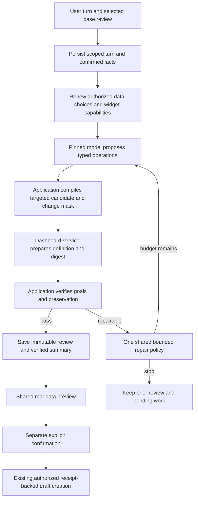

# Reliable conversational dashboard editing

Planning amendment,2026-10-26: [assistant orchestration](ai-assistant-orchestration.md)
now owns intent interpretation, progressive server skills, provider-neutral model
routing and a shared attempt/cost budget. Existing typed dashboard operations,
outcome/visual checks, immutable reviews and release gates remain required. Follow
the [new program](../../openspec/changes/README.md#ai-assistant-orchestration-program)
instead of treating the old C3/stages5-6 sequence as an implementation prerequisite.
No implementation or live model trial is authorized by this planning amendment.

Status: target architecture, proposed on2026-10-23. Stage1's evaluation harness
and failed-quality baseline are implemented; durable task state is implemented,
capability resolution is implemented and archived. Stage4's semantic compiler is implemented and archived opt-in; stages5-6 remain proposed and default enable remains blocked by failed model quality. Current behavior is documented
in [AI API](../current/api/ai-agent-api.md),
[dashboard API](../current/api/dashboard-api.md),
[reviewed tasks](../current/operations/ai-reviewed-tasks.md) and
[verification evidence](../current/flows/ai-creation-verification.md).

Stage4 corrective follow-up is implemented and archived. It covers unchanged-review retention, same-turn titles,
cross-device replacement scope, view-aware history reuse and bounded schema in
[operation contract corrections](../../openspec/changes/archive/2026-10-24-fix-ai-dashboard-operation-contract/proposal.md).
It does not implement the stage5 outcome verifier or stage6 repair policy.

## Problem and product outcome
An operator creates a dashboard, names it, rearranges cards, requests a different
history view, reduces sizes and removes labels. Later turns must fulfill those
requests while retaining unrelated data and layout choices. Errors must preserve
the original task and previous good review, and Back/Forward must restore exact
stored versions. The operator should not need to understand widget schemas.

This target addresses the actual bus/tram conversations reported by the user.
It does not promise perfect natural-language interpretation or treat one successful
model response with many assertions as repeatability evidence.

## Current architecture and gaps
| Concern | Exists in code | Remaining work |
| --- | --- | --- |
| Identity and mutation boundary | Verified JWT, actual account scope, immutable PlanStore reviews, confirmation/digests, ordinary creation receipts | Retain these guarantees through new planning paths |
| Task memory | TaskConversationMemory, context_json continuation, explicit-name helper, pending-change map | Durable accepted turns before remote calls, typed facts/pending ledger, revision/branch concurrency |
| Data/widget catalogue | WidgetCapabilities, manifests, typed settings and compatible views shared with the editor | Resolve exact authorized source data against these capabilities instead of model guessing |
| Refinement | Opt-in typed semantic compiler, scoped reuse, stable keys, server-derived masks and expected outcomes; existing preparation and legacy path retained | Verify actual user-goal outcomes and collateral preservation before default enable |
| History | Authorized stored ancestry and exact review restore; frontend history navigation | Reliable branch/reload continuity tied to task state |
| Repair | Draft repair in ActionPlanner and preparation retries in CreationTaskPlanning | One total call budget, typed diagnostics, explicit failure versus clarification |
| Validation | Ordinary preparation checks definitions/bindings/layout and generates digest | Outcome/preservation checks against user goals and actual base before READY |
| Testing | Java/frontend tests, template evaluation scripts and several successful live refinements | Versioned multi-turn outcome corpus, repeated trials, held-out cases and full dialogue release gate |

The current settings acceptance records380 frontend and178 AI/dashboard Java tests,
10 live API cases and one real-model settings refinement with21 assertions. Those
checks establish their tested behavior, not whole-conversation reliability.

## Target boundaries
| Owner | Responsibility | Must not own |
| --- | --- | --- |
| ai-agent-service domain | Typed task facts/goals, semantic operations, reuse/partial edit rules, change masks and outcome checks | HTTP, JDBC, provider SDKs or dashboard query implementation |
| ai-agent-service application | Accept turns, renew scoped choices, invoke pinned provider, coordinate compile/prepare/verify/repair, save reviews | A second widget compatibility matrix or direct dashboard table writes |
| ai-agent-service adapters | Existing provider adapters, ordinary authorized service HTTP, JDBC task/plan persistence, safe audit | Hidden identity overrides, raw provider errors in user-visible state |
| dashboard-service | Widget descriptors, data compatibility, authoritative definition/binding/layout validation, query rendering contracts, preparation/digest and private creation | Model prompts, chat history or conversation state |
| device/telemetry services | Actual device/source/field/metric identity, sample availability and evidence | AI-invented capabilities or interpretation of conversational layout |
| frontend | Existing assistant, shared canvas/widget rendering, explicit source choices, history/confirmation/retry UI | Authoritative task facts, alternative generated definitions or fake measurements |
| evaluation tooling | Frozen realistic corpus, independent expected outcomes, repeated quality and visual evidence | Production bypass endpoints or changing expected answers to hide regressions |

Use Spring Boot/Java21, existing service HTTP, PostgreSQL/JDBC/Flyway and React19
seams. Add focused domain/application/adapter classes with explicit ports instead
of extending the largest planner. No mandatory new framework, vector database,
generic agent platform, microservice, Kafka topic or multi-agent network is needed.
Consider infrastructure additions only after evidence identifies a specific gap.

## Target turn lifecycle

Genuine ambiguity can exit to one structured user question at resolution or
interpretation. Provider/access/dependency failure exits to a typed failure, not
a request for widget schemas. Missing samples remain a legitimate no-data preview.
No planning, preparation, repair or history operation invokes domain mutation.

## Contracts and invariants
1. Task state and immutable executable reviews are separate. Confirmed facts and
   failed turns persist even without a READY candidate. Raw input is retained
   within existing bounds; provider secrets/JWTs never enter task data.
2. The selected base is explicit and authorized. Editing after undo starts a
   branch from that exact definition, not from the latest failed candidate.
3. Models receive bounded current facts, view/selection, actual choices and pending
   work. They propose typed actions; application code owns known arguments, stable
   keys and concrete data bindings. No raw model query/definition/coordinates.
4. One descriptor remains the settings/view source of truth. Resolution combines
   it with actual data identity, type, units, semantic prerequisites and authority.
   Availability and compatibility are different facts. Do not invent metric aliases.
5. Commands modify only their declared scope. Presentation-only changes preserve
   geometry; moving cards permits necessary downstream row reflow but preserves
   untargeted identity, data, settings and relative order at every breakpoint.
6. Compiler-owned masks and independent outcome checks reject collateral edits and
   known unsatisfied goals before READY. A model-generated success sentence is not
   evidence. Natural-language goal extraction still requires independent evaluations.
7. Explicit null/default resets preserve the implemented descriptor semantics.
   Percentage shrinking respects grid quantization and minima, reported honestly.
8. One coordinator owns all dashboard model calls: initial call plus up to two
   additional calls by default. Do not multiply budgets through nested helpers,
   switch models silently or launch a second call because the first is slow.
9. Existing confirmation, version/digest, expiry, current authorization and domain
   receipts remain authoritative. UNKNOWN mutation reconciliation is separate from
   planning retry. No automatic publication, deletion or source creation.
10. Additive protocol readers precede new writers/default prompts. Legacy stored
    reviews execute exactly as reviewed. Rollback disables generation, retaining
    readers, audit, state and receipt compatibility.

## Proposed API/persistence surface
Exact schemas belong to the owning change designs until implementation updates
current API docs. These are proposed contracts, not working routes:
- Add task/branch/turn persistence after ai-agent-service V002, separate from
  ai_reviewed_plans/action execution status. Use revision checks, request identity,
  atomic state writes and no open DB transaction across provider calls.
- Extend planning/clarification requests with optional request/revision/base metadata
  and responses with safe task summary/outcome sidecars. Legacy clients keep their
  immutable-parent path, without retry deduplication promises they cannot support.
- Add owner-scoped GET `/ai-agent/dashboard-tasks/{taskId}` for failures before the
  first review; read-only recovery never runs a model or exposes context_json.
- Add authenticated read-only POST `/dashboards/composition/capabilities` to resolve
  selected devices against real field/metric metadata and widget constraints.
- Keep ordinary `/dashboards/composition/prepare`, GET plan recovery and confirmed
  `/execute`/private draft APIs as the authoritative preparation/execution path.

## Delivery and requirement coverage
The [program index](../../openspec/changes/README.md#ai-dashboard-reliability-program)
owns order, dependencies and statuses. Implementation details/tasks belong to:

| Stage | Change | User problem addressed |
| --- | --- | --- |
| 1 | [Conversation evals](../../openspec/changes/archive/2026-10-23-establish-ai-dashboard-conversation-evals/proposal.md) | Measure the actual multi-turn failures before changing behavior |
| 2 | [Durable task state](../../openspec/changes/archive/2026-10-24-persist-ai-dashboard-task-state/proposal.md) | Stop losing names, selections and unfinished requests |
| 3 | [Capability resolution](../../openspec/changes/archive/2026-10-24-resolve-ai-dashboard-widget-capabilities/proposal.md) | Choose actual compatible data/widgets without asking for schemas |
| 4 | [Semantic edits](../../openspec/changes/compile-ai-dashboard-semantic-edits/proposal.md) | Change only requested widgets and preserve identity/settings |
| 5 | [Outcome verification](../../openspec/changes/verify-ai-dashboard-edit-outcomes/proposal.md) | Reject technically valid but wrong/no-op results; verify real preview |
| 6 | [Bounded recovery](../../openspec/changes/repair-ai-dashboard-planning-failures/proposal.md) | Repair internally, ask only meaningful questions and release after repeated acceptance |

The earlier preview change's completed work remains the baseline. Its unfinished
sections11/12 map to these owners, with traceability retained there. They are not
a prerequisite to finish/archive before this program, nor a separate parallel
implementation backlog. Close their acceptance items only with the new evidence.

## Evaluation and release
Begin with at least24 scenarios, including eight critical full conversations.
Freeze original Russian turns and separate held-out paraphrases. Initial baseline
can fail known cases; harness completion does not mean quality acceptance.
Before default enable, run five fresh trials per critical conversation, require
all40 to satisfy mandatory outcomes, and at least95% success across the complete
nonambiguous corpus. Structural/access/mutation/preservation regressions must have
zero violations. These are project gates, not statistical reliability guarantees.

Report conversations, independent trials and assertions separately; retain failures
and unreached turns. Track first-try/after-repair outcomes, repeated questions,
no-ops, latency, actual call counts and available token/cost data. Provider failure
cannot become a successful unresolved case. Compare models on this same frozen
corpus rather than assuming the cheapest or largest model is sufficient.

Use synthetic field observations for repeatable deterministic/browser tests and
a separately labelled HSL integration smoke. No-data, stale/unknown and false/zero
remain distinct. Review screenshots and measured key-element bounds at compact
desktop/mobile sizes. Only explicit isolated execution jobs create private test
drafts, compare exact reviewed configuration, then archive their own resources.
Never commit generated reports, model output, credentials or screenshots as source.

## Engineering basis and limits
These primary materials informed the design; they do not prove this implementation
will work without its own acceptance:
- [tldraw agent](https://tldraw.dev/starter-kits/agent): typed editing actions,
  structured/visual context, sanitation and real editor application.
- [tldraw spatial harness](https://tldraw.dev/blog/harnessing-the-agents): context,
  tools and layout diagnostics around a model for visual work.
- [OpenAI function calling](https://developers.openai.com/api/docs/guides/function-calling):
  predictable tool interfaces, invalid-state prevention and known work moved to code.
- [Vercel v0 engineering](https://vercel.com/blog/how-we-made-v0-an-effective-coding-agent):
  layered deterministic/model repair and working-preview outcome measurement.
- [json-render source](https://github.com/vercel-labs/json-render): catalogue/schema/
  renderer alignment as an inspectable implementation pattern, not a migration mandate.
- [LangGraph persistence](https://docs.langchain.com/oss/python/langgraph/persistence):
  explicit durable checkpoints/continuation; use our PostgreSQL architecture instead.
- [Anthropic agent evals](https://www.anthropic.com/research/demystifying-evals-for-ai-agents)
  and [OpenAI eval guidance](https://developers.openai.com/api/docs/guides/evaluation-best-practices):
  realistic outcomes, repeated trials, regressions and trace-based diagnosis.
- [Anthropic effective agents](https://www.anthropic.com/research/building-effective-agents)
  and [tool engineering](https://www.anthropic.com/research/writing-tools-for-agents):
  simple composable workflows and evaluation-driven tool design.

No universal success rate, fixed model ranking or benchmark gain is inferred from
these sources. Runtime structural guarantees and measured model understanding are
separate claims. Library adoption, extra agents, fine-tuning and larger models
require a measured reason beyond the problems addressed by this program.
