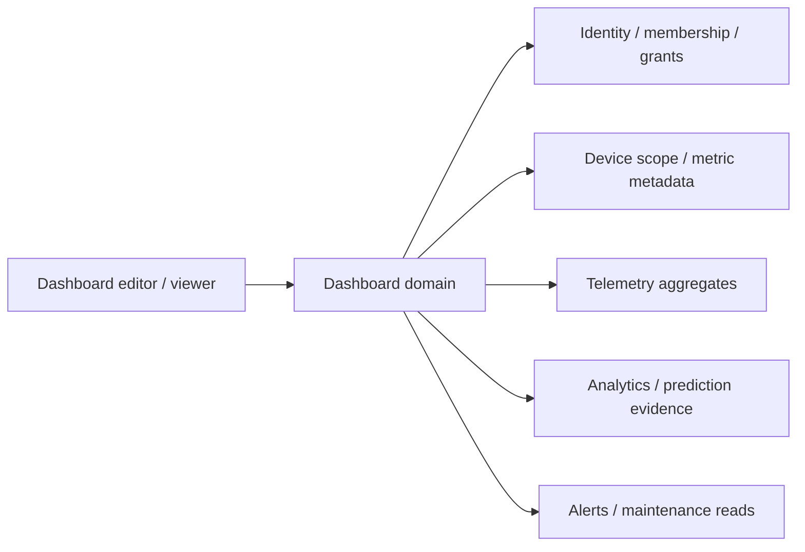

# Настраиваемые дашборды VoltCanary

Дата: 7 октября 2026; checkpoint 2026-10-09. Статус: **целевые продуктовые требования; private domain и typed query engine реализованы, editor/team/calculation этапы ещё не реализованы**.
Документ фиксирует будущую возможность платформы; перечисленные маршруты,
permissions, расчёты и бюджеты не являются действующими API или результатами
нагрузочных испытаний. Нумерованные требования сопоставлены с
[активной программой OpenSpec](../../openspec/changes/README.md) и её приёмкой.
Private domain ownership/service8089/database подтверждены [ADR-011](../adr/ADR-011-private-dashboard-domain.md).

DB-08/09/10/22/33/38/39/40/43 server foundation: private definitions/drafts,
immutable publication and rollback-as-new-draft, ETags/conflicts, body-bound24h
idempotency, owner/account checks, archive/restore/copy, quotas and preferences
implemented and verified with PostgreSQL plus real-JWT local smoke. DB-12 safe
unsupported payload storage is preserved; unknown widget versions remain inert.
Browser autosave/editor, USER entry/default routing, templates, team grants and
calculations remain target behavior. Current API:
[dashboard-api.md](../current/api/dashboard-api.md).

DB-16/17/18/19/20/21/23/24/26/27/28/29/30/31/32/39/40/41/42/43 and
W01–04/W07–13 have server query contracts: current active owner, fixed/dynamic
scope, UTC/DST/shared asOf/contextHash, complete reducers/counts, qualified
provenance and secure cache. W11 is single-account; W05/06/14/15 remain dependency
unsupported. Frontend supplies typed API/read hooks with obsolete-scope and
actor isolation; editor/viewer integration is a separate change.
Tests exercise250 devices, zero comparison, sparse/manual freshness, source
authorization, immutable references, partial outage, bounded fanout and no writes.
The local synthetic12-widget/100-device/24h profile measured cold-cache max405ms,
warm p95 128ms (ten warm samples), and telemetry failure4093ms with independent
panels retained. Earlier first-facts read was1379ms. This is a single local query
profile, not a fresh-JVM, ingestion, soak, scaling or production capacity claim.

## 1. Продуктовое решение и текущая граница

Пользователь создаёт несколько дашбордов для своих рабочих задач, выбирает
виджеты, устройства, метрики, период и компоновку. Быстрый старт — шаблон,
полная настройка — визуальный редактор. Личный дашборд можно клонировать;
позже команда сможет публиковать общую версию, а каждый участник — сохранять
собственные временные фильтры. Настройка не требует JSON, SQL или JavaScript.

Настраиваемый дашборд — сохранённое представление разрешённых данных.
Он не меняет правила алертов, ML deployment, настройки источника или права
устройств. Такие действия выполняются в соответствующих reviewed workflows.

Текущий baseline:

- [DashboardPage](../../frontend/src/pages/DashboardPage.tsx) — фиксированный
  обзор; hook [useFleetDashboard](../../frontend/src/features/dashboard/useFleetDashboard.ts)
  использует ограниченные списки и первые шесть устройств для signals.
- В [AppLayout](../../frontend/src/app/AppLayout.tsx) Dashboard виден в ADMIN
  navigation. Будущие личные дашборды должны быть доступны обычному USER.
- [Device API](../current/api/device-api.md) ограничивает данные account владельца.
  Это ещё не организация с несколькими участниками и общими устройствами.
- [Identity](../current/api/identity-auth-contract.md) имеет USER/SUPPORT/ADMIN.
  Руководитель филиала или техник — пока продуктовые персоны, не готовые роли.
- [Telemetry API](../current/api/telemetry-api.md) предоставляет latest,
  metrics, readings, export и quality. [Analytics API](../current/api/analytics-api.md)
  предоставляет baseline, anomalies, risk, recommendations и prediction trace.
  Полные агрегаты парка и бизнес-расчёты требуют новых контрактов.

**Первый релиз:** приватные серверные дашборды текущего account, безопасные
виджеты, редактор, шаблоны и персональный стартовый экран. **Командный релиз:**
workspace membership, resource grants и публикация общего представления.
Переименование USER в «менеджер» не заменяет реализацию этих зависимостей.

## 2. Бизнесы, пользователи и конкретные задачи

Сегменты ниже — продуктовые гипотезы по назначению VoltCanary, а не доказанный
спрос. Первый фокус — кафе/магазины, небольшие мастерские и эксплуатация зданий:
у них задачи непосредственно связаны с уже поддерживаемыми устройствами.

| Бизнес / оборудование | Пользователь и решение | Что выводить по умолчанию | Что потребуется дополнительно |
| --- | --- | --- | --- |
| Кафе, ресторан: холодильники, бойлеры, кондиционеры | Менеджер смены: какой прибор проверить сейчас; владелец: куда уходит энергия | Открытые HIGH/CRITICAL, устройства без свежего сигнала, мощность холодильников за 24 h, ближайшее обслуживание; владельцу — энергия за 7 d и сравнение с предыдущими 7 d | Реальная температура камеры только при наличии temperatureC; часы работы заведения; агрегат энергии. По потребляемой мощности нельзя утверждать температуру продукта |
| Продуктовый магазин / сеть небольших точек | Руководитель точки: локальные проблемы; региональный менеджер: какие точки требуют внимания | Матрица «точка → свежие / устаревшие / неизвестные сигналы», открытые критические события, температура по выбранным датчикам; рейтинг энергопотребления точек | Иерархия филиалов, общие права, полные межустройственные агрегаты. Сравнивать только точки с сопоставимым периодом/покрытием |
| Прачечная, небольшое сервисное предприятие: машины, нагреватели | Оператор: работающие приборы и отклонения; владелец: загрузка и расход | Current power, runtimeHours delta за смену, события, обслуживание; энергия за день | Подтверждённые циклы/заказы для «энергии на стирку». Пики мощности сами по себе не считаются бизнес-циклами или выполненными заказами |
| Управляющая компания / офис / мини-отель: HVAC, насосы, бойлеры | Диспетчер: здание и этаж с проблемой; инженер: источник и история | Поэтажная таблица устройств, сигналы без обновления, anomalies, обслуживание за 7 d, мощность HVAC | Часовой пояс площадки, schedule/occupancy для сравнения рабочих и нерабочих часов; мультипользовательское владение. Температура помещения требует своего датчика |
| Мастерская / небольшое производство: насосы, компрессоры, станки | Техник: куда выехать; руководитель: какие активы требуют плановой проверки | Вибрация/температура выбранных приборов, risk с временем расчёта, evidence и рекомендации, runtimeHours, календарь | Датчики vibrationMmS/temperatureC, паспортные пороги оборудования, история подтверждённых исходов. Risk не равен точному времени до отказа |
| Малый серверный узел / офисный IT: SERVER_NAS, кондиционер | IT-инженер: питание, охлаждение, отсутствие данных | Power/current/voltage, temperatureC при наличии, сигнал и quality, incidents | OS/network/application metrics и UPS health отсутствуют в нынешнем telemetry contract. Потребление NAS не является доказательством доступности сайта |
| Сервисная компания, обслуживающая чужие площадки | Выездной техник: доступные ему активы и предстоящие проверки; координатор: очередь по клиентам | Назначенные площадки, incidents, обслуживание, evidence для выезда | Делегированные grants и workspace/tenant isolation; назначение исполнителя требует отдельного API. SUPPORT не получает всё автоматически |
| Дом / DIY / Home Assistant | Владелец: быстро увидеть потребление и необычное поведение | 3–6 избранных устройств, энергия за день, сигналы, события, режим demo | Интеграции и тарифы по мере готовности. Это простой шаблон той же системы, без отдельного редактора |

### Персоны и набор данных

| Персона | Первый экран / период | Предпочтительный drill-down | Граница прав |
| --- | --- | --- | --- |
| Владелец / руководитель | 7/30 d, энергия и изменение, точки с проблемами, подтверждённые outcomes | Филиал → группа оборудования → устройство | Только разрешённые площадки; финансовые показатели по отдельному grant |
| Менеджер смены / диспетчер | Сегодня / последние 6 h, incidents и свежесть | Инцидент → конкретный интервал telemetry | Смотрит площадку; Ack/Resolve только при incident permission |
| Техник | Последние 24 h и предстоящее обслуживание 7 d | Актив → anomalies/quality → maintenance | Доступ к назначенным активам; editor дашборда не даёт право менять устройство |
| Энергоменеджер | 7/30 d, энергия, peak power, coverage, сравнение | Площадка/тип → сравнение устройств | Cost только при доступе к тарифу; energy read отдельно от configuration write |
| ML-инженер | Последние расчёты, family/horizon, coverage и prediction path | Prediction → model lineage / ML workspace | ML grants; оператору смены не навязываются datasets и training runs |
| SUPPORT / platform ADMIN | Диагностика только разрешённого account | Read-only trace / разрешённый операционный экран | Platform identity role не становится неограниченным правом на бизнес-данные |

Шаблон можно выбрать вручную вне зависимости от персоны. Персона меняет
рекомендации и текст, а не расширяет доступ. Предлагаемый бизнес-профиль
не обязателен при регистрации; пользователь может пропустить выбор.

## 3. Создание, открытие и редактор

| ID | Обязательное поведение |
| --- | --- |
| DB-01 | Раздел «Дашборды» доступен USER с правом читать свои устройства. `/dashboard` сохраняется как вход: открывает доступный personal default, иначе безопасный системный обзор. Если default удалён/архивирован/недоступен, показывается объяснение и обзор, без redirect loop |
| DB-02 | Список разделён на «Мои», «Избранные», позже «Командные»; поиск по имени, сортировка недавно открытые/имя/изменённые. Карточка показывает владельца, private/shared, время изменения, published revision. Доступ к скрытым дашбордам не раскрывается счётчиком или названием |
| DB-03 | Create предлагает «Из шаблона», «Пустой», «Копия доступного». Шаги: название/задача → площадка/устройства → период → preview → сохранить. Имя 1–80 символов, description до 500; ID независим от имени. Duplicate name допустимо с подсказкой. Отмена не создаёт опубликованный объект |
| DB-04 | Шаблон сначала показывает виджеты и недостающие данные. Пользователь привязывает placeholders к своим площадкам/группам; template не содержит чужих UUID. Отсутствующая метрика даёт «Нужен датчик температуры», а не пустой успешный график. Unsupported виджет можно убрать или оставить с явной заглушкой |
| DB-05 | Preview использует реальные разрешённые данные; демонстрационные данные допустимы только с постоянной маркировкой. Private/shared выбран явно, private по умолчанию. Первый успешный save предлагает «Сделать стартовым»; не заменяет пользовательский стартовый экран молча |
| DB-06 | View и Edit — разные режимы. В View отсутствуют drag handles; случайное перетаскивание не меняет layout. В Edit доступны Add, Configure, Duplicate, Delete, Move, Resize, Undo/Redo и Preview desktop/tablet/mobile. Создание нового алерта из панели всегда открывает отдельный rule workflow |
| DB-07 | Add открывает каталог с поиском по задаче «события/энергия/свежесть/ML» и thumbnail. Настройка выбранного widget имеет четыре секции: данные → расчёт/период → представление → переход. Preview показывает unit, scope count и data state; Add запрещён при структурно неверной конфигурации |
| DB-08 | Изменения сохраняются в draft через 2 s после последнего изменения и при явном Save draft; показываются Saving/Saved/Failed и время. Published layout не меняется до Publish. Неудачный autosave сохраняет draft локально, привязанный к user/account/dashboard/baseRevision; secrets и telemetry values не сохраняются |
| DB-09 | Publish показывает summary изменённых widgets/filters/layout и сохраняет новую immutable revision. Текущая view-version стабильна. Undo/Redo держит не меньше 20 edit-операций; rollback создаёт новую revision из старой, история не перезаписывается |
| DB-10 | При двух редакторах используется optimistic concurrency; stale save возвращает 409. UI предлагает открыть новый published version, сохранить свою копию или повторно применить изменения после сравнения. Молчаливого last-write-wins нет |
| DB-11 | Обычный viewer меняет временные filters/time в своём URL; это не публикует конфигурацию. «Сохранить по умолчанию» явно пишет personal preference. Изменение общих default filters требует Edit + Publish |
| DB-12 | Delete в интерфейсе означает archive с подтверждением имени и последствий для default/favorites. Restore сохраняет ID и revisions; в первом релизе нет пользовательского hard-delete. Размонтирование страницы, logout и переход с unsaved/failed draft дают понятный способ продолжить/отбросить |

### Компоновка и доступность

**DB-13.** Desktop ≥1200 px: 12 columns, tablet 768–1199: 6, mobile <768: 1.
Widget catalog задаёт minWidth/minHeight и допустимые размеры, например KPI
2×2, chart 6×4, table 6×5. Высота единицы 48 px, gap 16 px — начальные design
tokens для прототипа, не основание ломать established CSS. Collision никогда
не создаёт overlap: displaced widgets сдвигаются вниз с undo. Desktop layout
не перезаписывается при открытии телефона. Mobile порядок хранится отдельно,
по умолчанию соответствует section/order; пользователь может изменить его.

**DB-14.** Перемещение и размеры доступны через меню «Выше/Ниже/В секцию» и
«Малый/Средний/Большой», клавиатуру и pointer без удержания drag. Фокус остаётся
на перемещённой карточке; изменение позиции озвучивается. График имеет
текстовое резюме и доступный список значений; таблица локально прокручивается,
заголовок страницы и основные команды остаются достижимыми при 200% text zoom.

**DB-15.** Sections имеют название и collapsed state; скрытие пользовательское,
не скрывает глобальную ошибку/свежесть экрана. Заголовок показывает имя,
scope, period/timezone, private/shared, Edit и last refresh. Один primary action
на задачу. Цвет статуса привязан к смыслу; декоративный цвет серии не означает
аварийность. Threshold labels видимы текстом. Нет редактируемого HTML или
пользовательского кода в note/link widget.

## 4. Каталог виджетов и их контракт

Каждый widget сохраняет `type`, `typeVersion`, title, binding, query intent,
time policy, presentation, drill-down и layouts. Manifest описывает поля,
units, минимальный размер, разрешённые reducers и required capabilities.
Каталог расширяемый на уровне кода платформы, а не arbitrary plugins/SQL.

Обозначения: **C** — существующие данные, нужна композиция/UI;
**A** — новый полный агрегат или историческая семантика; **D** — новый домен.
Наличие C не означает готовый endpoint пользовательского widget.

| ID / type | Конкретное содержание и настройки | Переход / ограничения / зависимость |
| --- | --- | --- |
| W01 · fleet-count | Активно зарегистрированные устройства; раздельные counts свежие/старые/никогда не измерялись/неизвестно. Scope location/type/tags; freshness policy по ожидаемому интервалу sender | К filtered Devices; регистрация ACTIVE не значит online. Полный server count, не length страницы. C+A |
| W02 · latest-value | Последнее значение одной метрики одного устройства, unit, measuredAt, receivedAt, age, expected interval, quality; optional sparkline и threshold | Device telemetry с metric. По умолчанию не усреднять latest нескольких устройств. Нет значения — unavailable/never measured. C |
| W03 · time-series | 1–8 series одного compatible unit; raw/avg/min/max; общий/локальный период, min/max envelope и maintenance markers | Brush/fields → device interval. Разрывы сохраняются, легенда подписывает устройство и reducer; display downsampling не меняет расчёт KPI. C+A |
| W04 · metric-summary | Min/max/mean/p95 измеренной метрики за период; sample count, coverage и comparison с равным предыдущим периодом | На graph с исходным interval/reducer. p95 считается по полному набору согласно server weighting policy, не по display points. A |
| W05 · energy-period | kWh за interval по cumulative energyWh либо integrated activePowerW с явной provenance; totals по выбранным независимым meters, trend/comparison | На devices/energy details. Не суммировать counter values как расход; reset/gap/duplicate meter policy см. раздел 6. A |
| W06 · peak-and-ranking | Top N (5/10/20) по kWh или peak W, выбранные группы/площадки, измеряемая база и coverage | На выбранную группу. Current power rank и energy-period rank — разные показатели; никакого «худший филиал» без сопоставимых данных. A |
| W07 · incident-list | OPEN/ACKNOWLEDGED, severity, устройство, возраст и время события; location/type/rule; pagination. KPI отдельно: открыты сейчас либо созданы за interval | На конкретный incident/telemetry evidence. Ack/Resolve показываются по incident grants и имеют pending/confirmation; dashboard Edit не даёт mutation permission. C+A |
| W08 · maintenance-agenda | Следующие 7/30 d: start/end/timezone, device, title, status, suppression/exclusion flags; фильтр location/type | Maintenance operation; raw/derived exclusions не объединяются в одно «выключено». При schedule API rights — отдельный reviewed action. C |
| W09 · risk-list | Последний risk score/level, calculatedAt/window, source и coverage; фильтр high/unknown, sort risk/freshness; device count denominator | Device analytics. Не средний «индекс здоровья бизнеса»; score не probability. Для failure prediction — отдельный family+horizon и confidence. C+A |
| W10 · quality-and-freshness | Gap duration, last valid reading, invalid/out-of-order/rate-limited flags, never-seen отдельно от lost signal; count по источникам/приборам | Device source/telemetry quality. Heartbeat/network online не выводится из отсутствия измерений. C+A |
| W11 · location-matrix | Rows locations, columns registered/fresh/old/unknown/open critical/energy; scope subtree и один общий interval | Смена location в runtime context. Каждая колонка указывает своё time basis: now/snapshot/interval. В v1 один owner account; сеть — workspace grants. A+D для команды |
| W12 · prediction-evidence | Для selected devices: predictionStatus, model/family/horizon, createdAt, confidence, serving path, reason; label для heuristic/fallback/unavailable | Prediction/ML workspace только по правам. Готовность policy не означает actual model runtime usage; инференс не запускается просмотром дашборда. C |
| W13 · context-note | Plain text до 1000 chars и разрешённые внутренние ссылки: инструкция смены, контакты роли без secrets | Нет iframe, произвольного script/HTML или автоматически исполняемой внешней ссылки. Не хранить passwords/tokens. C — новый display type |
| W14 · estimated-cost | Estimate по W05, тарифу/валюте/периоду действия; coverage, taxes/fees policy видны; сравнение только при одной валюте | Вне v1: нужна tariff entity и отдельные права. Без тарифа «Не настроен тариф», без энергии — unavailable. Не billing invoice или доказанная экономия. A+D |
| W15 · uptime-or-cycle | Подтверждённый uptime/cycle count и energy per cycle | Вне v1: определения downtime/cycle и event contracts. ActivePowerW≠0 не доказывает availability; COUNTER/SENSOR runtimeHours delta не доказывает выполненный заказ. D |

**DB-16.** Добавление widget требует выбрать business query, а не REST URL.
Backend принимает allowlisted query intent. Unknown type/version сохраняется
в документе как «Виджет не поддерживается»; editor не удаляет его при save.
Deprecated manifest мигрирует явно и сохраняет исходную revision.
Порог оформления выбирается из server threshold либо задаётся локально с
явной подписью «Порог этого виджета» и unit. Такая настройка не создаёт и не
меняет alert rule; смена unit приводит к пересчёту или повторной валидации
порога. Hide series и цвет линии тоже не меняют данные или правила.

**DB-17.** Selector показывает только доступные IDs и реальные capabilities.
Название/metric label/unit берутся из server metadata. Метрики для выбранного
периода могут отличаться от latest; отсутствие температуры не подменяется
мощностью. Derived widget виден с dependency explanation до Add.

## 5. Фильтры, время и повторное использование

**DB-18.** Общие параметры: location/subtree, device types, tags, explicit IDs,
period и timezone. Scope mode — `fixed` (сохранённые IDs) или `dynamic`
(location/type/tags predicate). Для dynamic указано «Включает новые подходящие
устройства»; перед publish показан текущий count. Удалённый fixed ID остаётся
unavailable slot, не заменяется первым доступным устройством.
Predicate различает `location.tags` и `device.tags`; последний предлагается
только после появления соответствующего registry contract/capability.
Произвольный metadata JSON не превращается в поисковый язык. Server scope
resolver задаёт правила subtree, archive и tag matching; editor показывает
их человеческое описание и число выбранных доступных объектов.

**DB-19.** Effective widget scope = разрешённые viewer devices ∩ dashboard
binding ∩ runtime filters ∩ widget binding. Fixed widget явно маркируется
«Зафиксирован: кухня» и не переезжает на другую площадку при global filter.
Scope нельзя расширять query-параметром. Изменения filters сначала собираются,
один Apply отправляет согласованный запрос; stale responses не заменяют новую
выборку. Все widgets одной группы используют один resolved `asOf`.

**DB-20.** Время: последние 15 m / 1 h / 6 h / 24 h / 7 d / 30 d,
сегодня/вчера/эта неделя и custom from/to. Calendar boundaries задаёт timezone
дашборда, timestamps передаются в UTC; DST сутки могут иметь 23/25 h.
Widget timeMode = inherit / fixed interval / relative lookback, override badge
всегда видим. Event-time и snapshot-now панели имеют разные подписи.

**DB-21.** Compare = предыдущий период той же длительности либо ручной interval;
при выборе calendar comparison явно учитывается DST. Абсолютная delta и %
отдельны; base=0 → percent «не определён», а не infinity или 100%.
Несопоставимые coverage/units/currency дают предупреждение и не окрашиваются
как доказанное улучшение. Week-over-week by operating hours требует schedule
domain и не входит в v1.

**DB-22.** Внутренний share URL содержит dashboard ID, revision при pin,
разрешённые nonsecret filters, period/timezone. Back/reload восстанавливают
контекст. URL даёт ссылку на представление, не доступ. Favorite/default
хранятся server-side отдельно от definition. Copy as new создаёт независимый
ID и draft, переносит bindings только в пределах разрешённого account;
при смене workspace требуется rebind.

## 6. Математика и честность бизнес-показателей

**DB-23.** Fleet aggregates вычисляются по полному authorised scope либо
возвращают `partial/truncated` с evaluated/requested count. Никогда не
подписывать length(limit=200) как «все устройства». Для critical incident
count учитывается incident ID один раз, а не число notification attempts.
«Открыты сейчас» не фильтруется неожиданно периодом создания.

**DB-24.** Default freshness = max(3×configured sampling interval, 60 s);
если cadence неизвестен — явный dashboard default 5 min с отметкой источника
порога. Это freshness, а не online/offline. Для sparse/manual/import-only
источника policy выбирается отдельно, иначе ежедневное измерение выглядело бы
неисправным. Future timestamp > allowed clock skew → unknown/quality warning.

**DB-25.** Energy method сохраняется в query/result:

- `COUNTER_DELTA`: разности соседних согласованных energyWh с идентичной
  meter/source identity, один segment на reset; отрицательная delta не
  превращается в consumption и не скрывается. Нет boundary sample или
  reset semantics → partial/unknown с причиной.
- `POWER_INTEGRAL`: трапециевидный интеграл пары W readings: средняя мощность ×
  elapsed hours / 1000 → kWh. Большой gap > configured tolerance не
  интегрируется как известное потребление. Результат помечается estimate.
- При наличии обоих методов выбранный authoritative method виден; их
  результаты не складываются. Одинаковые физические meters, upstream meter
  и его submeter не суммируются без metering-topology policy. До её появления
  aggregate требует явно независимые приборы и предупреждение о double count.

**DB-26.** Quality provenance: requested scope, evaluated scope, metric/source,
window, excluded intervals, last data timestamp, received/query time, reducer,
method, sample count и coverage definition. Coverage measured intervals не
выводится из registration count. Для time-weighted mean фиксируется weighting;
арифметическое mean sparse samples не именуется mean consumption per hour.

**DB-27.** Raw energy/telemetry включает фактический расход во время обслуживания;
derived analytics использует исключения своих contracts. UI указывает, какой
набор показан. Риск/ML отображает window, calculatedAt, family/horizon и
confidence; confidence не accuracy, heuristic не trained prediction.
Нет универсального «через N дней сломается» из score.

## 7. Data states и refresh

| ID | Требование |
| --- | --- |
| DB-28 | Каждый widget имеет idle/loading/ready/empty/partial/stale/error/no-access/unsupported. Successfully empty и error различимы. Known zero показывается только после успешного расчёта; unknown никогда не становится 0 |
| DB-29 | При failed refresh сохраняются только ранее разрешённые значения с measuredAt и «Обновление не удалось». Scope change не сохраняет неподписанные values предыдущего scope. Ошибка одной зависимости не блокирует остальные widgets; общая ошибка группируется в компактный banner |
| DB-30 | Обновление manual/off/30 s/1 min/5 min; по умолчанию 1 min для live templates, off для fixed historical. Min 30 s, jitter, backoff после ошибок; hidden browser tab и невидимые/collapsed panels не поллят постоянно. Resume сначала переоценивает права и freshness |
| DB-31 | Relative ages обновляются по часам без fetch; shared live screen постоянно показывает timezone/last refresh и «Данные устарели». Ошибку связи нельзя скрыть настройкой widget visibility. Kiosk режим — отдельная авторизованная сессия без edit/actions; anonymous/public kiosk вне scope |
| DB-32 | Requests отменяются при изменении scope/period; response содержит context hash и asOf. Результат старого context не отображается. Refresh telemetry не вызывает recalculate, training, source token rotation или отправку notification |

## 8. Владение, совместная работа и аудит

**DB-33.** V1: dashboard owner = authenticated user; данные принадлежат его
активному device account. USER может создать private dashboard; SUPPORT/ADMIN
не получают автоматическое право читать этот private dashboard. Personal default
и drafts изолированы по user/account. Disabled account блокируется также
на downstream queries, не только на UI.

**DB-34.** Командный релиз добавляет `view`, `edit`, `manage-sharing`,
`publish`, `archive` dashboard grants; owner имеет все. Workspace manager
может иметь grants управления, но это новая membership model. Viewer может
изменять временные filters, Favorite/Default и Copy если разрешено;
не может публиковать. Editor изменяет draft; Publish выдаётся отдельно.
Управление dashboard и resource/incident/ML/tariff grants разделено.

**DB-35.** Share target — users/teams одного workspace. Сервер повторно
проверяет доступ на list/read/query/export, а не доверяет `workspaceId`/UUID
из browser. Перед share редактор видит preview доступности для получателя.
Если участники имеют разные resource grants, UI пишет «Показаны доступные вам
устройства» и denominator своего scope; сравнение с общей командной цифрой
не маскируется. Название и count недоступных ресурсов не раскрываются.

**DB-36.** Revoke доступа очищает widget values и client cache при следующем
auth event/query; следующий запрос немедленно запрещён. Dashboard сам по себе
не выдаёт resource grants. При публикации автор выбирает минимальную
аудиторию; внешние links, межклиентское sharing и анонимный embed запрещены
в этих релизах. Export definition не включает telemetry, credentials, ACL или
неразрешённые bindings; импорт проходит rebind и schema validation.

**DB-37.** Audit фиксирует actor/time/workspace/dashboard/revision/action для
create/publish/archive/restore/share/revoke/rollback. Просмотр private values
не попадает в definition/audit log. Уход owner из workspace требует передачи
ownership уполномоченным manager, не orphan-доступ бывшего сотрудника.
Deletion/disable пользователя обрабатывается membership/account contract.

## 9. Целевая модель и API

Целевая граница — **Dashboard domain**: definitions, revisions, drafts,
templates, preferences и dashboard grants. При реализации первый кандидат —
отдельный backend module `dashboard-service`; физическое размещение утвердить
в OpenSpec/ADR до добавления сервиса. Это не generic SettingsService.
Domain не владеет telemetry, incidents, maintenance или ML lifecycle.
Read composition выполняется через явные authenticated batch-query ports;
identity/device/telemetry/analytics/alert остаются владельцами своих данных.

**DB-38.** Definition: `id`, `ownerUserId`, `accountId`, future `workspaceId`,
`schemaVersion`, name/description, status ACTIVE/ARCHIVED, publishedRevision,
defaultContext, sections, widgets and layouts. Widget query содержит только
allowlisted metric/reducer/scope/time enums и IDs. Revision immutable;
draft имеет baseRevision, author и updatedAt. Preference отдельно хранит
favorite/default и user's defaultContext. Template имеет version, task/persona,
capabilities и symbolic bindings. Никаких raw tokens, delivery recipients
или свободных HTTP request definitions.

**DB-39.** Планируемые публичные endpoints через gateway:

| Method / path | Семантика и существенные ответы |
| --- | --- |
| GET /dashboards | Cursor list собственных/разрешённых; metadata, favorite, status; default page 20, max 100 |
| POST /dashboards | Создать private draft из blank/template/copy; Idempotency-Key возвращает тот же ID при retry |
| GET /dashboards/{id} | Published revision и permissions; `?revision=n` только для доступной истории; ETag |
| GET, PUT /dashboards/{id}/draft | Авторский draft, baseRevision, If-Match; 409 revision conflict, 422 field-level validation |
| POST /dashboards/{id}/publish | Publish проверенного draft с If-Match/Idempotency-Key; новую revision вернуть явно |
| POST /dashboards/{id}/copy | Новый private draft, доступные bindings; ACL не копируется |
| POST /dashboards/{id}/archive, /restore | Soft lifecycle; revision history остаётся |
| GET /dashboards/{id}/revisions | Cursor metadata history; rollback через draft из разрешённой revision и новый publish |
| POST /dashboards/{id}/query | Batch widgets + runtimeContext + revision/draftRef; сервер валидирует definition и grants; каждое result имеет status/provenance/contextHash/asOf |
| GET /dashboard-widget-types, /dashboard-templates | Только server allowlist/доступные capabilities; versioned manifests |
| GET, PUT /dashboard-preferences/me | Default/favorites/context текущего user; не меняет dashboard definition |
| GET, PUT /dashboards/{id}/grants | Только командный релиз + manage-sharing; изменения аудитируются |

401 запускает auth recovery; 403 блокирует операцию без раскрытия чужих данных;
unknown/nonvisible dashboard ID возвращает согласованный 404. 413/422
возвращают typed validation, 429 — retry-after. Definition query не принимает
произвольный SQL, URL или изменённый widget вне разрешённого draft.
Для отказа части panels batch возвращает общий response с per-widget error,
а не ошибку всего экрана. Preview draft также проходит server grants.

## 10. Бюджеты и расширяемость

Это начальные целевые бюджеты, которые нужно подтвердить нагрузочным тестом.

**DB-40.** Default template 6–8 widgets; лимит v1 — 24 на dashboard,
10 dashboards на user, 8 series на chart, 20 ranking rows, 50 table rows/page.
Лимит dashboard scope — 500 devices, выбранные individually series — до 50
устройств на request group; превышение требует сужения scope, не тихого
обрезания. Workspace/fleet scale сверх этого — следующий capacity profile.
Лимиты централизованы в server capabilities и понятны в UI.

**DB-41.** Один batched query на видимые panels, объединение одинаковых запросов,
bounded backend concurrency (стартовый лимит 6 dependency queries), timeout
панели 5 s; query result не хранится в definition. Cache key включает
account/workspace, viewer authorization fingerprint, revision, scope, interval,
units и reducer. Межпользовательский cache без grants fingerprint запрещён.

**DB-42.** Цель на контрольном профиле 12 widgets / 100 devices / 24 h:
interactive editor ≤1 s после получения definition, первая meaningful panel
≤2 s, все успешные панели p95 ≤5 s при тёплом cache и доступных dependencies.
Измерять end-to-end отдельно от backend latency, включая холодный старт и
error state; не заявлять эти числа как обеспеченные текущим стеком.
30 d допустим только в пределах retention/API limits; Auto interval выбирает
bucket и показывает его, export/raw не притворяется display series.

**DB-43.** Версии schema/widget migratable; unknown widget не ломает остальные.
Frontend вынесен в `features/dashboards/{components,hooks,model}` и domain API,
страница только компонует. Existing TelemetryChart/Field/Dialog/SectionFeedback
переиспользуются после проверки пригодности; не добавлять редактор в большой
DashboardPage одним монолитом. Catalog tests проверяют capability/permissions,
не делают snapshots каждого пикселя.

## 11. Шаблоны первого релиза

| Template | Layout и widgets | Defaults / следующий шаг |
| --- | --- | --- |
| «Смена: моя площадка» | Первый ряд W01 freshness, W07 open critical; далее W07 list и W08 agenda; снизу W03 выбранных приборов и W10 quality | Dynamic location; telemetry last 6 h, incidents now, maintenance next 7 d. Review incident ведёт сразу к его interval |
| «Энергия: выбранные приборы» | W05 energy, W04 peak power, W06 ranking; W03 power trend; W10 coverage | Last 7 d vs previous 7 d, timezone площадки. При неизвестном method энергия остаётся unavailable, а не 0 |
| «Холодильное оборудование» | W02 temperatures при наличии; W03 power/temperature отдельными compatible charts; W07 incidents; W09 risk; W08 checks | FRIDGE dynamic scope, 24 h. Без temperatureC шаблон явно предлагает подключить датчик |
| «Техник: очередь проверки» | W09 high/unknown risk; W07 active incidents; W08 next maintenance; W10 source/quality; W13 инструкция проверки | Доступные приборы, last 24 h / next 7 d. Assignment фильтр только после API назначения |
| «Мои устройства» | 3–6 W02 избранных, W07 incidents, W03 power, W10 freshness | Account owner, 24 h. Минимум технических ML-полей, raw identifiers под details |

Командные «Обзор сети» (W11) и «ML evidence» (W12 для authorised cohorts),
а также cost/cycle widgets добавляются после соответствующих data/grant
контрактов. System overview остаётся доступным как read-only fallback;
редактирование его предлагает «Создать личную копию».

## 12. Проверяемая приёмка

| Сценарий | Конкретный ожидаемый результат / покрытие |
| --- | --- |
| Новый USER с 3 demo devices | Создаёт «Мои устройства», выбирает 3 real bindings и 24 h, публикует, делает default. Reload/новая сессия восстанавливают dashboard ID, layout и defaults. DB-01–05,22,33 |
| Менеджер кафе | Из шаблона выбирает Kitchen, удаляет risk, добавляет power chart, переставляет карточки меню без drag, публикует. На 390 px тот же dashboard читается и не меняет desktop layout. DB-06–15 |
| Добавление устройства в location | Dynamic panel включает новый прибор после refresh и обновляет count; fixed panel остаётся на прежних IDs. Удаление fixed устройства даёт unavailable slot. DB-18–19 |
| Смена timezone / DST | «Сегодня» в Europe/Belgrade использует календарные границы площадки, а не 24 h из browser timezone; одинаковый resolved interval передан всем inherited panels. DB-20–21 |
| Ошибка risk при успешной telemetry | Chart продолжает работать; risk помечен stale с временем или unavailable. Старый Kitchen result не появляется после выбора Office. DB-27–32 |
| Парк 250 устройств | W01 получает полное authorised count, а не 200; источник partial приводит к partial UI и не к «250 online». Таблица имеет рабочую следующую страницу. DB-23,40 |
| Счётчик энергии 10000 → 10500 Wh | Полностью покрытый interval даёт 0.5 kWh, а не 20.5 kWh. Reset, gap, meter replacement и upstream/submeter проверяются отдельно; partial видим. DB-25–26 |
| Нулевой comparator | Delta с zero base показывает absolute difference и undefined percent; недостаточная coverage не даёт зелёное «энергия снижена». DB-21,26 |
| Два редактора | Первый публикует revision 4; stale draft второго от revision 3 получает conflict, не перезаписывает 4. Сохранить личную копию не переносит sharing. DB-08–10,22 |
| Double publish / network retry | Повтор с тем же Idempotency-Key не создаёт второй dashboard/revision; failed query reload не подменяет successful publish ошибкой сохранения. DB-39 |
| Viewer общей площадки | Меняет time/filters без изменения общего default; не может Publish/Share/Ack без конкретного grant. Другой viewer не получает эти personal filters. DB-11,34–35 |
| Попытка чужого UUID / cache hit | List/read/query/export/preview запрещают чужое устройство; cached values другого user не попадают в response. Share URL ничего не выдаёт без разрешения. DB-33–36,41 |
| Revoke во время просмотра | Следующий query запрещён; бывшие значения убраны из view/cache. Скрытые названия/числа недоступных приборов не присутствуют в HTML или query result. DB-35–36 |
| Неизвестная typeVersion | Одна unsupported placeholder; другие widgets работают; save не удаляет неизвестную configuration. DB-16,43 |
| Нет temperatureC / tariff / cycle events | Шаблон объясняет отсутствующую capability; power не превращается в temperature, estimate не появляется без tariff, cycle не выводится из произвольного peak. W02,W14,W15,DB-17 |
| Keyboard / touch / 200% text | Create/configure/reorder/resize/publish/undo доступны без drag; фокус возвращается; mobile nav/forms не перекрыты; empty/error озвучиваются. DB-13–15,28 |
| Контрольный performance profile | Зафиксированы p50/p95 cold/warm, request count, partial dependencies, 24 widgets, hidden-tab pause и backoff. Бюджеты DB-40–42 принимаются по evidence |

До реализации редактора проверить прототип на менеджере смены, технике и
владельце: создать из шаблона ≤3 min, добавить настроенный widget ≤90 s,
найти unknown/stale без подсказки, объяснить scope/time и открыть конкретный
инцидент. Это UX-цели, не измеренные результаты. Критерий ошибки — человек
принимает unavailable за здоровое устройство или считает filter правом доступа.

## 13. Границы поставки и зависимости

1. **Личные dashboards:** DB-01–33,38–43 в пределах private account;
   DB-23–27 требуют проверенных агрегатов перед включением energy/ranking.
   При первой поставке допускается каталог W01–04,W07–10,W12–13;
   несовершенные W05–06 не заменять приблизительным frontend sum.
2. **Командные dashboards:** workspace/membership/resource grants + DB-34–37,
   W11, version conflict и управляемая публикация. Зависимость от tenant
   administration обязательна; межклиентский сервисный доступ проектировать
   отдельно от share внутри workspace.
3. **Бизнес-расчёты:** metering topology, tariffs, schedules, cycles, downtime,
   W14–15. Критерии событий и математика определяются до отображения KPI.
   Reporting/PDF/email schedules/public embed/AI-generated dashboards не входят
   в эти requirements и оформляются самостоятельными product changes.

На основе документа созданы OpenSpec changes: private domain и query engine
реализованы; visual editor, task templates, energy aggregates, workspace
membership, team publication, tariff estimates и operational period metrics.
Их зависимости и полное DB/W покрытие указаны в
[индексе программы](../../openspec/changes/README.md). Код и main specs текущего
поведения обновляются при завершении каждого этапа; плановые tasks остаются
unchecked до implementation и verification.
Перед кодом применить выбранный active change через проектный OpenSpec workflow.
[Roadmap](product-roadmap.md) и
[target architecture](architecture.md) ссылаются на этот источник требований.
AGENTS.md и project skills не требуют изменений: workflow и структура пока
не изменены.

## 14. Источники и основания

- Текущие contracts: [telemetry](../current/api/telemetry-api.md),
  [analytics](../current/api/analytics-api.md), [devices](../current/api/device-api.md),
  [identity](../current/api/identity-auth-contract.md),
  [alerts](../current/api/alerts-api.md). UI/UX gaps:
  [аудит консоли](ui-design-requirements.md).
- [ENERGY STAR: Restaurants](https://www.energystar.gov/buildings/resources-audience/small-biz/restaurants)
  описывает refrigeration/HVAC/kitchen equipment в управлении энергией ресторанов.
  Это основание рассматривать сегмент; конкретные шаблоны VoltCanary — наша
  продуктовая гипотеза, а не подтверждённая рекомендация ENERGY STAR.
- [Grafana: Variables](https://grafana.com/docs/grafana/latest/visualizations/dashboards/variables/)
  — пример общего контекста, обновляющего связанные элементы dashboard.
  VoltCanary использует свои typed scopes и ограничения, не принимает
  Grafana configs или их permission model по умолчанию.
- [W3C: Dragging Movements](https://www.w3.org/WAI/WCAG22/Understanding/dragging-movements.html)
  требует pointer-альтернативу dragging; клавиатурная доступность проверяется
  дополнительно. DB-14 предусматривает оба способа.
