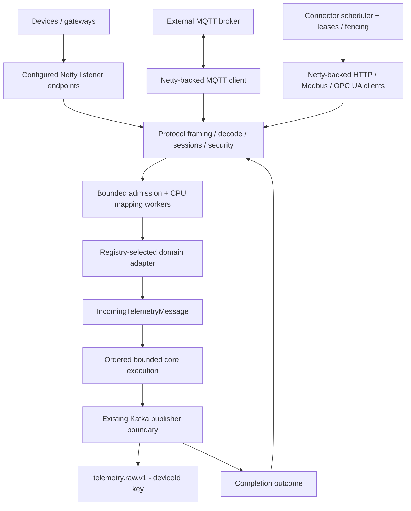

# Proposed ingestion event transport

Status: target only, 2026-11-19. Owner:
[`adopt-netty-multiprotocol-ingestion`](../../openspec/changes/adopt-netty-multiprotocol-ingestion/proposal.md).
Decision: [proposed ADR-016](../adr/ADR-016-netty-multiprotocol-ingestion.md).
Current behavior: [ingestion architecture](../current/architecture/telemetry-ingestion.md),
[HTTP API](../current/api/ingestion-api.md),
[data flow](../current/architecture/03-data-flow.md) and
[scaling](../current/architecture/09-horizontal-scaling-matrix.md).
This document is the detailed target contract; the change design owns delivery gates.

## Layers And Ownership

Transport owns sockets, channels, event loops, connection limits, TLS hooks,
read/write watermarks and lifecycle. Protocol owns stream framing, bounded
decoding, negotiation, requests/correlation, session/auth exchanges and wire ACKs.
Domain adapters own topic/register/node/vendor mapping and capability manifests.
Core owns source authority, normalization/processing, validation, rate limiting,
idempotency and canonical publication. No Netty ByteBuf, MQTT packet, Modbus
response or OPC UA SDK object enters the canonical model/core.

Spring owns typed configuration, DI, startup/readiness and stop ordering. Netty
owns I/O readiness and channel callbacks. No business stage relies on Spring MVC
thread-local context. HTTP telemetry may move independently from management and
internal endpoints; preserve their configured routes, authentication and health.
This is not a demand to migrate every Spring control-plane HTTP endpoint.

## Endpoints, Framing And Security

Declare listener/client profiles with protocol, bind/remote address, explicit
port, TLS termination mode, credential/trust references, decode limits,
deadlines and resource class. Separate endpoints are the default. Shared ports
require a separately tested negotiation contract, e.g. applicable ALPN; neither
TCP packet boundaries nor a guessed first byte select arbitrary protocols.
Support fragmented frames, multiple frames per read and partial writes. Reject
oversize lengths before allocation; cap headers, payload, nesting, metric count,
batch items and decompressed bytes/expansion. Bound handshake, first-frame,
partial-frame, idle and response time; idle traffic cannot reset an absolute
partial-frame deadline forever. Bound outbound pending bytes and slow readers.

TLS termination at a trusted proxy or in the channel must be explicit per profile.
Define proxy trust, certificate rotation, hostname verification, client identity
and allowed protocol versions in the deployment profile. Never trust arbitrary
forwarded headers or log tokens/cert private keys. OPC UA SecureChannel and
application certificate/session validation remain required even where TCP/TLS
settings exist. Polling egress/redirect/DNS policy must preserve existing SSRF and
credential boundaries. TLS/codec work itself must have connection/rate/size caps.

## Execution, Admission And Memory

Every stage has finite configured limits: connections, pending handshakes,
per-channel reads/writes, frame/decompressed bytes, decoded items, canonical
items, keyed lanes, executor threads/queues, external requests and total in-flight
events/bytes. Validate the aggregate memory budget at startup. Queue limits count
batch items and bytes, not just HTTP requests. No unbounded executor, callback
queue, futures list, lane map or virtual-thread submission is allowed.

Admission reserves capacity before copying/expanding or scheduling work. Before
authentication, enforce endpoint/IP/connection and protocol limits; untrusted
source/account fields cannot select an unlimited tenant budget. After authority
resolution, attribute work to the actual source/account. Enforce source, account
and protocol quotas plus reserved fair shares/weighted scheduling so a large
tenant, import, slow source or retry storm cannot consume all realtime capacity.
Admission fairness complements existing shared rate limits; it does not replace
their authoritative cross-replica policy. Local limits bound each replica; shared
quotas remain authoritative for regional identities.

Event loops do bounded framing and cheap checks only. Heavy JSON/vendor parsing,
normalization and processing use bounded CPU workers. Blocking Redis/HTTP source
recovery, credential access, usage recording and Kafka waits use bounded blocking
workers with explicit I/O deadlines and bulkheads. The initial whole synchronous
pipeline may run there. Executor rejection must not run work inline on a Netty
or SDK I/O callback thread. Async clients still need finite concurrency, buffers,
request timeouts and callback work bounds. A slow connector may not block the
supervisor's traversal or lease-renewal/control capacity for other sources.
Event loops improve connection concurrency; CPU throughput requires measurement.

Channel state and writes return to that channel's event loop. Shared adapter beans
must be stateless/thread-safe; mutable decoders, sessions and auth state are per
channel/source and single-owner. A singleton registry does not serialize traffic.
Before offload, copy into a bounded immutable owned value by default. If retained
ByteBuf handoff is necessary, document sole ownership and retain/release across
success, rejection, cancellation, exceptions, timeout and shutdown. Release
exactly once, including late completions. Use leak detection and direct-memory
plateau tests; do not retain slices as unbounded history.

Capture a bounded immutable context containing correlation/trace identity,
authenticated principal references, receivedAt, deadline, config/processing pins,
ownership generation and protocol correlation handle. Restore/clear logging and
observation context per task. Keep raw credentials in narrowly scoped secret
handling, not tracing or queued diagnostic metadata. Release admission permits
only when their owned work/resources actually terminate, even after client timeout.

## Completion, ACK And Retry

An application execution port returns eventual typed outcomes, mapped by each
protocol: published, duplicate-confirmed, filtered, invalid/unauthorized,
overloaded, failed or unknown. These are conceptual outcomes; preserve existing
HTTP DTO/status contracts instead of inventing a new public response enum.

Lifecycle is reserved -> running -> publish-pending -> published/failed/unknown
-> resource release. Production `published` requires the configured Kafka
acknowledgement. Neither a memory queue nor an adapter future submission is
durable acceptance. Kafka ACK does not prove Timescale persistence or downstream
analytics. Filtered is an intentional no-event policy outcome; duplicate is a
distinct result, not a new event. Publishing-disabled development mode must be
explicitly unqualified for durable delivery and excluded from capacity claims.

Initially retain the existing publisher and its bounded blocking wait on workers.
Changing completion wiring must not tune Kafka batches, partitions or brokers.
A transport disconnect/deadline cancels queued work where safe. Once publication
may have started, cancellation cannot undo it; track late outcome without sending
another wire response. A timeout may mean UNKNOWN, not proven failure. Keep
bounded pending completion/identity state with an expiry/reconciliation policy;
do not free the key and publish concurrent conflicting retries blindly.

Idempotency acquisition is not publication proof. A duplicate while the first
attempt is pending must await the same bounded completion or get a retryable/
unknown response; it cannot get a success receipt for an unpublished event. Test
failure before send, broker ACK after timeout and crash after ACK before response.
Reuse logical identity and sourcePosition semantics on retry. Preserve current
dedup keys and downstream conflict behavior; do not promise exactly-once effects
across arbitrary crashes from this transport change. If current storage cannot
represent safe pending/confirmed outcomes, extend its internal reservation
protocol within this change and qualify it before enabling concurrent dispatch.
Do not add a new durable ingestion spool implicitly.

| Mode | Completion / overload policy |
| --- | --- |
| HTTP single | Existing success only after pipeline completion; 429 for authoritative rate/quota rejection, 503 for temporary capacity/dependency/drain; preserve validation/auth status mapping and bounded retry guidance |
| HTTP batch/import | Bound body/items and reserve progressively within the declared request budget; preserve per-item accepted/duplicate/rejected results and counts, input result order and historical timestamp policy; no whole-batch success for queued items |
| MQTT | Device-to-broker PUBACK is broker-hop acceptance only. Subscriber ACK must be controlled through the selected client's supported API after the mapped pipeline outcome. Bound receive window/prefetch and callback work; on exhaustion pause delivery where safe or disconnect without acknowledging retryable items, using jittered reconnect and configured persistent sessions |
| HTTP/Modbus polling | Do not schedule unlimited overdue polls; bounded due-work/fairness, one active poll per configured lane, deadlines and backoff. Skip/defer policy is observable; do not fabricate missing samples or report capture completeness |
| OPC UA subscription | Bound SDK and application notification queues; tune supported publish/receive credits and sampling only through explicit source policy. On overflow or unavailable replay, record a gap/UNKNOWN completeness; reconnect is not proof of recovery of missed values |

MQTT QoS0 provides no redelivery guarantee; loss/disconnect/overflow must be visible
and cannot qualify reliable delivery. QoS1/2 provide protocol/session guarantees,
not end-to-end exactly-once ingestion. Verify when the SDK emits PUBACK/PUBREC/
PUBCOMP, what it persists and when manual completion is effective. If ACK cannot
be delayed to the required boundary, replace the client or explicitly require a
separate application receipt/replay contract before enabling reliable mode.
Do not claim delayed PUBCOMP alone establishes durability if prior ACK/session
state already relinquished replay. Invalid/unauthorized poison messages need a
bounded terminal disposition with audit; do not cause infinite poison reconnect.
Wire ACK for terminal disposal is not successful telemetry acceptance. Optional
application ACK topics would require an explicit source/device contract, outside
the default preserved broker protocol. A Netty MQTT codec is not a full client,
session store, QoS engine, authenticator or broker.

## Correctness, Ordering And Control Plane

Preserve `IncomingTelemetryMessage` source/device/account/time/metrics/origin/
context/historicalImport/sourcePosition. Keep the actual pipeline stage order:
backpressure and envelope validation -> source authorization -> binding schema
and processing pins -> normalization -> processing input checks -> rate limit ->
filtered outcome or normalized validation -> usage -> idempotency -> canonical
event -> publication -> audit/metrics. Preserve source tokens, active status,
ownership and protocol checks. Runtime config comes from
`source.runtime-config.v1`; bounded cache-miss HTTP recovery, if used, stays off
event loops and fails closed on unavailable or invalid authority.

Pins must describe the authorized source/config and processing generation for
the admitted event. Recheck invalidation/ownership at the effect boundary using
existing fences; queued work cannot resurrect revoked sources or retired connector
generations. No transport-derived sourcePosition or schema pin may replace an
owner-issued identity. Preserve VCL numeric/Boolean/TEXT, input-generation,
live/import and capture-quality distinctions; transport reception establishes no
complete upstream coverage, absent-event proof or temporal RULE readiness.

Use bounded serial lanes keyed by authenticated account/source/device (plus
connector ownership generation where relevant) across concurrent offload. Keep
per-source ordered inputs in admitted order and preserve sourcePosition sequence
and gap/conflict policy. Publish order for the same device across local source
lanes must use a documented bounded device publication lane, matching the existing
Kafka `deviceId` key; do not let a faster parse overtake an earlier ordered item.
Do not sort by occurredAt or promise global order across independent connections
or replicas without source sequence/ownership. Same-source connections lacking
a common sequence have only declared local admission order. Broker session order,
poll order and OPC subscription sequence rules must be preserved/documented.
Hold ordered completion slots through uncertain publication where necessary;
bound lane lifetime/cardinality and backpressure head-of-line blocking rather
than bypassing correctness. Across replicas retain shared idempotency and rate
limits; do not claim a local lane creates regional total order.

## Protocol Migration Matrix

Exact library versions/APIs and transitive Netty dependencies are NOT qualified
by this proposal. G0 must inspect the resolved dependency tree, authoritative SDK
documentation/source and representative peer tests; record supported versions,
group injection/ownership, callback executor, ACK/cancel/reconnect behavior,
security and licensing. Do not assume a transitive Netty dependency exposes
shared event-loop configuration or that an executor wrapper migrates transport.

| Mode / current implementation | Full target / evidence required |
| --- | --- |
| HTTP push/import / MVC | Netty server HTTP codecs, existing DTO semantics and gateway contract; verify TLS/proxy identity, body limits, keepalive, batch partial responses and management endpoint coexistence |
| HTTP polling / JDK client | Netty-backed bounded HTTP client under connector leases; prove timeout/cancel, connection pool/DNS/TLS ownership, redirect/egress safety, mappings and per-source fairness |
| MQTT / Paho MQTT v3 client | Qualified Netty-backed external-broker client replacing the transport implementation; prove MQTT version/QoS/session/manual ACK and resubscribe behavior before migration; no embedded broker |
| Modbus TCP / DigitalPetri modbus-tcp through operations port | Verify resolved client's transport and configuration APIs; use qualified Netty integration or replace client. Prove MBAP length/transaction correlation, unit IDs, supported functions/types/endianness, exception responses, timeout and reconnect under leases |
| OPC UA / Eclipse Milo sdk-client through operations port | Verify Netty use and ownership for the selected SDK/version; use supported transport integration or reviewed client replacement. Preserve SecureChannel, certificates/policies, session renewal, subscription sequencing/republish/queue overflow and fencing |

The shared transport API may manage compatible group pools, resources and
lifecycle while a qualified SDK owns its Netty groups. This is acceptable if
the matrix records it and the same admission/completion/observability contracts
apply. Forcing a single EventLoopGroup into unsupported SDKs is prohibited.
Interim isolated legacy SDK modes remain functional and explicitly unqualified
for full Netty coverage. Replacement must preserve supported features; failures
block that mode's migration rather than silently removing it.

## Replicas, Lifecycle And Rollout

HTTP load-balances stateless admission; connections stay on their owning replica.
Existing long-lived channels do not move when adding pods. Remove readiness for
new admission, advertise retry/reconnect where protocol supports it, stop new
polls/subscriptions, drain within a configured deadline, then close channels.
Keep completion workers, correctness state and event loops alive until drain or
explicit unknown/failure disposition; then stop SDK clients and owned groups in
dependency order. Never shut down a shared group from one adapter. Readiness
requires valid configuration, warmed/usable source read model and required
dependencies/executors. Liveness must not restart healthy processes solely because
one source or dependency is temporarily unavailable.

MQTT replicas require unique stable client identities and an explicitly selected
broker-supported shared subscription or exclusive leased subscription topology.
Ordinary identical subscriptions on every replica duplicate deliveries; a shared
clientId can evict peers. Prove session continuity and redelivery for the chosen
topology/version. HTTP polling, Modbus and OPC UA retain source leases, renewal,
monotonic fencing and backoff. Recheck fences on queued work, publication and
callbacks after config replacement; stale owners stop emission. Validate the
remaining check/send race against existing fencing guarantees rather than
claiming a local check atomically fences Kafka itself.

Opt-in routing selects exactly one transport generation per endpoint/source cohort.
HTTP switches gateway routes after new readiness and drains old listeners. MQTT
and connector cutovers stop/fence the old owner before starting the new one;
session transfer and source config generation must be coordinated. Shadow decode
may compare sanitized results but must never publish/ACK as another active owner.
Rollback reverses routing only after new admission stops and pending/unknown
work is reconciled; preserve logical IDs, dedup state and generation fences.
Do not dual-write to compare implementations or reset shared correctness state.
Record old/new ownership, in-flight outcomes and rollback completion per cohort.

## Acceptance And Evidence

No numerical capacity or SLO is asserted. Before performance implementation
qualification, freeze a manifest with device/source/account cardinalities,
simultaneous/idle/churning connections, protocol mix/QoS, payload and batch size
distributions, metrics/types, per-device cadence, burst pattern, imports,
ordering/sequence model, security/session settings and reconnect behavior.
Record baseline/target commit/images, dependency versions, JVM/GC/direct memory,
CPU/RAM/network/storage, executor/queue/connection budgets, replicas, shared
dependencies, dataset, duration/warmup/drain, seeds, generator resources,
telemetry histogram buckets and sampled persistence observer error bounds.
Freeze numeric p95/p99/max latency, sustained accepted unique rate, connection
capacity, error/overload budgets, resource ceilings, lag/drain/recovery deadlines
and a meaningful baseline comparison rule before measured runs. Until then the
performance gate is BLOCKED, not an invitation to invent a million-events claim.

| ID | Required assertion / evidence |
| --- | --- |
| ET01 | Layer/architecture tests prove protocol and Netty types remain outside canonical/core and adapter capability/registry dispatch stays intact |
| ET02 | Fragmentation/coalescing, oversized/malformed/compressed frames, handshake/partial-frame slow clients and slow readers terminate within configured bounds without unbounded allocation |
| ET03 | Thread instrumentation proves no blocking core/publisher/lookup/credential work on I/O loops; saturation never invokes caller-runs; CPU and blocking queue/thread counts stay within frozen caps |
| ET04 | Flood one source/account/protocol/import lane; other allocated shares meet frozen latency/progress budgets, all queues/bytes/in-flight stay bounded and overload is explicit |
| ET05 | Success, rejection, cancel, timeout, exception, disconnect and shutdown tests show exactly-once resource release, no ByteBuf leaks and bounded heap/direct-memory plateau after drain |
| ET06 | Single/batch/import parity covers auth/status/ownership/protocol, pins/generation, typed metrics/VCL, sourcePosition, filtered/duplicate/error outcomes and partial response counts |
| ET07 | Pending duplicate, failed/late Kafka ACK, connection loss and crash/retry tests never turn memory admission into durable success; reconcile accepted unique identities and disclose unknowns |
| ET08 | Concurrent variable-cost work preserves declared source/device order and sequence/gap rules; cross-replica guarantees remain explicitly limited to qualified ownership/dedup contracts |
| ET09 | MQTT QoS/session/ACK and HTTP polling/Modbus/OPC UA peer tests cover backpressure, poison payload, notification overflow/gaps, slow sources, retries, reconnect and industrial auth/cert failure |
| ET10 | At least two replicas: source config warmup, shared correctness failure, lease loss/renewal/fencing, pod drain/restart, scale-in and route rollback; no concurrent old/new effect path or false complete-capture claim |
| ET11 | Comparable per-mode baseline/target plus burst and mixed protocol overload profiles meet the pre-frozen throughput, p95/p99, concurrent connections, CPU/heap/direct memory/GC/thread/FD budgets and generator validity |
| ET12 | Redis/source recovery/credential/Kafka degradation, reconnect storms and recovery profiles meet frozen rejection/lag/drain bounds; reconcile all unique outcomes after drain, report fixed-resource replica comparisons separately from increased total capacity |

Measure transport-to-admission, queue, decode/map, core and Kafka-completion
latency separately, plus end-to-end sampled committed visibility where claimed.
Report distributions per protocol/outcome/phase with sample counts, not averaged
replica percentiles. Bound metric label cardinality; source-level diagnostics
use controlled sampling. Record connections, event-loop lag, reserved bytes/items,
queue age, lane depth, active workers, dropped/deferred polls, session/gap counters,
lease/config generation, publish timeouts/unknowns and dependency/consumer lag.

Use the [load evidence contract](load-testing.md). Separate offered, scheduled,
started, attempts, retries, rejected, pending/unknown, duplicate, filtered,
published unique and persisted unique counts. Reconcile expected logical keys
and values, including sourcePosition/generation where applicable, after bounded
drain; COUNT alone is insufficient. Validate generator saturation and dropped
iterations before attributing limits to ingestion. Report PASS/FAIL/BLOCKED/
INCONCLUSIVE/NOT_RUN per claim. A green smoke is not throughput scaling evidence.

Historical references are not qualification: the request's supplied summary of
`artifacts/load-tests/local-hourly-resume10-rerun-20260929-174105/report.md`
describes 3600 s, 119952 readings, 1199520 values, 48 rejects and overall FAIL
(about 33.32 readings/s). It is neither a current ceiling nor a target PASS.
`artifacts/ingestion-horizontal-scale-summary.json` is described as smoke evidence only.
Neither artifact exists in this isolated worktree, so these supplied historical
figures were not independently re-read or requalified here.
Existing harness blockers and incomplete qualification in `load-testing.md`
must be resolved for the chosen profiles; no new campaign is run by this proposal.
