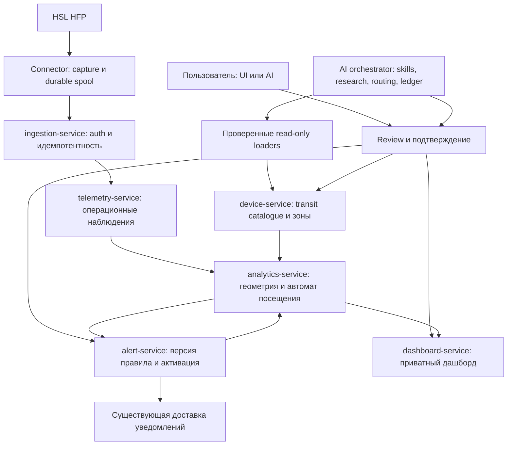

# Геозоны, обслуживание остановок и AI-настройка транспорта

**Scope correction 2026-11-03:** this specialized implementation design/queue is
superseded by [configurable operations](configurable-operations-platform.md).
Retain identity, coverage and acceptance constraints as one solution package;
do not implement transit-specific core tables/rule branches from this document.
Implementation remains stopped pending an explicit resume.

Статус: **целевая архитектура и план реализации**, 2026-11-03.
Runtime и работающие API этим документом не изменены. Пользователь выбрал
контроль **только обязательных остановок**. Новая кампания моделей, подключение
живого автобуса и отправка уведомлений этим планированием не запускаются.

Программа: [Transit stop monitoring](../../openspec/changes/README.md#transit-stop-monitoring-program).
Нормативная приёмка: [сквозные сценарии](transit-stop-monitoring-acceptance.md).
Машиночитаемый план корпуса: [scenario manifest](transit-stop-monitoring.scenarios.json).
Существующая архитектура AI: [assistant orchestration](ai-assistant-orchestration.md).

## 1. Продуктовый контракт

Пользователь может вручную или через AI выбрать автобус и рейс, получить
проверенные остановки, определить обязательные места обслуживания, создать
геозоны, включить правило и подготовить приватный дашборд. Оба интерфейса
используют одни API, проверки и receipts.

Нужно различать три понятия:

- **Остановка рейса:** упорядоченное посещение stopId в определённом рейсе.
- **Обязательное обслуживание:** версионированная пользовательская/операторская
  политика, требующая наблюдаемого открытия дверей при этом посещении.
- **Наблюдаемое выполнение:** телеметрическое свидетельство по этой политике,
  а не доказательство посадки пассажиров или вины водителя.

Наличие остановки в GTFS, timepoint или разрешение посадки не доказывает
обязанности открывать двери при отсутствии пассажиров. AI не создаёт такую
обязанность из расписания. Если подтверждённого набора обязательных остановок
нет, правило сохраняется неактивным и запрашивается выбор конкретных остановок
или импорт проверенной политики. Подтверждённая политика может явно включить
все посещения выбранного рейса; это отдельное осознанное решение пользователя.

Базовый алерт: **«Возможный пропуск обязательного обслуживания остановки»**,
код POSSIBLE_MISSED_REQUIRED_STOP. Он означает «в принятом потоке не наблюдалось
требуемого обслуживания при достаточном покрытии по выбранной политике».
Публичный MQTT не гарантирует полноту всех физических событий. Даже хорошее
покрытие не превращает это заключение в доказанный физический факт.

## 2. Что уже есть и чего пока нет

| Поверхность | Реальная основа | Недостающая часть |
| --- | --- | --- |
| HSL | connector в deploy/connectors/hsl, создание VEHICLE/source, фиксированная HSL-интеграция | Событийный capture, справочник рейсов/остановок, полнота и перегрузка |
| Телеметрия | GPS и transport.doorsOpen/routeId/direction/nextStopId/scheduledStart | operatingDay, устойчивый trip match, события без GPS, доказательства покрытия |
| Геозоны | owner/device settings в telemetry-service, круги 10–50000 м, максимум 50 | Общие versioned зоны, связи с правилами, серверная потоковая оценка |
| События зон | frontend/src/vehicles/monitoringModel.ts вычисляет ENTER/EXIT по истории | Работа без открытого браузера и durable состояние |
| Алерты | alert-service: lifecycle, dedup, channels и текущие числовые правила | Типизированное пространственно-временное правило |
| AI | Spring AI, реестр skills, durable план/receipts, бюджет, review | Transit skills, безопасное исследование, выбранные профили моделей, составная приёмка |
| Дашборды | Общий compiler/preview/private draft, карта, boolean history | Слои остановок/зон и свидетельства обслуживания через owner capabilities |

Текущий LatestPositions оставляет одну последнюю точку на машину, а отправка
происходит примерно раз в 5 секунд. map_position принимает только VP с GPS.
Открытие и закрытие дверей между отправками может потеряться; события без
координат и отдельные DOO/DOC не проходят. Этот путь подходит для latest map,
но не для вывода об отсутствии открытия дверей. Не превращать его в источник
таких отрицательных заключений.

## 3. Два контура и владельцы данных

- device-service владеет TransitSnapshot, StopServicePolicy, SpatialZone,
  ZoneSet, привязками device/source и их immutable revisions. Каталог публичных
  данных может иметь общий immutable cache; account-owned imports и политики
  остаются изолированными. HTTP/provider access — адаптеры, не domain.
- ingestion-service проверяет источник, scope, лимиты, ключи событий и capture
  session. Не доверяет accountId/deviceId из произвольного тела коннектора.
- telemetry-service хранит принятые операционные наблюдения и coverage evidence.
  Отдельный поток не меняет совместимость существующих GPS/measurement API.
- analytics-service выполняет серверную пространственно-временную оценку,
  хранит состояние посещения и результат. Не владеет уведомлениями.
- alert-service владеет rule revisions, разрешением активации, алертами,
  suppression/maintenance и доставкой через существующие notification ports.
- dashboard-service владеет определениями и owner widget contracts. Не вычисляет
  факт обслуживания; читает авторизованные проекции.
- ai-agent-service владеет планом, вопросами, делегированием и бюджетом.
  Не пишет в чужие БД и не вычисляет алерт по каждой GPS-точке.

На первом этапе не добавлять новый микросервис, Flink, vector DB или новую
agent framework. Ввести ограниченные модули и порты в существующих сервисах.
Оценить необходимость иного stream runtime по измеренным нагрузкам.

## 4. Справочник транспорта и доверие к внешним данным

HSL HFP — источник фактических наблюдений; GTFS и Digitransit — источник
маршрутов, вариантов, порядка остановок, service dates и геометрии. Live lookup
не нужен на каждую позицию. Известный provider загружается обычным адаптером,
без LLM и свободного браузинга.

TransitSnapshot включает provider/feed namespace, version/content hash,
fetchedAt, effective service dates, source URI/attribution, route/trip/pattern,
направление, platform stopId, stopSequence и координаты/shape. stopId без
namespace и человекочитаемый номер линии не являются устойчивой идентичностью.
Повтор одной остановки на кольцевом маршруте различается stopSequence.

Для HSL trip resolver использует физическую машину operator/vehicle из topic,
route, operatingDay, scheduledStart, direction и provider lookup. HFP topic
direction 1/2 явно отображается в GTFS 0/1; нельзя применять простое приведение.
Учитывать Europe/Helsinki, DST, service day и GTFS-время более 24:00.
Нет уникального совпадения — TRIP_UNRESOLVED и уточнение, а не угаданный рейс.
nextStopId — подсказка прогресса, не полный список остановок и не trip ID.
Назначение машины может измениться, не меняя идентичности физического устройства.

Research skill применяется только если структурированных данных недостаточно.
Возвращает EvidenceDocument с URL, датой, digest, безопасной выдержкой и
кандидатами фактов; внешняя страница не становится инструкцией или командой.
Ограничить домены, redirects, private-network egress, объём, MIME, время,
число загрузок и срок хранения. Секреты добавляются server-side. Более сильная
модель не получает расширенных прав. Неподдержанный provider требует отдельного
адаптера; AI не устанавливает коннектор и не исполняет найденный код.

Read-only discovery может заполнять технический content-addressed cache
публичных reference данных, но не создаёт account-owned import/policy.
Материализация выбранного импорта — отдельное reviewed действие. Cache candidate
и подтверждённый доменный ресурс имеют разные статусы и не смешиваются.

API Digitransit требует registration/subscription key; секрет настраивается
оператором, не копируется в prompt. GTFS-package adapter позволяет обойтись
без обязательной online GraphQL-зависимости. Проверять ZIP paths/expansion bounds,
размер, referential integrity и даты; старый snapshot не считается текущим.
Новая версия не заменяет закреплённую под работающим рейсом молча.
Отмена/объезд из RT получает bounded freshness и effective scope; невалидные или
устаревшие сведения ведут к UNKNOWN, а не к выдуманной отмене остановки.

## 5. Событийный capture и покрытие

Сохранить latest mailbox для карты; добавить отдельный durable путь операционных
событий. Для выбранных машин принимать VP, DOO, DOC и проверенные stop/journey
events (ARR/DEP/ARS/PDE/PAS/VJA/VJOUT). Список allowlisted и ограниченный.
Не считать два разных события с одним timestamp дубликатами.

VehicleOperationalObservation:
eventId, schemaVersion, sourceId, deviceId, captureSessionId,
sourceEventKey, providerEventType, occurredAt, receivedAt, payloadDigest,
journey identity, stop reference, optional position/speed/door state,
quality/provenance. DoorState = OPEN | CLOSED | UNKNOWN; отсутствие не CLOSED.
Событие двери без GPS сохраняется; привязка к месту допустима только через
однозначные временные/рейсовые свидетельства с максимальным возрастом.

Stable source key использует provider identity, тип, время и нормализованный
content hash при отсутствии provider event ID. UNKNOWN delivery повторяется
с тем же key. Стабильный source key не зависит от captureSessionId; повтор после
reconnect не создаёт новое физическое событие. Разные типы при одном времени
сохраняются. Не заявлять, что эвристический hash различает любые физические повторы.

Коннектор сохраняет событие в ограниченный disk spool до локального принятия,
батчит без coalescing дверных переходов, удаляет после durable ingress ACK.
Ingress transactional outbox и telemetry consumer inbox сохраняют идемпотентность;
нет сквозной распределённой exactly-once транзакции. Crash между стадиями
проверяется с повторной доставкой. Replay не переписывает occurredAt.

CoverageInterval фиксирует disconnect, restart, overflow, clock skew,
неподдерживаемый event, sampling/coalescing и stale feed. Переполнение не
маскируется: интервал degraded, метрика и диагностическое событие. Отсутствие
provider sequence/replay означает, что upstream loss может быть невыявляемым.
CoverageQuality описывает принятую наблюдаемость, а не гарантирует физическую полноту.

Партиционирование по account/device/source. Retention, outbox/spool limits и
скорость чтения — typed deployment policy. Предлагаемый pilot envelope:
20 машин, 10 входных событий/сек на машину burst, 15 минут локального spool;
размер в байтах рассчитывается из измеренного p99 payload и проверяется тестом.
Это цель приёмки, не существующая capacity claim. TTL evidence не короче окна
оспаривания/объяснения алерта; исходное предложение 30 дней, явно настраиваемо.
Дольше хранится bounded lineage, без обещания бесконечного доступа к raw evidence.

## 6. Зоны и совместимость существующей карты

SpatialZone имеет accountId, id, version, WGS84 circle, name, provenance,
enabled и effectiveFrom. ZoneSet с immutable revision может относиться к
конкретному transit snapshot/route pattern и повторно использоваться машинами.
Начальный scope — круги; polygons/corridors — следующий capability, не скрытая
подмена круга. Расстояния вычисляются в метрах серверной функцией; frontend
рисует те же параметры и не становится исполнителем правила.

Не переносить молча существующие пользовательские настройки в account-wide
правила. Старый owner/device endpoint сохраняется. Явный импорт создаёт новые
zone IDs с legacy provenance, после review; старый географический view продолжает
работать. Переиспользование зон в новом UI идёт через canonical zone API.
Удаление referenced revision запрещено; deactivation создаёт новую версию.
Изменение координат/радиуса инвалидирует неподтверждённый review.

Для остановок используются platform coordinates и occurrence binding.
Противоположная сторона дороги, соседняя платформа и геометрическое пересечение
не дают права выбрать другую остановку. Кандидаты ограничиваются текущим
рейсом, порядком и направлением; неоднозначность приводит к UNKNOWN.

## 7. Правило и автомат посещения

Название типа правила: REQUIRED_STOP_SERVICE. Версионированный payload связывает
device/source, transitSnapshotId, trip/pattern scope, mandatoryPolicyRevision,
zoneSetRevision, service predicate и evidence policy. Запрещены SQL, скрипты и
свободный eval. Начальная алгебра содержит только зарегистрированные события,
пространственные проверки, ограниченные окна и observed boolean predicates.
Произвольный CEP-язык не входит в первый релиз.

Подтверждаемые pilot defaults, а не данные HSL:

| Параметр | Начальное предложение |
| --- | --- |
| Контрольная граница | 30 м, пользовательское значение |
| Индикатор близости на карте | 10 м; не обязательное условие обнаружения проезда |
| Обслуживание | Наблюдаемые OPEN и скорость ≤0.5 м/с в течение 2 с в зоне |
| Подтверждение выхода | Вне 30 м непрерывно ≥3 с, минимум 2 валидных наблюдения |
| Allowed lateness | 10 с после подтверждённого выхода |
| Максимальный gap наблюдений для отрицательного вывода | 2 с |
| Time/location association для события без GPS | ≤2 с, тот же однозначный рейс |
| Silence handling | UNKNOWN через 15 с без пригодных наблюдений; не «выезд» |

Review показывает все значения и смысл обслуживания. Если нужна только дверь без
остановки, пользователь выбирает другой зарегистрированный predicate.
10 м — визуальный ориентир: автобус, прошедший в 20 м, не должен исчезнуть из
контроля. Точность GPS может быть неизвестна; 10/30 м не означают гарантии такой
точности. Использовать uncertainty band из реального accuracy при наличии или
явного допущения policy; пограничная/непригодная геометрия даёт UNKNOWN.
Debounce сохраняет порог 30 м, не заменяет его незаметно на 35 м.

Visit key:
accountId + ruleRevision + deviceId + sourceId + tripInstanceId + stopSequence.
На посещении закреплены версии расписания, зон, политики, evaluator version и
event-time окна. Повтор остановки в новом рейсе/sequence — отдельное посещение.

| Состояние | Переход |
| --- | --- |
| WAITING | Ожидаем обязательное посещение текущего однозначного рейса |
| ARMED | Наблюдаем уверенный вход внутрь 30 м |
| SERVICE_OBSERVED | Подтверждён predicate обслуживания внутри окна |
| EXIT_PENDING | Подтверждён выход; ожидаем поздние события |
| CLOSED | SERVICED / POSSIBLE_MISSED / UNKNOWN / EXEMPT |

Вход в середине уже начатого посещения без наблюдаемого начала даёт LEFT_CENSORED
и запрещает отрицательный вывод. Возможный пропуск — только после уверенного
наблюдаемого входа, выхода, достаточного покрытия и отсутствия service witness
во всём окне после allowed lateness. Условие «автобус остановился» не должно быть
предусловием ARMED: иначе проехавший без остановки автобус не будет обнаружен.

Нет входа, только две точки снаружи — недостаточно для заявленного сценария.
Не интерполировать пересечение как наблюдаемое. PAS помогает сопоставить
посещение, но не подменяет доказательство прохождения пользовательской 30 м зоны.
Отдельный route-bypass detector можно добавить позже; MVP возвращает UNKNOWN.

Late event внутри 10 с может предотвратить алерт. После финализации позднее
свидетельство создаёт append-only correction и обновляет жизненный цикл с
причиной; никогда не удаляет историю и не создаёт второй алерт. Timer durable,
связан с event-time progress и wall-clock deadline для остановившегося потока.
Deadline без доказанного покрытия закрывает UNKNOWN, не нарушение.

Trip change, cancellation, approved detour, source switch, rule revision,
disabled state, maintenance, loss of access и delete проходят явные проверки.
Новая версия действует на новые посещения; текущие завершаются pinned версией
либо явно закрываются UNKNOWN при инвалидирующем изменении. Деактивация
немедленно запрещает новую доставку. Maintenance в окне приводит к EXEMPT или
UNKNOWN по review policy; ingestion продолжает хранить наблюдения.
Изменение доступа запрещает выдачу evidence бывшему владельцу.

## 8. Алерты, API и события

Предлагаемые пути ниже **не существуют как контракт реализации**. На change
implementation уточнить DTO/OpenAPI, gateway routes и bounded pagination.

| Владелец | Предлагаемый интерфейс |
| --- | --- |
| device | GET /transit/providers, /transit/routes, /transit/trips, /transit/stops; bounded filters |
| device | POST /transit/imports; GET /transit/imports/{id}; snapshot/policy review |
| device | POST/GET /spatial-zones; PUT /spatial-zones/{id} с If-Match; zone-set revisions |
| device | POST /stop-service-policies; immutable revisions и provenance |
| ingestion | POST /ingestion/vehicle-events; existing source auth, bounded batch/ACK |
| telemetry | Authorized operational-event/coverage evidence reads; immutable cutoffs |
| alert | POST /alert-rules/prepare для typed rule; existing CRUD расширяется совместимо |
| alert | POST /alert-rules/{id}/activate с If-Match, reviewed digest и idempotency key |
| analytics | POST /analytics/stop-service/evaluate для dry-run; GET bounded visits/evidence |
| dashboard | Existing composition/prepare, create/draft/receipt API и registered capabilities |

Rule definition belongs alert-service, с отдельным typed compiler для нового
правила. Не протаскивать operator/deviceId в несовместимый numeric-rule mapper.
Старые condition types остаются без изменений. Rule activation receipt
доказывает сохранённый payload и выбранные snapshot/zone/policy revisions.
No-data даёт WAITING_FOR_DATA; никакого выдуманного dry-run успеха.

Активация асинхронна: DRAFT → PREPARED → ACTIVATING → ACTIVE/WAITING_FOR_DATA.
Owner activation receipt сначала подтверждает запрос и exact revisions.
ACTIVE допустим только после durable evaluator readiness ACK для activation
epoch: загружены все pinned projections, сохранён стартовый checkpoint и
определена граница live evaluation. ACK публикуется analytics outbox и
идемпотентно принимается alert inbox. До ACK UI/AI показывает ACTIVATING.
Временная потеря ACK приводит к reconciliation того же epoch, не новой активации.
Необработанный backlog до start boundary может использоваться dry-run без
ретроактивной доставки; historical notification требует отдельной явной политики.
После рестарта checkpoint не сдвигается на текущее время молча.

Новые topic contracts, все target-only:
- vehicle.operational.accepted.v1 — telemetry producer после durable хранения;
  analytics consumer; key account/device/source; EventEnvelope.
- transit.snapshot.changed.v1 и spatial.zone-set.changed.v1 — device outbox;
  consumers поддерживают authorized immutable projections.
- alert.stop-service-rule.changed.v1 — alert outbox; analytics projection,
  с effective revision и disabled tombstones.
- analytics.stop-service.evaluated.v1 — analytics outbox; alert inbox consumer.
- analytics.stop-service-rule.ready.v1 — evaluator readiness ACK конкретного
  activation epoch; alert inbox consumer.

Outcome event содержит visitId, stable outcomeId/revision, rule/snapshot/zone/policy
versions, occurrence/vehicle/source, window, observed minimum distance,
door/service witnesses, coverage gaps, quality и bounded evidence refs/digest.
Alert uniqueness — logical rule + device/source + trip instance + occurrence;
конфигурационные ревизии и correction не порождают второй алерт того же
посещения. Actor/account берётся из доверенного envelope.
Notifications используют отдельную стабильную delivery identity; retry провайдера
не считается новым алертом. Не обещать exactly-once email/Telegram доставку.
Терминальный алерт не auto-resolve просто потому, что двери открылись на следующей
остановке. Correction/ack/resolve сохраняют reason и исходные evidence refs.

## 9. AI: управляемая делегация и разные модели

Переиспользовать PrimaryAssistant, IntentOrchestration, SkillRegistry,
ConfirmedInputs, SpringAiExchange, durable AttemptLedger и existing V/R.
Добавить versioned skills, а не второй assistant engine.

| Роль | Контракт и права |
| --- | --- |
| Coordinator | Интерпретирует запрос, выбирает registered intents, DAG и вопросы |
| Transit research | Read-only structured loaders; bounded web evidence при необходимости |
| Device/setup | Существующие CREATE_DEVICE / CREATE_DATA_SOURCE; receipt-backed identity |
| Spatial/policy | Propose zone set и explicit mandatory policy |
| Rule designer | Typed rule proposal, dry-run evidence, activation review |
| Dashboard designer | Existing semantic operations с owner capabilities |
| Assessor | Read-only original requirements, authorized evidence и candidate diff |

Работники возвращают typed result coordinator; они не вызывают друг друга
рекурсивно и не подтверждают себе мутации. Максимум один уровень делегации в
первом релизе, максимум два параллельных read-only задания. Идентичность
delegationJobId/parentStep, source question и expected revision сохраняется.
Вопрос работника поднимается пользователю через coordinator без нового чата.
Cancelled/late worker не заменяет более свежий review.

Новые intents: RESOLVE_TRANSIT_TRIP, PREPARE_ZONE_SET,
PREPARE_STOP_SERVICE_POLICY, PREPARE_STOP_SERVICE_RULE,
TEST_STOP_SERVICE_RULE, ACTIVATE_STOP_SERVICE_RULE.
Resolve/test — read-only; prepare/activation идут через review.
Они не объявляются доступными до регистрации owner endpoints и capability.

План:
resolve vehicle/trip → prepare bundle → confirm create/connect device →
bind receipts → create zones/policy → save disabled rule → optional dashboard →
verify required receipts → confirm activation.
Пользователь может подтвердить bounded bundle заранее, если каждая разрешённая
мутация, критерий выбора и предел fan-out показаны в review; материализованные
IDs только из receipts. Нельзя переиспользовать согласие для другого автобуса,
остановки, источника или изменившейся политики. По умолчанию активация отдельная.
Dashboard optional и не блокирует сбор данных, но запрошенный dashboard остаётся
незавершённой обязательной целью плана до создания.

Источник live state не заменяется synthetic автоматически. WAITING_FOR_DATA
сохраняет устройство и прогресс; dry-run на fixture маркируется synthetic и
не становится live evidence. Исследование/просмотр не создают domain resources.

Routing policy:
- PINNED сохраняет текущую семантику единственной выбранной модели.
- Для opt-in AUTO назначать зарегистрированный qualified profile по skill/phase
  без routing-LLM. Выбранную модель закрепить в durable step binding до вызова.
  Новый профиль/эскалация — только разрешённый переход policy, trace и reservation.
- Экономичная модель — конкретизация схемы/простые вопросы; более сильная —
  неоднозначный research/compound planning, если это подтвердили evals.
  Для GTFS lookup, геометрии и обработки событий LLM не нужна.
- Все child calls, context/format corrections, assessments и research-provider
  calls учитываются в одном turn/plan ledger. У web/download есть также
  собственные технические egress/byte лимиты; это не второй денежный бюджет.
- Per-profile native schema/tool support, context/output reserve, deadline,
  qualification evidence и PriceSnapshot обязательны. Unknown price —
  явная operator cap или блокировка экономического AUTO; не выдуманная цена.
- Trace: job/step/attempt, model/profile/version, evidence IDs, bounded codes,
  actual/unknown usage. Без API keys, raw pages, private reasoning.
- Пилотные пределы: 12 chat calls/turn, 80/plan, 30 с research job,
  8 документов и 1 МБ извлечённого текста/research job; общая длительность
  long-running plan не равна сроку JWT. Денежный ceiling настраивается и
  показывается до активации AUTO, не фиксируется в исходниках.
  Текущие session/timeout guards сохраняются: последовательные turns с refresh;
  долгие I/O jobs возобновляются с reauthorization без хранения refresh token.

Разные модели не требуют независимых агентов с широкими полномочиями.
Специализация прежде всего задаётся skill, schema, scoped context и тестами;
маршрутизация не должна маскировать плохие контракты.

## 10. Дашборд и пользовательский контроль

Обычный интерфейс предоставляет каталог маршрутов/рейсов, редактор ZoneSet,
выбор обязательных остановок, predicate/coverage policy, dry-run и активацию.
AI использует эти же функции; сценарий должен работать с отключённой генерацией.

Дашборд: карта автобуса и pinned остановок/30 м зон, текущий рейс, двери,
скорость, history measured door states, посещения, покрытие и алерты.
Новый evidence widget/слой регистрируется владельцем, capability содержит
параметры и freshness; общий preview/renderer сохраняется.
Отрисовка/опрос не запускают evaluator. Нет полного слоя — честное указание
ограничения, а не карта с вымышленными остановками.
«В зоне», «Остановился», «Дверь открыта» — разные наблюдаемые признаки.
Пользователь может увидеть, почему конкретное посещение SERVICED/UNKNOWN,
в какие моменты были вход/выход, откуда правило обязательности и какой gap найден.

## 11. Порядок реализации и доказательства готовности

T1 reference catalogue, T2 operational capture и T3 reusable zones независимы.
T4 evaluator/rule activation объединяет T1–T3. T5 manual UI/dashboard и T6 AI
потребляют owner contracts T4; AI dashboard capabilities требуют T5.
T7 harness/fixture design начинается сразу, release gate — после T1–T6.
Не ждать live A6 для написания этих контрактов; release AI использует общие
незавершённые A5/V/R/A6 quality gates, не закрывает их новым названием.

Первый вертикальный срез: один выбранный физический автобус, один однозначный
рейс, одна явно обязательная остановка, круг 30 м, evidence alert, обычный UI.
Затем полный список остановок, reload/partial recovery, multi-model и held-out
AI dialogue. Это ограничение pilot rollout, не глобальный запрет сложных планов.

Предлагаемые release gates: deterministic/security suite 100%; ноль ложных
алертов на UNKNOWN/EXEMPT cases; replay/correction без дублей; доступ к чужим
данным ноль; reviewed/saved equality 100%. На frozen 24-family AI corpus:
first-pass complete-task success ≥90%, final ≥95%, не менее 3 trials/family;
critical wrong-resource/unauthorized activation = 0.
Это новые proposed thresholds, подлежат фиксации до запуска; старые A5/A6
критерии нельзя ослаблять. Все не достигнутые шаги входят в знаменатель.
Экономика: all calls/latency/known cost и cost per successful complete task;
unknown price не позволяет заявлять экономию. Synthetic, provider fixtures,
live feed и real-model evidence отчётливо разделяются.
На реальном автобусе нельзя требовать фактического нарушения ради теста:
успех срабатывания доказывается независимым synthetic/replay корпусом;
live smoke доказывает идентичность, реальные поля и честные quality limits.

## 12. Источники и принятые практики

Проверены 2026-11-03; это обоснование предложений, не проверка живого HSL-сеанса.

- [HSL HFP](https://digitransit.fi/en/developers/apis/5-realtime-api/vehicle-positions/high-frequency-positioning/):
  отдельные door/stop events, physical identity, route/stop mapping, direction и
  operating day. Эти возможности требуют адаптера, не гарантируют полноту потока.
- [HSL open data](https://www.hsl.fi/en/hsl/open-data):
  GTFS datasets и каналы realtime.
- [Digitransit APIs](https://digitransit.fi/en/developers/apis/):
  registration/API key; конкретные quotas проверять в текущем portal.
- [GTFS reference](https://gtfs.org/documentation/schedule/reference/):
  service-day time, stop sequence и pickup/drop-off permissions.
- [Building effective agents](https://www.anthropic.com/research/building-effective-agents):
  простые composable workflows, routing и bounded orchestrator/worker pattern.
- [Spring AI tool calling](https://docs.spring.io/spring-ai/reference/api/tools.html):
  application-defined tools; сохраняем собственный durable execution boundary.
- [Event-time processing](https://nightlies.apache.org/flink/flink-docs-stable/docs/concepts/time/):
  различие event/processing time и late events. Заимствуем понятия, не вводим Flink.

