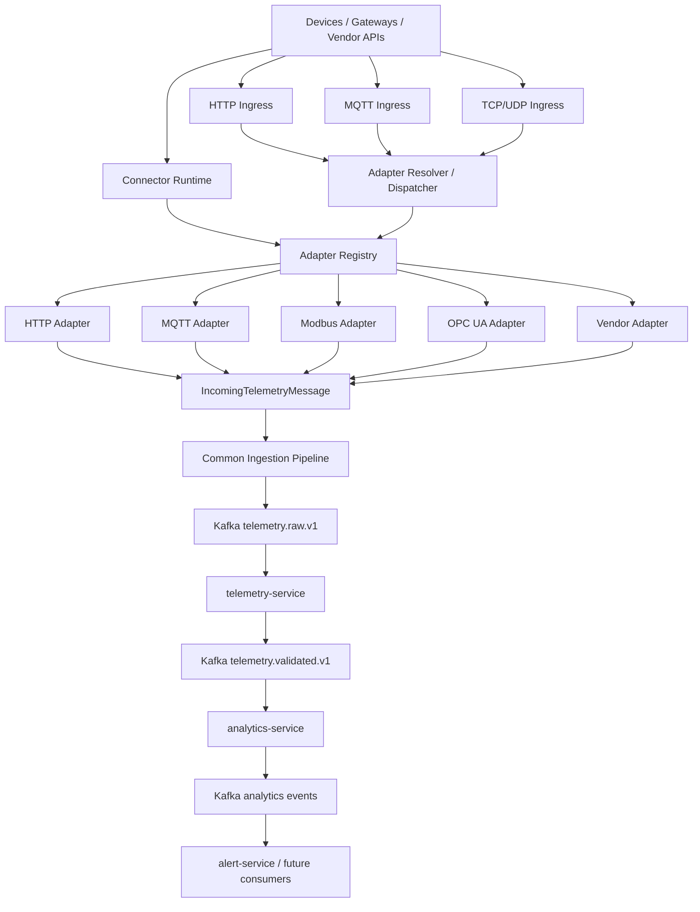
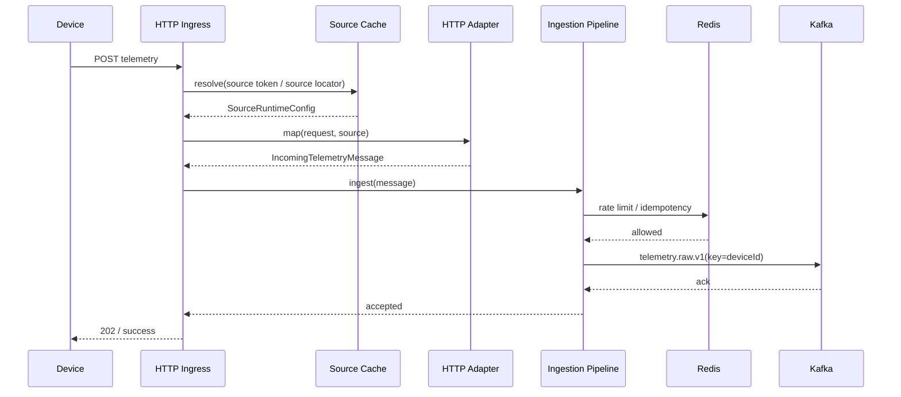
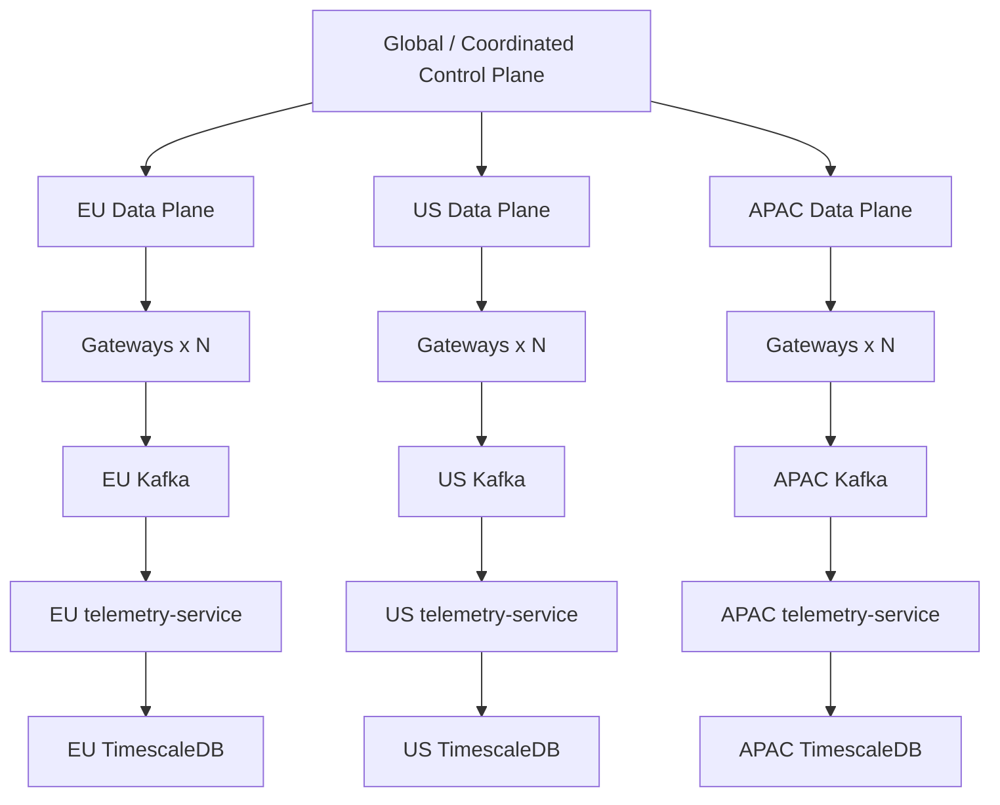

# VoltCanary Ingestion Architecture
## Target Architecture for Protocol Adapters, Horizontal Scaling, Future Service Split, and Multi-Region Deployment

**Status:** Target design  
**Scope:** `ingestion-service` and its immediate contracts  
**Primary goal:** Build the correct long-term architecture now, while keeping it deployable as a single `ingestion-service` today.

---

## 1. Executive Summary

VoltCanary should treat `ingestion-service` as a **Protocol Gateway / Telemetry Data Plane entry point**, not merely as an HTTP controller with an MQTT side path.

The target architecture should satisfy four properties from the beginning:

1. **Protocol extensibility**  
   Adding Modbus TCP, OPC UA, CoAP, Sparkplug B, vendor REST APIs, or custom TCP must not require changes to the common telemetry pipeline.

2. **Horizontal scalability**  
   Stateless ingress paths should scale by adding replicas. Stateful connectors such as Modbus polling or OPC UA subscriptions should use explicit source ownership so that only one runtime instance owns a connector at a time.

3. **Future service decomposition**  
   Today all adapters may live in one deployable `ingestion-service`. Later HTTP, MQTT, industrial protocols, or vendor connectors may be extracted into separate services without changing downstream telemetry contracts.

4. **Future regional scalability**  
   The architecture must support a later split into regional Data Planes such as EU, US, and APAC while keeping a shared or globally coordinated Control Plane.

The most important boundary is:

```text
PROTOCOL-SPECIFIC WORLD

MQTT topics
Modbus registers
OPC UA NodeIds
CoAP resources
vendor JSON
custom TCP frames

              │
              ▼
       Protocol Adapter
              │
              ▼

VOLTCANARY CANONICAL WORLD

sourceId
deviceId
accountId
timestamp
metrics
metadata
ingestion attributes
```

After the adapter boundary, no downstream service should need to understand MQTT, Modbus, OPC UA, Shelly, Tasmota, Tuya, or any other protocol.

---

# 2. Current State

The current `ingestion-service` already has several good properties:

- one logical telemetry ingress boundary;
- HTTP endpoints for single, batch, and import ingestion;
- MQTT ingestion path;
- a shared internal model: `IncomingTelemetryMessage`;
- a common pipeline: `DefaultTelemetryIngestionPipeline`;
- rate limiting;
- idempotency;
- source and device validation;
- Kafka publication to `telemetry.raw.v1`;
- storage isolated in `telemetry-service`.

Current flow:

```text
HTTP
  │
  ▼
IngestionController
  │
  ▼
IngressOrchestrator
  |
  v
HttpTelemetryAdapter
  │
  └─────────────┐
                │
MQTT            │
  │             │
  ▼             │
MqttTelemetrySubscriber
  │             │
  └─────────────┘
                ▼
    IncomingTelemetryMessage
                │
                ▼
DefaultTelemetryIngestionPipeline
                │
                ▼
      TelemetryReceivedEvent
                │
                ▼
       telemetry.raw.v1
                │
                ▼
       telemetry-service
                │
                ▼
          TimescaleDB
```

This is a good MVP shape, but the implementation should be redesigned before adding many protocols.

The target system should not grow into this:

```text
IngestionController
MqttTelemetrySubscriber
ModbusManager
OpcUaManager
CoapManager
ShellyManager
TuyaManager
TasmotaManager
...
        │
        ▼
large shared service with protocol-specific branches
```

Instead, it should grow through explicit adapter contracts and runtime orchestration.

---

# 3. Architectural Principles

## 3.1 One logical ingress boundary, many adapters

For now there should still be one deployable service:

```text
ingestion-service
```

But logically it consists of multiple components:

```text
ingestion-service
│
├── ingress layer
├── adapter layer
├── connector runtime
├── source configuration read model
├── common ingestion core
├── Kafka publisher
└── observability / health
```

Do not create one microservice per protocol today.

However, do not design classes in a way that assumes all adapters must always live inside the same JVM.

---

## 3.2 Separate transport, protocol, and connector

These are different concepts.

### Transport

How bytes/messages are transported.

Examples:

```text
HTTP
TCP
UDP
MQTT transport connection
WebSocket
Serial
BLE
```

### Protocol

How communication is structured.

Examples:

```text
REST
MQTT
Modbus TCP
OPC UA
CoAP
Sparkplug B
BACnet/IP
```

### Connector / adapter

How VoltCanary integrates with a concrete source type.

Examples:

```text
Generic MQTT
Tasmota over MQTT
Shelly over MQTT
Home Assistant WebSocket
Generic Modbus TCP
Siemens OPC UA
Generic REST Polling
Tuya Cloud API
```

A source should therefore be able to describe all three where useful.

Example:

```json
{
  "adapterType": "TASMOTA_MQTT",
  "transport": "MQTT",
  "protocol": "MQTT"
}
```

Another example:

```json
{
  "adapterType": "GENERIC_MODBUS_TCP",
  "transport": "TCP",
  "protocol": "MODBUS_TCP"
}
```

---

## 3.3 Adapters normalize protocol-specific data

An adapter is responsible for:

- protocol-specific parsing;
- protocol-specific addressing;
- connection lifecycle where applicable;
- payload mapping;
- optional polling;
- optional subscription;
- optional command execution;
- protocol-level error conversion;
- producing canonical `IncomingTelemetryMessage`.

An adapter is **not** responsible for:

- account-wide rate limiting;
- global idempotency policy;
- Kafka topic selection for canonical raw telemetry;
- general source authorization;
- analytics;
- time-series persistence;
- alerting.

---

## 3.4 Common ingestion pipeline stays protocol-agnostic

The common pipeline should know nothing about:

- MQTT topic syntax;
- Modbus register numbers;
- OPC UA NodeIds;
- BACnet object identifiers;
- Shelly/Tasmota/Tuya payload formats;
- CoAP resource paths.

The common pipeline receives a canonical object and performs generic processing.

---

## 3.5 Push and active connectors scale differently

A major design distinction:

### Stateless / push ingress

Examples:

- REST push;
- inbound webhook;
- some MQTT gateway patterns.

These can usually be routed to any replica.

```text
Device
  │
  ▼
Load Balancer
  │
  ├── ingestion-1
  ├── ingestion-2
  └── ingestion-3
```

### Stateful / active connector

Examples:

- Modbus polling;
- OPC UA long-lived subscription;
- vendor REST polling;
- custom TCP connection owned by VoltCanary.

These require ownership.

```text
source-123
    │
    ▼
exactly one runtime owner
    │
    ▼
connector instance
```

The adapter must not solve ownership itself. Ownership belongs to the connector runtime.

---

# 4. Target Logical Architecture



Inside one deployable process:

```text
┌────────────────────────────────────────────────────────────┐
│                    ingestion-service                       │
│                                                            │
│  ┌──────────────────── INGRESS ────────────────────────┐   │
│  │ HTTP │ MQTT │ TCP │ UDP │ WebSocket │ import       │   │
│  └─────────────────────────┬────────────────────────────┘   │
│                            │                                │
│                            ▼                                │
│                Adapter Resolver / Dispatcher                │
│                            │                                │
│                            ▼                                │
│                    Adapter Registry                         │
│                            │                                │
│         ┌──────────────────┼───────────────────┐            │
│         ▼                  ▼                   ▼            │
│      HTTP              MQTT               Industrial       │
│     adapters           adapters             adapters        │
│         │                  │                   │            │
│         └──────────────────┼───────────────────┘            │
│                            ▼                                │
│                IncomingTelemetryMessage                    │
│                            │                                │
│                            ▼                                │
│                Common Ingestion Pipeline                   │
│                            │                                │
│                            ▼                                │
│                    Kafka Publisher                          │
│                                                            │
│  ┌──────────────── CONNECTOR RUNTIME ──────────────────┐   │
│  │ source assignment │ polling │ subscriptions │ health │   │
│  └──────────────────────────────────────────────────────┘   │
│                                                            │
│  ┌────────────── SOURCE CONFIG READ MODEL ─────────────┐   │
│  │ source config │ mapping │ status │ region │ auth refs│   │
│  └──────────────────────────────────────────────────────┘   │
└────────────────────────────────────────────────────────────┘
```

---

# 5. Recommended Code / Module Structure

Even while deploying one service, use internal modules or very strict package boundaries.

The current repository is Maven-based, so the first implementation should keep
Maven and introduce these boundaries as packages or Maven modules. Do not make a
Gradle migration part of the ingestion architecture change unless there is a
separate build-system decision.

```text
ingestion/
│
├── ingestion-app/
│   └── Spring Boot application / wiring
│
├── ingestion-core/
│   ├── canonical message model
│   ├── common ingestion pipeline
│   ├── validation
│   ├── normalization
│   ├── idempotency
│   ├── rate-limit contracts
│   └── canonical event creation
│
├── adapter-api/
│   ├── adapter contracts
│   ├── manifests
│   ├── capabilities
│   ├── adapter registry
│   └── common connector models
│
├── adapter-http/
│   ├── HTTP push
│   ├── HTTP batch
│   ├── imports
│   └── generic webhook
│
├── adapter-mqtt/
│   ├── MQTT ingress
│   ├── topic mapping
│   └── payload mapping
│
├── adapter-industrial/
│   ├── Modbus TCP
│   ├── OPC UA
│   └── later BACnet / CoAP
│
├── connector-runtime/
│   ├── ownership
│   ├── lifecycle
│   ├── scheduler
│   ├── health
│   └── lease manager
│
├── source-config/
│   ├── local read model
│   ├── config event consumer
│   └── credential references
│
└── kafka-out/
    ├── TelemetryReceivedEvent
    └── producer
```

If a multi-module refactor is too large for one change, use the same boundaries as packages first and convert them into modules afterward.

Important rule:

> `adapter-*` modules may depend on `adapter-api` and canonical models, but `ingestion-core` must not depend on concrete protocol modules.

---

# 6. Canonical Ingress Model

The existing `IncomingTelemetryMessage` concept should remain, but it should become an explicit architectural contract.

Recommended conceptual model:

```java
public record IncomingTelemetryMessage(
        String messageId,
        String sourceId,
        String deviceId,
        String accountId,
        Instant occurredAt,
        Instant receivedAt,
        Map<String, MetricValue> metrics,
        TelemetryOrigin origin,
        IngestionContext context,
        boolean historicalImport
) {}
```

Example support types:

```java
public record TelemetryOrigin(
        String adapterType,
        String protocol,
        String transport
) {}
```

```java
public record IngestionContext(
        String sourceToken,
        String clientIp,
        Map<String, String> metadata
) {}
```

Avoid protocol-specific objects in the canonical model.

Bad:

```java
Integer modbusRegister;
String mqttTopic;
String opcUaNodeId;
```

Good:

```java
Map<String, String> metadata;
```

Even metadata should only contain data needed for observability, traceability, auditing, or downstream semantics.

It should not become a dumping ground for entire raw protocol models.

---

# 7. Adapter API

Do not build a single giant interface with irrelevant methods.

Use capability-specific interfaces.

The examples below use reactive return types to express asynchronous work.
That is not a requirement to migrate the current Spring MVC service to WebFlux
in the first implementation; synchronous methods, futures, or Reactor types are
all acceptable if the adapter boundary remains the same.

Base contract:

```java
public interface TelemetryAdapter {

    AdapterType type();

    AdapterManifest manifest();
}
```

Capabilities:

```java
public record AdapterCapabilities(
        boolean inbound,
        boolean polling,
        boolean subscription,
        boolean commands,
        boolean discovery
) {}
```

Manifest:

```java
public record AdapterManifest(
        AdapterType type,
        String displayName,
        TransportType transport,
        ProtocolType protocol,
        AdapterCapabilities capabilities,
        String configSchemaVersion
) {}
```

---

## 7.1 Inbound adapter

For data already arriving at VoltCanary.

```java
public interface InboundTelemetryAdapter extends TelemetryAdapter {

    Mono<IncomingTelemetryMessage> handle(
            InboundAdapterRequest request,
            SourceRuntimeConfig source
    );
}
```

`InboundAdapterRequest` should be transport-neutral enough for dispatching, but protocol-specific implementations may have typed request models internally.

Example:

```java
public sealed interface InboundAdapterRequest
        permits HttpAdapterRequest,
                MqttAdapterRequest,
                TcpAdapterRequest {
}
```

---

## 7.2 Polling adapter

For connectors where VoltCanary actively reads data.

```java
public interface PollingTelemetryAdapter extends TelemetryAdapter {

    Mono<PollResult> poll(
            SourceRuntimeContext context
    );
}
```

Where:

```java
public record PollResult(
        List<IncomingTelemetryMessage> messages,
        PollStatus status
) {}
```

The connector runtime determines *when* to call `poll()`.

The adapter determines *how* to talk to the source.

---

## 7.3 Subscription adapter

For long-lived subscriptions such as OPC UA or certain MQTT/vendor connections.

```java
public interface SubscriptionTelemetryAdapter extends TelemetryAdapter {

    Flux<IncomingTelemetryMessage> subscribe(
            SourceRuntimeContext context
    );
}
```

The connector runtime owns start, stop, retry, and restart decisions.

---

## 7.4 Command adapter

Do not force telemetry interfaces to include commands.

```java
public interface CommandAdapter extends TelemetryAdapter {

    Mono<CommandResult> execute(
            SourceRuntimeContext context,
            DeviceCommand command
    );
}
```

This allows a future device-command path without polluting ingestion contracts.

---

# 8. Adapter Registry

Adapters should register through dependency injection.

```java
@Component
public final class AdapterRegistry {

    private final Map<AdapterType, TelemetryAdapter> adapters;

    public AdapterRegistry(List<TelemetryAdapter> adapters) {
        this.adapters = adapters.stream()
                .collect(Collectors.toUnmodifiableMap(
                        TelemetryAdapter::type,
                        Function.identity()
                ));
    }

    public TelemetryAdapter require(AdapterType type) {
        TelemetryAdapter adapter = adapters.get(type);

        if (adapter == null) {
            throw new UnsupportedAdapterException(type);
        }

        return adapter;
    }
}
```

Adding a new adapter should normally require:

1. new adapter implementation;
2. manifest/config schema;
3. tests;
4. Spring bean registration.

It should **not** require changing the common ingestion pipeline.

---

# 9. Adapter Dispatcher / Resolver

The dispatcher must be small.

Its responsibility:

> Resolve which adapter should handle a source/request.

It must not parse all protocols.

Example:

```java
public interface AdapterResolver {

    ResolvedAdapter resolve(AdapterResolutionContext context);
}
```

```java
public record AdapterResolutionContext(
        String sourceId,
        TransportType transport,
        ProtocolType declaredProtocol,
        Integer localPort,
        String mqttTopic,
        Map<String, String> metadata
) {}
```

Preferred resolution order:

```text
1. Known source configuration
2. Explicit endpoint / route
3. Explicit listener / port
4. Topic namespace
5. Optional protocol sniffing
```

Protocol sniffing should be the last option.

For registered sources, the system should already know the adapter.

Example:

```text
sourceId = source-123
        ↓
SourceRuntimeConfig
        ↓
adapterType = GENERIC_MODBUS_TCP
        ↓
AdapterRegistry
        ↓
GenericModbusTcpAdapter
```

No guessing is necessary.

---

# 10. Ingress Layer

The ingress layer deals with network mechanics only.

It should not contain business validation.

---

## 10.1 HTTP

Target flow:

```text
HTTP request
   │
   ▼
IngestionController
   │
   ▼
HttpIngressRequest
   │
   ▼
AdapterResolver
   │
   ▼
HttpTelemetryAdapter
   │
   ▼
IncomingTelemetryMessage
   │
   ▼
Common Ingestion Pipeline
```

`IngestionController` should stay thin.

Bad:

```java
controller:
- token validation
- source resolution
- metric normalization
- rate limiting
- idempotency
- protocol branching
```

Good:

```java
controller:
- deserialize HTTP request
- create transport request
- call ingress orchestrator
- map result to HTTP response
```

---

## 10.2 MQTT

The current MQTT subscriber should be split into transport and adapter logic.

Target:

```text
MQTT client / broker subscription
        │
        ▼
MqttIngress
        │
        ▼
MqttAdapterRequest
        │
        ▼
AdapterResolver
        │
        ▼
MqttTelemetryAdapter
        │
        ├── topic resolver
        ├── payload decoder
        └── configurable mapping
        │
        ▼
IncomingTelemetryMessage
```

Do not hard-code one payload schema forever.

Generic MQTT configuration should support topic and payload mapping.

Example:

```json
{
  "adapterType": "GENERIC_MQTT",
  "subscription": {
    "topicFilter": "factory/+/telemetry"
  },
  "deviceId": {
    "fromTopicSegment": 1
  },
  "mapping": [
    {
      "from": "$.temperature",
      "toMetric": "temperature"
    },
    {
      "from": "$.voltage",
      "toMetric": "voltage"
    }
  ]
}
```

Later vendor-specific MQTT adapters may reuse the same MQTT transport.

---

## 10.3 TCP / UDP

For raw TCP/UDP protocols, Netty is an appropriate transport foundation.

However:

```text
Netty != protocol architecture
```

A listener may be configured for one known protocol.

Example:

```text
port 1502 -> custom Modbus listener
port 9001 -> custom Volt device protocol
```

Optional multiplexing is possible:

```text
Netty connection
    │
    ▼
ProtocolDetector
    │
    ├── protocol A
    ├── protocol B
    └── unsupported
```

But protocol detection must not become the main routing mechanism for registered devices.

When a protocol is detected, the pipeline should be replaced with protocol-specific handlers and the detector removed.

---

# 11. Source Configuration as a First-Class Runtime Model

`source` must evolve from mostly identity/security metadata into a connector definition.

Recommended conceptual model:

```java
public record SourceRuntimeConfig(
        String dataSourceId,
        String sourceId,
        String deviceId,
        String accountId,
        AdapterType adapterType,
        ProtocolType protocol,
        TransportType transport,
        SourceStatus status,
        String homeRegion,
        ConnectionConfig connection,
        MappingConfig mapping,
        PollingConfig polling,
        SubscriptionConfig subscription,
        String credentialsRef,
        RateLimitPolicy rateLimit,
        Map<String, String> attributes,
        long version
) {}
```

Not every adapter uses every field.

The actual persisted model can use typed configuration per adapter.

---

## 11.1 Prefer typed adapter configuration

Avoid one unvalidated JSON blob for everything.

Possible design:

```java
public sealed interface AdapterConfig
        permits MqttAdapterConfig,
                HttpPollingAdapterConfig,
                ModbusTcpAdapterConfig,
                OpcUaAdapterConfig {
}
```

Example:

```java
public record ModbusTcpAdapterConfig(
        String host,
        int port,
        int unitId,
        Duration connectTimeout,
        Duration pollInterval,
        List<ModbusMetricMapping> mappings
) implements AdapterConfig {}
```

Example mapping:

```java
public record ModbusMetricMapping(
        int address,
        ModbusRegisterType registerType,
        DataType dataType,
        double scale,
        String metric
) {}
```

---

# 12. Source Configuration Read Model

The current pipeline resolves source data through `device-service`.

This should not remain a synchronous dependency in the telemetry hot path at scale.

Target pattern:

```text
device-service / source authority
           │
           │ SourceCreated
           │ SourceUpdated
           │ SourceDisabled
           │ SourceDeleted
           ▼
      Kafka config topic
           │
           ▼
 ingestion-service
 Source Config Consumer
           │
           ▼
 local read model
```

Each ingestion instance keeps a local copy of the source metadata required for telemetry processing.

Possible technologies:

### MVP / early stage

- in-memory map loaded on startup;
- Kafka config events;
- periodic reconciliation with `device-service`.

### More durable local state

- RocksDB;
- embedded persistent state;
- compacted Kafka topic as authoritative replicated read model.

Recommended long-term direction:

```text
Kafka compacted topic:
source.runtime-config.v1

key = dataSourceId
```

Then each ingestion instance can rebuild local state after restart.

`sourceId` remains the external/source-facing identifier. It must not be treated
as globally unique unless the source registry enforces that. Use `dataSourceId`
as the durable runtime-config key, or an explicitly scoped key such as
`accountId:sourceId` when an external protocol cannot carry `dataSourceId`.

---

## 12.1 Hot path

Desired telemetry hot path:

```text
message
  │
  ▼
local source lookup
  │
  ▼
validation
  │
  ▼
rate limit / idempotency
  │
  ▼
Kafka
```

Avoid:

```text
message
  │
  ▼
remote device-service call
  │
  ▼
continue
```

A remote fallback may exist temporarily, but it should not be required for every message.

---

# 13. Common Ingestion Pipeline

The common pipeline should be redesigned as a sequence of protocol-independent stages.

Recommended conceptual flow:

```text
IncomingTelemetryMessage
        │
        ▼
1. source lookup
        │
        ▼
2. source status / authorization
        │
        ▼
3. generic timestamp validation
        │
        ▼
4. canonical metric validation
        │
        ▼
5. rate limiting
        │
        ▼
6. idempotency
        │
        ▼
7. canonical enrichment
        │
        ▼
8. TelemetryReceivedEvent creation
        │
        ▼
9. Kafka publish
```

Possible stage interface:

```java
public interface IngestionStage {

    Mono<IngestionContext> process(IngestionContext context);
}
```

Then:

```java
public final class DefaultTelemetryIngestionPipeline {

    private final List<IngestionStage> stages;

    public Mono<IngestionResult> ingest(IncomingTelemetryMessage message) {
        ...
    }
}
```

Do not over-engineer this if the current pipeline is already clean.

The main rule is that protocol branching must not appear in it.

Bad:

```java
if (message.protocol() == MQTT) { ... }

if (message.protocol() == MODBUS) { ... }
```

If adding Modbus requires editing the common pipeline, the boundary is wrong.

---

# 14. Normalization Responsibility

Use two normalization layers.

## 14.1 Protocol normalization

Performed by adapter.

Examples:

```text
Modbus register -> metric
MQTT JSON path -> metric
OPC UA NodeId -> metric
vendor field -> metric
```

## 14.2 Canonical normalization

Performed by common pipeline.

Examples:

```text
temperature unit normalization
numeric range validation
timestamp sanity checks
known metric naming rules
canonical metadata enrichment
```

This distinction prevents the common pipeline from becoming protocol-aware.

---

# 15. Connector Runtime

The connector runtime is the most important new subsystem for polling and long-lived connections.

Responsibilities:

- discover enabled active sources;
- acquire source ownership;
- start connector instance;
- stop connector instance;
- restart after config changes;
- schedule polling;
- maintain subscriptions;
- manage retries;
- track health;
- release ownership;
- react to application shutdown.

Conceptual structure:

```text
ConnectorRuntime
│
├── SourceAssignmentManager
├── ConnectorFactory
├── ConnectorSupervisor
├── PollScheduler
├── ConnectorHealthManager
└── ConnectorLeaseManager
```

---

# 16. Connector Instance

A running stateful source should have an explicit runtime object.

```java
public interface ConnectorInstance {

    String sourceId();

    ConnectorState state();

    Mono<Void> start();

    Mono<Void> stop();
}
```

Possible states:

```java
public enum ConnectorState {
    CREATED,
    STARTING,
    RUNNING,
    DEGRADED,
    RETRYING,
    FAILED,
    STOPPING,
    STOPPED
}
```

Do not use only:

```text
connected = true/false
```

Different protocols have different lifecycle semantics.

---

# 17. Source Ownership and Horizontal Scaling

Stateless ingress scales through load balancing.

Stateful connectors need assignment.

Example:

```text
source-A
source-B
source-C
source-D
        │
        ▼
SourceAssignmentManager
        │
   ┌────┼────┐
   ▼    ▼    ▼
 ing-1 ing-2 ing-3
```

Only one active owner per source should exist unless a specific adapter explicitly supports multi-owner semantics.

---

## 17.1 Lease abstraction

```java
public interface ConnectorLeaseManager {

    Mono<Lease> tryAcquire(
            String sourceId,
            String instanceId,
            Duration ttl
    );

    Mono<Boolean> renew(Lease lease);

    Mono<Void> release(Lease lease);
}
```

The implementation must be replaceable.

Possible initial implementation:

- PostgreSQL;
- Redis.

Possible future implementations:

- Kubernetes Lease;
- dedicated coordinator;
- Kafka-based assignment;
- etcd/Consul.

Adapters must not know which technology is used.

---

## 17.2 Lease behavior

Example:

```text
ingestion-1
  acquires source-123
        │
        ▼
starts Modbus polling
```

If `ingestion-1` dies:

```text
lease expires
    │
    ▼
ingestion-2 acquires source-123
    │
    ▼
starts connector
```

Use fencing/version information where duplicate active ownership could cause dangerous command execution.

Telemetry-only duplicate polling is less dangerous than duplicate device commands, but the platform should still avoid it.

---

# 18. Assignment Strategies

Do not hard-code assignment logic into adapters.

Possible strategies:

### Simple distributed lease scan

Good initial implementation.

Each replica:

1. observes active sources;
2. attempts to acquire available leases;
3. owns a bounded number of connectors.

### Consistent hashing

Useful when source counts become large.

```text
hash(sourceId) -> preferred instance
```

Still use a lease or fencing mechanism for correctness.

### Partition-based ownership

Future option:

```text
source assignments represented in Kafka partitions
```

This can provide consumer-group-style rebalancing.

The architecture should allow replacement of assignment strategy without changing adapters.

---

# 19. Backpressure

Backpressure should exist at multiple layers.

## 19.1 Network ingress

HTTP:

- request concurrency limit;
- body size limit;
- batch size limit;
- reject before expensive work.

MQTT:

- bounded processing concurrency;
- pause/slow consumption if supported;
- disconnect or reject invalid abusive clients where appropriate.

TCP:

- disable auto-read / control channel reads if downstream capacity is exceeded;
- per-connection buffer limit.

---

## 19.2 Connector runtime

Polling should not create unlimited concurrent work.

Use:

```text
max concurrent polls
per-adapter concurrency
per-account concurrency
per-source timeout
```

Do not schedule millions of timers individually if source count becomes large.

A wheel/tick/bucket scheduler or partitioned scheduling model may be needed later.

For the first version, Reactor scheduling plus bounded concurrency is enough if designed behind an abstraction.

---

## 19.3 Kafka producer

The gateway should define explicit behavior when Kafka is unavailable.

Recommended:

- bounded internal queue;
- producer timeout;
- retry with limits;
- metric and health degradation;
- reject/pause new ingest when buffers are full.

Do not allow unlimited memory growth.

---

# 20. Idempotency

Idempotency must work across replicas.

In-memory fallback is acceptable only for local development or explicitly degraded mode.

Production target:

```text
all replicas
    │
    ▼
shared regional idempotency store
```

Idempotency key should be deterministic when possible.

Examples:

```text
sourceId + sourceMessageId
sourceId + protocolSequenceId
sourceId + timestamp + payload fingerprint
```

Exact rules may vary by adapter.

Adapters may extract a protocol/vendor message ID, but the common idempotency service applies the platform policy.

Example:

```java
public record IdempotencyDescriptor(
        String sourceProvidedMessageId,
        String payloadFingerprint
) {}
```

---

# 21. Rate Limiting

Rate limit keys may include:

```text
sourceId
deviceId
accountId
clientIp
adapterType
```

At multiple replicas, the authoritative limiter must be shared within a region.

Redis is a reasonable initial implementation.

The pipeline should avoid exact global cross-region synchronization in the future.

Regional enforcement is usually sufficient for telemetry ingest, with higher-level account quotas reconciled asynchronously if required.

---

# 22. Kafka Contract

Keep `telemetry.raw.v1` as the canonical downstream boundary unless a deliberate versioning change is necessary.

Recommended key:

```text
Kafka record key = deviceId
```

Alternative, only if per-source ordering becomes the main semantic requirement:

```text
Kafka record key = sourceId
```

Choose one explicitly and document why.

For VoltCanary, `deviceId` is the default because telemetry persistence,
analytics, risk, and alerting are device-scoped. This preserves per-device
ordering even when one device has multiple physical or logical sources.

Benefits:

- all events for one device go to the same partition;
- per-device ordering is preserved for telemetry and analytics consumers;
- different devices can process in parallel;
- consumers scale through consumer groups.

Example:

```text
device-A -> partition 2
device-B -> partition 8
device-C -> partition 1
device-A -> partition 2
```

Do not use a random Kafka key.

---

# 23. Canonical Kafka Event

Keep the current `TelemetryReceivedEvent` shape unless a deliberate
`telemetry.raw.v2` change is approved. The current contract already carries the
fields required by downstream services:

```java
public record TelemetryReceivedEvent(
        UUID eventId,
        UUID deviceId,
        String sourceId,
        Instant timestamp,
        Map<String, Object> metrics,
        Instant receivedAt,
        String eventVersion,
        String correlationId,
        String producer,
        UUID accountId,
        Instant occurredAt
) {}
```

Future fields such as `origin`, `sourceConfigVersion`, or bounded metadata are
useful, but they should be added through a compatible event evolution plan or a
new topic version.

It is valuable when debugging:

> Which mapping/configuration version produced this event?

---

# 24. Credentials

Do not place plaintext credentials directly in general source configuration.

Source config contains:

```text
credentialsRef
```

Adapters resolve secrets through:

```java
public interface CredentialProvider {

    Mono<ConnectorCredentials> resolve(
            String credentialsRef
    );
}
```

Initial implementation may use the existing database/security mechanism.

Future implementation may use:

- Vault;
- AWS Secrets Manager;
- Kubernetes Secrets;
- regional secret store.

Adapters must not depend on the physical secret backend.

---

# 25. Adapter Manifest and Configuration Schema

Each adapter should expose metadata.

Example:

```java
public record AdapterManifest(
        AdapterType type,
        String displayName,
        ProtocolType protocol,
        TransportType transport,
        AdapterCapabilities capabilities,
        String configSchemaVersion
) {}
```

Future UI can use the manifest to render source setup forms.

Example conceptual manifest:

```json
{
  "type": "GENERIC_MODBUS_TCP",
  "displayName": "Modbus TCP",
  "protocol": "MODBUS_TCP",
  "transport": "TCP",
  "capabilities": {
    "inbound": false,
    "polling": true,
    "subscription": false,
    "commands": true,
    "discovery": true
  },
  "configSchemaVersion": "1"
}
```

Configuration schema can later define:

```text
host
port
unit id
poll interval
register mappings
timeout
retry policy
```

---

# 26. Mapping Engine

Do not hard-code all payload mappings inside adapter Java code.

Use two approaches:

### Generic adapters

Use configurable mapping.

Examples:

- generic MQTT;
- generic webhook;
- generic REST polling;
- generic Modbus;
- generic OPC UA.

### Vendor adapters

Code may encode known vendor semantics, while still allowing user overrides if useful.

---

## 26.1 Mapping abstraction

```java
public interface TelemetryMapper<I> {

    Mono<List<CanonicalMetric>> map(
            I input,
            MappingConfig config
    );
}
```

Possible mapping types:

```text
JSONPath
topic segment
Modbus register
OPC UA NodeId
constant
expression
unit conversion
scale
offset
rename
```

Do not build a huge general-purpose DSL immediately.

Start with typed mapping models per adapter and extract shared mapping primitives later.

---

# 27. HTTP Push Flow

Detailed target flow:

```text
1. Client sends POST /ingestion/readings
2. Controller deserializes request.
3. Request contains source identity/token.
4. Ingress orchestrator loads SourceRuntimeConfig from local read model.
5. AdapterResolver selects HTTP_PUSH adapter.
6. HttpTelemetryAdapter maps HTTP DTO into IncomingTelemetryMessage.
7. Common pipeline validates source status and canonical telemetry.
8. Shared rate limiter checks source/device/account/IP.
9. Shared idempotency store checks duplicate.
10. TelemetryReceivedEvent is created.
11. Event is published to telemetry.raw.v1 using deviceId as key.
12. HTTP response is returned.
```

Sequence:



---

# 28. MQTT Flow

Two common deployment models should be supported conceptually.

## Model A: VoltCanary subscribes to a broker

```text
Device -> MQTT Broker -> ingestion-service subscriber
```

Flow:

```text
MQTT message
    │
    ▼
MqttIngress
    │
    ▼
topic/source resolution
    │
    ▼
SourceRuntimeConfig
    │
    ▼
MqttTelemetryAdapter
    │
    ▼
IncomingTelemetryMessage
    │
    ▼
common pipeline
```

## Model B: VoltCanary later runs or fronts its own MQTT gateway

The same adapter model should still work.

Do not couple `MqttTelemetryAdapter` to one specific broker implementation.

---

# 29. Modbus TCP Polling Flow

Example source config:

```json
{
  "sourceId": "source-plant-17",
  "adapterType": "GENERIC_MODBUS_TCP",
  "homeRegion": "eu",
  "connection": {
    "host": "10.10.1.20",
    "port": 502,
    "unitId": 1
  },
  "polling": {
    "intervalMs": 5000,
    "timeoutMs": 2000
  },
  "mapping": [
    {
      "registerType": "HOLDING",
      "address": 40001,
      "dataType": "UINT16",
      "scale": 0.1,
      "metric": "voltage"
    }
  ]
}
```

Runtime flow:

```text
Source Config
    │
    ▼
SourceAssignmentManager
    │
    ▼
instance-2 acquires lease
    │
    ▼
ConnectorRuntime
    │
    ▼
ModbusTcpAdapter
    │
    ▼
Modbus device
    │
    ▼
register values
    │
    ▼
adapter mapping
    │
    ▼
IncomingTelemetryMessage
    │
    ▼
common pipeline
```

Important:

- Modbus adapter handles Modbus details.
- Connector runtime handles ownership and scheduling.
- Common pipeline handles canonical telemetry policy.

---

# 30. OPC UA Subscription Flow

```text
source enabled
    │
    ▼
assignment acquired
    │
    ▼
OpcUaAdapter.subscribe()
    │
    ▼
long-lived OPC UA session
    │
    ▼
Node value changes
    │
    ▼
mapping
    │
    ▼
IncomingTelemetryMessage
    │
    ▼
pipeline
```

If the connection fails:

```text
RUNNING
  ↓
DEGRADED
  ↓
RETRYING
  ↓
RUNNING
```

The adapter may use Eclipse Milo or another mature OPC UA library.

Do not implement the protocol manually over raw Netty unless there is a specific requirement.

---

# 31. Error Isolation

One failed source must not affect other sources.

Example:

```text
source-A Modbus: FAILED
source-B Modbus: RUNNING
source-C OPC UA: RUNNING
HTTP ingress: RUNNING
MQTT ingress: RUNNING
```

Per-source runtime should isolate:

- timeout;
- retry;
- backoff;
- connection state;
- decode failure;
- authentication failure;
- malformed payload.

Use bounded retry.

Avoid infinite tight retry loops.

Recommended categories:

```text
CONFIGURATION_ERROR
AUTHENTICATION_ERROR
CONNECTION_ERROR
TIMEOUT
PROTOCOL_ERROR
MAPPING_ERROR
RATE_LIMITED
DOWNSTREAM_UNAVAILABLE
```

---

# 32. Health Model

Track source runtime separately from service health.

Example:

```java
public record ConnectorHealth(
        String sourceId,
        ConnectorState state,
        Instant lastStartedAt,
        Instant lastConnectedAt,
        Instant lastMessageAt,
        Instant lastSuccessfulPollAt,
        Instant lastFailureAt,
        String lastErrorCode,
        String ownerInstanceId,
        long configVersion
) {}
```

Push source health may be based on `lastMessageAt`.

Polling source health may use `lastSuccessfulPollAt`.

Subscription source health may include current connection/session state.

Do not reduce all protocols to a single `connected` flag.

---

# 33. Observability

Metrics should include at minimum:

```text
ingestion_messages_total{adapter,status}
ingestion_messages_rate{adapter}
ingestion_rejected_total{reason}
ingestion_latency_seconds{adapter}
adapter_mapping_failures_total{adapter}
connector_state{adapter,state}
connector_reconnects_total{adapter}
connector_poll_latency_seconds{adapter}
connector_poll_failures_total{adapter}
connector_owned_sources{instance,adapter}
source_config_cache_entries
source_config_lag_seconds
idempotency_hits_total
rate_limit_rejections_total
kafka_publish_latency_seconds
kafka_publish_failures_total
```

Avoid sourceId as a Prometheus label if the source count can be large.

Use sourceId in structured logs and traces instead.

Logs should include:

```text
traceId
eventId
sourceId
deviceId
accountId
adapterType
instanceId
region
configVersion
```

---

# 34. Security Boundaries

The ingress layer must treat external protocol input as untrusted.

Required controls:

- maximum payload size;
- maximum batch size;
- maximum metric count;
- string length limits;
- parser limits;
- connection timeout;
- idle timeout;
- authentication;
- per-source authorization;
- replay/idempotency protection where relevant;
- safe logging without secrets;
- secret redaction;
- SSRF protection for user-configured HTTP polling destinations;
- allowed network policy for active connectors.

For active connectors, user-provided hostnames/IPs are security-sensitive.

Future production deployment should consider:

- restricted egress;
- private network connector / edge agent;
- deny access to metadata service addresses;
- deny link-local/internal infrastructure ranges unless explicitly authorized.

---

# 35. Edge Protocols

Some protocols should not be treated as ordinary cloud-side connectors.

Examples:

```text
BLE
Zigbee
Modbus RTU / RS-485
Matter / Thread
```

They often require local hardware or LAN access.

Future architecture:

```text
Sensors / PLC / local devices
        │
        ├── BLE
        ├── Zigbee
        ├── RS-485
        └── Matter
        │
        ▼
VoltCanary Edge Agent
        │
        ├── MQTT
        └── HTTPS
        │
        ▼
Regional VoltCanary Data Plane
```

The cloud adapter API should not assume direct access to `/dev/ttyUSB0`, Bluetooth, or a local Zigbee coordinator.

---

# 36. Single-Service Deployment Today

The target architecture must still run as one service now.

Example deployment:

```text
┌──────────────────────────────────────────────┐
│ ingestion-service                           │
│                                              │
│  HTTP ingress                               │
│  MQTT ingress                               │
│  TCP listeners                              │
│  adapter registry                           │
│  HTTP adapter                               │
│  MQTT adapter                               │
│  Modbus adapter                             │
│  OPC UA adapter                             │
│  connector runtime                          │
│  source config cache                        │
│  common ingestion pipeline                  │
│  Kafka producer                             │
└──────────────────────────────────────────────┘
```

This is a **logical modular monolith for ingestion**, not a monolithic architecture.

Internal boundaries should be strict enough that a module can later become a service.

---

# 37. Horizontal Scaling Stage

Later:

```text
                    Load Balancer
                         │
        ┌────────────────┼────────────────┐
        ▼                ▼                ▼
 ingestion-1       ingestion-2       ingestion-3
        │                │                │
        ├── local config cache             │
        ├── adapters                       │
        ├── connector runtime              │
        └────────────────┬─────────────────┘
                         ▼
                 regional Kafka
```

Shared/regional infrastructure:

```text
Kafka
Redis / idempotency
lease store
source config topic
```

Each instance is equivalent.

State that is safe to keep local:

```text
TCP connection
OPC UA session
MQTT client session
in-memory source config replica
temporary decoder buffers
```

State that requires shared coordination:

```text
source ownership
idempotency
rate-limit counters where exactness is required
source config authority
```

---

# 38. Future Service Split

The architecture must allow this without changing downstream contracts:

```text
HTTP Gateway x N
      │
      ├──────────────┐
      │              │
MQTT Gateway x N     │
      │              │
      ├──────────────┼──> telemetry.raw.v1
      │              │
Industrial Gateway   │
(Modbus/OPC UA) x N  │
      │              │
Vendor Connectors x N┘
```

A likely future decomposition:

```text
http-ingestion-service
mqtt-gateway-service
industrial-connector-service
vendor-connector-service
```

All of them reuse:

```text
adapter-api
canonical telemetry contract
ingestion-core or equivalent shared contract
```

Be careful with shared libraries:

- shared contracts are good;
- shared business implementation across independently deployed services should remain small;
- do not create a large "common" library that couples everything again.

---

# 39. Future Multi-Region Architecture

Long-term target:



---

# 40. Control Plane vs Data Plane

## Control Plane

Low-volume configuration and management.

Examples:

```text
accounts
devices
sources
adapter manifests
connector configuration
credential references
region assignment
billing metadata
policies
```

## Data Plane

High-volume telemetry execution.

Examples:

```text
protocol ingress
polling
subscriptions
telemetry validation
rate limiting
idempotency
Kafka
Timescale
analytics
alerts
```

This split is essential for regional growth.

---

# 41. Home Region

Add `homeRegion` to the source model before multi-region is implemented.

Today:

```text
homeRegion = default
```

Future:

```text
eu
us
apac
```

Only the source's home region should normally run active connectors for it.

```text
source-123
homeRegion=eu
      │
      ▼
EU connector runtime
```

This gives two assignment levels:

```text
source
  │
  ▼
region
  │
  ▼
instance
```

---

# 42. Regional Data Locality

Avoid a future design like:

```text
German device
    ↓
EU gateway
    ↓
US Kafka
    ↓
US database
```

Prefer:

```text
German device
    ↓
EU gateway
    ↓
EU Kafka
    ↓
EU telemetry-service
    ↓
EU TimescaleDB
```

Benefits:

- lower latency;
- lower cross-region bandwidth cost;
- fault isolation;
- easier data residency;
- independent scaling;
- easier regional maintenance.

---

# 43. Config Replication

The Data Plane should not synchronously call a remote global Control Plane for every telemetry event.

Instead:

```text
Control Plane
     │
     ▼
source config events
     │
     ├── EU
     ├── US
     └── APAC
```

Each region keeps its own runtime read model.

The same local-cache principle that helps horizontal scaling today also makes future multi-region architecture possible.

---

# 44. Long-Lived Connections

MQTT, WebSocket, TCP, OPC UA, and other persistent connections belong to one process at a time.

Do not attempt to distribute one live socket between replicas.

Example:

```text
device
  │
  ▼
gateway-7
```

If gateway-7 dies:

```text
gateway-7 DOWN
    │
    ▼
client reconnect
    │
    ▼
gateway-3
```

Persist only necessary metadata:

```text
last seen
last health
current/last owner
config version
```

The actual socket/channel/session remains local.

---

# 45. Transport Implementation Choices

Use mature libraries where possible.

## HTTP

Use the existing Spring MVC stack first. Spring WebFlux can be introduced later
only if the HTTP workload or connector runtime benefits justify the migration.

## MQTT

Use a mature MQTT library.

Netty may be underneath it, but the adapter should depend on an MQTT abstraction, not raw Netty MQTT implementation unless necessary.

## Custom TCP / UDP

Netty is appropriate.

## Modbus TCP

Prefer a mature Modbus implementation or implement the limited needed codec on top of Netty only if there is a strong reason.

## OPC UA

Prefer Eclipse Milo or another mature implementation.

## CoAP

Prefer Eclipse Californium or another mature CoAP library.

Architecture should describe the protocol, not the transport framework.

Bad naming:

```text
NettyAdapter
WebFluxAdapter
```

Good naming:

```text
ModbusTcpAdapter
HttpPushAdapter
CoapAdapter
CustomTcpAdapter
```

---

# 46. Suggested Java Packages

Example package structure inside one service:

```text
com.voltcanary.ingestion
│
├── app
│
├── ingress
│   ├── http
│   ├── mqtt
│   ├── tcp
│   └── udp
│
├── adapter
│   ├── api
│   ├── registry
│   ├── http
│   ├── mqtt
│   ├── modbus
│   ├── opcua
│   └── vendor
│
├── connector
│   ├── runtime
│   ├── assignment
│   ├── lease
│   ├── scheduler
│   └── health
│
├── source
│   ├── model
│   ├── cache
│   └── events
│
├── mapping
│
├── pipeline
│   ├── validation
│   ├── normalization
│   ├── ratelimit
│   ├── idempotency
│   └── event
│
├── credential
│
├── kafka
│
├── observability
│
└── config
```

---

# 47. Main Runtime Components

Recommended top-level Spring beans:

```text
IngressOrchestrator
AdapterResolver
AdapterRegistry
SourceRuntimeConfigRepository
DefaultTelemetryIngestionPipeline
TelemetryEventPublisher

ConnectorRuntime
SourceAssignmentManager
ConnectorLeaseManager
ConnectorScheduler
ConnectorHealthManager
CredentialProvider
```

---

# 48. Ingress Orchestrator

A useful orchestration boundary:

```java
public interface IngressOrchestrator {

    Mono<IngestionResult> ingest(
            IngressRequest request
    );
}
```

Possible implementation:

```java
public final class DefaultIngressOrchestrator
        implements IngressOrchestrator {

    private final SourceRuntimeConfigRepository sourceRepository;
    private final AdapterResolver adapterResolver;
    private final DefaultTelemetryIngestionPipeline pipeline;

    @Override
    public Mono<IngestionResult> ingest(IngressRequest request) {
        return sourceRepository.requireBySourceLocator(request.sourceLocator())
                .flatMap(source ->
                        adapterResolver.resolve(request, source)
                                .handle(request, source)
                )
                .flatMap(pipeline::ingest);
    }
}
```

This keeps controllers/subscribers small and centralizes the common sequence.

Exact interface shapes can differ.

---

# 49. Source Runtime Repository

```java
public interface SourceRuntimeConfigRepository {

    Mono<SourceRuntimeConfig> findByDataSourceId(String dataSourceId);

    Mono<SourceRuntimeConfig> requireByDataSourceId(String dataSourceId);

    Mono<SourceRuntimeConfig> requireBySourceLocator(SourceLocator locator);

    Flux<SourceRuntimeConfig> activeSources();
}
```

Implementation may initially wrap an in-memory map.

Later it may use RocksDB or another local state store.

No adapter should directly call `device-service`.

---

# 50. Config Event Consumer

Example events:

```text
SourceRuntimeConfigCreated
SourceRuntimeConfigUpdated
SourceRuntimeConfigDisabled
SourceRuntimeConfigDeleted
```

Topic:

```text
source.runtime-config.v1
```

Prefer compacted Kafka semantics.

Key:

```text
dataSourceId
```

Payload contains the latest source runtime configuration.

This is a read-model event stream, not necessarily the domain event history.

---

# 51. Configuration Changes While Running

If an active connector config changes:

```text
source config v7
      │
      ▼
source config v8
```

Connector runtime should compare versions.

Possible action:

```text
1. receive config v8
2. mark current connector stale
3. stop connector using v7
4. release/reacquire if necessary
5. start connector using v8
6. update health
```

For small changes, hot reload may be supported later.

Start with safe stop/start semantics.

---

# 52. Scheduling

Polling schedule belongs to connector runtime, not to the Modbus/HTTP adapter.

Bad:

```text
ModbusAdapter creates its own @Scheduled task
HttpPollingAdapter creates another scheduler
VendorAdapter creates another scheduler
```

Good:

```text
ConnectorScheduler
     │
     ├── source A every 5s
     ├── source B every 30s
     └── source C every 1m
```

Then:

```text
scheduler fires
     │
     ▼
adapter.poll(source)
```

This makes concurrency, quotas, and balancing manageable.

---

# 53. Retry Policy

Retry policy should have two levels.

## Protocol operation retry

Example:

```text
Modbus poll timed out
```

Adapter/runtime may retry a small number of times.

## Connector lifecycle retry

Example:

```text
OPC UA server unavailable
```

Connector supervisor retries with exponential backoff.

Recommended conceptual policy:

```text
initial delay
max delay
multiplier
jitter
max consecutive fast retries
```

Avoid synchronized reconnect storms across replicas.

Jitter is important.

---

# 54. Time Handling

Canonical events should distinguish:

```text
occurredAt
receivedAt
```

For imports:

```text
occurredAt << receivedAt
historicalImport = true
```

Timestamp policy remains in common pipeline.

Examples:

- future timestamp tolerance;
- maximum age for normal real-time ingest;
- historical import exceptions;
- duplicate handling.

Adapters only extract/interpret the source timestamp.

---

# 55. Raw Payload Retention

Decide explicitly whether the gateway stores raw protocol payloads.

Recommended default:

- do not include arbitrary raw payload in `telemetry.raw.v1`;
- optionally log a bounded/redacted fingerprint;
- optionally emit protocol-specific raw records to a dedicated diagnostic channel when debug mode is enabled.

Reason:

- security;
- PII/secrets;
- message size;
- vendor payload instability.

If raw retention becomes a product requirement, define a separate contract and retention policy.

---

# 56. Import Flow

Imports should still pass through the canonical model and common validation where appropriate.

Possible difference:

```text
historicalImport = true
```

Import adapters may allow:

- older timestamps;
- larger batches;
- different rate-limit policy;
- asynchronous job processing.

Do not maintain a completely separate telemetry semantics stack.

---

# 57. Batch Ingestion

Batch requests should not bypass per-message invariants.

Target flow:

```text
HTTP batch
   │
   ▼
HttpBatchAdapter
   │
   ▼
List<IncomingTelemetryMessage>
   │
   ▼
pipeline with bounded concurrency
```

Batch-level optimization is allowed.

Examples:

- one source cache lookup;
- bulk Redis operation;
- Kafka batching.

But correctness should remain equivalent to single-message ingestion.

---

# 58. Protocol-Specific Authentication

Separate protocol authentication from platform authorization.

Examples:

```text
MQTT username/password
OPC UA certificate
vendor API token
HTTP source token
```

Adapter/credential layer deals with protocol credential mechanics.

Common pipeline deals with:

```text
is this source enabled?
does this source belong to this account/device?
is this adapter allowed for this source?
is the request valid for this source?
```

---

# 59. Commands and Bidirectional IoT

Telemetry ingestion should not prevent future commands.

Long-term:

```text
                 VoltCanary
                     │
        ┌────────────┴────────────┐
        ▼                         ▼
Telemetry path               Command path
        │                         │
adapter -> canonical        canonical -> adapter
```

Potential future topic:

```text
device.command.requested.v1
```

Command worker resolves the same source adapter and invokes `CommandAdapter`.

This is another reason adapters should be explicit components.

---

# 60. Versioning

Version these contracts deliberately:

```text
IncomingTelemetryMessage
TelemetryReceivedEvent
SourceRuntimeConfig
Adapter configuration schema
Kafka topics
```

Not every Java class requires public semantic versioning.

But persistent/wire contracts do.

Example:

```text
telemetry.raw.v1
source.runtime-config.v1
```

Adapter-specific configuration should include a schema version.

---

# 61. What Should Be Rewritten

Because the system is not in production, prefer correct boundaries over preserving weak structures.

Recommended refactoring:

## Rewrite / heavily change

- `IngestionController` orchestration responsibility;
- legacy `RestTelemetryMapper` role;
- `MqttTelemetrySubscriber` responsibility;
- source-resolution hot path;
- protocol validation if embedded in common pipeline;
- configuration model for source connectors;
- connector lifecycle logic if currently ad hoc.

## Keep conceptually

- `IncomingTelemetryMessage` as canonical ingress representation;
- `DefaultTelemetryIngestionPipeline` as common protocol-neutral pipeline;
- `TelemetryReceivedEvent`;
- `telemetry.raw.v1`;
- separation where `telemetry-service` owns TimescaleDB persistence.

## Add

- adapter API;
- adapter registry;
- adapter resolver;
- ingress orchestrator;
- source runtime config read model;
- config event consumer;
- connector runtime;
- lease manager;
- assignment manager;
- health model;
- credential provider;
- adapter manifests;
- typed adapter configuration.

---

# 62. Recommended Implementation Sequence

Because correctness is more important than preserving current code, implement in architectural slices.

---

## Phase 1 — Define contracts

Create:

```text
adapter-api
SourceRuntimeConfig
AdapterType
ProtocolType
TransportType
AdapterManifest
AdapterCapabilities
IncomingTelemetryMessage cleanup
```

No new protocol yet.

Acceptance:

- project compiles;
- architecture dependency rules are testable.

---

## Phase 2 — Refactor HTTP through adapter architecture

Status: implemented in `ingestion-service`; HTTP single, batch, and import
endpoints now route through `IngressOrchestrator` and `HttpTelemetryAdapter`.

Change:

```text
IngestionController
legacy RestTelemetryMapper path
```

Target:

```text
IngestionController
    ↓
IngressOrchestrator
    ↓
HttpTelemetryAdapter
    ↓
IncomingTelemetryMessage
    ↓
pipeline
```

Keep external HTTP API stable unless there is a deliberate API redesign.

---

## Phase 3 — Refactor MQTT

Change current subscriber into:

```text
MqttIngress
MqttTelemetryAdapter
MqttTopicResolver
MqttPayloadMapper
```

Both HTTP and MQTT now converge at the adapter boundary.

Acceptance:

```text
HTTP -> adapter -> canonical -> pipeline
MQTT -> adapter -> canonical -> pipeline
```

---

## Phase 4 — Source config read model

Introduce:

```text
source.runtime-config.v1
SourceRuntimeConfigConsumer
SourceRuntimeConfigRepository
```

Remove `device-service` from the normal telemetry hot path.

Keep temporary reconciliation/fallback only if useful during migration.

---

## Phase 5 — Shared scaling dependencies

Make rate limiting and idempotency valid across replicas.

Production target:

```text
Redis-backed rate limiting
Redis-backed idempotency
```

No silent in-memory correctness fallback in a multi-replica production mode.

---

## Phase 6 — Connector runtime

Implement:

```text
ConnectorRuntime
ConnectorScheduler
ConnectorLeaseManager
SourceAssignmentManager
ConnectorHealthManager
```

No industrial protocol yet.

---

## Phase 7 — Generic HTTP Polling Adapter

Use HTTP polling as the first active connector because it is simpler than Modbus/OPC UA.

This validates:

- scheduling;
- ownership;
- credentials;
- health;
- retries;
- active connector lifecycle.

---

## Phase 8 — Modbus TCP

Add the first industrial adapter.

This is the architecture test.

Success criterion:

> Adding Modbus must not require changes in the common ingestion pipeline.

---

## Phase 9 — OPC UA

Add subscription-based lifecycle.

This validates long-lived connector behavior.

---

## Phase 10 — Deployment scale test

Run multiple replicas.

Verify:

- push requests can hit any instance;
- source config is available locally;
- active source has one owner;
- owner moves after failure;
- idempotency survives replica changes;
- rate limiting works across replicas;
- Kafka ordering is preserved per chosen key.

---

# 63. Dependency Rules

Recommended ArchUnit rules:

```text
ingestion-core MUST NOT depend on adapter.http
ingestion-core MUST NOT depend on adapter.mqtt
ingestion-core MUST NOT depend on adapter.modbus
ingestion-core MUST NOT depend on adapter.opcua

adapter-api MUST NOT depend on Spring MVC or Spring WebFlux controllers
adapter-api MUST NOT depend on concrete protocol libraries

telemetry-service MUST NOT depend on ingestion adapter packages
```

Example conceptual rule:

```java
noClasses()
    .that().resideInAPackage("..pipeline..")
    .should().dependOnClassesThat()
    .resideInAnyPackage(
        "..adapter.mqtt..",
        "..adapter.modbus..",
        "..adapter.opcua.."
    );
```

Architecture tests are strongly recommended because protocol boundaries tend to erode over time.

---

# 64. Testing Strategy

## Unit tests

Adapter tests:

```text
payload -> canonical message
invalid payload
mapping failure
missing field
unit conversion
topic/register/node mapping
```

Pipeline tests:

```text
timestamp validation
source disabled
metric validation
rate limiting
idempotency
event creation
```

Runtime tests:

```text
lease acquisition
lease loss
connector restart
config version update
retry/backoff
source failure isolation
```

---

## Integration tests

Use Testcontainers where applicable.

Examples:

```text
HTTP -> ingestion -> Kafka
MQTT broker -> adapter -> Kafka
Redis idempotency across two ingestion instances
config topic -> local source cache
lease failover
Modbus test server -> adapter -> Kafka
```

---

## Architecture tests

Verify dependency directions.

---

## Load tests

Test:

```text
high HTTP request rate
large number of MQTT messages
many active polling sources
Kafka slowdown
Redis slowdown
source config update storm
connector reconnect storm
```

---

# 65. Failure Scenarios to Test

At minimum:

```text
Kafka unavailable
Redis unavailable
device-service unavailable
source config consumer lagging
one ingestion replica crashes
lease store unavailable
MQTT broker reconnect
Modbus endpoint timeout
OPC UA session loss
invalid config pushed
credential rotated
source disabled while running
mapping config changed
duplicate telemetry after retry
```

Define expected behavior before production.

---

# 66. Recommended Behavior During Dependency Failures

## Kafka unavailable

- do not accept unlimited data into memory;
- apply bounded buffering;
- reject/pause ingress when full;
- active polling may pause;
- health becomes degraded.

## Redis unavailable

For production:

- decide per policy whether ingestion should fail closed or use limited local degraded semantics;
- never pretend strong cross-replica idempotency/rate limiting still exists.

## Source config unavailable

Existing local cache should continue serving known sources.

New/changed sources may be temporarily unavailable.

This is another benefit of local read models.

---

# 67. API Compatibility

The architecture can be rewritten internally without changing public API immediately.

Existing endpoints may remain:

```text
POST /ingestion/readings
POST /ingestion/readings/batch
POST /ingestion/imports/readings
POST /ingestion/imports/readings/batch
```

Internally they route through the new adapter architecture.

Later a cleaner API version can be introduced separately if desired.

---

# 68. Scaling Model Summary

## Scale dimension 1: more replicas

```text
ingestion-service x1
        ↓
ingestion-service xN
```

Enabled by:

```text
stateless push ingress
local replicated source config
shared Kafka
shared idempotency
shared rate limits
connector ownership
```

---

## Scale dimension 2: split by workload

```text
HTTP Gateway
MQTT Gateway
Industrial Gateway
Vendor Connector Gateway
```

Enabled by:

```text
adapter API
stable canonical model
stable Kafka contract
isolated modules
```

---

## Scale dimension 3: regions

```text
EU Data Plane
US Data Plane
APAC Data Plane
```

Enabled by:

```text
Control Plane / Data Plane separation
homeRegion
regional Kafka
regional state
replicated source config
no remote lookup in hot path
```

---

# 69. Target End-State

The target architecture should allow the following evolution without redesigning telemetry semantics.

### Today

```text
one ingestion-service
HTTP + MQTT
```

### Near future

```text
N ingestion-service replicas
HTTP + MQTT + HTTP polling + Modbus + OPC UA
```

### Later

```text
HTTP Gateway x N
MQTT Gateway x N
Industrial Gateway x N
Vendor Gateway x N
```

### Long-term

```text
Global / coordinated Control Plane

EU Data Plane
US Data Plane
APAC Data Plane
```

At every stage, the downstream boundary remains:

```text
Adapter
   │
   ▼
IncomingTelemetryMessage
   │
   ▼
Common Ingestion Pipeline
   │
   ▼
TelemetryReceivedEvent
   │
   ▼
telemetry.raw.v1
```

---

# 70. Final Design Rules

The implementation should be considered correct only if these statements remain true:

1. Adding a new protocol does not require changing the common ingestion pipeline.
2. The common pipeline does not parse protocol-specific data.
3. Protocol adapters do not own global rate limiting or idempotency policy.
4. Stateful connector ownership is outside the adapters.
5. One source is not accidentally polled by every replica.
6. Source metadata is not synchronously fetched from `device-service` for every telemetry event.
7. Kafka partitioning is deterministic and documented.
8. A single connector failure does not fail the entire ingestion service.
9. HTTP/MQTT/TCP transports can scale independently in the future.
10. The current one-service deployment remains possible.
11. A future service split does not require changing `TelemetryReceivedEvent`.
12. A future multi-region split does not require global synchronous coordination for every telemetry event.
13. Long-lived sockets/sessions remain local to one process.
14. Shared correctness state is explicit.
15. Adapter configurations are versioned.
16. Credentials are referenced, not spread through general configuration.
17. Source runtime configuration is replicated into the Data Plane.
18. `telemetry-service` remains protocol-agnostic.
19. TimescaleDB persistence remains outside the gateway.
20. The adapter boundary is treated as a permanent architectural contract.

---

# 71. Short Reference Architecture

```text
                         CONTROL PLANE
                    ┌────────────────────┐
                    │ devices / sources  │
                    │ connector config   │
                    │ credentials refs   │
                    │ homeRegion         │
                    └─────────┬──────────┘
                              │
                         config events
                              │
══════════════════════════════╪════════════════════════════
                              │
                           DATA PLANE
                              │
                    Source Config Read Model
                              │
       ┌──────────────────────┼──────────────────────┐
       │                      │                      │
       ▼                      ▼                      ▼
  HTTP Ingress           MQTT Ingress         Connector Runtime
       │                      │               polling/subscription
       └──────────────┬───────┴───────────────┘
                      ▼
             Adapter Resolver
                      │
                      ▼
              Adapter Registry
                      │
      ┌───────────────┼────────────────────┐
      ▼               ▼                    ▼
 HTTP Adapter     MQTT Adapter      Modbus / OPC UA / ...
      │               │                    │
      └───────────────┼────────────────────┘
                      ▼
          IncomingTelemetryMessage
                      │
                      ▼
         Common Ingestion Pipeline
                      │
         ┌────────────┼────────────┐
         │ validation │ rate limit │
         │ idempotency│ enrichment │
         └────────────┼────────────┘
                      ▼
          TelemetryReceivedEvent
                      │
                      ▼
              telemetry.raw.v1
              key = deviceId
                      │
             ┌────────┼────────┐
             ▼        ▼        ▼
        telemetry-service -> telemetry.validated.v1 -> analytics-service -> alert-service
```

This is the architecture VoltCanary should target now.
